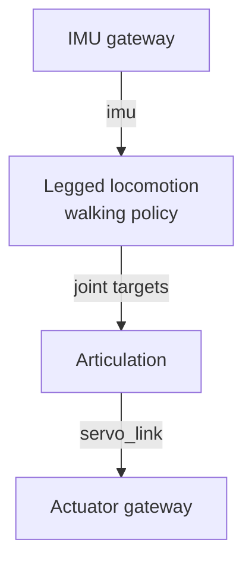

# Articulation

The **Articulation** controller drives an articulated robot joint by joint: legged robots, humanoids, grippers, pan-tilt heads, or any set of joints that receives joint targets. Unlike Motion Studio, it uses no arm kinematics (no DH parameters, no Cartesian motions). It bounds and forwards joint targets from an upper controller, such as the [**Legged locomotion**](../../station/nodes_and_connections/index.md#node-types-and-modules) node that runs a walking policy, and it lets you jog and calibrate the joints by hand.

| Item | Value |
| :--- | :--- |
| Node | `rc.articulation_controller_manager.NAME` |
| Document | `.sdda` ([Stellar Designer](../../tutorials/stellar_designer/articulation/index.md)) |
| Joints | 1 to 64, driven by one actuator gateway |
| Units | rad, rad/s, N·m |

---

## 1. The Document

An `.sdda` document lists the joints and how the gateway's actuators drive them.

| Per joint | Meaning |
| :--- | :--- |
| Name | Joint name |
| Position min / max | Range of motion; targets outside it are refused |
| Velocity max | Velocity limit; also the reference for the jog speed |
| Torque max | Torque limit; the controller clamps its total output to it |
| Offset (optional) | Joint position at actuator position zero |
| Kp, Kd (optional) | Stiffness and damping, for PD torque control |

**Drive mode.** In `position` mode the controller bounds the joint targets and the drive (or the simulated joint) follows them with its own position control. In `pd_torque` mode the controller computes a PD torque from Kp and Kd and sends torque commands.

**Actuator mapping.** As for manipulators, influence factors connect actuators to joints; one actuator can move several joints and several actuators can move one joint, as long as the mapping is invertible.

**Watchdogs.** The controller stops its output when the gateway's feedback is older than 100 ms or when no new target arrives for 200 ms. Reconnecting never switches the servo on by itself.

---

## 2. Open the Articulation UI

Start the gateway and the Articulation node, then click **Articulation** in the node's **CONTROL** section.

| Area | Contents |
| :--- | :--- |
| Left rail | **Joints** (joint monitor), **Constraints** (configured limits), **Set origin** |
| Top bar | **Servo on**, **Servo off**, **Stop**, **Clear stop**, the control mode, and the button that opens the **Joint control** panel |
| Status strip | **Servo** On/Off, **Feedback** age in milliseconds, **Safety** (*Ready* or the reason for a stop) |
| **Controller** | The Articulation node this window controls |
| **Joint monitor** | Per joint: position, velocity, effort and target |

!!! warning "**Stop the upper controller first.** Pause or stop Legged locomotion (or any program that sends joint targets) before you jog or calibrate by hand."

---

## 3. Jog Joints

1. Open the **Joint control** panel (button at the right of the top bar).
2. Click **Servo on**.
3. Under **Joint jog**, set the **Speed** (1–100 % of each joint's velocity limit; 10 % by default).
4. Hold **−** or **+** next to a joint. The joint moves while you hold the button and holds its position when you release it.

Leaving the window, switching to another tab or losing the connection switches the servo off.

---

## 4. Send Joint Targets

Under **Joint targets**:

1. Click **Use measured positions** to copy the current positions into the target fields.
2. Change the targets of the joints you want to move.
3. Click **Stream targets**. The controller follows the targets while the stream runs; **Stop target stream** ends it and switches the servo off.

---

## 5. Set the Origin

**Set origin** assigns an angle to the current position of a joint, for example after an encoder was replaced:

1. Bring the joint to a known position.
2. Choose the joint, then click **Reset current angle to 0**, or enter the true angle (deg or rad) and click **Set current angle**.

The servo switches off first; the joint does not move. Afterwards the servo stays off and a stop is latched: check the joint monitor, click **Clear stop**, then **Servo on**.

!!! info "Some devices only support setting the origin to zero, and robots in simulation do not support it."

---

## 6. Control from Programs

| From | How |
| :--- | :--- |
| A walking robot | The **Legged locomotion** node runs a walking policy and sends joint targets to this node |
| The SSH workspace | `sodero tools call articulation.get_status`, `articulation.get_joint_state`, `articulation.servo_on`, `articulation.uc_pos`, `articulation.stop` ([sodero CLI](../../ssh_workspace/sodero_cli/index.md)); `sodero articulations get` shows the joints and actuators |
| A module on the Station | A module node connected to the Articulation node ([Modules](../../station/modules/index.md)) |
