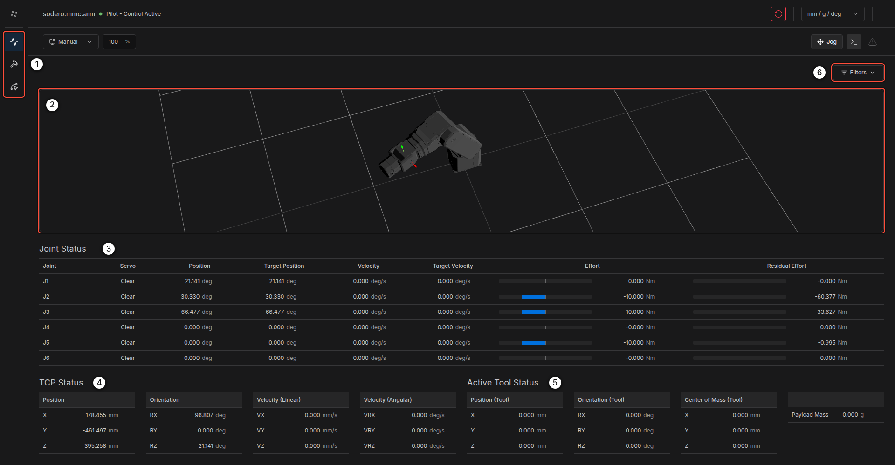
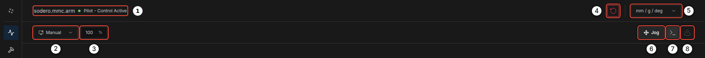
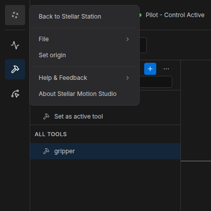
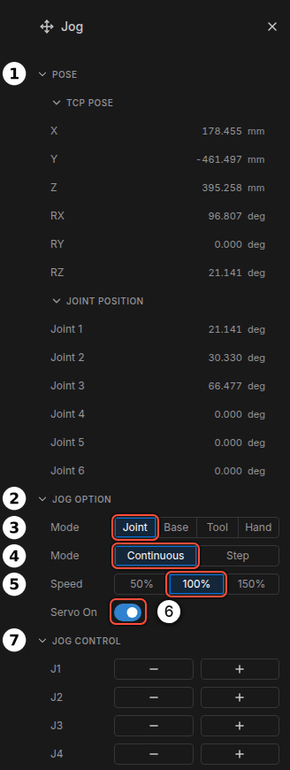
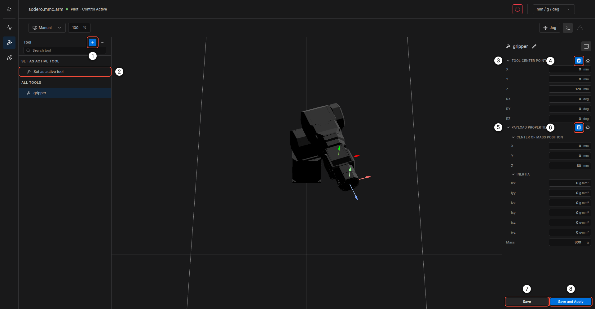
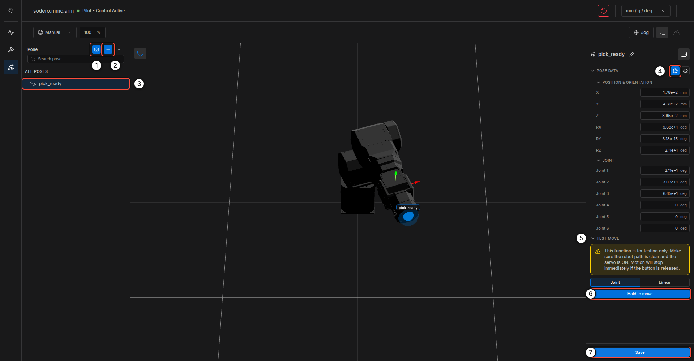

# Motion Studio

**Stellar Motion Studio** is the controller UI for manipulators. A Motion Studio node (`rc.controller_manager.NAME`) runs the arm's real-time controller: kinematics, dynamics, trajectory generation and safety limits from the arm's `.sdd` document. The Motion Studio web UI lets you watch the arm in 3D, jog it, define tools and teach poses.

---

## 1. Open Motion Studio

1. On the Station, add a **Motion Studio** node and an **Actuator gateway**, load the `.sdd` and `.gw` documents and connect `servo_link` ([Nodes and Connections](../../station/nodes_and_connections/index.md)).
2. Start the gateway, then the Motion Studio node.
3. Click **Stellar Motion Studio** in the node's **CONTROL** section. Motion Studio opens in a new tab for that arm.

---

## 2. Screen Layout

<figure markdown="span">
  { width="1000" }
  <figcaption>The Home page</figcaption>
</figure>

| No. | Item | Description |
| :---: | :--- | :--- |
| 1 | Pages | **Home**, **Tool** and **Pose** |
| 2 | 3D view | The arm in its current pose, with its 3D model from the `.sdd` |
| 3 | **Joint Status** | Per joint: position, target position, velocity, target velocity, effort and residual effort |
| 4 | **TCP Status** | Position and orientation of the tool center point, and its linear and angular velocity |
| 5 | **Active Tool Status** | The active tool's TCP offset, center of mass and payload mass |
| 6 | **Filters** | Shows or hides the cards of the Home page |

### Header

<figure markdown="span">
  { width="1000" }
  <figcaption>The header</figcaption>
</figure>

| No. | Item | Description |
| :---: | :--- | :--- |
| 1 | Robot and role | The controller node and whether this window has control (*Pilot - Control Active*) |
| 2 | **Manual** / **Auto** | Manual limits the tool speed for safe teaching; Auto runs at full programmed speed |
| 3 | Feed rate | Speed override in percent (10–150 %), applied to motion in progress |
| 4 | **Error Reset** | Clears a protective stop or a drive fault |
| 5 | Units | `mm / g / deg` or `m / kg / radian` |
| 6 | **Jog** | Opens the jog panel |
| 7 | **Command log** | Commands sent from this window |
| 8 | **Alarm** | Active alarms and notifications |

The Stellar mark at the top left opens the menu: **Back to Stellar Station**, **File** (import and export tools and poses), **Set origin**, **Help & Feedback** and **About Stellar Motion Studio**.

<figure markdown="span">
  { width="380" }
  <figcaption>The menu</figcaption>
</figure>

---

## 3. Jog the Arm

Click **Jog** in the header to open the jog panel.

<figure markdown="span">
  { width="328" }
  <figcaption>The jog panel</figcaption>
</figure>

1. Switch **Servo On** ⑥.
2. In **JOG OPTION** ②, choose the jog **Mode** ③:
    - **Joint**: move one joint at a time (J1…Jn).
    - **Base**: move the tool in the robot's base frame (X, Y, Z, RX, RY, RZ).
    - **Tool**: move the tool in its own frame.
    - **Hand**: hand guiding. The arm compensates gravity so you can move it by hand; the jog buttons are disabled.
3. Choose **Continuous** (moves while you hold a button) or **Step** (5° or 10 mm per click) ④, and the **Speed** ⑤ (50 %, 100 % or 150 %).
4. Hold **−** or **+** next to a joint or axis in **JOG CONTROL** ⑦. Motion stops when you release the button.

The **POSE** section ① shows the current TCP pose and joint positions.

!!! error "**Keep the emergency stop within reach.** A continuous jog moves until you release the button. Do not leave the window while jogging, and make sure the payload is set correctly before you use **Hand** mode."

---

## 4. Tools

The **Tool** page defines the tools mounted on the flange.

<figure markdown="span">
  { width="1000" }
  <figcaption>The Tool page</figcaption>
</figure>

1. Click **+** ① to add a tool and rename it with the pencil icon (for example `gripper`).
2. Enter the **TOOL CENTER POINT** ③: the TCP position and orientation relative to the flange. The calculator icon ④ opens **TCP Calibration**, which computes the TCP from 3–10 poses that touch the same point.
3. Enter the **PAYLOAD PROPERTIES** ⑤: center of mass, inertia and mass. The calculator icon ⑥ opens **Payload Calibration**.
4. Click **Save** ⑦, or **Save and Apply** ⑧ to make it the active tool at once. **Set as active tool** ② activates a saved tool.

!!! warning "A wrong payload makes hand guiding and collision detection unreliable. Set the mass and center of mass of every tool you mount."

---

## 5. Poses

The **Pose** page stores named poses.

<figure markdown="span">
  { width="1000" }
  <figcaption>The Pose page</figcaption>
</figure>

1. Jog the arm to the pose, then click the camera icon ① (**Save Current Pose**). Or click **+** ② (**Add pose**) and fill in the values.
2. Select the pose in the list ③. **POSE DATA** shows its TCP pose and joint positions; the icon ④ (**Set from current**) copies the current pose into it.
3. **TEST MOVE** ⑤ moves the arm to the pose: choose **Joint** or **Linear** motion and hold **Hold to move** ⑥. The arm moves only while you hold the button.
4. Click **Save** ⑦.

Saved poses appear as markers in the 3D view. Right-click a pose to copy it, duplicate it or delete it. Use **File** in the menu to export or import tools and poses.

---

## 6. Set the Origin

When an absolute encoder is replaced or the arm is reassembled, set the joint origins: menu › **Set origin**, choose the joint, enter its true angle and click **Calibration**. The servo stays off afterwards.

---

## 7. Program the Arm

Motion Studio is for setup and teaching. Programs run outside the UI and call the same controller:

| From | How |
| :--- | :--- |
| The SSH workspace | `sodero tools call motion.move_j`, `motion.move_l`, `motion.get_tcp_pose` and the other `motion.*` tools ([sodero CLI](../../ssh_workspace/sodero_cli/index.md)) |
| A module on the Station | A module node connected to the Motion Studio node's `manipulator` port ([Modules](../../station/modules/index.md)) |

```sh
sodero tools call motion.get_tcp_pose --input '{"target": "rc.controller_manager.arm"}'
sodero tools call motion.move_j --input '{"target": "rc.controller_manager.arm",
  "waypoints": [{"q": {"values": [0, 0, 1.5708, 0, 1.5708, 0]}, "vel": 0.5, "acc": 1.0}]}' --execute
```

!!! info "Tools use SI units: radians, meters and seconds. Check a tool's arguments with `sodero tools describe motion.move_j` before you call it."
