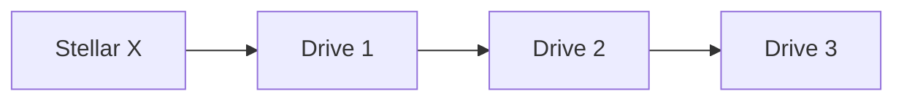
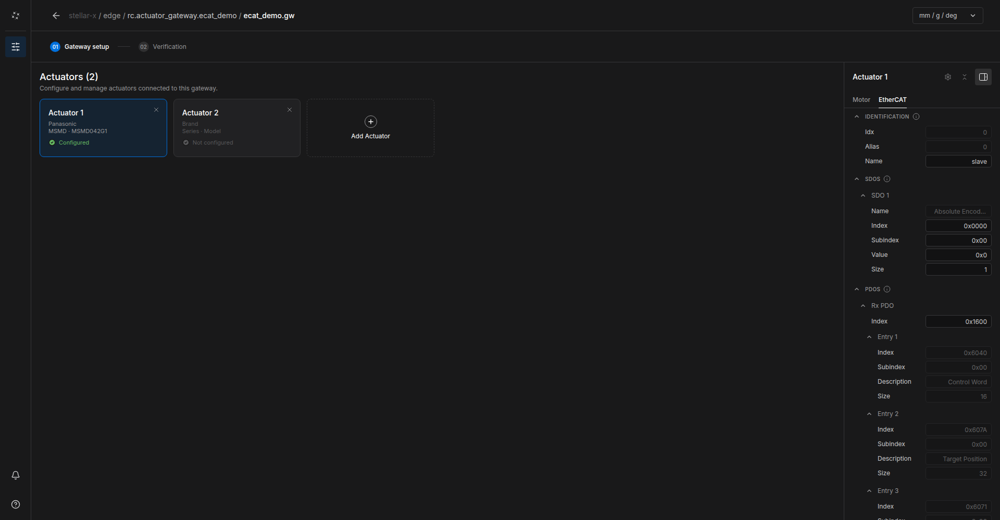
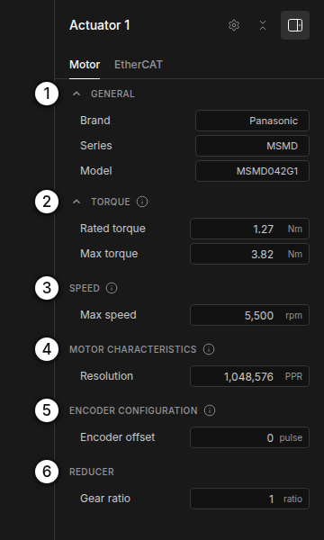
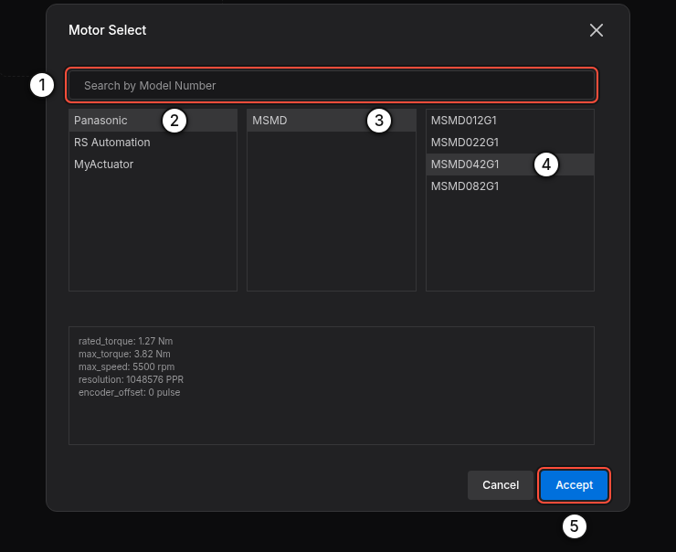
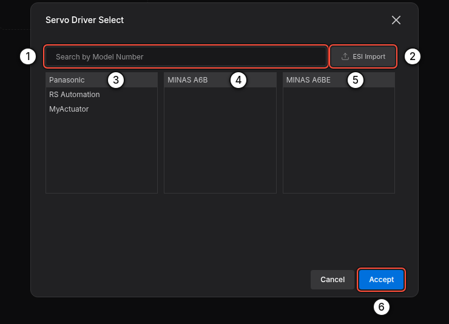
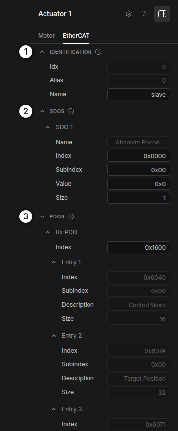
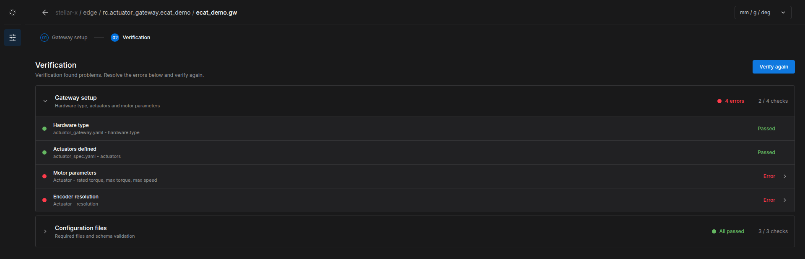

# EtherCAT Gateway

Stellar X is an EtherCAT master. An actuator gateway of type **EtherCAT** drives CiA 402 servo drives on the controller's EtherCAT port with distributed-clock synchronization at the gateway's control period (1 ms by default). This page covers wiring, the gateway document, parameters, bring-up and troubleshooting.

!!! error "**Real motors move.** Bring up a new EtherCAT system with the robot clear of people and obstacles, the drives' safe torque off (STO) and emergency stop wired, and someone at the emergency stop."

---

## 1. What You Need

| Item | Requirement |
| :--- | :--- |
| Drives | EtherCAT servo drives with the CiA 402 profile, supporting cyclic synchronous position (CSP). Mobile bases also need cyclic synchronous velocity (CSV); torque control needs cyclic synchronous torque (CST). |
| Drive data | The drive's ESI file (EtherCAT Slave Information, `.xml`) from the manufacturer, unless the drive is in the built-in catalog |
| Motor data | Rated and peak torque, maximum speed, encoder resolution, gear ratio |
| Cables | Standard EtherCAT (Ethernet) cables, one per drive |

Built-in catalog: **Panasonic MINAS A6BE**, **RS Automation CSD7**, **MyActuator RMD-X (EtherCAT)** drives, and Panasonic MSMD, RS Automation CSMA/CSMT and MyActuator RMD-X motors.

---

## 2. Wire the Drives

Connect the drives as a line, starting at Stellar X:



- Plug Stellar X's **EtherCAT Out** port into the **IN** port of the first drive. Connect each drive's **OUT** port to the next drive's **IN** port.
- **Do not use a network switch.** EtherCAT frames must pass through the drives in a line.
- **The cable order is the actuator order.** The first drive on the cable is actuator 1 (index 0) of the gateway, the second is actuator 2 (index 1), and so on. To change the order, change the wiring.
- Devices after the last controlled drive are allowed; the gateway ignores them.
- The EtherCAT port needs no IP address and is not configured on the Network Settings page.

---

## 3. Create the Gateway Document

1. On the Station, add an **Actuator gateway** node, for example `arm` ([Nodes and Connections](../../station/nodes_and_connections/index.md)).
2. Click **Edit Stellar Gateway Designer**. In **Create gateway definition**, choose **EtherCAT** and click **Next** › **Create** ([Gateway Designer](../gateway_designer/index.md)).
3. Click **Add Actuator** once per drive, in cable order.
4. For each actuator, fill in the **Motor** tab and the **EtherCAT** tab as described below.
5. Open **02 Verification**, click **Verify** and fix any errors.

<figure markdown="span">
  { width="1000" }
  <figcaption>An EtherCAT gateway with two actuators; the EtherCAT tab of actuator 1</figcaption>
</figure>

### Motor Tab

<figure markdown="span">
  { width="340" }
  <figcaption>Motor tab</figcaption>
</figure>

Click **Brand**, **Series** or **Model** ① to open **Motor Select**: search by model number, or pick **Brand** › **Series** › **Model**. The preview shows the catalog values, and **Accept** fills them in. For a motor that is not in the catalog, type the values.

<figure markdown="span">
  { width="760" }
  <figcaption>Motor Select catalog: search ①, or pick Brand ② › Series ③ › Model ④, then Accept ⑤</figcaption>
</figure>

The fields of the **Motor** tab:

| Section | Field | Unit | Meaning |
| :--- | :--- | :--- | :--- |
| ② TORQUE | **Rated torque** | Nm | Continuous motor torque. Torque commands are sent to the drive in per mille of this value. |
| | **Max torque** | Nm | Peak motor torque. The gateway limits joint torque to *Max torque × Gear ratio*. |
| ③ SPEED | **Max speed** | rpm | Maximum motor speed. The joint speed limit is *Max speed ÷ Gear ratio*. |
| ④ MOTOR CHARACTERISTICS | **Resolution** | PPR | Encoder pulses (counts) per motor revolution, **before** the gear, e.g. 1,048,576 (2²⁰) or 8,388,608 (2²³) |
| ⑤ ENCODER CONFIGURATION | **Encoder offset** | pulses | Absolute encoder zero. Set by origin calibration in Motion Studio; leave 0 for a new robot. |
| ⑥ REDUCER | **Gear ratio** | – | Motor turns per joint turn |

!!! info "If **Gear ratio** is exactly 1, the gateway reads the gear ratio configured in the drive itself (object 0x6091). Enter the real ratio when the drive does not hold it."

### EtherCAT Tab

Click the gear icon in the actuator panel to open **Servo Driver Select**:

<figure markdown="span">
  { width="560" }
  <figcaption>Search ① or pick Brand ③ › Series ④ › Model ⑤, or import the drive's ESI file ②. Accept ⑥ fills in the EtherCAT tab.</figcaption>
</figure>

- Pick the drive from the catalog, or click **ESI Import** ② and choose the drive's ESI `.xml`. If the file describes several devices, choose yours; then choose the RxPDO and TxPDO areas to use.
- **Accept** fills in the drive's identification, start-up SDOs and PDO mapping. Values you change later are highlighted; click one to return to the catalog value.

<figure markdown="span">
  { width="340" }
  <figcaption>IDENTIFICATION ①, SDOS ②, PDOS ③</figcaption>
</figure>

| Section | Field | Meaning |
| :--- | :--- | :--- |
| **IDENTIFICATION** | **Idx** | Position of the drive on the cable, from 0 (read-only) |
| | **Alias** | An alias that identifies the device (read-only). The gateway addresses drives by their position on the cable, not by alias. |
| | **Name** | A label for logs |
| **SDOS** | **Index**, **Subindex**, **Value**, **Size** | Start-up parameters written to the drive before operation. Index, subindex and value are hexadecimal (`0x…`); size is in bytes. The entry named *Absolute Encoder Reset* is not written at start-up; Motion Studio's origin calibration uses it. |
| **PDOS** | **Rx PDO** / **Tx PDO** index | The PDO mapping objects, typically `0x1600` and `0x1A00` |
| | Entries | The objects exchanged every cycle (see below). **Init Value** sets a constant for extra RxPDO entries. |

### Process Data

The gateway uses these CiA 402 objects:

| Direction | Object | Name | Required |
| :--- | :--- | :--- | :--- |
| RxPDO (to drive) | 0x6040 | Controlword | Yes |
| | 0x607A | Target position | For position control |
| | 0x60FF | Target velocity | For velocity control (**mobile bases**) |
| | 0x6071 | Target torque | For torque control |
| | 0x60B2 | Torque offset | Optional (feed-forward) |
| | 0x6060 | Modes of operation | Optional (also written by SDO) |
| TxPDO (from drive) | 0x6041 | Statusword | Yes |
| | 0x6064 | Position actual value | Yes |
| | 0x606C | Velocity actual value | Recommended |
| | 0x6077 | Torque actual value | Recommended |
| | 0x6061 | Modes of operation display | Recommended |
| | 0x603F | Error code | Recommended (fault messages) |

You do not choose the mode of operation. The controller selects it per command: position commands use CSP (8), velocity commands CSV (9), torque and impedance commands CST (10).

### Verify

Open **02 Verification** and click **Verify**. Open a check marked **Error** to see which actuator and which value to fix, then click **Verify again**.

<figure markdown="span">
  { width="1000" }
  <figcaption>Verification found missing motor parameters and encoder resolution</figcaption>
</figure>

!!! warning "A Strider (mobile base) drives its wheels in velocity mode. If the drive's RxPDO has no **Target velocity (0x60FF)**, the wheels do not move and the gateway reports it. Choose a PDO mapping that includes 0x60FF."

---

## 4. Connect a Controller

1. Add the controller node (Motion Studio, Strider or Articulation) and import its document. The document must name this gateway and its actuator indices ([Design Documents](../../station/design_documents/index.md#5-rules-for-documents)).
2. Connect the controller's `servo_link` to the gateway's `servo_link`.

---

## 5. Bring Up the System

1. Power the drives. Release the emergency stop and STO.
2. Select the gateway and click **Start node**. Watch **LOGS** › **Gateway events**:

    ```text
    EtherCAT: starting on network port 'eth0' (2 drive(s) expected).
    EtherCAT: found drive 1 (MINAS-A6B).
    EtherCAT: found drive 2 (MINAS-A6B).
    EtherCAT ready: 2 drive(s) operational, 1.0 ms cycle.
    ```

3. Optional: before you start a controller, click **Test Stellar Gateway** in the gateway's **CONTROL** section to open the test console and move single actuators.
4. Start the controller node, open its UI and switch **Servo On**. Jog slowly first and check each joint's direction.

!!! idea "**Tip:** Bring up one drive first. When it reaches *EtherCAT ready* and moves correctly, add the next drive to the cable and to the document."

---

## 6. Troubleshooting

The gateway explains every problem in **Gateway events**, followed by a hint. The most common messages:

| Message | Cause and fix |
| :--- | :--- |
| *EtherCAT: no cable link on network port …* | No Ethernet link. Plug the cable into Stellar X's **EtherCAT Out** port and into the first drive's **IN** port, and power the drive. |
| *EtherCAT: no drive answered on network port …* | The cable goes to the wrong port of the drive (OUT instead of IN), to a switch, or the drive has no power. |
| *EtherCAT: found M of the N drives this gateway controls.* | The chain ends after drive M. Check the cable from drive M's OUT port to the next drive's IN port, and that drive's power. |
| *…configuration describes K drive(s), but the gateway controls N.* | The drive list in the document does not match the actuators. Fix it in the Gateway Designer. |
| *Drive … exchanges x/y bits of process data …, the project describes …* | The PDO mapping in the document does not match the drive. Re-select the drive or re-import its ESI file. |
| *Drive … did not reach SAFE-OP / OP …* | The drive refused the configuration or the synchronization. The AL status in the message names the reason (sync, watchdog, PDO or cycle time). |
| *Drive … gets velocity commands, but Target Velocity (0x60FF) is not in its …* | Add 0x60FF to the RxPDO (see [Process Data](#process-data)). |
| *Servo ON failed: drive … did not enable (it stays in 'switch on disabled').* | The drive refuses to switch on: check its STO and enable inputs, the emergency stop and its main power. |
| *Drive … fault: … (error code 0x….)* | A drive alarm, such as overcurrent, voltage, temperature, encoder or following error. Read the alarm on the drive and look it up in its manual, then **Error Reset** / **Fault Reset** in the controller UI. |
| *EtherCAT communication lost: the drives stopped answering.* | A cable was unplugged or a drive lost power. The message names the segment; fix it and restart the gateway. |
| *No commands from the robot controller for 3.0 s: servo turned OFF for safety.* | The controller stopped or lost its connection. Start the controller and switch the servo on again. |

!!! info "Problems that are not in the gateway's log (such as a joint moving in the wrong direction or the wrong distance) come from the documents: check the actuator order (cable order), **Gear ratio**, **Resolution**, and the joint mapping in the controller's document."
