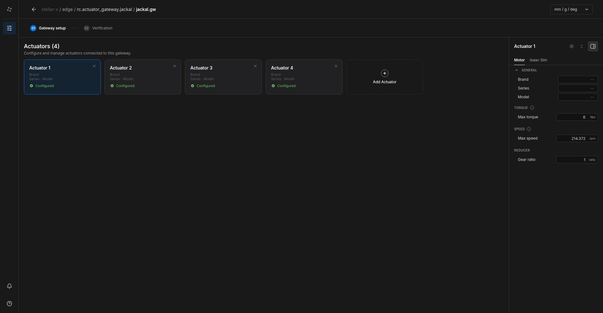
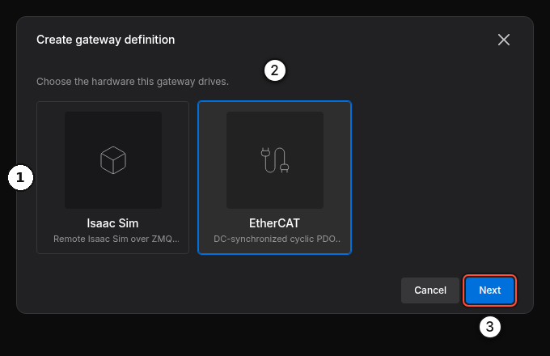
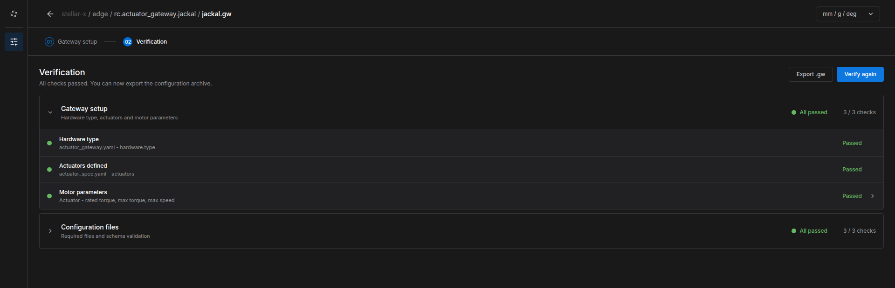
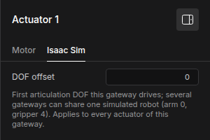

# Gateway Designer

**Stellar Gateway Designer** creates and edits gateway documents (`.gw`): the hardware type, the list of actuators, each actuator's motor and drive parameters, and the fieldbus settings. It is part of Stellar Designer and opens from an actuator gateway node on the Station.

---

## 1. Open the Gateway Designer

1. Select an actuator gateway node on the Station.
2. Click **Edit Stellar Gateway Designer** in the **DEFINITION** section.

The Gateway Designer opens in a new tab with the node's document. Edits are saved back to the node automatically. **Stop the gateway before you edit**; the Station refuses saves while it runs (*Gateway '…' is running — stop it in the Station, then save again.*) and while its [test console](../test_console/index.md) is open (*Gateway '…' has a test console open — stop the test in the Station, then save again.*).

<figure markdown="span">
  { width="1000" }
  <figcaption>A simulation gateway with four actuators</figcaption>
</figure>

| Area | Contents |
| :--- | :--- |
| Breadcrumb | Where the document belongs: device / Station / node / file. The arrow returns to the Station. |
| Steps | **01 Gateway setup** (actuators and their parameters) and **02 Verification** |
| **Actuators (N)** | One card per actuator, in index order, with its brand, model and status (**Configured** / **Not configured**). **Add Actuator** adds one; **×** removes one. |
| Actuator panel | The parameters of the selected actuator, in tabs: **Motor** and a tab for the hardware type (**EtherCAT** or **Isaac Sim**) |
| Units | `mm / g / deg` or `m / kg / radian` for display |

---

## 2. Choose the Hardware Type

A new gateway node starts with an empty document. When you open it, the Gateway Designer asks for the hardware type:

<figure markdown="span">
  { width="620" }
  <figcaption>Create gateway definition</figcaption>
</figure>

| Type | Use |
| :--- | :--- |
| **Isaac Sim** ① | A robot in NVIDIA Isaac Sim ([Simulation Gateway](../simulation/index.md)) |
| **EtherCAT** ② | CiA 402 servo drives on the EtherCAT port ([EtherCAT Gateway](../ethercat/index.md)) |

Select the type and click **Next** ③, then **Create**.

To change the type of an existing gateway, click the Stellar mark at the top left and choose **Definition** › **Replace definition**. Pick the new type and click **Next** › **Replace**. Existing actuators keep their motor settings and receive the new type's hardware settings; the previous type's hardware settings are removed. This cannot be undone.

---

## 3. Add and Configure Actuators

1. Click **Add Actuator** once per motor. Actuator 1 is index 0, actuator 2 is index 1, and so on.
2. Select an actuator card. Fill in the **Motor** tab: pick the motor from the catalog (**Brand** › **Series** › **Model**) or enter its values.
3. Fill in the tab of the hardware type: **EtherCAT** (identification, SDOs, PDOs) or **Isaac Sim** (DOF offset).

### Motor Parameters

| Field | Unit | Meaning |
| :--- | :--- | :--- |
| **Rated torque** | Nm | Continuous torque of the motor. For EtherCAT drives it is the reference for torque commands in per mille. |
| **Max torque** | Nm | Peak torque of the motor. The gateway clamps torque commands to *Max torque × gear ratio* at the joint. |
| **Max speed** | rpm | Maximum motor speed. The gateway limits velocity commands to *Max speed ÷ gear ratio* at the joint. |
| **Resolution** | PPR | Encoder pulses per motor revolution, before the gear (EtherCAT). For example 2²³ = 8,388,608 for a 23-bit encoder. |
| **Encoder offset** | pulses | Zero offset of the absolute encoder. Normally set by origin calibration in Motion Studio, not by hand. |
| **Gear ratio** | ratio | Motor turns per joint turn. |

For simulation gateways only **Max torque**, **Max speed** and **Gear ratio** apply.

---

## 4. Verify and Export

Open **02 Verification** and click **Verify**. The Gateway Designer checks the hardware type, the actuator list, the motor parameters (for EtherCAT also the encoder resolution) and the configuration files.

<figure markdown="span">
  { width="1000" }
  <figcaption>All checks passed</figcaption>
</figure>

Errors (for example a parameter that must be positive) must be fixed; warnings are advisory. Then start the gateway from the Station.

When all checks pass, **Export .gw** downloads the document as a `.gw` file, which you can import into another gateway node (**Import .gw**).

---

## 5. Simulation Gateways

For **Isaac Sim** gateways, the actuator panel has an **Isaac Sim** tab with one setting:

<figure markdown="span">
  { width="300" }
  <figcaption>The Isaac Sim tab of an actuator</figcaption>
</figure>

**DOF offset** is the first joint of the Isaac Sim articulation that this gateway drives. Leave it at 0 when one gateway drives the whole robot. Several gateways can share one simulated robot, for example an arm gateway with offset 0 for joints 1–6 and a gripper gateway with offset 6 for the joints after them.

The robot name in the scene and the simulator address are set on the Station node, not in the document ([Simulation Gateway](../simulation/index.md)).
