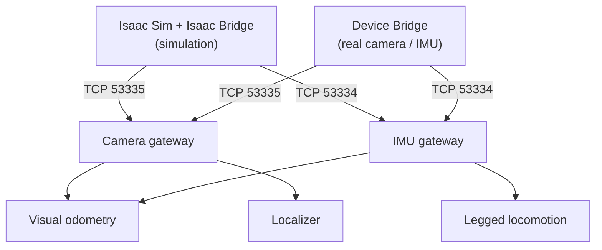
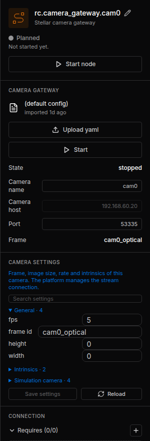
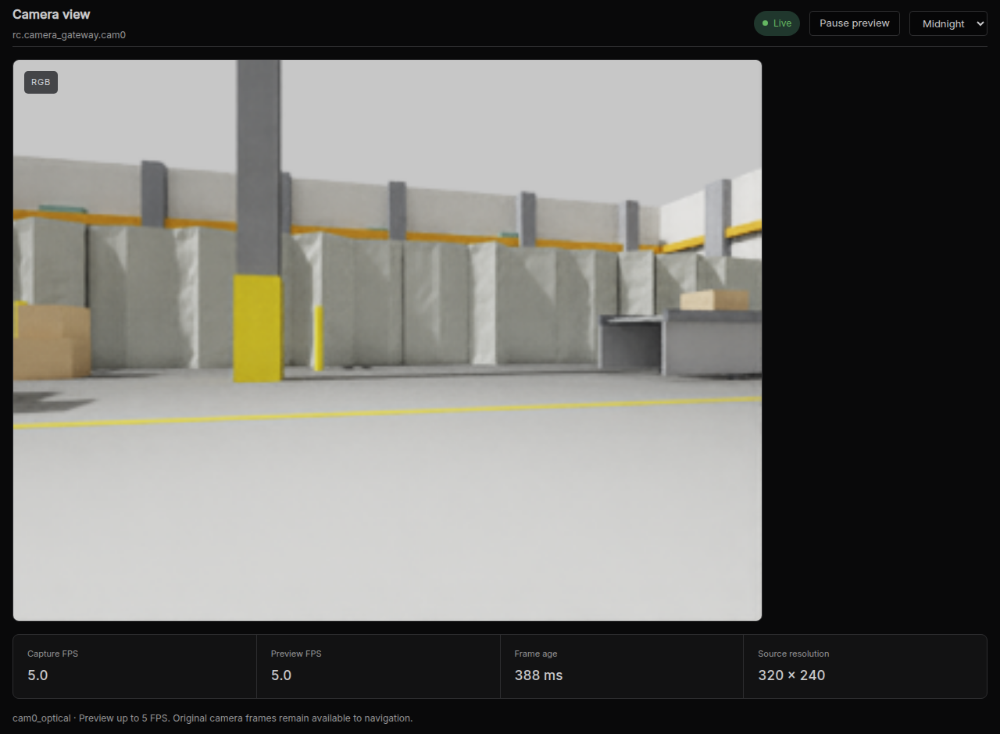

# Sensors and Cameras

Stellar Station has built-in gateways for the two sensors its navigation and walking controllers use: an **RGB-D camera** and an **IMU**. In simulation they read the cameras and IMUs of Isaac Sim. For real sensors, a small computer next to the sensors runs the [Device Bridge](../device_bridge/index.md), which serves real devices exactly as Isaac Sim serves simulated ones.

| Your sensor | Use |
| :--- | :--- |
| A camera or IMU in Isaac Sim | Camera gateway / IMU gateway, connected to Isaac Sim (this page) |
| A real RGB-D camera (e.g. Intel RealSense) or USB IMU | The [Device Bridge](../device_bridge/index.md) on a sensor computer, plus the Camera gateway / IMU gateway |
| Any other device (digital I/O, force sensors, custom hardware) | Your own gateway module ([Create Custom Modules](../../extend/custom_modules/index.md)) |

---

## 1. Camera Gateway

Add the node with **Add node** › **Gateway** › **Camera gateway** and a name such as `cam0`. Nodes that use the camera connect to its `camera` port.

<figure markdown="span">
  { width="300" }
  <figcaption>The camera gateway's inspector</figcaption>
</figure>

### Connection

In the **CAMERA GATEWAY** section of the inspector:

| Field | Value |
| :--- | :--- |
| **Camera name** | The name of the camera: in Isaac Sim, the camera prim's name (for example `cam0` for `/World/jackal/links/base_link/cam0`); with the Device Bridge, the bridge's robot name |
| **Camera host** | The address of the Isaac Sim computer or the sensor computer. The field is greyed out when a camera address is configured for the unit; the gateway then uses that address at every start, even if an uploaded YAML names another. To change it, contact Sodero support. |
| **Port** | `53335` |

### Camera Settings

Stop the node, change the values and click **Save settings**.

| Setting | Meaning |
| :--- | :--- |
| **fps** | Expected frame rate (the source decides the actual rate) |
| **frame id** | Name of the camera's optical frame, at most 15 characters, for example `cam0_optical`. The map bundle's extrinsics refer to this name. |
| **width**, **height** | Image size; 0 takes it from the frames |
| Intrinsics | `fov` mode with the horizontal field of view in degrees, or `manual` mode with fx, fy, cx, cy in pixels. A new camera gateway offers only the field of view; load `manual` values with **Upload yaml** ([Device Bridge › Camera](../device_bridge/index.md#camera)). |
| Simulation camera | Connection timeouts |

!!! info "Isaac Sim renders cameras with square pixels and the principal point at the image center, so `fov` mode with the camera's horizontal field of view is exact. Isaac Bridge prints each camera's field of view in the Isaac Sim console when the scene plays."

### See the Image

While the camera gateway runs, click **Camera view** on its node card:

<figure markdown="span">
  { width="1000" }
  <figcaption>Camera view of cam0: frame rate, frame age and resolution</figcaption>
</figure>

---

## 2. IMU Gateway

Add the node with **Add node** › **Gateway** › **IMU gateway**. Nodes that use the IMU connect to its ports.

| Setting | Meaning |
| :--- | :--- |
| **Robot in World** | The robot whose IMU to read: its articulation prim name in Isaac Sim, or the Device Bridge's robot name |
| **Sample rate (Hz)** | IMU sample rate (default 250) |
| **Sensor event rate (Hz)** | Rate of the published IMU events (default 20) |

The IMU gateway connects to the controller's configured simulator or sensor address. To set or change that address for your controller, contact Sodero support.

In Isaac Sim, a robot publishes IMU data when its robot prim names the link that carries the IMU in `rc:imuLink` ([Robot Setup](../../virtual_simulation/robot_setup/index.md#7-imu)).

---

## 3. Mounting: Where the Sensor Sits

Sensor data is in the sensor's own frame. Where the camera is mounted on the robot (its position and orientation relative to the robot's `base_link`) is part of the map bundle's extrinsics, used by the Localizer ([Load and Configure a Map](../../navigation/map_bundle/index.md#3-check-the-values-for-the-first-run)). Measure the mounting on the robot; do not rotate the data in the source.

---

## 4. Troubleshooting

| Symptom | Cause and fix |
| :--- | :--- |
| Camera log: *Waiting for simulator at …:53335 (World not running?)* | Isaac Sim is not playing, the camera host is wrong, or a firewall blocks port 53335 |
| Camera log: *…publishes frames of camera(s) … but none of camera 'cam0'* | **Camera name** does not match a camera in the scene |
| Camera log: *Frames … are stale or carry capture times that do not match this Station's clock* | The clocks of the two computers differ. Synchronize them (NTP), or stop sending capture times at the source (Isaac Sim: start it with `RC_CAMERA_CAPTURE_TIME=0`; Device Bridge: `send_capture_time: false`) so that the Station uses arrival times. |
| Camera view is black or frozen | The camera prim looks at nothing, or the scene is paused |
