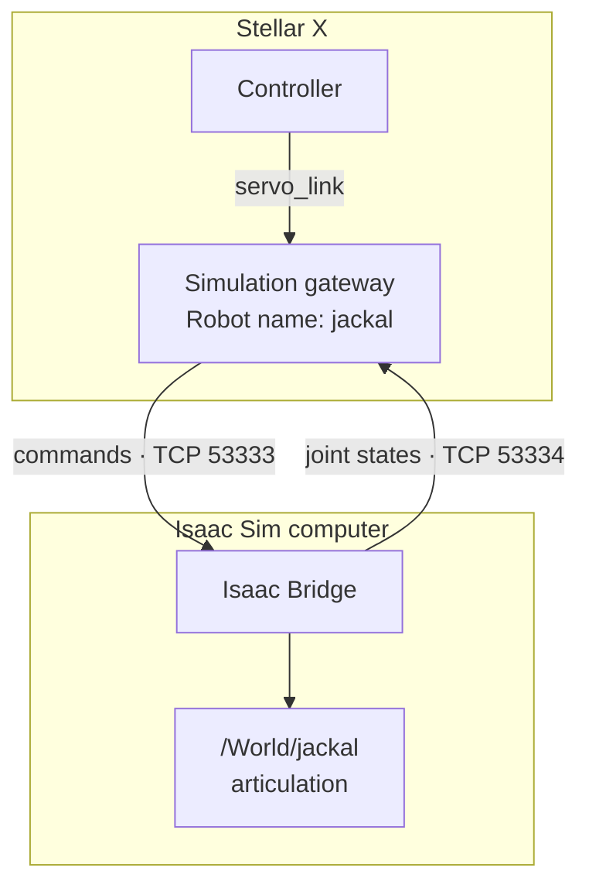
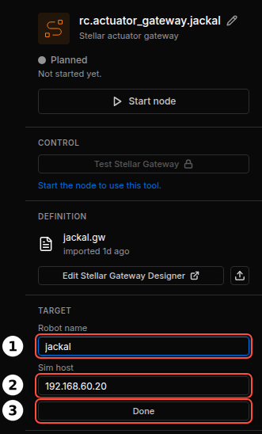

# Simulation Gateway

A **simulation gateway** is an actuator gateway of type **Isaac Sim**. Instead of a fieldbus it drives the joints of a robot in NVIDIA Isaac Sim, through the [Isaac Bridge](../../virtual_simulation/extension_installation/index.md) extension on the Isaac Sim computer. The controller connected to it (Motion Studio, Strider, Articulation) behaves exactly as with real motors, so everything you build and test in simulation carries over to the real robot.



---

## 1. The Name Rule

!!! warning "**The gateway's Robot name must be exactly the name of the robot's articulation prim in the Isaac Sim scene.**"

Isaac Bridge serves every articulation in the scene under the name of its prim: the robot at `/World/jackal` is served as `jackal`. A simulation gateway subscribes to the robot whose name equals its **Robot name**. If the names differ (`Jackal` vs. `jackal`, `jackal_1` vs. `jackal`), the gateway never receives a joint state, keeps waiting and the robot never moves.

| Station (gateway) | Isaac Sim (scene) |
| :--- | :--- |
| **Robot name** `jackal` | Articulation prim `/World/jackal` |
| Actuator 1, 2, 3, 4 (indices 0–3) | The robot's 1st, 2nd, 3rd and 4th joint, in the order they are defined in the USD file |
| **DOF offset** 0 | The gateway starts at the robot's first joint |

Use names with lowercase letters, digits and `_`, starting with a letter. Every robot in the scene must have a unique prim name.

---

## 2. Create a Simulation Gateway

1. Add an **Actuator gateway** node on the Station.
2. Either import a simulation `.gw` (**Import .gw**), or click **Edit Stellar Gateway Designer**, choose **Isaac Sim**, and add one actuator per joint of the robot ([Gateway Designer](../gateway_designer/index.md)).
3. In the node's **TARGET** section, click **Change** and set:
    - **Robot name**: the articulation prim name (see the rule above).
    - **Sim host**: the IP address of the Isaac Sim computer.

    Click **Done**. Changes take effect when the gateway starts next time.

<figure markdown="span">
  { width="331" }
  <figcaption>Robot name and Sim host</figcaption>
</figure>

!!! info "If Sodero support has configured a default simulator address for your controller, the gateway connects to that address and **Sim host** is ignored."

---

## 3. Check the Connection

Start Isaac Sim's scene (**Play**), then start the gateway. Its **Gateway events** log shows:

```text
Simulation: robot 'jackal', simulator at 192.168.60.20; waiting for it to start.
Simulator connected.
```

| Log message | Meaning |
| :--- | :--- |
| *waiting for it to start* | No joint state arrives yet. Normal until Isaac Sim plays. If it stays, see Troubleshooting. |
| *Simulator connected.* | Joint states arrive; the controller can switch the servo on. |
| *Simulator connection lost; servo turned OFF.* | The simulation stopped or the network dropped. The gateway reconnects by itself. |
| *Simulator connected again; turn the servo on to continue.* | Switch the servo on again in the controller UI. |

When the simulation is stopped and played again, Isaac Sim puts the robot back at its starting pose, and the controller's servo is off until you switch it on again.

---

## 4. Several Robots and Shared Robots

- **Several robots:** add one gateway (and controller) per robot, each with its own **Robot name**. All of them use the same Isaac Sim computer and ports.
- **One robot, several gateways:** an arm and its gripper can be driven by two gateways on the same articulation. Set the gripper gateway's **DOF offset** to the index of the gripper's first joint ([Gateway Designer](../gateway_designer/index.md#5-simulation-gateways)).

---

## 5. Troubleshooting

| Symptom | Cause and fix |
| :--- | :--- |
| The log stays at *waiting for it to start* | Isaac Sim is not playing; **Sim host** is not the Isaac Sim computer; its firewall blocks TCP 53333–53334; **Robot name** does not match the prim name |
| The Isaac Bridge window does not list the robot | The prim has no articulation root ([Robot Setup](../../virtual_simulation/robot_setup/index.md)) |
| The Isaac Bridge window shows the robot as *not bound* | The robot is not a valid PhysX articulation (check the Isaac Sim console), or two prims share the name ([Robot Setup](../../virtual_simulation/robot_setup/index.md)) |
| Servo on is accepted but the robot does not move | Strider: the drive mode is not **Twist**. Motion Studio: the joint count of the scene differs from the gateway's actuators. |
| A wheel or joint turns the wrong way | The joint order or axis in the scene differs from the document. Fix the scene or the document; do not invert signs elsewhere. |
| Motion looks slow, or localization lags | The simulation runs slower than real time: controllers follow simulation time, but camera-based localization runs on wall-clock time. Lower the scene's physics and render rates, close other GPU programs ([Real-Time Performance](../../virtual_simulation/connect_station/index.md#6-real-time-performance)). |
