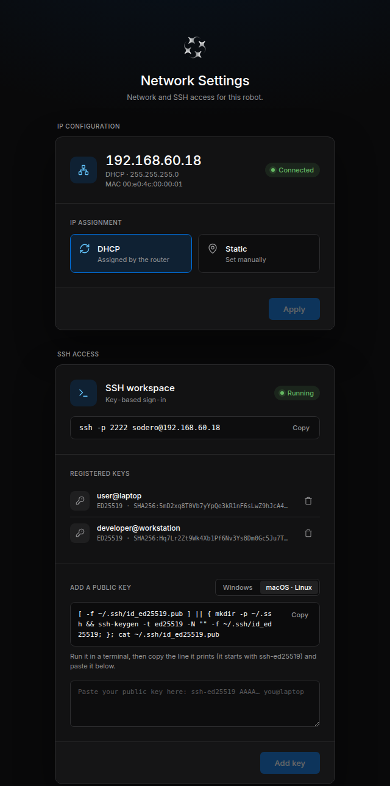
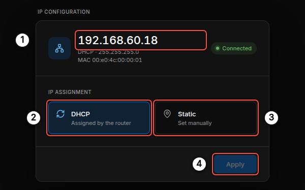
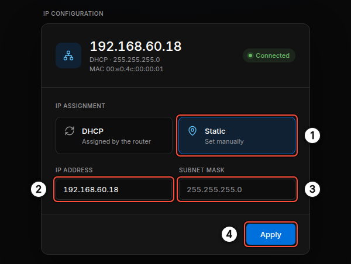
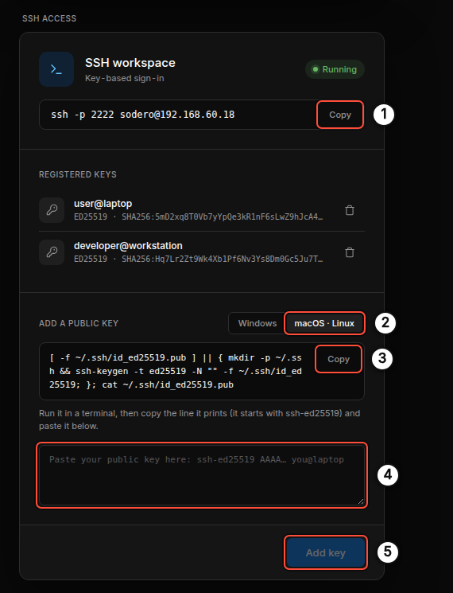

# Network Settings

Stellar X serves a small settings page on **port 3000**. Use it for the two things you need before anything else:

- the IP address of the controller's LAN port, and
- SSH access to the controller's [SSH workspace](../../../ssh_workspace/overview/index.md).

Open the page from any computer on the same network:

```text
http://ROBOT_ADDRESS:3000
```

In this guide the controller's address is `192.168.60.18`, so the page is `http://192.168.60.18:3000`.

!!! info "**Initial address: static `10.0.0.1`.** The LAN port starts with the static address `10.0.0.1` (subnet mask `255.255.255.0`), and a [factory reset](../stellar_x/index.md#5-hardware-factory-reset) brings it back. To reach it the first time, connect your PC with a cable and give the PC a static address in the same subnet, such as `10.0.0.2` ([Stellar X](../stellar_x/index.md#4-network-configuration)). Then open `http://10.0.0.1:3000` and change the address under [IP Configuration](#1-ip-configuration)."

The page needs no sign-in: anyone on the same network can change the address and register SSH keys. Connect Stellar X only to networks you trust.

<figure markdown="span">
  { width="420" }
  <figcaption>The Network Settings page</figcaption>
</figure>

!!! info "Stellar Station itself is served on the standard web port: `http://ROBOT_ADDRESS` (port 80). Port 3000 is only for these settings."

---

## 1. IP Configuration

The **IP CONFIGURATION** card shows and changes the address of the LAN port.

<figure markdown="span">
  { width="560" }
  <figcaption>Current address and IP assignment</figcaption>
</figure>

| No. | Item | Description |
| :---: | :--- | :--- |
| 1 | Current address | The address the LAN port has now, how it got it (**DHCP** or **Static**), the subnet mask and the port's MAC address. **Connected** means a cable is plugged in and the link is up. |
| 2 | **DHCP** | The router assigns the address. This is the simplest setup on an office or lab network. |
| 3 | **Static** | You enter the address yourself. Use it for a direct cable between your PC and the controller, or on a network without a DHCP server. |
| 4 | **Apply** | Applies the selection. Nothing changes until you click it. |

### Set a Static Address

<figure markdown="span">
  { width="560" }
  <figcaption>Static address</figcaption>
</figure>

1. Click **Static** ①. The card shows **IP ADDRESS** and **SUBNET MASK**.
2. Enter the new address in **IP ADDRESS** ②. The subnet mask ③ is fixed to `255.255.255.0`.
3. Click **Apply** ④.

After **Apply**, the controller moves to the new address and the page stops answering at the old one. Open `http://NEW_ADDRESS:3000` to continue.

!!! warning "Your PC must be on the same subnet to reach the new address. For example, after setting `10.0.0.1` on a direct cable, give your PC a static address such as `10.0.0.2` with mask `255.255.255.0`."

!!! info "**Automatic rollback.** If the new setting cannot be applied, or no address comes up (for example **DHCP** is selected but no DHCP server answers), the controller restores its previous settings by itself and the page reports what happened."

### Notes

- The page changes the **LAN port only**. The EtherCAT port is reserved for EtherCAT devices; it never gets an IP address and is not shown here.
- No default gateway is configured. Stellar X works on the local network and does not need Internet access.
- With **DHCP**, find the controller's address in your router's client list; its host name is `stellar-x`.

---

## 2. SSH Access

The **SSH ACCESS** card controls who can sign in to the controller's SSH workspace. The workspace accepts SSH keys only; there is no password sign-in.

<figure markdown="span">
  { width="560" }
  <figcaption>SSH workspace status, registered keys and key registration</figcaption>
</figure>

| No. | Item | Description |
| :---: | :--- | :--- |
| 1 | Connection command | The exact command to connect, with **Copy**. **Running** means the workspace is up. |
| 2 | Operating system | Shows the key command for **Windows** (PowerShell) or **macOS · Linux**. |
| 3 | Key command | Creates a key on your computer if it has none, then prints its public key. |
| 4 | Public key box | Paste the printed line here. It starts with `ssh-ed25519`. |
| 5 | **Add key** | Registers the key. It appears under **REGISTERED KEYS**. |

### Register a Computer

1. Select your operating system ②, click **Copy** ③ and run the command in a terminal on your computer.

    === "macOS · Linux"

        ```sh
        [ -f ~/.ssh/id_ed25519.pub ] || { mkdir -p ~/.ssh && ssh-keygen -t ed25519 -N "" -f ~/.ssh/id_ed25519; }; cat ~/.ssh/id_ed25519.pub
        ```

    === "Windows (PowerShell)"

        ```powershell
        if (!(Test-Path $HOME\.ssh\id_ed25519.pub)) { mkdir $HOME\.ssh -Force | Out-Null; ssh-keygen -t ed25519 -f $HOME\.ssh\id_ed25519 }; Get-Content $HOME\.ssh\id_ed25519.pub | Set-Clipboard; Get-Content $HOME\.ssh\id_ed25519.pub
        ```

        On Windows the command also copies the key to the clipboard. When `ssh-keygen` asks for a passphrase, press Enter twice to create the key without one.

2. Paste the printed line into the box ④ and click **Add key** ⑤.
3. Click **Copy** next to the connection command ① and run it:

    ```sh
    ssh -p 2222 sodero@192.168.60.18
    ```

To revoke access, click the trash icon next to a key under **REGISTERED KEYS**. The computer can no longer sign in; files in the workspace are kept.

!!! warning "Paste only the **public** key (the `.pub` file). The page refuses private keys and keys with options."

!!! info "Each person or computer should have its own key. The key's comment (for example `user@laptop`) is shown in the list, so you can tell the keys apart."

Continue with [SSH Workspace](../../../ssh_workspace/overview/index.md) to learn what you can do once you are connected.
