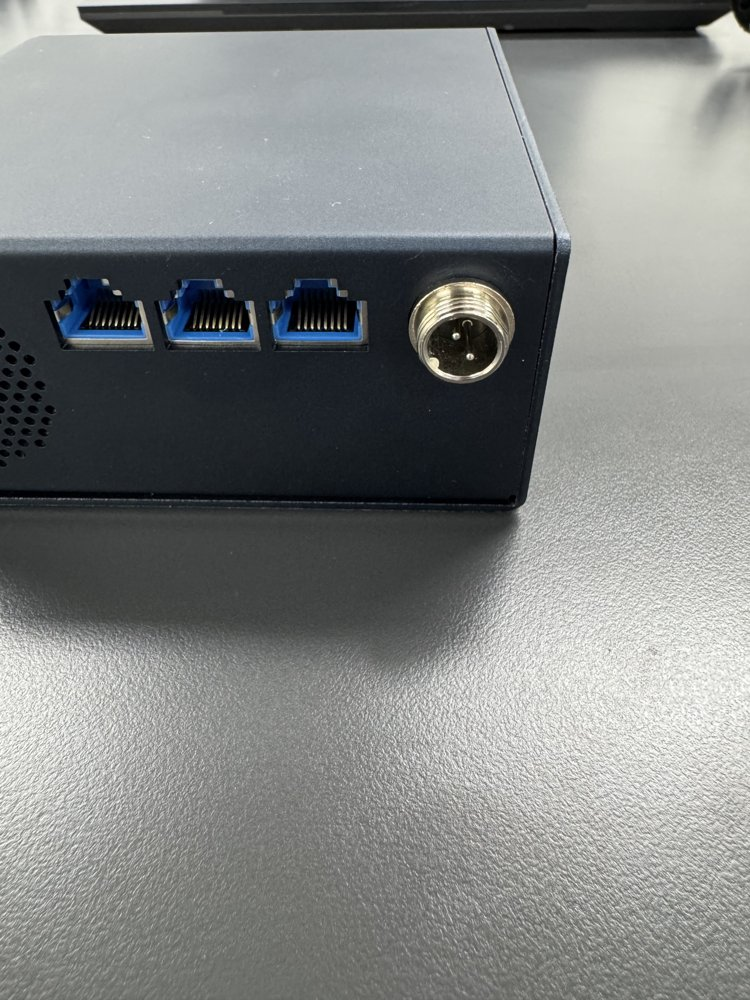
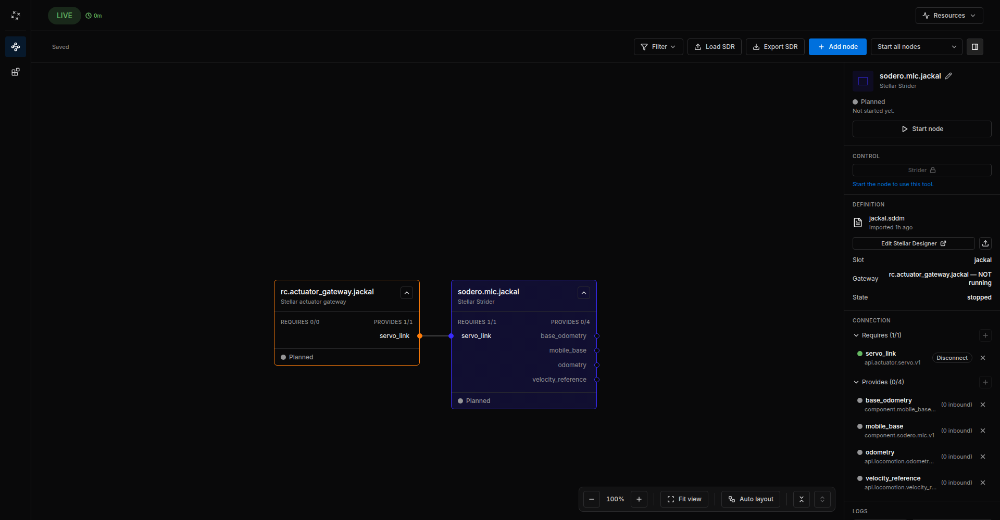

# Stellar X

This guide takes you from unboxing and hardware assembly to the first network connection between Stellar X and your PC.

---

## 1. What's in the Box
Check that your package includes the following components. If anything is missing, contact [our support team](https://www.sodero.io/contact).

<figure markdown="span">
  { width="750" }
  <figcaption>Stellar X Main Unit</figcaption>
</figure>

<figure markdown="span">
  { width="500" }
  <figcaption>24V Power Adapter</figcaption>
</figure>

<figure markdown="span">
  { width="500" }
  <figcaption>Power Cable</figcaption>
</figure>

---

## 2. Device Overview
The network and power ports are on the rear panel.

<figure markdown="span">
  { width="500" }
  <figcaption>Rear panel: ① Eth1 ② Eth2 ③ EtherCAT Out ④ 24V DC In</figcaption>
</figure>

| Port | Initial setting | How to change it | Use |
| :--- | :--- | :--- | :--- |
| **1. Eth1** | Static address `10.0.0.1`, subnet mask `255.255.255.0` | On the [Network Settings](../network_settings/index.md) page: DHCP or another static address | First connection with a cable from your PC; afterwards your office or lab network |
| **2. Eth2** | DHCP | Not changed by the Network Settings page | A router or switch that assigns addresses by DHCP |
| **3. EtherCAT Out** | No IP address | — | EtherCAT master output. Connect it to the **IN** port of the first EtherCAT drive. |
| **4. 24V DC In** | — | — | Power input |

---

## 3. Hardware Setup & Power On
Follow these steps in order to prevent electrical damage.

1. **Prepare the Adapter:** Connect the power cable to the 24V power adapter. **Do not plug it into the wall outlet yet.**

2. **Connect to Stellar X:** Insert the adapter's output cable into the **24V DC In** port on the unit.

    !!! error "To prevent **electrical arcing (sparks)** or connection issues, always connect the cable to the **Stellar X unit first**, and *then* plug the power adapter into the wall."

    !!! info "The connector has a small guide notch inside. If it doesn't slide in easily, **gently rotate the cable** until the notch aligns with the port."

    <figure markdown="span">
      { width="500" }
      <figcaption>Aligning the connector notch</figcaption>
    </figure>

3. **Secure the Connection:** Once the connector is fully inserted, hand-tighten its metal nut so that it stays locked in place.

    <figure markdown="span">
      { width="500" }
      <figcaption>Securing the locking nut</figcaption>
    </figure>

4. **Power Up:** Plug the power cable into a wall outlet. Stellar X powers on automatically and takes about 1 minute to start up.

---

## 4. Network Configuration
Your PC must be on the same subnet as Stellar X.

1. **Physical Connection:** Connect an Ethernet (LAN) cable to **Eth1 (Port 1)** on the Stellar X unit and the other end to your PC's LAN port.

    <figure markdown="span">
      { width="500" }
      <figcaption>Connecting to Eth1</figcaption>
    </figure>

2. **Configure Your PC:**
   Eth1 starts with the static address `10.0.0.1`, so set your PC to a static IP in the same subnet (e.g., `10.0.0.2`).

    !!! warning "Avoid using `10.0.0.1` for your PC, as this will cause an IP conflict."

    * **For Ubuntu Users:**
        1. Go to **Settings > Network**.
        2. Click the **gear icon** next to your wired connection.
        3. Select the **IPv4** tab and choose **Manual**.
        4. Set Address: `10.0.0.2` / Netmask: `255.255.255.0`.
        5. Click **Apply**.

    * **For Windows Users:**
        1. Go to **Settings > Network & Internet > Ethernet**.
        2. Find **IP assignment** and click **Edit**.
        3. Select **Manual**, toggle **IPv4 On**, and enter:
            - IP address: `10.0.0.2`
            - Subnet mask: `255.255.255.0`
        4. Click **Save**.

3. **Verify the Connection:**
   Open your preferred web browser (Chrome, Edge, etc.) and type the following into the address bar:
   `http://10.0.0.1`

4. **Success!**
   If **Stellar Station** appears, you are ready to start your project. Continue with the [Quick Start](../../../get_started/quick_start/index.md).

    <figure markdown="span">
      { width="800" }
      <figcaption>Stellar Station with an example robot system</figcaption>
    </figure>

    !!! info "To change Eth1's address or to connect it to your office network, use the [Network Settings](../network_settings/index.md) page on port 3000. The rest of this documentation uses the example address `192.168.60.18` for Stellar X; replace it with your controller's address, for example `10.0.0.1` while you use the direct cable."
