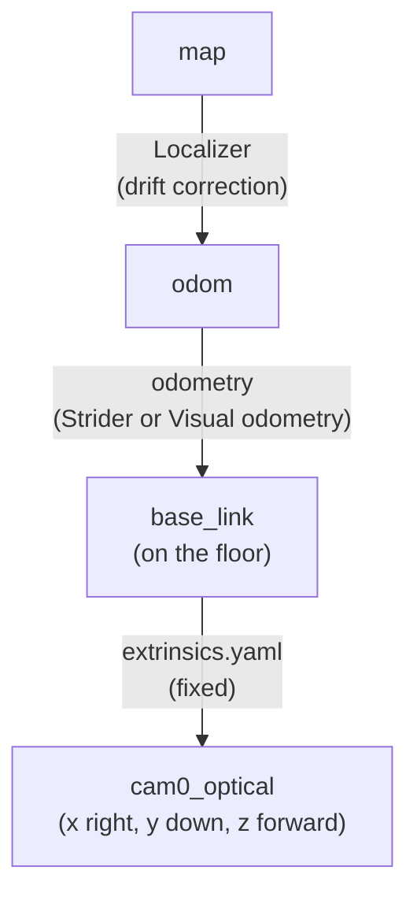

# Map Bundle (.nav)

A map bundle is one file that carries the map of one site together with the settings to localize and navigate in it. You attach it to the **Localizer**; the **Navigator** runs on the same bundle, and **Visual odometry** uses its camera calibration.

Stellar Station does not build maps on the robot; there is no SLAM. The map comes from a 3D model of the site, such as the USD world of your NVIDIA Isaac Sim scene, or from a 3D scan of the real site. This page specifies the format completely, so that you can build bundles for your own sites.

!!! info "The Localizer matches the camera's depth images against the 3D point cloud of the bundle to find the robot on the map. The Navigator plans paths on the 2D occupancy grid. Both describe the same site in the same coordinates."

---

## Bundle Layout

```text
site.nav/              optional top folder, any name
├── meta.yaml          map ID and a description of the grid
├── localizer.yaml     Localizer settings, including the point-cloud file
├── navigator.yaml     Navigator settings: robot size, speeds, tolerances
├── extrinsics.yaml    camera mounting on the robot
├── initial_pose.yaml  starting pose of the robot on the map
└── map/
    ├── MAP_ID.ply     3D point cloud of the site
    ├── MAP_ID.pgm     2D occupancy grid image
    └── MAP_ID.yaml    grid resolution, origin and thresholds
```

| File | Read by |
| :--- | :--- |
| `meta.yaml` | Localizer and Navigator (the map ID) |
| `localizer.yaml`, `initial_pose.yaml`, `map/MAP_ID.ply` | Localizer |
| `navigator.yaml` | Navigator |
| `extrinsics.yaml` | Localizer and Visual odometry |
| `map/MAP_ID.pgm`, `map/MAP_ID.yaml` | Navigator and the map views |

- **All eight files are required**, and no other file is accepted. `MAP_ID` is the `map_id` of `meta.yaml`: the Localizer and the Navigator open the grid files by this name.
- **Archive:** a gzip-compressed tar. The files sit at its root or in one top folder, which is dropped on upload. The file name does not change the format: `site.nav` and `site.nav.tgz` can be the same file.
- **Limits:** the archive and its unpacked contents at most 64 MiB each, each YAML file at most 1 MiB, at most 128 archive entries including folders.
- **Names:** at most 160 characters of letters, digits, `_`, `-`, `.` and `/`; no hidden names (starting with `.`) and no links. Map files sit directly in `map/` and end in `.ply`, `.pgm` or `.yaml` (`.yml` is refused).
- **YAML:** plain mappings with unique keys; unknown keys are refused. Quote dates and times, and write exponents with a decimal point: `1.0e-6` is a number, `1e-6` is read as text.

---

## Coordinate Frames

| Frame | Meaning |
| :--- | :--- |
| `map` | The site: x and y horizontal, z up, the floor at z = 0, in meters. The point cloud, the grid, the initial pose and goals use it. |
| `odom` | Continuous motion measured by odometry (Strider wheel odometry or Visual odometry). It drifts; the Localizer corrects the drift. |
| `base_link` | The robot, **on the floor**: x forward, y left, z up. |
| Camera optical frame, for example `cam0_optical` | x right, y down, z forward along the view. |



The Localizer is planar by default (`icp.planar: true`): it estimates x, y and yaw of `base_link` and holds its height, roll and pitch at zero. `base_link` therefore lies on the floor, and the camera height in `extrinsics.yaml` is its height **above the floor**.

!!! warning "Measure the camera's x and y from the base origin that your odometry tracks, but its z from the floor, even when your robot model places `base_link` higher, for example at the wheel axles. A height taken from a raised base puts every camera point too low by that offset: the fit error exceeds `icp.max_rmse` and the localization status stays **Initializing** (`initializing`)."

---

## Files

### meta.yaml

| Key | Type | Unit | Meaning | Example |
| :--- | :--- | :--- | :--- | :--- |
| `schema_version` | integer | — | Always `1` | `1` |
| `map_id` | text | — | Map name: letters, digits, `_`, `.`, `-`, starting with a letter, at most 64 characters | `warehouse` |
| `frame_id` | text | — | Map frame (default `map`) | `map` |
| `created`, `z_slice` | text, [min, max] | —, m | Optional: creation time (quoted) and the height band used for the grid | `[0.05, 0.65]` |
| `source` | mapping | — | Optional provenance: `ply` (a file name, not a path), `ply_sha256`, `points`, `bbox_min`, `bbox_max` | `ply: warehouse.ply` |
| `grid.image`, `grid.yaml` | text | — | `map/MAP_ID.pgm` and `map/MAP_ID.yaml` | `map/warehouse.pgm` |
| `grid.width`, `grid.height` | integer | cells | Exactly the size of the PGM | `500`, `620` |
| `grid.resolution` | number | m/cell | Exactly the `resolution` of the grid YAML | `0.05` |
| `grid.origin` | [x, y, yaw] | m, m, rad | Exactly the `origin` of the grid YAML | `[-12.5, -12.5, 0.0]` |
| `tool`, `solid_footprints`, `grid.min_points`, `grid.padding`, `grid.mark_unknown`, `grid.points_in_slice`, `grid.occupied_cells`, `grid.unknown_cells` | any | — | Optional, informational | |

```yaml
schema_version: 1
map_id: warehouse
created: '2026-01-15T09:00:00Z'
z_slice: [0.05, 0.65]
grid:
  image: map/warehouse.pgm
  yaml: map/warehouse.yaml
  resolution: 0.05
  width: 500
  height: 620
  origin: [-12.5, -12.5, 0.0]
```

### Occupancy Grid: map/MAP_ID.yaml and map/MAP_ID.pgm

The grid uses the standard occupancy-grid map format: a gray image and a YAML file with exactly these six keys (a key such as `mode` is refused).

| Key | Type | Unit | Meaning | Example |
| :--- | :--- | :--- | :--- | :--- |
| `image` | text | — | File name of the PGM, without a folder | `warehouse.pgm` |
| `resolution` | number | m/cell | Cell size, 0.001 to 100 | `0.05` |
| `origin` | [x, y, yaw] | m, m, rad | Lower-left corner of the image in `map`; keep yaw at `0.0` | `[-12.5, -12.5, 0.0]` |
| `negate` | 0 or 1 | — | `1` inverts the gray values | `0` |
| `occupied_thresh`, `free_thresh` | number | 0 to 1 | Occupancy above the first is an obstacle, below the second is free; `free_thresh` must be lower | `0.65`, `0.196` |

```yaml
image: warehouse.pgm
resolution: 0.05
origin: [-12.5, -12.5, 0.0]
negate: 0
occupied_thresh: 0.65
free_thresh: 0.196
```

- **Image:** binary `P5` or ASCII `P2` PGM, maximum value 255, at most 16 million pixels. After the header, a P5 file holds exactly width × height bytes.
- **Values:** the occupancy of a pixel is `(255 − value) / 255` with `negate: 0`. With the thresholds above, write **0** for obstacles, **254** for free floor and **205** for unknown space.
- **Rows:** row 0 is the top of the map, the largest y. The pixel in column `c` and row `r` of an image `height` rows tall is the cell centered at `x = origin_x + (c + 0.5) × resolution`, `y = origin_y + (height − r − 0.5) × resolution`. The warehouse grid, 500 × 620 cells of 0.05 m, covers x from −12.5 m to 12.5 m and y from −12.5 m to 18.5 m.

### Point Cloud: map/MAP_ID.ply

- **Format:** `format binary_little_endian 1.0` (recommended) or `format ascii 1.0`, with an ASCII header in LF line endings that ends in `end_header`.
- **Contents:** one `element vertex` with 1 to 2,000,000 points. The properties are `x`, `y`, `z` (required), `nx`, `ny`, `nz` and `red`, `green`, `blue` (optional), each of type `float`, `double` or `uchar` (also written `float32`, `float64`, `uint8`). `comment` lines are allowed; faces, other elements or properties (alpha, intensity, scalar fields) and lines such as `obj_info` are refused. The warehouse header has `element vertex 1405083`, then `property float x`, `y`, `z`, `nx`, `ny`, `nz` and `property uchar red`, `green`, `blue`.
- **Values:** meters in the `map` frame, finite and at most 1,000,000 in magnitude. Normals, when present, must not be zero. Colors are optional (`uchar` 0 to 255 or `float` 0 to 1); without them the Localizer matches geometry only.
- **Size:** binary `float` coordinates with normals and colors take 27 bytes per point, so 2 million points use about 54 MB of the 64 MiB limit. Use `float`, not `double`.

### extrinsics.yaml

| Key | Type | Unit | Meaning | Example |
| :--- | :--- | :--- | :--- | :--- |
| `camera_frame_id` | text | — | The camera's optical frame: the `frame_id` in the camera node's **CAMERA SETTINGS**, at most 15 characters. Required by the Localizer. | `cam0_optical` |
| `edges` | list | — | 1 to 32 fixed transforms; a frame is the `child` of one edge at most | |
| `parent`, `child` | text | — | Frame names | `base_link`, `cam0_optical` |
| `xyz` | [x, y, z] | m | Position of the child in the parent frame | `[0.22, 0.0, 0.468]` |
| `quat` | [x, y, z, w] | — | Orientation of the child in the parent frame; the squares sum to 1 within 0.01 | `[-0.5, 0.5, -0.5, 0.5]` |

```yaml
camera_frame_id: cam0_optical
edges:
  - parent: base_link
    child: cam0_optical
    xyz: [0.22, 0.0, 0.468]       # 0.22 m ahead of base_link, 0.468 m above the floor
    quat: [-0.5, 0.5, -0.5, 0.5]  # level, looking forward
```

Rotations are written only as `quat` in the order `[x, y, z, w]`; an edge with `rpy` is refused. Edges may form a chain, for example `base_link` → `mast` → `cam0_optical`, but no loop, and they must connect the camera frame to `base_link`. For a camera that looks forward, tilted down by θ, `quat = [-a, a, -b, b]` with `a = (cos(θ/2) + sin(θ/2)) / 2` and `b = (cos(θ/2) − sin(θ/2)) / 2`:

| Tilt θ | 0° (level) | 10° | 20° | 30° |
| :--- | :--- | :--- | :--- | :--- |
| `quat` | `[-0.5, 0.5, -0.5, 0.5]` | `[-0.5417, 0.5417, -0.4545, 0.4545]` | `[-0.5792, 0.5792, -0.4056, 0.4056]` | `[-0.6124, 0.6124, -0.3536, 0.3536]` |

### initial_pose.yaml

| Key | Type | Unit | Meaning | Example |
| :--- | :--- | :--- | :--- | :--- |
| `x`, `y` | number | m | Position of `base_link` (not the camera) in `map` | `-1.5984`, `2.3881` |
| `yaw` | number | rad, −π to π | Heading; `0` faces the +x axis of the map | `0.0` |

```yaml
x: -1.5984
y: 2.3881
yaw: 0.0
```

The Localizer starts from this pose when it has no confirmed pose on this map. Once it has localized, it restarts from its last confirmed pose on the same `map_id`. A pose set with **Set Initial Pose** on Strider's Navigation page, or with the `localization.set_initial_pose` tool, replaces both. Give a changed map a new `map_id` so that an old pose is not reused.

### localizer.yaml

Only `map.file` is required; a key you leave out keeps its default. An excerpt of the warehouse file:

```yaml
map:
  file: map/warehouse.ply
  voxel_size: 0.05
icp:
  device: CPU:0
  lambda: 1.0
  max_correspondence_dist: 0.12
  max_iterations: 20
sensor: {depth_min: 0.3, depth_max: 10.0}
status: {degrade_after_s: 5.0, lost_after_s: 60.0, accept_streak: 1}
publish:
  obstacles: {z_min: 0.08, z_max: 0.65}
```

| Key | Default | Meaning |
| :--- | :--- | :--- |
| `map.file`, `map.voxel_size` | required, `0.05` m | The point cloud, `map/MAP_ID.ply` (changes only with a new bundle); the cell size that the map and the camera points are reduced to |
| `frames.map`, `frames.odom`, `frames.base` | `map`, `odom`, `base_link` | Frame names; keep the defaults, which the Navigator also uses |
| `icp.planar` | `true` | Estimate x, y and yaw only (wheeled robots); `false` also estimates height, roll and pitch (walking robots) |
| `icp.device` | `CPU:0` | `CPU:0`, or `CUDA:0` for a GPU |
| `icp.rate_hz`, `icp.max_iterations` | `10` Hz, `50` | Localization rate; iterations per camera frame |
| `icp.lambda` | `0.968` | Weight of geometry against color, 0 to 1; `1.0` matches geometry only |
| `icp.max_correspondence_dist`, `icp.init_max_correspondence_dist` | `0.1` m, `0.3` m | Match distance while tracking, and while initializing or relocalizing |
| `icp.min_fitness`, `icp.max_rmse` | `0.3`, `0.05` m | A pose is accepted when at least this share of camera points matches the map, within this fit error |
| `icp.max_jump_m`, `icp.max_jump_rad` | `1.0` m, `0.5` rad | Largest accepted correction against the odometry prediction |
| `icp.deg_ratio`, `icp.deg_min_info`, `icp.deg_threshold` | `0.05`, `5.0`, `0` | Handling of directions the view cannot observe, such as along a corridor |
| `icp.max_solve_points`, `robust_delta`, `relative_fitness`, `relative_rmse`, `min_structural_fitness`, `rmse_growth_factor`, `sigma_depth`, `cov_inflation`, `recovery_radius_m`, `recovery_yaw_rad` | `0`, `0`, `1.0e-6`, `1.0e-6`, `0`, `1.05`, `0.01`, `4.0`, `0.4`, `0.5` | Advanced tuning; keep the defaults |
| `sensor.depth_min`, `sensor.depth_max` | `0.2` m, `6.0` m | Depth range of the camera points used |
| `status.accept_streak`, `status.init_min_fitness` | `3`, `0.7` | Accepted fits in a row, each with at least this fitness, needed to become **Healthy** (`localized`) |
| `status.degrade_after_s`, `lost_after_s`, `degrade_fitness` | `2.0` s, `10.0` s, `0.5` | Time without an accepted fit before **Degraded** (`degraded`) and **Lost** (`lost`); fitness below which the state degrades |
| `status.clock_skew_ms`, `status.odometry_stale_s` | `200` ms, `3.0` s | Largest camera-to-odometry lag; odometry silence before the input reconnects |
| `recovery.auto_reseed`, `lost_wait_s`, `attempts`, `attempt_timeout_s`, `spacing_s`, `radius_step_m`, `max_radius_m`, `yaw_jitter_rad` | `true`, `3.0` s, `5`, `5.0` s, `1.0` s, `0.3` m, `1.0` m, `0.17` rad | After **Lost**, retry automatically around the last confirmed pose: schedule and search area |
| `publish.pose_hz`, `status_hz`, `obstacles_hz` | `20`, `1`, `10` Hz | Output rates |
| `publish.obstacles.z_min`, `z_max`, `ground_relative` | `0.10` m, `0.30` m, `false` | Height band above the floor whose camera points mark live obstacles for the Navigator; `true` measures from the floor seen in each image |
| `publish.obstacles.size_cells`, `resolution`, `decay_s` | `48`, `0.05` m, `2.0` s | Live obstacle grid around the robot (at most 48 × 48 cells) and how long a mark lasts |
| `odometry.frame_policy`, `recovery`, `source` | `match`, `auto`, empty | `match` uses only odometry from `odom` to `base_link`, `any` accepts a single source under any frame names; keep `recovery: auto`; an empty `source` follows the node connected to the Localizer's `odometry` port |
| `global_search.*` | see meaning | Grid of the `localization.global_search_*` tools: `xy_step_m` 1.0, `yaw_step_deg` 15, `coarse_radius_m` 1.2, `sample_radius_m` 6.0, `timeout_s` 120, `max_candidates` 100000, `shortlist` 32, `ambiguity_margin` 0.08 |

### navigator.yaml

The sections are `bt_navigator`, `planner_server`, `controller_server`, `local_costmap`, `global_costmap`, `behavior_server`, `velocity_smoother` and `navigator`; section and key names follow Nav2 conventions. An excerpt of the warehouse file:

```yaml
controller_server:
  general_goal_checker: {xy_goal_tolerance: 0.1, yaw_goal_tolerance: 0.1}
  FollowPath: {desired_linear_vel: 0.3, max_angular_vel: 0.5}
local_costmap:
  global_frame: odom
  rolling_window: true
  width: 4
  height: 4
  robot_radius: 0.34
  inflation_layer: {inflation_radius: 0.6}
global_costmap: {global_frame: map, robot_radius: 0.34}
velocity_smoother:
  max_velocity: [0.3, 0.0, 0.5]
  min_velocity: [-0.2, 0.0, -0.5]
navigator: {drive: diff}
```

- **Write the complete file.** Start from the `navigator.yaml` of a working bundle, such as the warehouse example in [Navigate in Simulation](../simulation_tutorial/index.md), and change values only. A key you leave out falls back to a built-in value that may not suit your robot; without `robot_radius` the Navigator does not start.
- **Text values are fixed:** frame names, `plugin` entries and plugin lists keep their values. The one choice is `navigator.drive`: `diff` or `holonomic`.
- **Numbers** are 0 to 1,000,000, except the entries of `min_velocity` and `max_decel`, which may be negative. Velocity lists have three entries: `[x m/s, y m/s, yaw rad/s]`.
- **Robot size** is a circle, `robot_radius`; a polygon `footprint` is refused.

The **Template** column lists the values of the reference navigator configuration, which defines the accepted keys. They are a starting point for your own values, not the built-in values used for a key you leave out.

| Key | Template | Meaning |
| :--- | :--- | :--- |
| `local_costmap.robot_radius`, `global_costmap.robot_radius` | `0.42` m | Radius around `base_link` that covers the robot; required, the same value in both |
| `*.inflation_layer.inflation_radius`, `cost_scaling_factor` | `0.75` m, `3.0` | Distance from obstacles within which paths cost more, and how fast that cost falls off |
| `local_costmap.width`, `height`, `resolution` | `6` m, `6` m, `0.05` m | Size and cell size of the local window around the robot; the global costmap follows the grid's resolution |
| `*.obstacle_layer.enabled`, `decay_s` | `true`; `2.0` s local, `10.0` s global | Add the Localizer's live obstacles, and how long they are kept |
| `planner_server.GridBased.tolerance`, `allow_unknown`, `use_astar` | `0.5` m, `true`, `false` | How far from a blocked goal a path may end; plan through unknown cells; A* instead of Dijkstra |
| `controller_server.controller_frequency`, `FollowPath.desired_linear_vel`, `FollowPath.max_angular_vel` | `20.0` Hz, `1.2` m/s, `0.825` rad/s | Control rate, cruise speed and turn rate limit |
| `controller_server.FollowPath.lookahead_dist`, `min_lookahead_dist`, `max_lookahead_dist` | `1.5`, `0.6`, `1.8` m | Look-ahead distance on the path |
| `controller_server.FollowPath.use_rotate_to_heading`, `rotate_to_heading_min_angle` | `true`, `0.785` rad | Turn in place toward the path when the heading error exceeds this angle |
| `controller_server.FollowPath.allow_reversing`, `use_holonomic_lateral`, `max_lateral_vel` | `false`, `false`, `0.2` m/s | Drive backwards along the path; move sideways (with `navigator.drive: holonomic`) |
| `controller_server.general_goal_checker.xy_goal_tolerance`, `yaw_goal_tolerance` | `0.25` m, `0.25` rad | Arrival tolerance |
| `controller_server.progress_checker.required_movement_radius`, `movement_time_allowance` | `0.5` m, `10.0` s | The robot must move this far within this time, or recovery starts |
| `velocity_smoother.max_velocity`, `min_velocity`, `max_accel`, `max_decel` | `[1.2, 0, 0.825]`, `[-0.1, 0, -0.825]`, `[0.25, 0, 1.2]`, `[-0.5, 0, -1.6]` | Velocity and acceleration limits; deceleration entries are 0 or less |
| `behavior_server.spin.angle`, `backup.distance`, `backup.speed`, `wait.duration` | `1.5708` rad, `0.15` m, `0.1` m/s, `2.0` s | Recovery moves |
| `navigator.drive` | `diff` | `diff` (differential and skid steer) or `holonomic` |
| `navigator.require_base_ready` | `true` | Accept goals only while the base is enabled, free of faults and in twist mode |
| `navigator.odom_max_age_s`, `localization_max_age_s` | `0.5` s, `1.0` s | Stop when odometry or the map pose is older than this |
| `navigator.recovery_rounds`, `replan_period_s` | `2`, `1.0` s | Recovery rounds before a goal fails; how often the route is checked and replanned when blocked |
| `navigator.preempt_on_new_goal` | `true` | A new goal replaces the active one; `false` refuses it as busy |

---

## Change Settings Later

After the upload, the settings in `localizer.yaml`, `navigator.yaml`, `extrinsics.yaml` and `initial_pose.yaml` can be changed without a new bundle:

- **Station page:** select the Localizer or the Navigator node. The inspector's **NAVIGATION SETTINGS** section groups the keys your files contain as Localizer, Navigator, Camera calibration and Initial pose.
- **CLI:** `sodero navigation get --node rc.navigator`, edit the returned `config`, then `sodero navigation apply` with its SHA-256 (see [sodero CLI](../../ssh_workspace/sodero_cli/index.md)).

Stop the Localizer, the Navigator and Visual odometry before you save; the new values apply when the nodes start again. The map files, `meta.yaml` and `map.file` change only with a new bundle.

!!! warning "Uploading a bundle replaces all of its settings, including changes saved on the Station page or with the CLI. Copy those changes into your files before you upload a new version."

---

## Build a Bundle from Your Own Site

Any point-cloud tool, such as CloudCompare or Open3D, can do the steps below.

### 1. Get a Point Cloud

Choose the `map` frame first: x and y horizontal, z up, the floor at z = 0, in meters. Then collect points on every surface the camera will see:

- **3D model:** sample points on the surfaces of the site's model, for example the USD world of your Isaac Sim scene, with normals and colors where available. When the map frame is the world frame, poses in the simulator and on the map are the same.
- **3D scan:** scan the real site with a laser scanner or by photogrammetry, and level the scan so that the floor lies at z = 0.

### 2. Clean and Export the PLY

1. Remove people, vehicles and other objects that move, stray points and everything outside the site.
2. Downsample to a point spacing of 2 to 5 cm, at most 2 million points; the Localizer reduces the map to `map.voxel_size` (5 cm by default) anyway.
3. Export a binary little-endian PLY with `float` x, y, z, optional normals and `uchar` colors: points only, no faces and no extra fields.

### 3. Make the Occupancy Grid

1. Pick the resolution (typically 0.05 m) and a rectangle that covers the cloud with a margin. Its lower-left corner is the `origin`; width and height are its size divided by the resolution, rounded up.
2. Mark a cell **occupied** (0) when it holds points in the height band the robot can hit, from just above the floor to just above the robot, for example 0.05 to 0.65 m.
3. Mark a cell **free** (254) when it holds floor points and no obstacle, and every other cell **unknown** (205).
4. Write the PGM with its top row at the largest y, then the grid YAML. Record the height band in `meta.yaml` as `z_slice`.

!!! idea "**Tip:** Compare the PGM with a top view of the point cloud. The walls must line up; a grid mirrored top to bottom was written bottom row first."

### 4. Write the YAML Files

Choose a map ID, name the three map files after it, and write the five YAML files as described above. Copy the width, height, resolution and origin of the grid into `meta.yaml` without rounding.

### 5. Measure the Camera Mounting

Measure the camera's optical center from `base_link`: x forward and y left from the base origin, z up from the floor. Measure its downward tilt and take the quaternion from the [extrinsics.yaml](#extrinsicsyaml) section. Set `camera_frame_id` and the edge's `child` to the camera node's `frame_id`.

### 6. Pack the Bundle

```sh
# build/site.nav/ holds the five YAML files and map/
tar -czf site.nav.tgz -C build site.nav   # file for the Station page
cp site.nav.tgz site.nav                  # the same file, named for sodero maps upload
tar -tzf site.nav                         # every entry starts with site.nav/
```

!!! warning "Do not pack with `tar -czf site.nav.tgz -C build/site.nav .`: the `./` entry it adds is refused. Archive entries with hidden names, such as files some archivers add on macOS, are refused too."

---

## Attach the Bundle

The Localizer and the Navigator share one bundle, so one upload serves both. See [Localization and Navigation](../overview/index.md) for the node graph and [Navigate in Simulation](../simulation_tutorial/index.md) for a complete run.

### Station Page

1. Stop the Localizer and the nodes that use its bundle (Navigator, Visual odometry).
2. Select the Localizer node. In the inspector's **LOCALIZER** section, click **Upload .nav** and choose `site.nav.tgz`.
3. The section shows the file name, and **NAVIGATION SETTINGS** lists the settings of the bundle.
4. Start the Localizer and the Navigator again.

!!! info "Upload `site.nav.tgz` on the Station page and `site.nav` with the CLI; both are the same gzip-compressed tar. The page checks the archive's layout; the CLI preview checks every rule on this page, so preview a new bundle with the CLI before you upload it on the page."

### sodero CLI

```sh
sodero runtime node stop rc.navigator --execute
sodero runtime node stop rc.localizer --execute
sodero navigation get --node rc.localizer                                     # note "sha256"
sodero maps upload site.nav --node rc.localizer --if-sha256 SHA256            # preview: checks the bundle
sodero maps upload site.nav --node rc.localizer --if-sha256 SHA256 --execute  # attach it
sodero runtime node start rc.localizer --execute
sodero runtime node start rc.navigator --execute
```

- With Visual odometry, also stop `rc.visual_odometry` before the upload, and start it again before the Localizer.
- The file name must end in `.nav`, and the file may be at most 64 MiB.
- The preview reports the first problem it finds (see [Validation Errors](#validation-errors)) and changes nothing.
- `--node rc.navigator`, with the SHA-256 from `sodero navigation get --node rc.navigator`, attaches the same shared bundle. After each upload or settings change, read the SHA-256 again.

---

## Validation Errors

`KEY` stands for the path of a setting, for example `localizer.icp.max_rmse` or `extrinsics.edges.0`.

| Message | Cause | Fix |
| :--- | :--- | :--- |
| `Use a gzip .nav archive no larger than 64 MiB.`, `Navigation data exceeds 64 MiB.` | Not gzip-compressed (zip, plain tar), or too large | Pack with `tar -czf`; fewer points, `float` instead of `double` |
| `Unsafe, duplicate or unsupported navigation archive member.` | A `./` entry, hidden name, link, unsupported character, name over 160 characters or more than 128 entries | Pack the folder by name; remove hidden files and links |
| `A .nav bundle needs meta, localizer, navigator, extrinsics and initial_pose YAML files.` | A YAML file is missing, or the files sit in more than one top folder | Add the file; use one top folder |
| `Navigation bundles accept only their five YAML documents and map PLY/PGM/YAML data.`, `Include exactly the referenced PLY, PGM and occupancy YAML map files.` | An extra or unreferenced file, a `.yml` or upper-case extension, or a folder inside `map/` | Remove it, or fix the reference |
| `The localizer must reference a PLY contained in map/.`, `Metadata grid references must identify bundled map data.` | `map.file`, `grid.image` or `grid.yaml` does not name a bundled file | Use `map/MAP_ID.ply`, `map/MAP_ID.pgm`, `map/MAP_ID.yaml` |
| `Metadata grid dimensions, resolution and origin must match its occupancy data.` | `meta.yaml` differs from the PGM size or the grid YAML | Copy the values exactly |
| `Occupancy image or threshold values are inconsistent.` | The grid YAML `image` names another file, or `free_thresh` is not below `occupied_thresh` | Fix the name (no folder) or the thresholds |
| `map: unknown or missing fields.` | The grid YAML has an extra key such as `mode`, or lacks one | Use exactly the six keys |
| `Use a P2/P5 PGM with at most 16 million pixels and maximum 255.`, `PGM pixel count does not match its dimensions.` | Not an 8-bit PGM, too many pixels, or missing or extra bytes | Save an 8-bit P5 PGM |
| `PLY must contain only point vertices, optional normals and RGB.`, `PLY requires XYZ and 1–2 million points.` | Faces, other elements or properties, an `obj_info` line, no x, y, z, or too many points | Export points only, with supported properties; downsample |
| `PLY requires a bounded LF header.`, `PLY point data length is inconsistent.` | CRLF line endings, or point data that does not match the header | Export again with LF line endings |
| `Use plain YAML data types.`, `Each YAML document must be a mapping.`, `Invalid YAML document.` | An unquoted date or time (for example in `created`), an empty file or a syntax error | Quote dates and times; fix the file |
| `KEY: number outside supported bounds.` | A value out of range, or a number read as text, such as `1e-6` | Use the ranges on this page; write `1.0e-6` |
| `KEY: unknown or missing fields.` | A misspelled or unsupported key, such as `rpy` in an edge or `footprint` in a costmap | Use only the keys on this page |
| `KEY: unsupported value.` | A fixed text value changed, `negate` other than 0 or 1, or an unknown `drive` | Restore the value |
| `KEY: invalid text.`, `KEY: invalid list length.` | A name with unsupported characters or not starting with a letter; a list with the wrong number of entries | Use letters, digits, `_`, `.` and `-`; 3 entries for `xyz`, `origin` and velocities, 4 for `quat` |
| `Calibration edges require unique children and unit quaternions.`, `Calibration frames must not contain a cycle.` | A frame is the child of two edges, a parent equals its child, `quat` is not unit length, or the edges form a loop | One edge per child, chained from `base_link`; normalize `quat` |
| `Minimum depth must be below maximum depth.`, `Lost timeout must follow degraded timeout.`, `Obstacle height bounds are inverted.` | An inconsistent pair of values | Correct the pair |
| `Navigation metadata requires schema_version: 1.`, `Unknown navigation metadata field.`, `Metadata source.ply must be a filename, not a path.` | Wrong version, an unknown key or a folder in `meta.yaml` | Use the keys above; write file names only |
| `Read the current navigation SHA-256 before applying a map.` | The SHA-256 is out of date | Run `sodero navigation get` again |
| `Use the matching document extension, node ID, current SHA-256 and execute flag.` | The CLI file name does not end in `.nav` | Rename the file, for example to `site.nav` |
| `… the file name must end with .tar.gz or .tgz or .tar or .zip` | A `.nav` file name on the Station page | Rename the file to `site.nav.tgz` |
| `the localizer is running — stop it before replacing its bundle` | Upload on the Station page while the Localizer runs | Stop the Localizer |

!!! info "Two problems appear only when the Localizer starts, in its log (`sodero runtime logs rc.localizer`): `camera_frame_id is required` when `extrinsics.yaml` has no `camera_frame_id`, and `no_extrinsics_edge` when no edge connects the camera node's `frame_id` to `base_link`."

---

## Checklist

- The `map` frame has the floor at z = 0, and the point cloud and the grid use the same coordinates.
- The grid files are `map/MAP_ID.pgm` and `map/MAP_ID.yaml`, and `meta.yaml` repeats their width, height, resolution and origin exactly.
- The PLY holds only x, y, z with optional normals and colors, and at most 2 million points.
- The grid YAML has exactly six keys, `negate` is 0 or 1, and `free_thresh` is below `occupied_thresh`.
- `camera_frame_id` matches the camera node's `frame_id`, the edges use `quat [x, y, z, w]`, and the camera height is measured from the floor.
- `initial_pose.yaml` gives the pose of `base_link`, with yaw in radians.
- `navigator.yaml` is complete, with your robot's `robot_radius` and speed limits.
- The archive is a gzip tar with one top folder, at most 64 MiB, and the CLI preview reports no problem.
- In simulation, the localization status reaches **Healthy** and the robot reaches a nearby goal before you drive the real robot.
