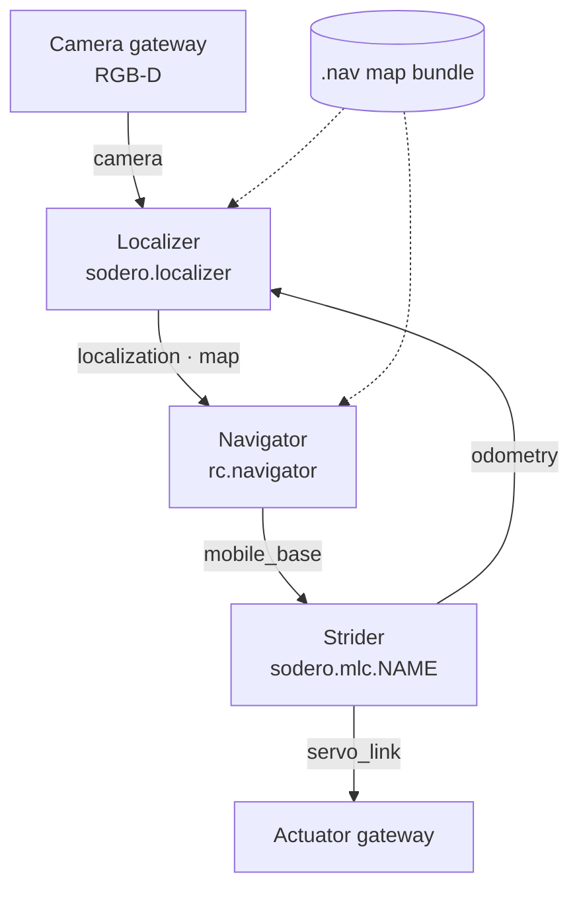

# Localization and Navigation

Stellar Station includes a complete navigation stack for mobile robots: it knows where the robot is on a map (**localization**) and drives it to goals around obstacles (**navigation**). Both run on Stellar X as built-in nodes and work with the base's Strider node: the localizer reads its odometry, and the navigator drives the base through it.

---

## 1. How It Works

| Node | Role |
| :--- | :--- |
| **Camera gateway** | Delivers depth and color images from the robot's RGB-D camera |
| **Strider** | Drives the base and reports **odometry**: how far the wheels have moved the robot |
| **Localizer** | Matches the camera's 3D view against the map's point cloud and corrects the odometry, so the robot knows its pose on the map |
| **Navigator** | Plans a path on the map's occupancy grid and drives the base along it, avoiding obstacles, until the goal is reached |
| **Visual odometry** (optional) | Estimates odometry from the camera, for robots without wheel odometry such as walking robots |
| **Map bundle** (`.nav`) | One file with the map (point cloud and occupancy grid) and the localizer and navigator settings for one site ([Load and Configure a Map](../map_bundle/index.md)) |

By default the localizer works in the plane: it estimates x, y and heading on the map. There is one localizer and one navigator per Station, so one robot per Station navigates.

---

## 2. Coordinate Frames

| Frame | Meaning |
| :--- | :--- |
| `map` | The fixed frame of the map |
| `odom` | The odometry frame; drifts slowly as the wheels slip |
| `base_link` | The robot, **on the floor** below its center |
| Camera optical frame | The camera (for example `cam0_optical`): x right, y down, z forward |

The localizer publishes the correction `map → odom`; Strider publishes `odom → base_link`; the map bundle's extrinsics give `base_link → camera`.

!!! warning "Because `base_link` is on the floor, the camera's mounting height in the extrinsics is its height **above the floor**, not above the robot's body frame. A wrong height makes the camera's view sink into or float above the map, and localization fails."

---

## 3. Set Up Navigation

| Step | Where |
| :--- | :--- |
| 1. Drive the base with Strider | [Quick Start](../../get_started/quick_start/index.md) |
| 2. Add a camera gateway and check its image | [Sensors and Cameras](../../gateways/sensors_and_cameras/index.md) |
| 3. Prepare the map bundle of the site | [Create a Map from Your Site](../create_map/index.md), or use a finished bundle |
| 4. Add the Localizer and the Navigator, upload the map once to the Localizer, connect the ports | [Load and Configure a Map](../map_bundle/index.md), [Navigate in Simulation](../simulation_tutorial/index.md) |
| 5. Set the initial pose and send goals | [Strider › Navigation Page](../../controllers/strider/index.md#5-navigation-page) |

The connections:

| From (requires) | To (provides) |
| :--- | :--- |
| Localizer `camera` | Camera gateway `camera` |
| Localizer `odometry` | Strider `odometry` (or Visual odometry `odometry`) |
| Navigator `localization` | Localizer `localization` |
| Navigator `map` | Localizer `map` |
| Navigator `mobile_base` | Strider `mobile_base` |

Start the nodes in this order: gateway, Strider, camera gateway, localizer, navigator. The localizer needs a running camera and an uploaded map; the navigator needs the map bundle's navigator settings.

---

## 4. Localization States

| State | Meaning | What to do |
| :--- | :--- | :--- |
| **Uninitialized** | No pose yet | Set the initial pose |
| **Initializing** | Searching around the initial pose | Wait; keep the robot still |
| **Healthy** (localized) | The camera view matches the map | Navigate |
| **Degraded** | Few recent matches (for example a featureless area or many people around) | Goals are still accepted; check the camera view |
| **Lost** | No match for a long time; the navigator stops | Set the initial pose again, or use **Global localization** |
| **Relocalizing** | A new initial pose is being checked | Wait |

**Global localization** on Strider's Navigation page searches the whole map for the robot's pose. Stop the robot before you start it, review the best candidate, and apply it.

---

## 5. Settings

The localizer and the navigator share their settings with the map bundle. Edit them in the inspector of either node under **NAVIGATION SETTINGS** (or with **Settings** on the node card), while the localizer, the navigator and visual odometry are stopped. The most useful ones:

| Group | Setting | Meaning |
| :--- | :--- | :--- |
| Navigator | `FollowPath.desired_linear_vel` | Cruise speed (m/s) |
| | `max_angular_vel`, `rotate_to_heading_angular_vel` | Turning speeds (rad/s) |
| | `rotate_to_heading_min_angle` | Above this heading error (rad), the robot turns in place before it drives. Use a small value for skid-steer bases. |
| | `xy_goal_tolerance`, `yaw_goal_tolerance` | How close counts as reached (m, rad) |
| | `robot_radius`, `inflation_radius` | Robot size and the clearance kept from obstacles (m) |
| Localizer | `icp.max_jump_m`, `icp.max_jump_rad` | Largest correction accepted per update |
| | `sensor.depth_min`, `sensor.depth_max` | Depth range of the camera used for matching (m) |
| Initial pose | `x`, `y`, `yaw` | The pose used when no other pose is known |

Uploading a map bundle again replaces these settings with the bundle's. The full list is in [Map Bundle Format](../map_bundle_format/index.md#files); from the SSH workspace use `sodero navigation get` and `sodero navigation apply` ([sodero CLI](../../ssh_workspace/sodero_cli/index.md)).

---

## 6. Send Goals from Programs

| From | How |
| :--- | :--- |
| Strider | **Set Goal**, **Start Navigation** ([Strider](../../controllers/strider/index.md#5-navigation-page)) |
| SSH workspace | `sodero tools call navigation.navigate_to_pose`, `navigation.get_status`, `navigation.cancel_navigation`, `localization.set_initial_pose` |
| Your module | A module connected to the Navigator's `navigation` port; it can send goals and follow their progress ([Create Custom Modules](../../extend/custom_modules/index.md)) |

A goal is a pose in the `map` frame. A patrol is a sequence of goals sent one after another by your program.
