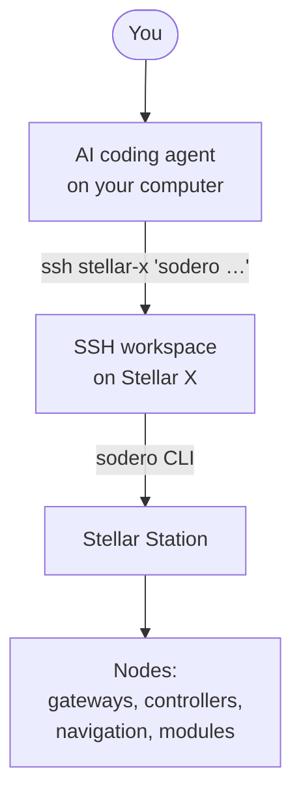

# Working with AI Coding Agents

The SSH workspace is built to be used by people and by AI coding agents alike. Every `sodero` command prints JSON, every change is previewed before it is applied, and the workspace ships its own operating rules for agents. With an agent such as **Claude Code** or **OpenAI Codex**, you describe a task in plain language and the agent runs the commands, reads the results and reports back:

- *"Which nodes are running, and why did the Strider node stop?"*
- *"Add a camera gateway named cam0 and connect it to the localizer."*
- *"Lower the navigator's top speed to 0.3 m/s."*
- *"Write a module that drives the robot through these three waypoints."*

---

## How It Works



The robot's workspace has **no Internet access**, and an AI agent needs the Internet to reach its language model. So the agent runs **on your computer** and works on the robot through SSH: it sends each command with `ssh`, reads the JSON that comes back and decides the next step.

!!! info "The agent changes the robot only through `sodero`, which performs exactly the operations of the Station page. Whatever the agent builds, you can inspect and change on the Station page, and the other way round."

---

## 1. Prepare SSH Access

1. Register your computer's SSH key on the robot's [Network Settings](../../hardware_setup/stellar_series/network_settings/index.md#2-ssh-access) page.
2. Add a host alias to `~/.ssh/config` on your computer, so the agent can use a short name:

    ```text
    Host stellar-x
        HostName 192.168.60.18
        Port 2222
        User sodero
    ```

3. Check that a command runs without a prompt:

    ```sh
    ssh stellar-x sodero project status
    ```

    It prints one line of JSON that describes the robot's Station.

!!! idea "**Tip (macOS · Linux):** Reuse one SSH connection"
    Agents run many short commands. Reusing one SSH connection makes each call faster. Add these lines under `Host stellar-x`:

    ```text
        ControlMaster auto
        ControlPath ~/.ssh/cm-%r@%h-%p
        ControlPersist 10m
    ```

---

## 2. Tell the Agent About the Robot

Create a working folder on your computer with an instructions file that your agent reads automatically when it starts: **`CLAUDE.md`** for Claude Code, **`AGENTS.md`** for Codex and most other agents. Copy this text into it:

```markdown
# Stellar X robot

The robot's SSH workspace is reachable as `ssh stellar-x '<command>'`.

Before you change anything, read the robot's own rules and follow them:
`ssh stellar-x cat /workspace/AGENTS.md`

- Use the `sodero` CLI over SSH. It prints JSON; read `sodero --help` and
  `sodero capabilities` instead of guessing commands.
- Commands that change something only preview until `--execute` is added.
  Show me the preview and wait for my OK before you add `--execute`.
- Never move the real robot unless I ask for that motion.
- Keep source files on the robot under /workspace/my-work.
```

The robot's own rules (`/workspace/AGENTS.md`) tell the agent how to read results and exit codes, how to wait for long operations without polling loops, which nodes drive real hardware on this robot, and what it must never do. They are maintained with the robot's software, so you do not need to copy them.

---

## 3. Start the Agent

=== "Claude Code"

    ```sh
    mkdir -p ~/stellar-x-work && cd ~/stellar-x-work
    # save the text above as CLAUDE.md
    claude
    ```

=== "Codex CLI"

    ```sh
    mkdir -p ~/stellar-x-work && cd ~/stellar-x-work
    # save the text above as AGENTS.md
    codex
    ```

=== "VS Code"

    Open the folder `~/stellar-x-work` in VS Code and start your agent extension there (for example Claude Code or Codex). The agent runs on your computer and reaches the robot with `ssh stellar-x`.

Start with a read-only request to see that everything is connected:

```text
Check the robot's Station and tell me which nodes exist and which are running.
```

The agent runs commands such as `sodero topology get` and `sodero runtime status` and summarizes the result.

---

## Example Tasks

| You ask | What the agent does |
| :--- | :--- |
| *"Why did the Strider node fail?"* | `sodero runtime status` to find the failed node and its reason, then `sodero runtime logs NODE` |
| *"Add a camera gateway cam0 and connect it to the localizer."* | `sodero topology get`, then `sodero topology add-node` and `sodero topology connect`, each previewed first |
| *"Lower the navigator's maximum speed to 0.3 m/s."* | `sodero navigation get --node rc.navigator`, edits the value, `sodero navigation apply` with the returned SHA-256 |
| *"Attach warehouse.nav to the localizer and the navigator."* | `sodero navigation get` for each node's SHA-256, then `sodero maps upload warehouse.nav --node rc.localizer` and the same for `rc.navigator` |
| *"Write a module that drives to these three points in a loop."* | Writes a package under `/workspace/my-work`, checks it, `sodero packages upload`, adds its node and starts it with `sodero apps start` |
| *"Drive the simulated robot forward 1 m."* | `sodero tools call strider.set_mode`, `strider.servo_on`, `strider.set_twist` and `strider.stop` on the **simulated** robot's target |

---

## Stay in Control

- **Review previews.** Ask the agent to show the preview of every change. Nothing changes until a command runs with `--execute`.
- **Set approval rules in your agent.** Most agents can require your approval before they run a command. A practical setup: allow read-only commands (`status`, `get`, `list`, `logs`) freely, and ask for approval for anything with `--execute`, `tools call` or `apps call`.
- **Real hardware moves.** A robot tool called with `--execute` can move real equipment. Keep the area clear and keep the emergency stop within reach. The robot's rules forbid the agent to move a robot unless you asked for that motion.
- **Protected assets.** Official modules expose their parameters and settings, but not their sources, binaries, weights or internal logs. Your own files, documents, packages and their logs are fully available to the agent.

---

## Give the Agent the Documentation

- Inside the workspace, `sodero-help` prints every guide and `/opt/sodero/docs/examples` holds runnable examples. The robot's `AGENTS.md` points the agent to them.
- This documentation is also published in a form made for language models: `llms.txt` (an index) and `llms-full.txt` (all pages in one file) at the root of each documentation version, for example `https://docs.sodero.io/latest/llms-full.txt`.
