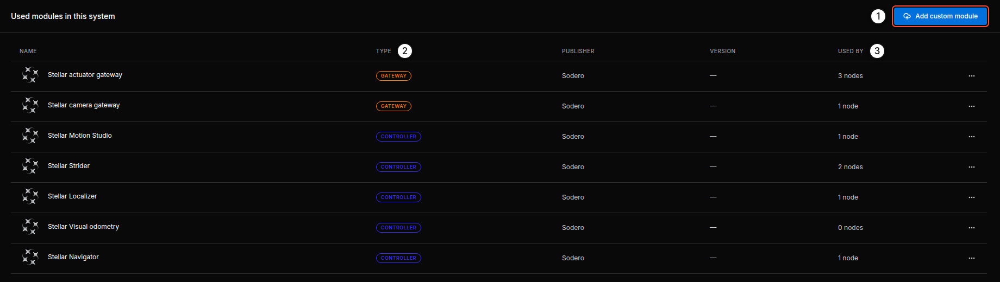
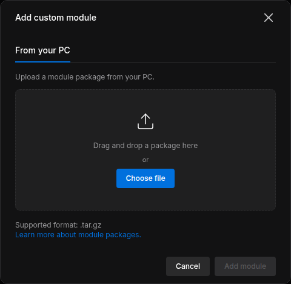

# Modules

A **module** is a program packaged to run on the Station as a node. The built-in modules (gateways, controllers, navigation) come with Stellar X. You can install your own modules to add robot behaviors, task logic or custom device interfaces; they run next to the built-in ones and use the same interfaces.

This page installs, updates and removes module packages. To build a package yourself, see [Create Custom Modules](../../extend/custom_modules/index.md).

---

## 1. The Modules Page

Click **Modules** in the left sidebar. The page lists the modules that the nodes of your system use.

<figure markdown="span">
  { width="1000" }
  <figcaption>Modules used in this system</figcaption>
</figure>

| No. | Item | Description |
| :---: | :--- | :--- |
| 1 | **Add custom module** | Installs a module package from your PC ([Install a Module](#2-install-a-module)) |
| 2 | **TYPE** | Gateway, Controller, Compound or Application |
| 3 | **USED BY** | How many nodes of the graph use the module |

The **⋯** menu of a row offers **Module info** and, for your own modules, **Remove module**.

---

## 2. Install a Module

1. Click **Add custom module**.
2. Drop the package (`.tar.gz`) or click **Choose file**, then click **Add module**.

<figure markdown="span">
  { width="460" }
  <figcaption>Installing a module package</figcaption>
</figure>

- Uploading a package with the same name replaces the installed version. Nodes that use it keep their connections; stop and start them to run the new version.
- Built-in modules cannot be replaced.

### Add and Start the Module's Node

1. Click **Add node** and choose the type that the module declares: **Gateway**, **Controller**, **Compound** or **Application** (the `role` in its `subsystem.yaml`: `gateway`, `component`, `compound` or `app`). Your module appears in the list with the **CUSTOM** badge. The status module of [Create Custom Modules](../../extend/custom_modules/index.md), for example, is a `component` and appears under **Controller**.
2. Connect its required ports, for example to a Strider's `mobile_base` or a Motion Studio's `manipulator`.
3. Right-click the node and choose **Start node**, or use **Start all nodes**.

If the module has its own web UI, a link with the module's name appears on its node card while it runs. Its logs appear in the inspector's **LOGS** section.

### Remove a Module

Stop and delete the nodes that use the module, then choose **Remove module** in the **⋯** menu of its row.
