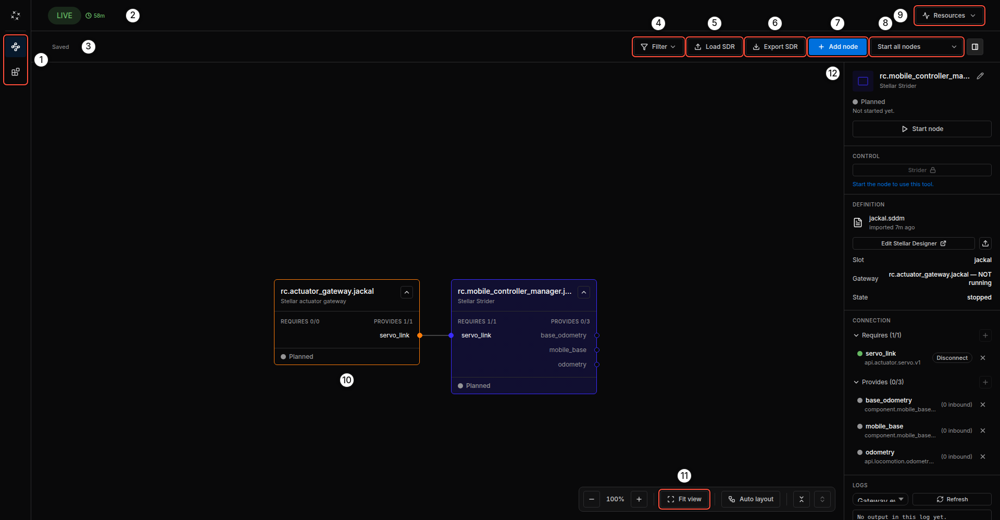
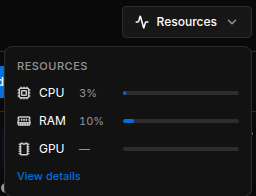
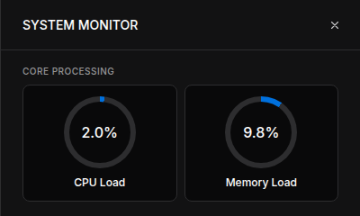
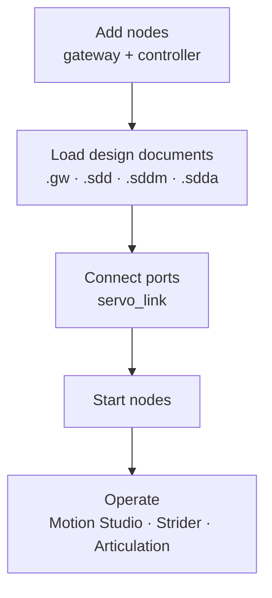

# Stellar Station Overview

**Stellar Station** is the control center of Stellar X. In a web browser you build the robot system as a graph of nodes (gateways, controllers, sensors, navigation and your own modules), load their design documents, start them, and watch their state and logs. The controller UIs (Motion Studio, Strider and Articulation) and Stellar Designer open from the Station as well.

Open the Station from any computer on the controller's network:

```text
http://ROBOT_ADDRESS
```

In this guide the address is `192.168.60.18`. On the controller's own network the Station needs no sign-in. Use a recent version of Chrome or Edge.

!!! info "If you do not know the controller's address yet, see [Network Settings](../../hardware_setup/stellar_series/network_settings/index.md)."

---

## 1. Screen Layout

<figure markdown="span">
  { width="1000" }
  <figcaption>The Runtime page of Stellar Station</figcaption>
</figure>

| No. | Item | Description |
| :---: | :--- | :--- |
| 1 | **Runtime** / **Modules** | The two pages of the Station. **Runtime** is the node graph shown here; **Modules** lists the modules used in the system and installs your own ([Modules](../modules/index.md)). |
| 2 | **LIVE** and uptime | The Station is running, and how long it has been running. |
| 3 | Save state | **Saved** / **Saving…**. Every change to the graph is saved to the controller automatically. If a save fails, the label turns into **Retry save**. |
| 4 | **Filter** | Shows only nodes of a type (Gateway, Controller, Compound, Application) or a status. Nodes connected to a match stay visible but dimmed. |
| 5 | **Load SDR** | Replaces the whole Station with an `.sdr` file ([Backup and Restore](../backup_restore/index.md)). |
| 6 | **Export SDR** | Downloads the whole Station as an `.sdr` file. |
| 7 | **Add node** | Adds a gateway, controller, compound or application node ([Nodes and Connections](../nodes_and_connections/index.md)). |
| 8 | **Start all nodes** | Starts or stops every node in dependency order ([Running Nodes](../running_nodes/index.md)). |
| 9 | **Resources** | CPU, memory and GPU load of the controller. |
| 10 | Node card | One node of the graph, with its ports and its state. |
| 11 | Canvas controls | Zoom out, zoom level and zoom in, **Fit view**, **Auto layout**, and collapse or expand all node cards. Drag the empty canvas to move the view. |
| 12 | Inspector | Details of the selected node: its state, controls, design document, connections and logs. The button at the right end of the toolbar shows or hides it. |

!!! idea "**Tip:** Right-click the empty canvas to add a node directly, and right-click a node for its actions (start, stop, open its UI, delete)."

---

## 2. Resources

Click **Resources** to see the controller's load. **View details** opens the system monitor.

<figure markdown="span">
  { width="256" }
  <figcaption>Resource usage</figcaption>
</figure>

<figure markdown="span">
  { width="420" }
  <figcaption>System monitor</figcaption>
</figure>

The bars turn amber at 70 % and red at 85 %. Stellar X has no GPU, so GPU shows **—**.

---

## 3. Theme

Click the Stellar mark at the top left and choose **Theme** › **Midnight** (dark) or **Twilight** (light).

---

## 4. What You Do on the Station

A typical robot system is built in this order. Each step has its own page.



| Step | Page |
| :--- | :--- |
| Add nodes and connect their ports | [Nodes and Connections](../nodes_and_connections/index.md) |
| Load or edit the documents of the nodes | [Design Documents](../design_documents/index.md) |
| Start and stop nodes, read their state and logs, open the controller UIs | [Running Nodes](../running_nodes/index.md) |
| Install your own programs | [Modules](../modules/index.md) |
| Back up, restore or copy the whole Station | [Backup and Restore](../backup_restore/index.md) |

For a complete walkthrough with a simulated robot, follow the [Quick Start](../../get_started/quick_start/index.md).

---

## 5. Pages Served by Stellar X

| Address | What it is |
| :--- | :--- |
| `http://ROBOT_ADDRESS` | Stellar Station, and Stellar Designer when opened from a node |
| `http://ROBOT_ADDRESS:8081/...` | Controller UIs (Motion Studio, Strider, Articulation) and module UIs; open them from their nodes on the Station page |
| `http://ROBOT_ADDRESS:3000` | [Network Settings](../../hardware_setup/stellar_series/network_settings/index.md) |
| `ssh -p 2222 sodero@ROBOT_ADDRESS` | [SSH Workspace](../../ssh_workspace/overview/index.md) |

!!! warning "Anyone who can reach the controller's network can open the Station and command the robot. Keep Stellar X on a trusted network."
