# 3D Model Creation

This tutorial assembles the 3D model of a robot arm for display in Stellar Designer, Motion Studio and the Station. The model is for visualization only: the kinematics come from the DH parameters of the `.sdd` document, not from the model. You can skip this step and add a model later.

The example is a 6-axis manipulator. Download its parts and unzip them:

- **[example_manipulator_parts.zip](models/example_manipulator_parts.zip)**

<figure markdown="span">
    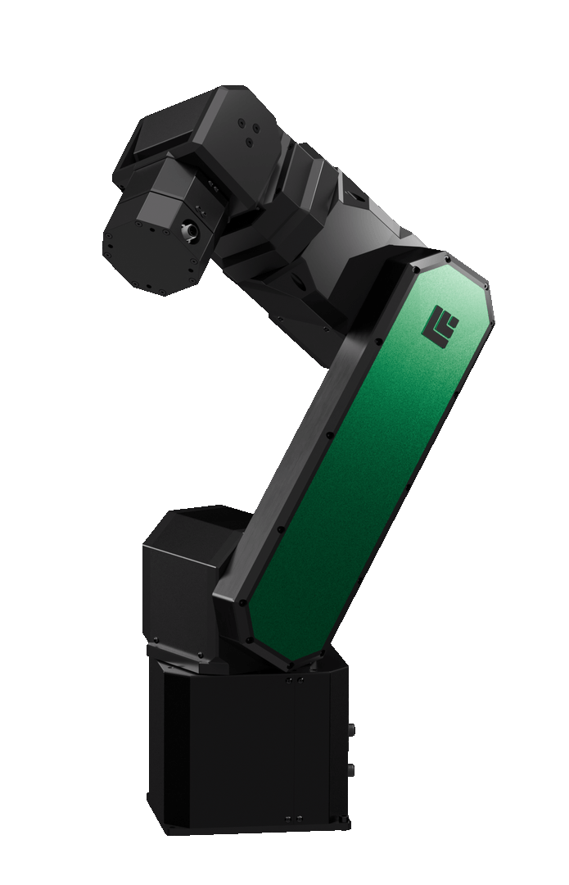{ width="400" }
    <figcaption>The example manipulator</figcaption>
</figure>

For your own robot you need one 3D model file per link, exported from your CAD design, and the robot's DH parameters.

The steps use [Blender](https://www.blender.org/download/){:target="_blank"}, which reads most common 3D formats. Any other 3D tool works as long as it produces the same object names, hierarchy and file format.

---

## 1. Prepare the Scene in Blender

### Clear the Scene

<figure markdown="span">
    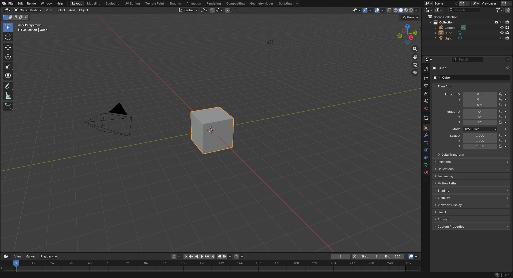{ width="1000" }
</figure>

Open Blender and delete the default `Camera`, `Cube` and `Light`.

### Naming Conventions

| Part | Name |
| :--- | :--- |
| Base joint | `J0` |
| Base link | `link0` |
| Joints | `J1` to `Jn` |
| Links | `link1` to `linkn` |

`n` is the number of joints, 6 in this example.

### Create the Joints

<figure markdown="span">
    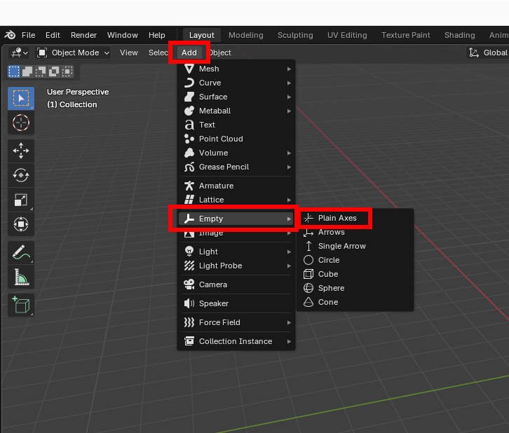
    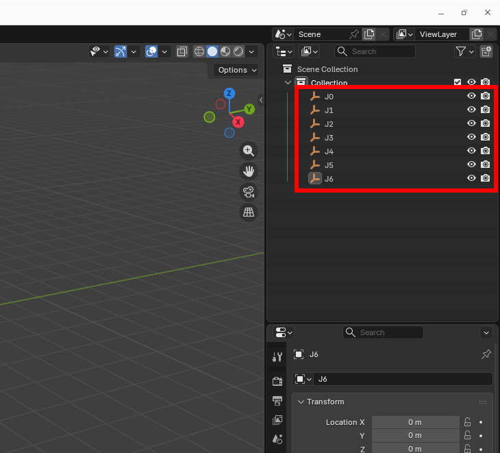
</figure>

Click **Add › Empty › Plain Axes** to add an axis object. Add seven of them and rename them `J0` to `J6`. Stellar Designer finds the joints by these names, so each name must be `J` followed by its number.

### Import the Links

<figure markdown="span">
    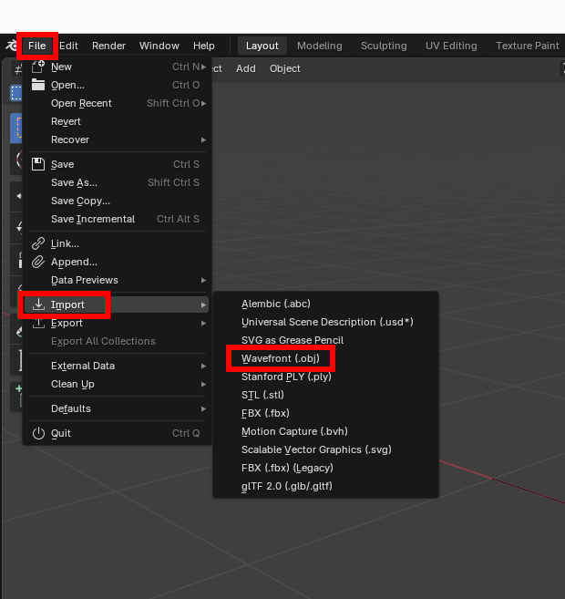
    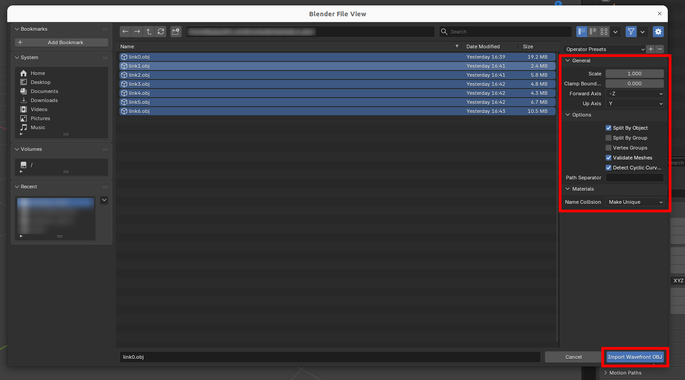{ width="1000" }
    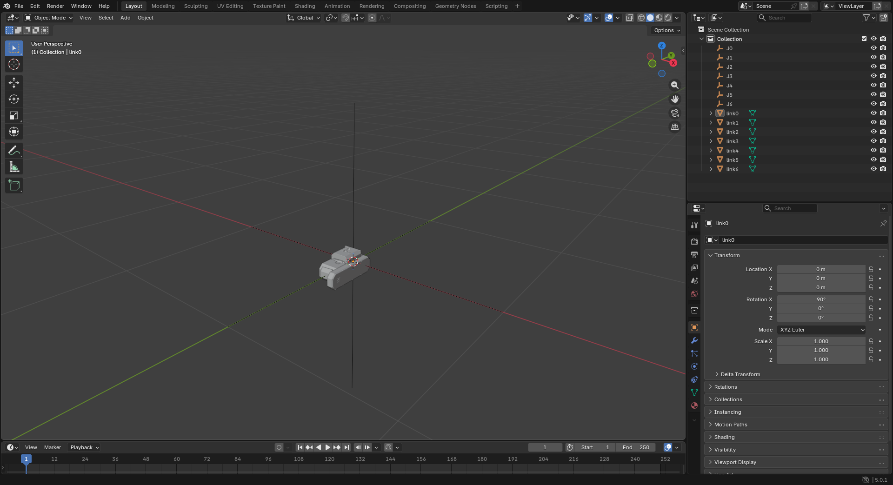{ width="1000" }
</figure>

Click **File › Import › Wavefront (.obj)**, open the folder of the unzipped parts and import all seven parts with the import settings shown above. The scene then looks like the last picture.

<figure markdown="span">
    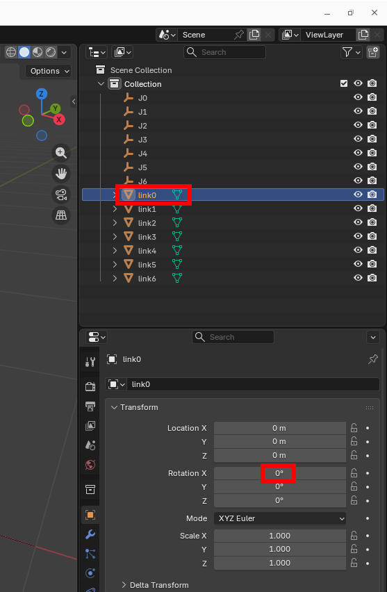
    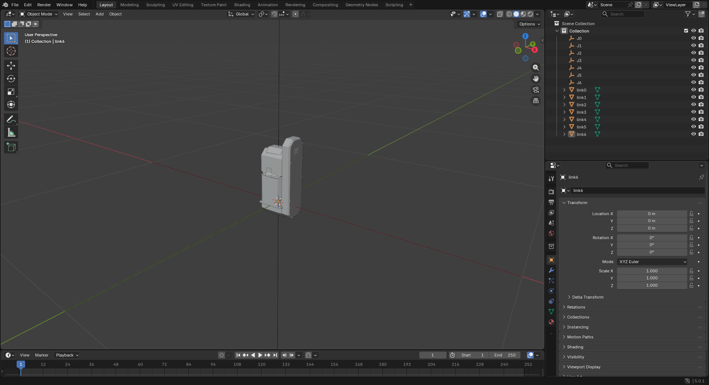{ width="1000" }
</figure>

Select `link0` and set **Rotation X** to `0`: the part stands upright. Repeat this for the other parts.

### Attach Each Link to Its Joint

<figure markdown="span">
    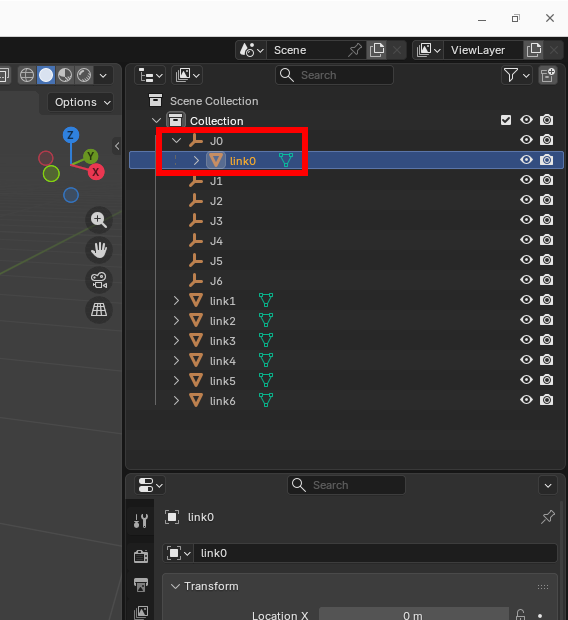
    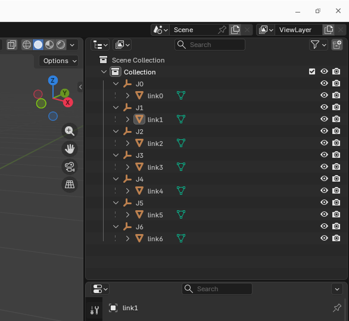
</figure>

Select `link0` and Shift-drag it onto `J0`, so that `link0` sits under `J0`. Repeat this for the other links.

---

## 2. Build the Hierarchy

The robot is a serial chain: each joint is a child of the previous joint, and each link is a child of its joint.

```text
World
└── J0
    ├── link0
    └── J1
        ├── link1
        └── J2
            ├── link2
            └── J3
                ├── link3
                └── J4
                    ├── link4
                    └── J5
                        ├── link5
                        └── J6
                            └── link6
```

<figure markdown="span">
    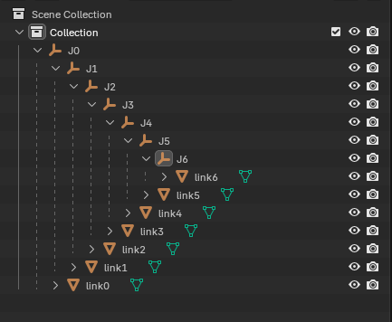
</figure>

Select `J1` and Shift-drag it onto `J0`: `J1` and `link1` are now under `J0`. Repeat this for the other joints.

| Item | Description |
| :--- | :--- |
| `World` | The scene of the 3D tool |
| `J0` to `Jn` | Joint nodes |
| `link0` to `linkn` | Link models |

!!! warning "Each joint `Jn` must be a child of the previous joint, and each link `linkn` a child of its joint `Jn`. With a different hierarchy the links do not move with their joints."

---

## 3. Match the DH Parameters

The joint frames in Blender must match the DH parameters of the robot in Stellar Designer.

### DH Convention

Stellar Designer applies the four DH parameters of a joint in this fixed order:

1. Rotation about Z by θ (theta)
2. Translation along Z by d
3. Translation along X by a
4. Rotation about X by α (alpha)

### Place the Joints

<figure markdown="span">
    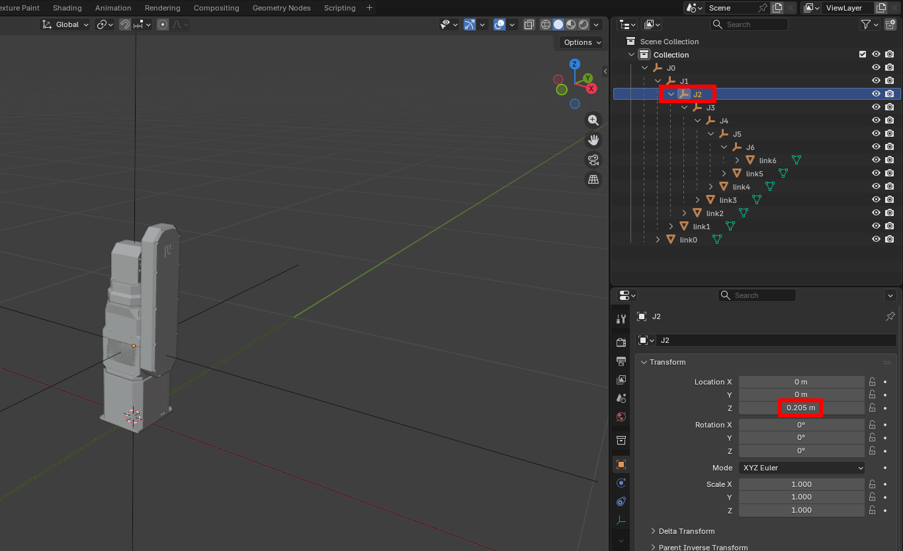{ width="1000" }
    <figcaption>J2 placed 0.205 m above J1</figcaption>
</figure>

Joint J1 of the example has θ = 0, d = 205 mm, a = 0 and α = 0 in Stellar Designer, so the frame of J2 sits 205 mm above J1 along Z.

1. Select `J2` and set **Location Z** to `0.205`. `link2` and everything under `J2` moves up.
2. Set **Location Z** of `J3` to `0.27` and of `J5` to `0.23`. The model then looks like the last picture below.

<figure markdown="span">
    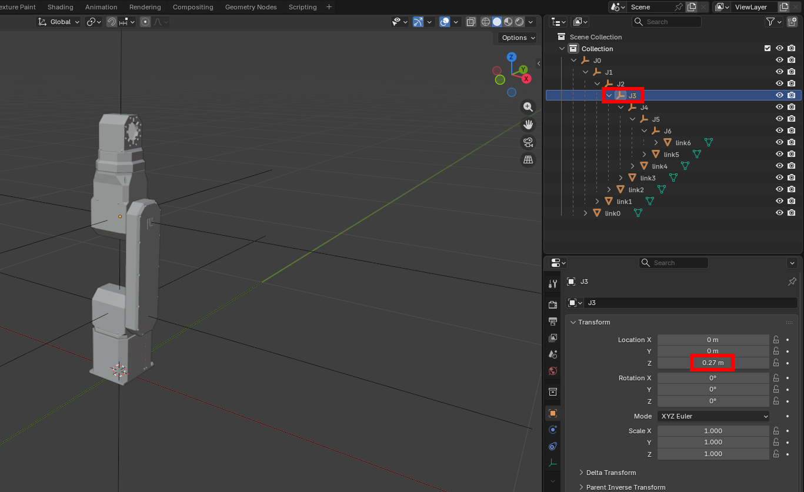{ width="1000" }
    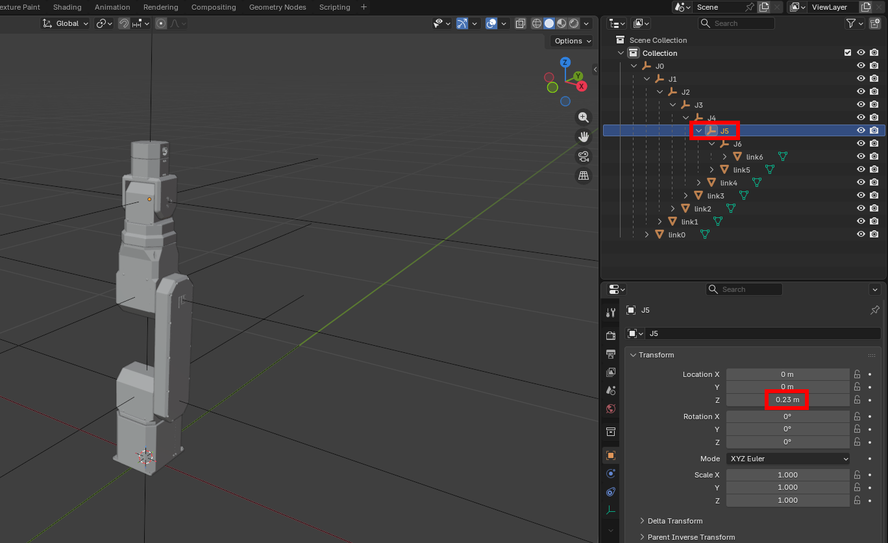{ width="1000" }
    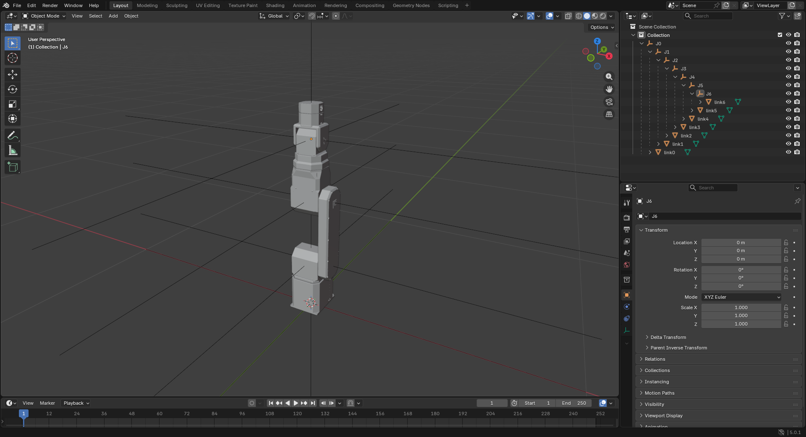{ width="1000" }
</figure>

For your own robot, the parts may not line up with the joint axes of the DH parameters. In that case, move the mesh itself in your CAD program. In the assembled pose, the base is at (0, 0, 0) and every joint is at 0.

### Joint Axes

- Set the rotation axis of each joint `Jn` according to its DH parameters.
- Rotate in the joint's local axes, not in the world axes.

---

## 4. Export the Model

1. Choose **File › Export › glTF 2.0 (.glb/.gltf)**.

    <figure markdown="span">
        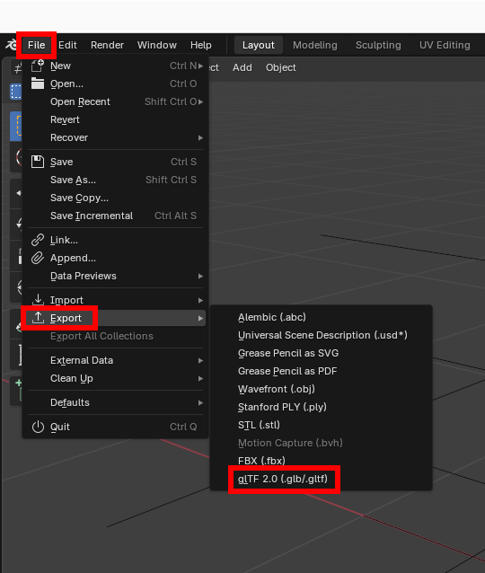
    </figure>

2. In the export window, set **Format** to **glTF Binary (.glb)** and, under **Transform**, clear **+Y Up**.

    <figure markdown="span">
        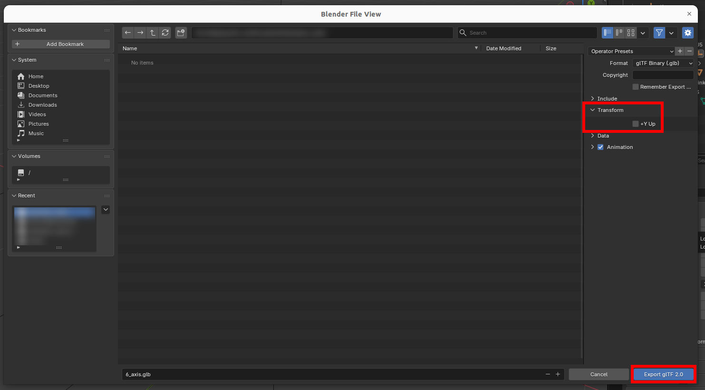{ width="1000" }
    </figure>

!!! warning "Clear **+Y Up**. Otherwise Blender converts the model to a Y-up coordinate system, and it appears rotated in Stellar Designer."

The finished files of this example: **[.blend](models/example_manipulator_assembly_vis.blend)** and **[.glb](models/example_manipulator_assembly_vis.glb)**.

---

## 5. Load the Model in Stellar Designer

Open the robot's document in Stellar Designer, click **Display** in the 3D view and choose **Load.glb** ([Stellar Designer](../introduction/index.md#display-menu)). Switch **Representation** to **3D Model**: each link moves with its joint when you jog the joints in **Robot Structure**. Motion Studio and the Station then show the robot with this model.

!!! info "Stellar Designer uses only the `.glb` file."
