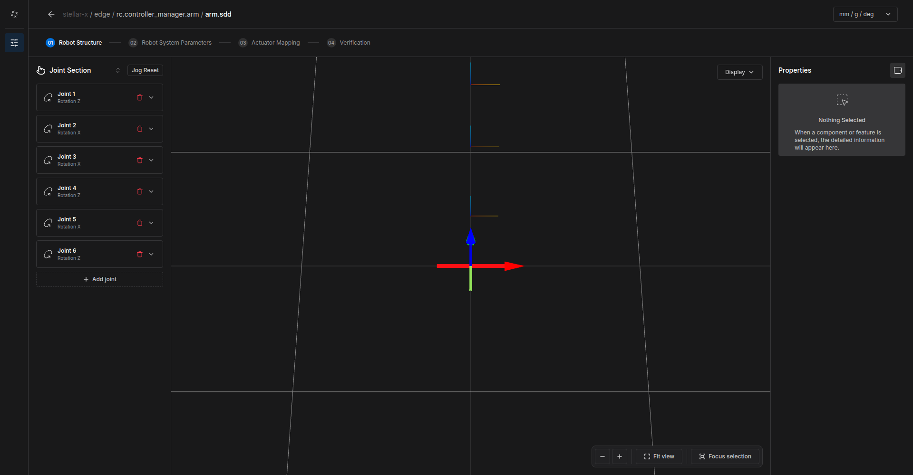
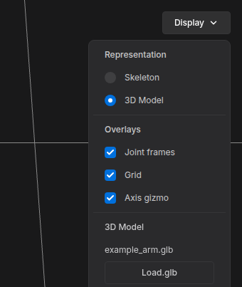

# Stellar Designer

**Stellar Designer** creates and edits the design documents of controllers: the robot's structure, its limits and safety settings, and how the gateway's actuators drive its joints or wheels. Each controller node on the Station holds one document:

| Document | Robot | Controller | Tutorial |
| :--- | :--- | :--- | :--- |
| `.sdd` | Manipulator (serial arm) | Motion Studio | [Manipulator](../manipulator/index.md) |
| `.sddm` | Wheeled mobile base | Strider | [Mobile Robot](../mobile_robot/index.md) |
| `.sdda` | Articulated robot driven joint by joint (legged robots, humanoids) | Articulation | [Articulation](../../../controllers/articulation/index.md) |

Gateway documents (`.gw`) are made in the [Gateway Designer](../../../gateways/gateway_designer/index.md).

---

## 1. Open Stellar Designer

1. On the Station, select a controller node (Motion Studio, Strider or Articulation).
2. Click **Edit Stellar Designer** in the node's **DEFINITION** section.

Stellar Designer opens in a new tab with the node's document. Changes are saved back to the node automatically. **Stop the node before you edit its document**; the new document takes effect the next time the node starts.

If the node has no document yet, Stellar Designer opens **Create robot definition**: choose a template of the robot type, or **Blank robot** for a manipulator, and click **Create**.

| Robot type | Templates |
| :--- | :--- |
| Manipulator | 2-axis two-bar arm, 4-axis SCARA, 4-axis cylindrical SCARA, 7-axis humanoid arm, Blank robot |
| Mobile | Differential drive 2WD, MiR250 differential, Skid steer 4WD, Mecanum 4WD, Swerve 4WD, Ackermann, Tricycle 3WD |

You can also import a document you already have with **Import** in the node's **DEFINITION** section ([Design Documents](../../../station/design_documents/index.md)).

---

## 2. Screen Layout

<figure markdown="span">
  { width="1000" }
  <figcaption>Stellar Designer with a 6-axis arm</figcaption>
</figure>

| Area | Description |
| :--- | :--- |
| Breadcrumb | Where the document belongs: device / Station / node / file. The arrow returns to the Station. |
| Steps | **01 Robot Structure** (or **Chassis Structure** for mobile robots), **02 Robot System Parameters**, **03 Actuator Mapping**, **04 Verification**. Click a step to open it; you can go back and forth. |
| Left panel | The joints (or wheels) of the robot, with their parameters |
| 3D view | The robot as you define it. Drag to rotate, right-drag to pan, scroll to zoom. **Fit view** frames the robot; **Focus selection** frames the selected part. |
| Right panel | Details of the selection, such as constraints, or the parameters of the current step |
| Units | `mm / g / deg` or `m / kg / radian`. Display only; documents store SI units. |

### Display Menu

<figure markdown="span">
  { width="340" }
  <figcaption>The Display menu</figcaption>
</figure>

**Display** in the 3D view switches between **Skeleton** (joint frames and links as lines) and **3D Model**, shows or hides **Joint frames**, **Grid** and **Axis gizmo**, and loads the robot's 3D model: **Load.glb** attaches a GLB file to the document, which Motion Studio and the Station show as the robot.

---

## 3. Workflow

1. **Structure.** Define the joints (manipulator) or the chassis and wheels (mobile robot).
2. **System parameters.** Enter the robot-wide values: payload, gravity, speed limits, goal tolerances, safety margins.
3. **Actuator mapping.** Connect the gateway's actuators to the joints or wheels, with their transmission factors.
4. **Verification.** Click **Verify**. When all checks pass, the document is ready; **Export** saves a copy to your computer.

Then start the node on the Station and try the robot, in simulation first.
