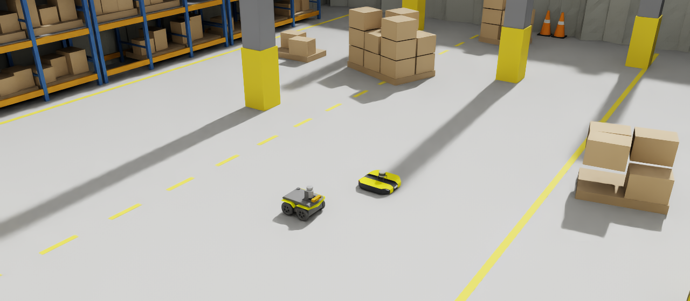
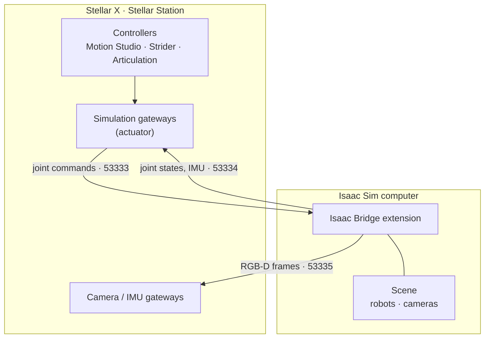

# Virtual Simulation with Isaac Sim

<figure markdown="span">
  { width="1000" }
  <figcaption>The example scene of the Quick Start: a Clearpath Jackal and a Clearpath Dingo in a warehouse</figcaption>
</figure>

[NVIDIA Isaac Sim](https://developer.nvidia.com/isaac/sim){:target="_blank"} is a robotics simulator with physically based rendering and GPU physics. With the **Isaac Bridge** extension, Isaac Sim becomes the simulator of Stellar X: the controllers on the Station drive robots in Isaac Sim exactly as they drive real motors.

---

## How It Works

- **Only the gateways change.** A simulation gateway replaces the fieldbus with the network connection to Isaac Sim. Controllers, documents, settings and applications stay the same as for the real robot.
- **The simulated robot behaves like servo drives.** Each joint receives position, velocity or torque commands and reports its position, velocity and torque, like a drive with its motor and encoder.
- **Cameras and IMUs** of the scene are served to the Station's camera and IMU gateways, so localization, navigation and walking controllers run on simulated sensors.
- **Several robots** can share one scene. Each robot has a unique name, and each gateway on the Station names the robot it drives.

What you can do in simulation:

- Check kinematics, joint directions and limits before the first power-on of a real robot.
- Develop and test applications, navigation and mission logic without hardware.
- Test multi-robot scenarios and sites that do not exist yet.

---

## Requirements

| Item | Requirement |
| :--- | :--- |
| Isaac Sim | 6.0 or later, on Linux or Windows ([Isaac Sim requirements and installation](https://docs.isaacsim.omniverse.nvidia.com/latest/installation/index.html){:target="_blank"}) |
| Isaac Bridge | The Sodero extension for Isaac Sim ([Isaac Bridge Installation](../extension_installation/index.md)) |
| Network | Stellar X and the Isaac Sim computer on the same network; Stellar X must reach the Isaac Sim computer on TCP ports 53333–53335 |
| Clock | Both computers synchronized with a time server (NTP), when you use cameras |

---

## Steps

| Step | Page |
| :--- | :--- |
| 1. Install Isaac Sim and the Isaac Bridge extension | [Isaac Bridge Installation](../extension_installation/index.md) |
| 2. Prepare the robot in the scene: articulation, name, joint order, cameras | [Robot Setup](../robot_setup/index.md) |
| 3. Point the Station's gateways at Isaac Sim and run | [Connect to Stellar Station](../connect_station/index.md) |

!!! idea "**Tip:** The [Quick Start](../../get_started/quick_start/index.md) walks through all three steps with a Jackal mobile robot."
