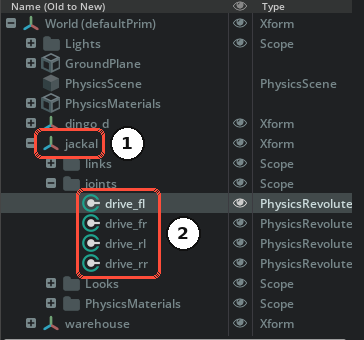
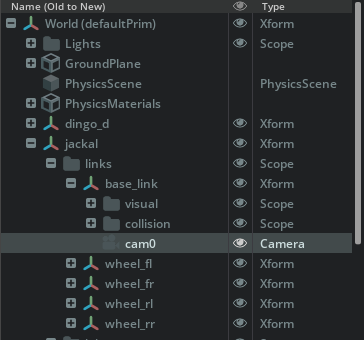

# Robot Setup

Isaac Bridge serves every robot of the open scene that follows a few rules. This page explains them and how to prepare your own robot. Scenes exported by Sodero already follow them, and so does the example scene of the [Quick Start](../../get_started/quick_start/index.md) (`jackal_warehouse.usd`): open it to see a working example.

---

## 1. The Rules

| Rule | Why |
| :--- | :--- |
| **The robot is a PhysX articulation.** Its top prim carries an **Articulation Root**. | The bridge finds robots by their articulation root. |
| **The prim name is the robot name.** It is unique in the scene and equal to the **Robot name** of the robot's gateway on the Station. | Gateways address robots by this name. |
| **The joints, in their USD order, are the actuators.** | Actuator 1 of the gateway is the robot's first movable joint, actuator 2 the second, and so on. |
| **Links are under `links`, joints under `joints`.** | Sensors refer to links by their name under `links`. |
| **Z up, meters.** | Joint values are exchanged in radians (revolute joints) and meters (prismatic joints). |

A robot prepared this way looks like this in the **Stage** panel:

<figure markdown="span">
  { width="364" }
  <figcaption>① the robot prim jackal with the Articulation Root ② its four drive joints in actuator order</figcaption>
</figure>

```text
/World/jackal              ← Articulation Root; prim name = robot name
    links/
        base_link          ← rigid body (with cameras below it)
        wheel_fl, wheel_fr, wheel_rl, wheel_rr
    joints/
        drive_fl           ← actuator 1
        drive_fr           ← actuator 2
        drive_rl           ← actuator 3
        drive_rr           ← actuator 4
```

---

## 2. Start from a Model

- **Isaac Sim assets.** Isaac Sim ships many robots from well-known manufacturers. Find them in the **Isaac Sim Assets** browser (**Window › Browsers**).
- **URDF.** Import a URDF with Isaac Sim's URDF importer (**File › Import**). See [Import URDF](https://docs.isaacsim.omniverse.nvidia.com/latest/importer_exporter/import_urdf.html){:target="_blank"} in the Isaac Sim documentation.
- **A 3D model.** Rig the robot yourself: rigid bodies and colliders on the links, joints between them, and an articulation root. See [Articulate a Basic Robot](https://docs.isaacsim.omniverse.nvidia.com/latest/robot_setup_tutorials/tutorial_gui_simple_robot.html){:target="_blank"} in the Isaac Sim documentation.

Then check the model against the rules above; the sections below show how to fix what differs.

---

## 3. Articulation Root and Name

1. Select the robot's top prim in the **Stage** panel, for example `/World/jackal`.
2. Right-click it and choose **Add › Physics › Articulation Root**. A robot has exactly one articulation root; remove any other articulation root inside the robot.
3. Rename the prim to the robot name. Use lowercase letters, digits and `_`, and start with a letter.

!!! warning "The robot name must be unique in the scene. If two prims share a name, only one of them is served."

**Fixed-base robots** (manipulators) are fixed to the world by a **Fixed Joint** from the world to their base link. Create it inside the robot (select the base link, **Create › Physics › Joint › Fixed Joint**) and leave **Body 0** empty, which means the world. Mobile and walking robots have no such joint.

---

## 4. Joints and Drives

**Joint order.** Actuator *i* of the gateway is the *i*-th revolute or prismatic joint under the robot prim, in the order the joints are stored in the USD file. The **Stage** panel shows this order when it is sorted **Old to New** (the default). Fixed joints do not count.

| Gateway | Isaac Sim |
| :--- | :--- |
| Actuator 1 (index 0) | 1st movable joint |
| Actuator 2 (index 1) | 2nd movable joint |
| … | … |

When the order of the scene differs from the order your controller document expects, change the actuator mapping in the document, or re-create the joints in the order you need.

**Drives.** Give every actuated joint a drive: right-click the joint and choose **Add › Physics › Angular Drive** (revolute) or **Linear Drive** (prismatic). The bridge sets the drive gains for each command mode. Set the drive's **Max Force** to the joint's real torque or force limit.

**Limits and zero.** The joint's lower and upper limits and its zero position come from the USD joint. Make the zero position match the zero of the real robot, so that the same document works for both.

**Starting pose.** Each time the scene plays, the robot starts where it was authored: its root at its position in the scene and every joint at its authored joint state, or at zero. Velocities start at zero.

**Passive joints.** Joints that are not actuators, such as caster wheels, are marked with the attribute `rc:passive = true` on the joint; they then do not count in the actuator order.

---

## 5. Physics and Mass

- Every link is a rigid body with a collider and a realistic mass. Wrong masses make torques, hand guiding and walking unrealistic.
- Wheels need friction: give the floor and the wheels a physics material with realistic friction.
- The bridge runs physics at the rate authored on the scene's **PhysicsScene** prim (`rc:physicsHz`) and renders at `rc:renderHz`. Without them it uses 60 Hz for both. Use at least 120 Hz physics for mobile robots and higher rates for walking robots; a lower render rate (20–30 Hz) leaves more time for physics. The render rate is lowered automatically so that each rendered frame runs a whole number of physics steps.

The current rates appear in the [Isaac Bridge status window](../extension_installation/index.md#3-open-the-status-window).

---

## 6. Cameras

Every **Camera** prim of the scene (except Isaac Sim's own viewport cameras) is served under its prim name, with color and depth images (640 × 480 at 15 frames per second by default). Cameras render only while the scene plays.

<figure markdown="span">
  { width="364" }
  <figcaption>The camera cam0 under the Jackal's base_link</figcaption>
</figure>

1. Create a camera under the link it is mounted on (**Create › Camera**), for example `/World/jackal/links/base_link/cam0`, so it moves with the robot.
2. Place and point it as on the real robot.
3. Give it a unique name. The Station's camera gateway uses this name as **Camera name**.
4. Note its horizontal field of view: the camera gateway needs it ([Sensors and Cameras](../../gateways/sensors_and_cameras/index.md)). Isaac Bridge prints each camera's field of view in the Isaac Sim console when the scene plays.

To change a camera's size or frame rate, or to publish only some cameras, follow **Cameras** in the extension's README.

---

## 7. IMU

Walking robots and visual odometry need an IMU. The bridge emulates an IMU on a link of the robot when the robot prim carries these attributes:

| Attribute (on the robot prim) | Type | Meaning |
| :--- | :--- | :--- |
| `rc:imuLink` | string | Name of the link under `links` that carries the IMU, for example `base_link` |
| `rc:imuOffset` | float3 | Position of the IMU in that link's frame, in meters (default 0, 0, 0) |

The Station's IMU gateway then reads it under the robot name ([Sensors and Cameras](../../gateways/sensors_and_cameras/index.md#2-imu-gateway)).

---

## 8. Add Attributes with the Script Editor

Attributes such as `rc:physicsHz`, `rc:imuLink` or `rc:passive` are custom USD attributes. Add them with **Window › Script Editor**, then save the scene (**File › Save**):

```python
import omni.usd
from pxr import Gf, Sdf

stage = omni.usd.get_context().get_stage()

# physics and render rates of the scene
scene = stage.GetPrimAtPath("/World/PhysicsScene")
scene.CreateAttribute("rc:physicsHz", Sdf.ValueTypeNames.Float).Set(120.0)
scene.CreateAttribute("rc:renderHz", Sdf.ValueTypeNames.Float).Set(30.0)

# an IMU on the base link of my_robot, 5 cm above the link origin
robot = stage.GetPrimAtPath("/World/my_robot")
robot.CreateAttribute("rc:imuLink", Sdf.ValueTypeNames.String).Set("base_link")
robot.CreateAttribute("rc:imuOffset", Sdf.ValueTypeNames.Float3).Set(Gf.Vec3f(0.0, 0.0, 0.05))

# a caster that is not an actuator
caster = stage.GetPrimAtPath("/World/my_robot/joints/caster_joint")
caster.CreateAttribute("rc:passive", Sdf.ValueTypeNames.Bool).Set(True)
```

Replace the prim paths with those of your scene.

---

## 9. Check the Robot

Press **Play** and open **Window › Isaac Bridge**:

| What you see | Meaning |
| :--- | :--- |
| `my_robot  /World/my_robot  bound, 6 DOF` | Ready. The DOF count must equal the number of actuators of the robot's gateway(s). |
| The robot is not listed | The prim has no articulation root. |
| The robot is listed but not bound | It is not a valid PhysX articulation (check the Isaac Sim console), or its name is used twice. |
| The DOF count is too high | Passive joints are not marked with `rc:passive`. |
| A camera is missing | Two cameras share a name, or the camera is one of Isaac Sim's viewport cameras. |

Next: [Connect to Stellar Station](../connect_station/index.md).
