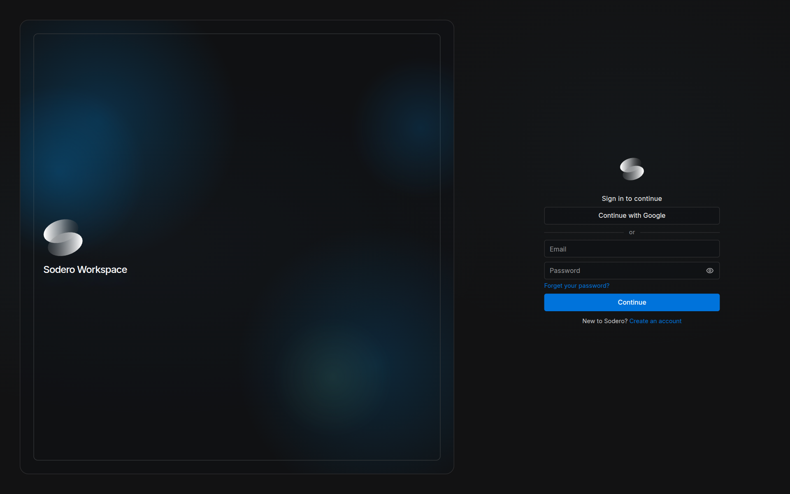
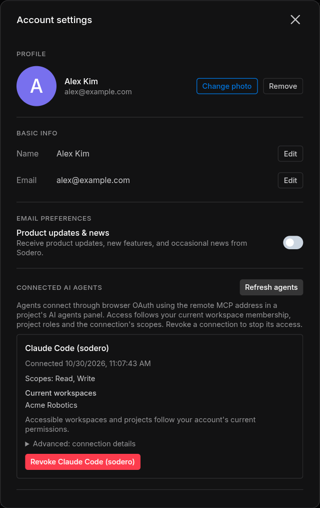
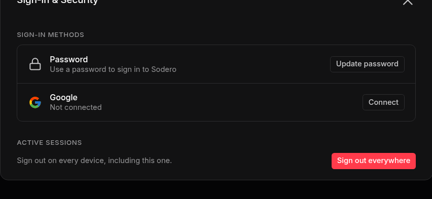

# Sign In and Account

One Sodero account signs you in to the Sodero Cloud portal at [app.sodero.io](https://app.sodero.io) and to the apps you open from it: Stellar Station, Studio and Theater. This page covers creating the account, signing in, accepting invitations and managing your account.

---

## 1. Create an Account

1. Open [app.sodero.io](https://app.sodero.io) and click **Create an account** under the sign-in form.
2. Enter your **Email** and a **Password** of at least 8 characters, and click **Create account**.
3. On *Check your email*, type the code from Sodero's email and click **Verify** (**Resend code** sends a new one). On *Email verified*, click **Continue**.
4. Answer the five profile questions, one per screen, and click **Get started**. The first question asks for your name, which the people in your workspaces see.

To use your Google account instead, click **Continue with Google** and choose the account. A new account then answers the profile questions.

!!! info "**Your first workspace.** If you do not belong to a workspace yet, Sodero Cloud creates one for you, named after you, with you as its owner ([Workspaces and People](../workspaces/index.md))."

---

## 2. Sign In

Open [app.sodero.io](https://app.sodero.io), enter your **Email** and **Password** and click **Continue**, or click **Continue with Google**. The portal opens on **Projects**.

<figure markdown="span">
  { width="760" }
  <figcaption>The sign-in screen</figcaption>
</figure>

### Reset a Forgotten Password

1. On the sign-in form, click the forgotten-password link under **Password**.
2. Enter your **Email** and click **Send code**.
3. Enter the **Code from the email** and a **New password** of at least 8 characters, and click **Reset password**. Then sign in with the new password.

### First Sign-In to an Account Sodero Set Up for You

Sign in with your email address and the temporary password from Sodero's email, if you received one. On *Choose a new password*, enter a **New password** (and the **Code from the email**, if asked) and click **Set password**.

---

## 3. Accept an Invitation

People invite you by email. The email has a **Review access** button that opens the portal with the invitation.

| Invitation to | Email subject | In the portal |
| :--- | :--- | :--- |
| A project | *Sodero project access: NAME* | **Accept invitation** (steps below) |
| A Stellar design file | *Sodero access: NAME* | **Accept invitation** or **Decline**, on a page titled *Invite received* |
| A workspace | *Sodero workspace access: NAME* | Accepted when you open the link while signed in ([Join a Workspace from an Invitation](../workspaces/index.md#4-join-a-workspace-from-an-invitation)) |

A Stellar design file is a robot or gateway document saved in Stellar Designer ([Make Documents in Stellar Designer](../../station/documents/index.md#4-make-documents-in-stellar-designer)).

To accept a project invitation:

1. In the email, click **Review access**. *Project invite received* shows the project, the invited address and who invited you.
2. If you are not signed in, click **Sign in**, or **Create an account** if you are new. Use the address the invitation was sent to. After you sign in, the invitation page comes back.
3. Click **Accept invitation**. The portal opens a moment later.

The project appears in **Projects** if you are a member of its workspace; otherwise it is a [guest project](../workspaces/index.md#guest-projects). A project invitation has no **Decline** button: if you do not want to join, ignore the email. Project invitations expire after 7 days.

| Message | What to do |
| :--- | :--- |
| *Wrong account* | You are signed in with another address. Click **Sign out**, then sign in with the invited address. |
| *Invite has expired.* | Ask for a new invitation. |
| *Invite is no longer pending.* | The invitation was already accepted, declined or cancelled. |
| *Invitation not found.* | The link is incomplete, or the invitation no longer exists. Ask for a new one. |

---

## 4. Account Settings

Click your avatar at the bottom of the left navigation bar and choose **Account Settings**.

<figure markdown="span">
  { width="560" }
  <figcaption>The Account settings dialog</figcaption>
</figure>

| To change | Do this |
| :--- | :--- |
| Your name | Under **Basic info**, click **Edit** next to **Name**, type the name and click **Save**. |
| Your photo | Under **Profile**, click **Change photo**, then **Upload photo** (PNG, JPEG or WebP) or pick a color. **Remove** goes back to a plain color. |
| Your email address | Click **Edit** next to **Email**, type the new address and click **Save**. Then type the code sent to the new address in the **Code** row and click **Confirm**. Until then, your account keeps the old address. |
| Emails about Sodero | Under **Email preferences**, turn **Product updates & news** on or off. |

Your name and photo are shown to the people in your workspaces.

**Connected AI agents** lists the AI agents connected to your account and lets you revoke them ([AI Agents](../../connect/ai_agents/index.md#review-and-revoke-agents)).

To change the theme, click your avatar, choose **Theme**, pick **Midnight** (dark, the default) or **Twilight** (light) and click **Apply**.

---

## 5. Sign-In & Security

Click your avatar and choose **Sign-in & Security**.

<figure markdown="span">
  { width="560" }
  <figcaption>Sign-in methods and active sessions</figcaption>
</figure>

| Setting | What it does |
| :--- | :--- |
| **Password** › **Update password** | Enter your **Current password** and a **New password** of at least 8 characters, then click **Save**. Shown only for accounts that have a password. |
| **Google** › **Connect** | Lets you also sign in with **Continue with Google** |
| **Google** › **Disconnect** | Ends sign-in with Google. Works only when your account has another way to sign in. |
| **Sign out everywhere** | Signs your account out on every device, including this one, without asking first. If you lose a device or think that someone knows your password, use it, then sign in again and update your password. |

To sign out of this browser only, click your avatar, choose **Sign out** and confirm. This also signs you out of the apps you opened from the portal.

---

## 6. Delete Your Account

!!! error "**Deleting your account cannot be undone.** It also deletes every workspace you own, with all its projects, and every project you created in other people's workspaces, for everyone who works in them."

Deleting your account also removes your profile, your Stellar design files, your memberships, and the Robot Systems and Robot Worlds you created in other people's projects. A workspace you own is deleted with every project in it, including projects that other members created.

Before you delete your account:

1. [Transfer ownership](../workspaces/index.md#7-transfer-ownership) of every workspace that other people still use.
2. [Download local copies](../../projects/projects/index.md#6-download-a-local-copy) of the Robot Systems and Robot Worlds that you or others want to keep.
3. Deactivate whatever is still active in your workspaces and projects.

Then open **Account Settings**, click **Delete account** and confirm with **Delete**. The portal signs you out. If a message asks you to contact support, part of the deletion did not finish: contact Sodero.

---

## Sign-In Messages

| Message | What to do |
| :--- | :--- |
| *Email or password is incorrect.* | Check both. If you forgot the password, [reset it](#reset-a-forgotten-password). |
| *Please confirm your email before signing in.* | Enter the code from the verification email. |
| *That code is not correct. …* or *That code has expired. …* | Use the code from the most recent email, or ask for a new code. |
| *No account uses this email address.* | Check the address, or create an account. |
| *Reset your password to sign in.* | [Reset your password](#reset-a-forgotten-password), then sign in with the new one. |
| *This account needs an administrator to finish its setup.* | Contact Sodero. |
| *Sign-in didn't finish* | Google sign-in was cancelled or refused. Click **Back to sign in** and try again. |
