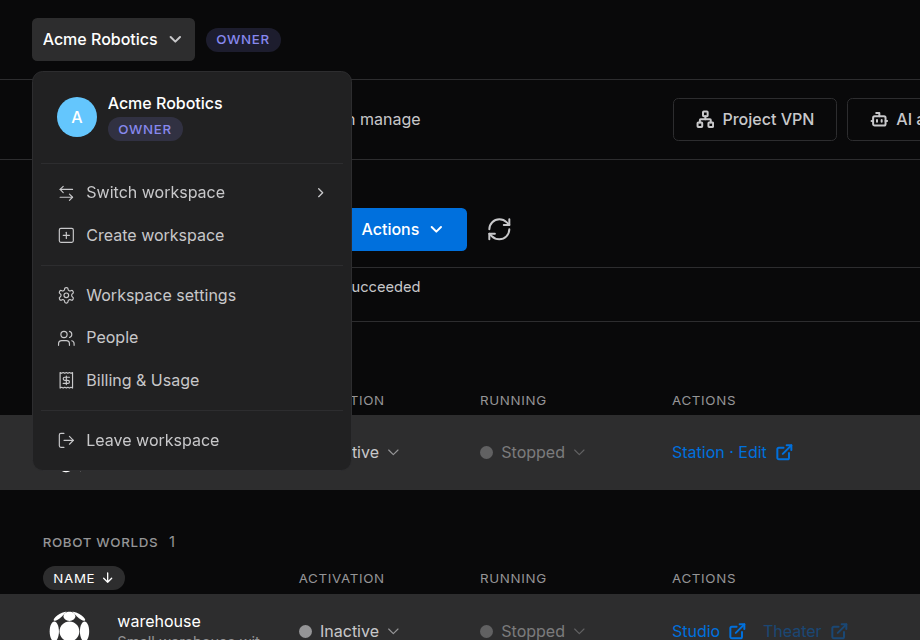
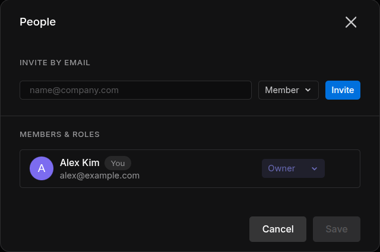
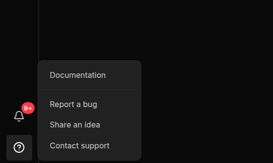

# Workspaces and People

A workspace is where a team works together in the Sodero Cloud portal. It holds the team's projects and people, the project libraries, and one plan with its credits ([Credits and Usage](../billing/index.md)). This page also covers the portal's navigation and help.

---

## The Workspace Menu

You can belong to several workspaces. The portal shows one at a time: its name is at the top left of the page, followed by a badge with your role. Click the name to open the workspace menu.

<figure markdown="span">
  { width="520" }
  <figcaption>The workspace menu of Acme Robotics</figcaption>
</figure>

The menu holds **Switch workspace**, **Create workspace**, **Workspace settings** (owner only), **People**, **Billing & Usage** ([Credits and Usage](../billing/index.md)) and **Leave workspace**. Everyone in the workspace can open **People** and **Billing & Usage**.

---

## Roles

Everyone in a workspace has one role: **Owner**, **Admin** or **Member**. A workspace has exactly one owner. Roles inside a project are separate: see [Project Access and Roles](../../projects/projects/index.md#4-project-access-and-roles).

| Action | Owner | Admin | Member |
| :--- | :--- | :--- | :--- |
| Invite people | Yes | As Member only | No |
| Remove people | Yes | Members only | No |
| Change roles, cancel invitations, change workspace settings, transfer ownership, delete the workspace | Yes | No | No |
| Create projects | Yes | Yes | When **Members can create projects** is on |
| Upload and delete files in project libraries | Yes | Yes | When **Members can manage the Library** is on |
| Manage every project in the workspace, **Empty all trash** | Yes | Yes | No: members have the role they were given in each project |

---

## 1. Create a Workspace

Open the workspace menu, choose **Create workspace**, enter a name of up to 30 characters and click **Create**. You are the owner of the new workspace, and the portal switches to it. Each workspace has its own plan and credits.

---

## 2. Switch Between Workspaces

Open the workspace menu, point at **Switch workspace** and click a workspace. A check mark shows the current one.

---

## 3. Invite People

Owners and admins invite people by email.

1. Open the workspace menu and choose **People**.
2. Under **Invite by email**, type the person's email address.
3. Choose the role: **Member** (the default) or **Admin**. Only the owner can invite admins.
4. Click **Invite**. The invitation is sent at once, without **Save**.

<figure markdown="span">
  { width="480" }
  <figcaption>The People dialog</figcaption>
</figure>

The person receives an email titled *Sodero workspace access: NAME* with a **Review access** button. An invitation is valid for 7 days; inviting the same address again replaces it. The owner sees open invitations in the list, marked **Pending**. If the dialog says *Couldn't send invitation. Try again.*, check the address; people who are already members cannot be invited.

!!! idea "**Tip:** To share one project only, invite the person to that project instead ([Share and Collaborate](../../projects/sharing/index.md))."

---

## 4. Join a Workspace from an Invitation

1. Sign in with the address the invitation was sent to. If you do not have an account yet, [create one](../sign_in/index.md#1-create-an-account) with that address first.
2. While you are signed in, open the invitation email and click **Review access**. The portal accepts the invitation at once.
3. Open the workspace menu, point at **Switch workspace** and choose the new workspace.

If the portal says *Invite has expired.*, ask for a new invitation. If it says *You're signed in with a different account. …*, sign out, sign in with the address the invitation was sent to and open the link again.

---

## 5. Manage Members and Invitations

Open the workspace menu and choose **People**. Under **Members & roles**, each person has a row with their name, email address and role.

- **Change a role** (owner): choose **Admin** or **Member** in the person's role menu.
- **Remove a person**: click **×** on their row. The owner can remove admins and members; admins can remove members.
- **Cancel an invitation** (owner): click **×** on the row of the pending invitation.

Click **Save** to apply the changes; **Cancel** discards them. Nobody can change their own role or remove themselves. Members see the list read-only.

---

## 6. Change Workspace Settings

Only the owner sees **Workspace settings** in the workspace menu.

| Section | What you can do |
| :--- | :--- |
| **Profile** | **Change color** sets the color behind the workspace's initial; **Remove** resets it. |
| **Basic info** | Edit **Name** (up to 30 characters) and click **Save** |
| **Permissions** | **Members can create projects**, and **Members can manage the Library** (upload and delete files in project libraries). Both are off by default. |

The color and the permissions are saved as soon as you change them. The dialog also holds [Transfer ownership](#7-transfer-ownership) and [Delete workspace](#8-delete-a-workspace).

---

## 7. Transfer Ownership

1. In **Workspace settings**, under **Ownership**, click **Transfer ownership**. The button stays disabled until someone else has joined the workspace.
2. Choose the new owner from the members and click **Next**.
3. Click **Transfer ownership** to confirm, then **Done**.

You become an admin.

---

## 8. Delete a Workspace

!!! error "**Deleting a workspace cannot be undone.** It permanently deletes every project, file and setting in the workspace, and everyone loses access."

Before you delete a workspace, deactivate its active Robot Systems and Robot Worlds and [download local copies](../../projects/projects/index.md#6-download-a-local-copy) of anything you want to keep.

1. In **Workspace settings**, under **Delete workspace**, click **Delete workspace**.
2. Type the workspace's exact name and click **Delete**. The portal opens your next workspace.

---

## 9. Leave a Workspace

Open the workspace menu, choose **Leave workspace** and click **Leave**. You lose access to the workspace and its projects, except projects you were invited to directly. To come back, someone must invite you again.

The owner cannot leave (*You're the only owner of this workspace. Transfer ownership before leaving.*): [transfer ownership](#7-transfer-ownership) first.

---

## Guest Projects

A guest project is a project you were invited to without being a member of its workspace. To see your guest projects, open the workspace menu, point at **Switch workspace** and choose **Guest projects (N)**, shown when you have some.

In this view, the top bar reads **Guest workspace**, and **Trash** and **Notifications** are hidden. In each project, you have the role you were invited with. Guest projects use the credits of the workspace they belong to.

---

## Notifications

Click the bell (**Notifications**) in the left navigation bar to see recent activity in the current workspace, such as projects created or trashed, people added or removed, and Robot Systems and Robot Worlds started, stopped or failed. A red badge counts the unread entries; **Read All** marks them read.

---

## The Left Navigation Bar

The left navigation bar is the column of icons on the left of every portal page.

| Item | Opens |
| :--- | :--- |
| Sodero logo, **Home** | Your **Recent** and **Favorites** projects, Robot Systems and Robot Worlds |
| **Projects** | The projects of the current workspace, or your guest projects |
| **Library** | My Library and the project libraries ([Libraries](../../projects/libraries/index.md)) |
| **Trash** | Items moved to Trash in this workspace ([Projects](../../projects/projects/index.md#7-move-to-trash-restore-and-delete)) |
| **Notifications**, **Help** | See below |
| Your avatar | **Account Settings**, **Sign-in & Security**, **Theme** and **Sign out** ([Sign In and Account](../sign_in/index.md)) |

---

## Help and Feedback

Click **Help** in the left navigation bar. The menu has **Documentation**, **Report a bug**, **Share an idea** and **Contact support**.

<figure markdown="span">
  { width="420" }
  <figcaption>The Help menu</figcaption>
</figure>

- **Report a bug** or **Share an idea**: fill in the fields, attach up to 10 PNG, JPG or PDF files (20 MB in total) if you like, and click **Submit report** or **Submit idea**. Sodero receives it with your name, email address and account ID, the page you were on and your browser details.
- **Contact support** opens the Sodero website in a new tab.

!!! warning "Do not include passwords, access keys or other sensitive information in the text or in the attachments."
