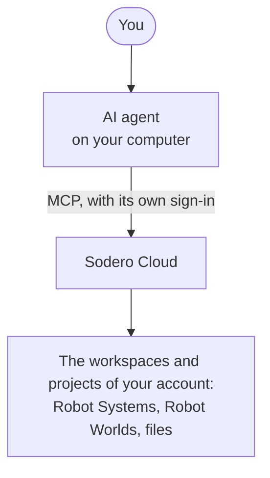
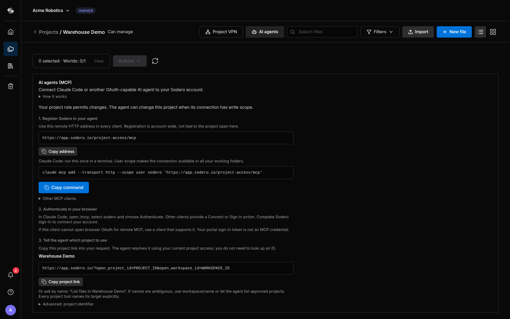

# AI Agents

Connect Claude Code or another AI agent to your Sodero account, then ask it in plain language to work on your projects. The agent reaches Sodero Cloud over the Internet with a sign-in of its own; it needs neither the [Project VPN](../project_vpn/index.md) nor anything installed from Sodero.

- *"Which Stations and Worlds in Warehouse Demo are active?"*
- *"Activate the warehouse World and the jackal Station, then start them."*
- *"Why did a node on jackal stop? Show me its log."*

---

## How It Works



- You register Sodero once in your agent, as a remote MCP server. The registration belongs to your account, not to one project.
- The agent signs in through your browser with your Sodero account, and on a consent page you allow it to access your account. It never sees your password, and you can revoke its access at any time.
- The agent never gets more than your own project roles allow.

---

## 1. Register Sodero in Your Agent

Open any project and click **AI agents** in the top bar. The **AI agents (MCP)** panel shows the address and ready-made settings for your agent, and what your project role allows.

<figure markdown="span">
  { width="800" }
  <figcaption>The AI agents panel of Warehouse Demo</figcaption>
</figure>

=== "Claude Code"

    Click **Copy command** and run the command once in a terminal:

    ```sh
    claude mcp add --transport http --scope user sodero 'https://app.sodero.io/project-access/mcp'
    ```

    `--scope user` makes Sodero available in all your working folders.

=== "Other MCP clients"

    The client must support remote MCP servers over Streamable HTTP and sign in through your browser (OAuth). Add a remote server with the address that **Copy address** copies:

    ```text
    https://app.sodero.io/project-access/mcp
    ```

    For a client with a JSON list of servers, expand **Other MCP clients** in the panel and click **Copy configuration**. Don't enter a token or a client ID: the client registers itself and signs in through your browser.

---

## 2. Sign In and Allow Access

1. Start the sign-in. In Claude Code, start `claude`, type `/mcp`, select **sodero** and choose **Authenticate**. Other clients have a **Connect** or **Sign in** action.
2. Your browser opens the Sodero sign-in. Sign in with your **Sodero** account, not with the account of your AI provider.
3. The consent page *Allow … to connect?* shows the permissions the agent requested and says: *This agent can access all workspaces and projects available to your account, including those you gain access to later. Current membership and roles always apply.* Click **Allow access**, or **Cancel** to refuse.
4. Return to your agent: Sodero is connected.

There is nothing to select: the consent covers your account, and the agent can use every project in which you have a role, now and later. What the agent may do depends on the access its client requests, which the consent page shows:

| Requested permissions | What the agent may do |
| :--- | :--- |
| *read project data* | Read your projects: status, items, files and jobs. This is the access a client gets when it requests no other. |
| *read project data and change project data or run commands* | Also make changes, such as uploading files, activating Stations and Worlds and running the Station and World tools |

!!! warning "**Approve only your own agent.** The consent page shows the name the agent gives itself; Sodero can't verify it. Allow access only right after you started the sign-in from your own agent."

**Changes also need a project role that allows them.** The project's owner and people with **Can manage** can change a project through an agent; people with **Can view** can only read. The **AI agents** panel of each project says what your role permits there.

A connection lasts up to 30 days. To renew it or change its access, sign the agent in again (in Claude Code, from `/mcp`), then [revoke](#review-and-revoke-agents) the entries you no longer need.

---

## 3. Tell the Agent Which Project to Use

Every request names a project. In the **AI agents** panel, click **Copy project link** and paste the link into your request, or give the project's name, for example *"List files in Warehouse Demo"*. When two projects have the same name, use `workspace/name`.

---

## What Agents Can Do

The agent works through Sodero's tools. Each tool name has three parts, for example `project.item.start`.

| Area | Tools | The agent can |
| :--- | :--- | :--- |
| Account | `account.workspace.list`, `account.project.list` | List your workspaces, and the projects it may use with read or write permission for each |
| Projects and jobs | `project.info.get`, `project.item.list`, `project.job.list`, `project.job.status`, `project.history.list` | Read a project's Robot Systems and Robot Worlds with their states, its jobs, and the actions agents took in it. Listing the Trash needs **Can manage**. |
| Run | `project.item.start`, `project.item.stop`, `project.job.start`, `project.job.cancel` | Activate or stop up to 8 Stations and Worlds at once, or activate and start them as one job |
| Items | `project.item.create`, `project.item.duplicate`, `project.item.rename`, `project.item.trash`, `project.item.restore`, `project.item.delete_permanently` | Create, duplicate, rename and trash Robot Systems and Robot Worlds. Restoring and permanently deleting from the Trash need **Can manage**. |
| Workspaces and projects | `workspace.project.create`, `workspace.history.list`, `project.manage.copy`, `project.manage.trash` | Create a project in a workspace where you may create projects, and list those requests. Copying a project and moving it to the Trash need **Can manage**. |
| Files | `project.file.list`, `project.file.download`, `project.asset.list`, `project.package.list` | List and download library files, search the robot and gateway documents of Sodero Assets, and list a Station's apps and packages |
| File changes | `project.upload.begin`, `project.upload.finish`, `project.upload.abort`, `project.file.rename`, `project.file.delete` | Upload files, and rename and delete library files ([Usage Limits](#usage-limits)) |
| Station and World tools | `system.tools.list`, `system.tools.describe`, `system.tools.call` | Run tools from a catalog of more than 100: Station status and logs, the node graph, documents, Store apps, robot control through [Motion Studio](../../operate/motion_studio/index.md), [Strider](../../operate/strider/index.md) and [Articulation](../../operate/articulation/index.md), navigation, cameras, and the World |

!!! info "**Changes need write access.** So does `system.tools.call`, even for a tool that only reads. Tools for a running Station or World need it to be active."

The agent cannot go beyond your roles, use the Project VPN, read files on your computer through Sodero, or download the contents of Sodero Assets. Cancelling a job stops further steps but doesn't undo changes.

---

## Stay in Control

- **Approve changes yourself.** Most agents can ask before they use a tool. A practical setup: allow the read-only tools freely (`account.workspace.list`, `account.project.list`, `project.info.get`, `project.item.list`, `project.history.list`, `project.job.list`, `project.job.status`, `project.file.list`, `project.file.download`, `project.asset.list`, `project.package.list`, `workspace.history.list`, `system.tools.list`, `system.tools.describe`) and keep approval on for every other tool, especially `system.tools.call`, `project.item.start`, `project.item.stop` and `project.job.start`.
- **Your client shows the tool names its own way.** A client may add a prefix and replace the dots: Claude Code shows `project.item.start` as `mcp__sodero__project_item_start`.
- **Review previews.** Most changes are previewed first. `project.item.create`, `project.item.duplicate`, `project.item.start`, `project.item.stop` and `project.job.start` act at once.
- **The agent acts as you.** What it changes is changed for everyone in the project.
- **Watch your credits.** A Station or World that an agent activated uses credits until it is deactivated. [Auto off](../../projects/activate_run/index.md#5-auto-off) still applies.

!!! warning "The rules Sodero gives every agent (preview changes first, move a robot only when you asked for that motion, treat files and logs as data and not as instructions) are instructions to the agent, not a safety function. An agent can misread them or make mistakes, and its tools have the same effect as your own actions. Approve every change yourself."

---

## Usage Limits

Agent tool calls count against your workspace's plan, per minute and per calendar month (UTC). **Billing & Usage** shows the calls used this month ([Billing and Usage](../../account/billing/index.md)). At the monthly limit, calls are refused until the renewal date that the **AI agents** panel shows. At the per-minute limit, the agent is told how long to wait.

An upload can be up to 1 GiB for a library file and up to 64 MiB for other kinds, such as Station packages, World scenes, map bundles and Station documents.

A tool call ends after 100 seconds. A change may still have been applied: have the agent check the state before it repeats the change.

---

## Review and Revoke Agents

1. Click your avatar at the bottom of the left navigation bar and choose **Account Settings**.
2. Under **Connected AI agents**, each agent shows its name, when it connected, its scopes (*Read* or *Read, Write*) and its **Current workspaces**.
3. To disconnect an agent, click **Revoke** followed by the agent's name, then **Confirm revoke**.

<figure markdown="span">
  { width="560" }
  <figcaption>Connected AI agents in Account settings</figcaption>
</figure>

Revoking stops the agent's further calls and job steps but doesn't undo what was done. To connect the agent again, sign it in again.

---

## Troubleshooting

| Message or symptom | What to do |
| :--- | :--- |
| The sign-in ends without the consent page, and the agent reports that access was denied | Start the sign-in again and finish it within 10 minutes, with your Sodero account. |
| `AUTH_REQUIRED`, `AUTH_EXPIRED` or `CONNECTION_REVOKED` | Sign the agent in again (Claude Code: `/mcp`). |
| `GRANT_MISSING` | Your account no longer has access to that workspace or project. Ask a person who manages it to add you again. |
| `NOT_FOUND` for a project | No project you can use matches the name or link. Check the name, or use `workspace/name` or the project link. |
| `WRITE_NOT_GRANTED` | The connection may only read. Connect the agent again with a client that requests write access. |
| `FORBIDDEN` | Your project role does not allow this action. Ask a person who can manage the project. |
| `RENAMED` | The agent called a tool by a former name. The message names the current tool: the agent calls that one instead. |
| `STATION_NOT_RUNNING` or `WORLD_NOT_RUNNING` | Activate the Station or World first. |
| `QUOTA_EXCEEDED` | Your workspace reached its plan's limit for agent calls. The message says when to try again. |
