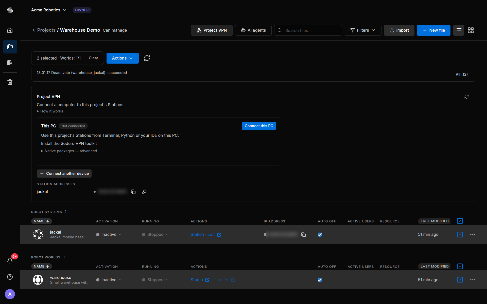

# Project VPN

The Project VPN connects your own computer to the Stations of a project, so you can use a Station's API from a terminal, your own scripts or your IDE. You approve every connection yourself, and a connection lasts at most 8 hours.

!!! info "**AI agents don't need the Project VPN.** To work on a project with Claude Code or another AI agent, see [AI Agents](../ai_agents/index.md)."

---

## What the Project VPN Reaches

A connection reaches one thing: the **Station API on port 8001** of each Station (Robot System) that was active when you connected. It does not reach other ports, Robot Worlds, Stations activated or restarted after you connected, or other projects. Your computer can call a Station, but a Station cannot connect to your computer.

The Project VPN doesn't start anything: activate the Stations you want to use first ([Activate and Run](../../projects/activate_run/index.md)). An active Station uses credits whether or not you are connected, and your tools' calls to it count as use for [Auto off](../../projects/activate_run/index.md#5-auto-off).

People who can manage the project (and, where enabled, editors) can connect computers and copy Station API keys. Others see *Your project role can't use the Project VPN. Ask the project owner for access.*

---

## 1. Install the Sodero VPN Toolkit

Install the toolkit once on each computer you want to connect. The portal calls the installed program **SoderoConnector**; your system lists it as **Sodero VPN**.

1. Open the project and click **Project VPN** in the top bar.
2. In the **This PC** row, under **Install the Sodero VPN toolkit**, the panel shows the install command for your computer. Copy it from there with **Copy**.
3. Run the command: on Linux or macOS in a terminal, as your normal user; on Windows in PowerShell. Approve the administrator prompt.

<figure markdown="span">
  { width="800" }
  <figcaption>The Project VPN panel of Warehouse Demo</figcaption>
</figure>

!!! info "**No install command?** If the panel shows no install command for your operating system, contact Sodero."

On Linux, the installer supports Debian and Ubuntu. On Windows, it also installs WireGuard for Windows, which Sodero VPN uses.

The toolkit also adds the `sodero` command and an optional status icon (**Sodero VPN** in your app menu, or `sodero tray`).

---

## 2. Connect This Computer

1. Activate at least one Station of the project. In **Project VPN**, click **Connect this PC**.
2. Your browser asks whether to open SoderoConnector. Allow it.
3. The connection window **Sodero — connect and approve** opens. If it asks you to sign in, sign in with your Sodero account in the browser tab that opens.
4. SoderoConnector shows the project, this computer's name and a six-character **Confirmation code**. Check the project, then approve as the prompts ask: type the code in SoderoConnector, or check that the portal shows the same code, tick the box and click **Approve this device**. When both sides ask, do both.
5. The row shows **Connected**. **Details** lists the Stations in this connection.

!!! warning "**Approve only a connection you started.** If a confirmation code appears that you didn't expect, cancel the request and don't approve it."

**Keep SoderoConnector running.** The connection stays open only while the program that made it runs: the connection window, or the terminal command. Once the portal says *The device manages this connection; the browser can close.*, you can close the portal tab.

---

## 3. Connect from a Terminal

You can connect without the portal page, for example on a computer you reach over SSH:

```sh
sodero login                                # once: sign in through your browser
sodero vpn connect --project PROJECT_ID     # stays in the foreground
```

1. `sodero login` opens the Sodero sign-in in your browser. Without a desktop, it prints the sign-in address and explains how to open it; finish within 5 minutes.
2. Replace `PROJECT_ID` with the project's identifier: in the project, open **AI agents** and expand **Advanced: project identifier**.
3. Answer `y` to *Connect this device to this project? [y/N]*, then type the **Confirmation code** that the command prints.
4. Leave the command running: `Ctrl+C` or closing the terminal disconnects. To keep the connection after you log out of SSH, run it inside `tmux` or `screen`.

`sodero vpn status` shows the connection, `sodero vpn disconnect` ends it, and `sodero --help` lists all commands.

!!! info "This `sodero` command belongs to the Sodero VPN toolkit. It is not the [sodero CLI](https://docs.sodero.io/stellar-x/latest/ssh_workspace/sodero_cli/) of the Stellar X SSH workspace."

---

## 4. Connect Another Device

**Connect another device** connects a different computer, for example a Linux machine without a desktop.

1. In **Project VPN**, click **Connect another device** and choose **CLI terminal** or **Desktop app**.
2. On the device, install the toolkit with the command shown in the row.
3. **CLI terminal:** run `sodero login` with the same Sodero account, then the connect command from the row, and keep it running. **Desktop app:** paste the link from the row into the device's browser.
4. Approve with the confirmation code, as in [step 2](#2-connect-this-computer).

The link works once, for one device, and only for 60 seconds; **Get a new link** makes a new one. The device must connect within 5 minutes.

---

## 5. Use a Station's Address and API Key

Each Station has its own address on the Project VPN. It stays the same when the Station is deactivated and activated again. You find it in **Station addresses** in the **Project VPN** panel and in the **IP address** column of the project's Robot Systems.

1. Connect this computer while the Station is active.
2. Click the copy icon next to the Station's address. It copies `http://ADDRESS:8001/`.
3. In **Station addresses**, click the key icon (*Copy the Station's API key*). The key is copied to your clipboard; it is never shown on screen.
4. In your tools, use the address and send the key with each request. The message that confirms the copy names the request header to use.

**The key changes each time the Station starts.** After the Station is deactivated and activated again, connect again and copy the new key.

!!! warning "**Keep the key private.** Treat it like a password: don't paste it into shared documents and don't commit it with your code."

---

## 6. Disconnect

Click **Disconnect** in the portal, **Disconnect and close window** in the connection window or **Disconnect VPN** in the status icon. In a terminal, press `Ctrl+C` where `sodero vpn connect` runs, or run `sodero vpn disconnect`.

A connection also ends on its own after 8 hours; about a minute after the program that holds it stops, for example when the computer sleeps; when all its Stations are deactivated or restarted; when you lose access to the project; or when your workspace has used its Project VPN time or data for the month. The toolkit never reconnects on its own.

---

## 7. Update or Uninstall the Toolkit

To update, run the install command from the panel with `update` in place of `install`, then connect again. To uninstall, run `sodero uninstall` (add `--purge` to also remove the VPN settings and the device identity), or on Windows uninstall **Sodero VPN** in **Installed apps**. WireGuard for Windows stays installed.

---

## Limits

| What | Limit |
| :--- | :--- |
| Open connections per person | 3, across all your projects |
| Connections per computer | 1 at a time |
| Length of a connection | 8 hours |
| Monthly use | Project VPN time and data per workspace, as your plan allows |

**Billing & Usage** shows the Project VPN time and data used this month ([Credits and Usage](../../account/billing/index.md)). When they are used up, new connections are refused until the counters reset.

---

## Troubleshooting

| Message or symptom | What to do |
| :--- | :--- |
| *No running Station is available for this project.* | Activate at least one Station, then connect. |
| *You have 3 connections, the maximum. …* | Disconnect a connection you don't need, here or in another project. |
| *No response from SoderoConnector. …* | Install or start the toolkit, allow your browser to open it, then click **Open SoderoConnector again**. If this computer is connected from another tab, click **Use here** on that connection. |
| A Station is missing, or *Some Stations stopped or changed. …* | The Station was activated or restarted after you connected. Disconnect, then connect again. |
| *A local network or another VPN already routes a target address.* | Disconnect the other VPN, or connect from a different network. |
| *Not signed in to Sodero …* or *Your Sodero sign-in has ended …* | Run `sodero login`. |
| A checksum, size or signature mismatch during installation | Don't work around it. Copy the command from the panel again; if the message comes back, report it to Sodero. |
