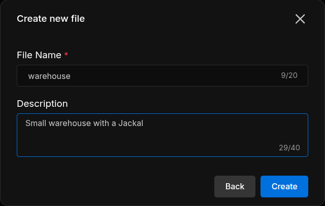
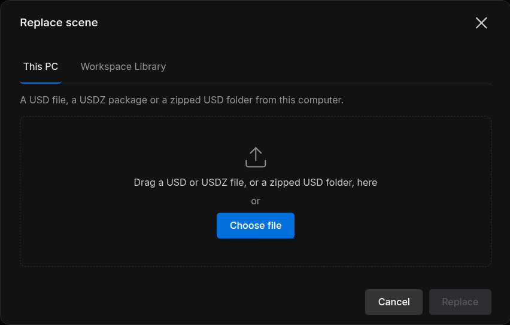
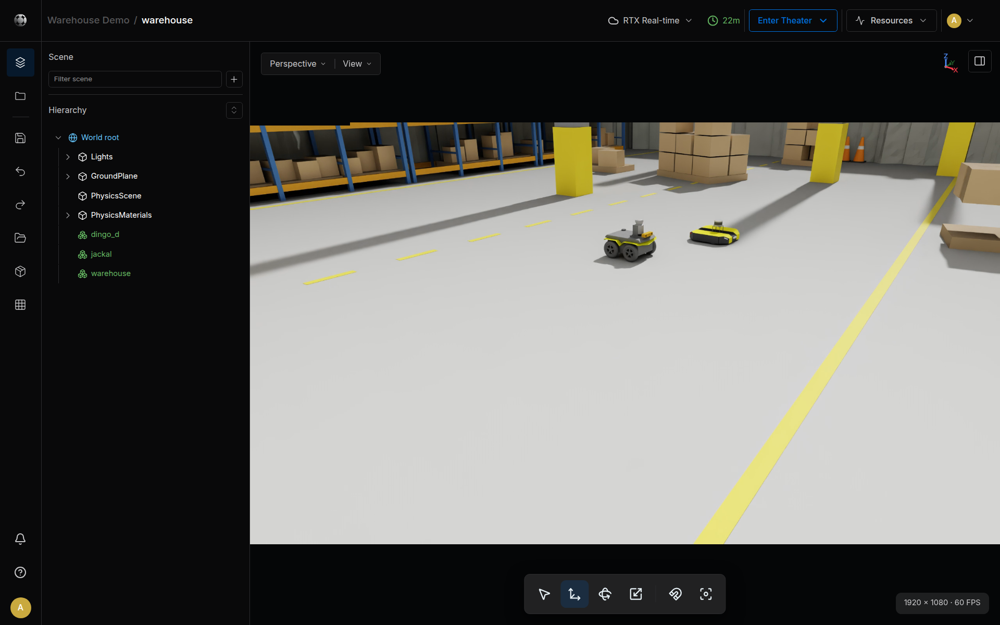

# Quick Start

Create a warehouse World, watch its simulation in Theater, then stop and deactivate it. This first exercise walks through the whole life of a World; driving its robots from a Station comes next ([Next: Connect a Robot System](#next-connect-a-robot-system)).

## Before You Start

- Sign in to [Sodero Cloud](https://app.sodero.io) with access to create a project and edit its files.
- In the workspace menu, open **Billing & Usage** and check the credits left and **Systems and Worlds running at once**.
- Download [jackal_warehouse.zip](files/jackal_warehouse.zip), the example scene with a Jackal and a Dingo. Keep the ZIP intact. It includes the accompanying Clearpath license notice.

**Credits:** an active World uses credits until you deactivate it, and Studio and Theater sessions can use credits while they are open. **Billing & Usage** shows your plan's rates ([Billing and Usage](../../account/billing/index.md)).

## Step 1: Create the Project and World { #step-1-create-the-project-and-world }

1. In **Projects**, click **+ Project**.
2. Enter `Warehouse Demo`, keep **Restricted**, and click **Create**.
3. In the project, click **New file**, choose **Robot World**, and click **Next**.
4. Enter `warehouse` as the **File Name**, then click **Create**.

<figure markdown="span">
  { width="480" }
  <figcaption>Naming the new Robot World</figcaption>
</figure>

The World appears as **Inactive**. Its **Studio** link opens the editor.

## Step 2: Import and Save the Scene { #step-2-import-and-save-the-scene }

1. Click **Studio** on the World row. Choose **RTX Real-time** or **WebGPU**, then click **Open Cosmic Studio**. Studio opens in a new tab. Keep the Sodero Cloud tab open while you work: Studio uses it to keep you signed in and to read library files.
2. Open the logo menu and choose **World › Replace scene…**.
3. On **This PC**, select `jackal_warehouse.zip`, click **Replace**, and confirm replacement.

    <figure markdown="span">
      { width="520" }
      <figcaption>The Replace scene dialog</figcaption>
    </figure>

4. Check that the **Hierarchy** shows `dingo_d`, `jackal` and `warehouse`.
5. Click **Save now** in the left rail and wait for *Saved just now*.

<figure markdown="span">
  { width="900" }
  <figcaption>The example scene in Studio. It contains a Jackal and a Dingo.</figcaption>
</figure>

Choose **Back to Sodero Cloud** from the logo menu to close Studio.

## Step 3: Activate the World { #step-3-activate-the-world }

On the project page, set the World's **Activation** to **Active**. Wait until **Activating** changes to **Active**. Activation prepares the environment; it does not start the simulation.

## Step 4: View and Run the Simulation { #step-4-view-and-run-the-simulation }

1. Click **Theater**, choose a rendering mode, and click **Open Cosmic Theater**.
2. Wait for *Ready*.
3. On the project page, set the World's **Running** state to **Running**. You can also click **Start Theater** in Theater when you control it: the first person with edit access who opened Theater controls **Start Theater** and **Stop Theater** ([Start and Stop](../../worlds/theater/index.md#start-and-stop)).
4. Select **jackal** in **Scene assets**; double-click the row to bring the camera to it.

The readout at the bottom of the viewport shows **FPS**, the rate at which your view is drawn, and **Physics RTF**, the real-time factor of the simulation: simulated time divided by wall-clock time. Near 1.00, the simulation keeps up with real time. The robots stay where they are until a Robot System drives them.

## Step 5: Stop and End the Session { #step-5-stop-and-end-the-session }

1. Set the World's **Running** state to **Stopped**. Stopping resets its pose and clock; it is not a pause that preserves progress.
2. Set **Activation** to **Inactive** and wait for deactivation to finish.
3. Close the Theater tab. In **Billing & Usage**, a green dot under **Recent runs** marks anything that is still active.

A stopped World stays active and keeps using credits until you deactivate it. Deactivating a World does not deactivate the project's Robot Systems: deactivate each file you activated.

## Next: Connect a Robot System { #next-connect-a-robot-system }

To drive the Jackal of this World, add a Robot System to the same project. Download its two documents first: [jackal.gw](files/jackal.gw), the simulation gateway document, and [jackal.sddm](files/jackal.sddm), the mobile robot document.

1. In the project, create a Robot System named `jackal` and open it with **Station · Edit** ([Create a File](../../projects/files/index.md#1-create-a-file)). In the **Store**, install `sodero.actuator_gateway`, `sodero.mlc` and `sodero.strider` ([Apps and Packages](../../station/apps/index.md)).
2. Add a **Gateway** node that runs `sodero.actuator_gateway` and name it `sodero.actuator_gateway.jackal` ([Add a Node](../../station/graph/index.md#1-add-a-node)). In its inspector, click **Upload** under **Gateway project** and import `jackal.gw` ([Documents and Settings](../../station/documents/index.md)).
3. Under the gateway document, set **Robot name** to `jackal`, the name of the robot's prim in the World. `jackal.gw` already fills it in ([Name the Robot](../../station/world_connection/index.md#2-name-the-robot)).
4. Add a **Controller** node that runs `sodero.mlc` and name it `sodero.mlc.jackal`. Click **Upload** under **document (robot)** and import `jackal.sddm`. Connect the node's `servo_link` port to the gateway ([Connect Ports](../../station/graph/index.md#3-connect-ports)).
5. Add `sodero.strider` and connect its `mobile_base` port to `sodero.mlc.jackal` ([Set Up the Nodes](../../operate/strider/index.md#1-set-up-the-nodes)).
6. Activate and run the World again (Steps 3 and 4). In the Station, click **Go live**, then **Start all nodes** ([Start and Monitor Nodes](../../station/run/index.md)). Right-click `sodero.strider`, open Strider and drive the Jackal ([Strider](../../operate/strider/index.md)).

For other robots, use documents made for this Station release, such as those in **Sodero Assets** ([Compatibility](../../reference/compatibility/index.md)).
