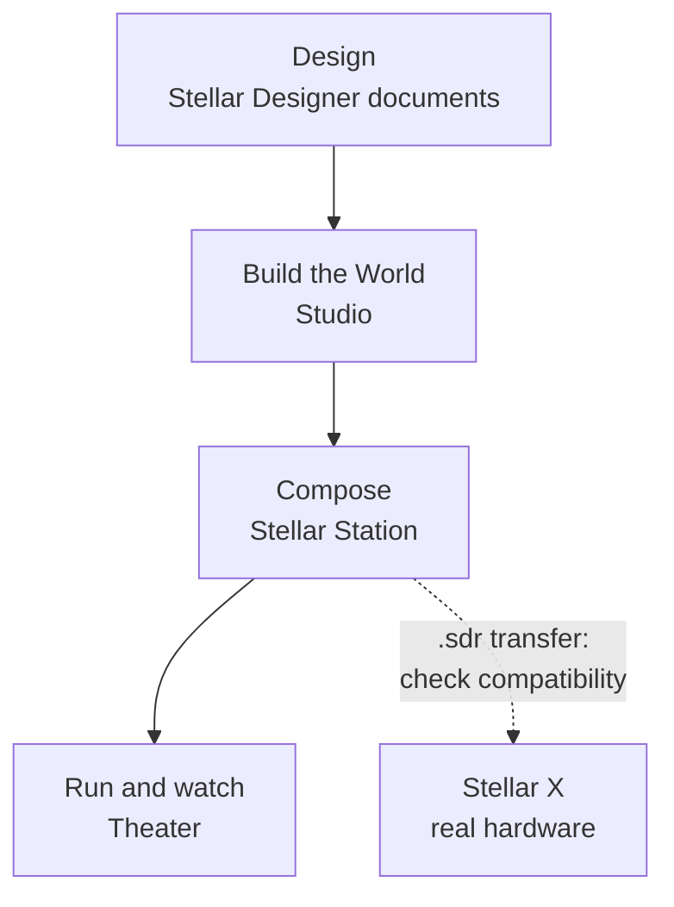

# What Is Sodero Cloud

Sodero Cloud runs the Sodero robot platform in your browser. You build a simulated place for your robots, compose their robot systems in Stellar Station, run both in the cloud and watch them live, with nothing to install.

---

## Projects, Worlds and Systems

Everything you build lives in a **project** in the Sodero Cloud portal at `https://app.sodero.io`. A project holds two kinds of file:

- **Robot Worlds**: simulated places with your robots in them, for example a warehouse with a mobile base.
- **Robot Systems**: the robot software. Each Robot System is one **Stellar Station**.

The Robot Systems of a project drive the robots in the project's active Robot World.

---

## Core Ideas

**Studio builds the World, the cloud simulates it, Theater shows it.** You build a Robot World in **Studio**, the World editor: bring in a scene, add robots and environments from Sodero Assets, arrange them and save. When you activate the World, Sodero Cloud simulates it. **Theater** shows the running World live in your browser, with the robots and the Stations that drive them.

**Each Robot System is a Stellar Station.** It uses a graph of nodes and Stellar Designer document types (`.gw`, `.sdd`, `.sddm`, `.sdda`). These concepts also apply to Stellar X. The available apps, menus and accepted document versions depend on the installed release ([Compatibility](../../reference/compatibility/index.md)).

**The World connects by itself.** The simulation gateways of every active Station in the project connect to the project's active World automatically. There is no Isaac Sim to install and no network to set up: each gateway finds its robot in the World by name.

---

## From Design to a Running Robot

**Design.** Describe each robot and its gateway in Stellar Designer documents: kinematics, wheels, limits and actuator mapping. Sodero also publishes ready-made documents in **Sodero Assets**.

**Build the World.** In [Studio](../../worlds/studio/index.md), bring in a scene or Sodero Assets, arrange them and save. The World must follow a few rules so that Stations can drive its robots ([Prepare a World for Simulation](../../worlds/prepare_world/index.md)).

**Compose.** In the [Station](../../station/overview/index.md), add gateways and controllers as nodes, connect their ports and load their documents.

**Run and watch.** On the project page, activate the World and its Robot Systems and run them ([Activate and Run](../../projects/activate_run/index.md)). Watch the World in [Theater](../../worlds/theater/index.md) and operate the robots from the controller UIs ([Strider](../../operate/strider/index.md)).

---

## Sodero Cloud and Stellar X

**Stellar X** is Sodero's motion controller for real robots. It runs the same Stellar Station on the robot, with EtherCAT for real drives ([Stellar X manual](https://docs.sodero.io/stellar-x/latest/)).

| | Sodero Cloud | Stellar X |
| :--- | :--- | :--- |
| Where the Station runs | In the cloud, one per Robot System | On the Stellar X controller |
| What it drives | Robots simulated in the project's Robot World | Real drives through EtherCAT, or a robot in NVIDIA Isaac Sim on your PC |
| Simulation | Built in: Studio, the cloud simulation and Theater | Isaac Sim with the Isaac Bridge extension, on your PC |
| Save a Station to a file | **Download local copy** (`.sdr`) | **Export SDR** |
| Load a Station from a file | **Import** (`.sdr`) | **Load SDR** |

**Move a Robot System with an `.sdr` file.** Check the destination's Station release and apps first ([Move Robot Systems Between Stellar X and Sodero Cloud](../../projects/files/index.md#move-robot-systems-between-stellar-x-and-sodero-cloud)).

**Adapt the design for real hardware.** Controllers send commands through a gateway. Reusing a controller design on Stellar X requires a compatible release, a hardware gateway, and checks of actuator mapping, calibration, limits and sensors. Follow the device manual before enabling motion.

!!! idea "**Tip:** Build and test the robot system in Sodero Cloud first. When it behaves as it should in the World, take it to the real robot on Stellar X."

---

## What You Need

| You need | Details |
| :--- | :--- |
| A browser | Everything runs in the browser: the portal, Studio, the Station, the controller UIs and Theater. |
| A Sodero account | Sign in at `https://app.sodero.io` ([Sign In and Account](../../account/sign_in/index.md)). |
| Credits | Active Robot Systems and Robot Worlds use your workspace's credits ([Billing and Usage](../../account/billing/index.md)). |
| Rendering | **WebGPU** needs support from your browser, operating system and GPU. **RTX Real-time** renders in the cloud and streams the view to your device. See [Compatibility](../../reference/compatibility/index.md). |

---

## Find Your Way in the Portal

### The Left Navigation Bar

The left navigation bar is the column of icons on the left of every portal page.

| Item | Opens |
| :--- | :--- |
| Sodero logo, **Home** | Your **Recent** and **Favorites** projects, Robot Systems and Robot Worlds |
| **Projects** | The projects of the current workspace, or your guest projects ([Projects](../../projects/projects/index.md)) |
| **Library** | The libraries of the projects in the current workspace ([Libraries](../../projects/libraries/index.md)) |
| **Trash** | Items moved to Trash in this workspace ([Projects](../../projects/projects/index.md#7-move-to-trash-restore-and-delete)) |
| **Notifications**, **Help** | See below |
| Your avatar | **Account Settings**, **Sign-in & Security**, **Theme** and **Sign out** ([Sign In and Account](../../account/sign_in/index.md)) |

The name of the current workspace is at the top left of the page; click it for the workspace menu ([Workspaces and People](../../account/workspaces/index.md)).

### Notifications

Click the bell (**Notifications**) in the left navigation bar to see recent activity in the current workspace, such as projects created or trashed, people added or removed, and Robot Systems and Robot Worlds started, stopped or failed. A red badge counts the unread entries; **Read All** marks them read.

### Help and Feedback

Click **Help** in the left navigation bar. The menu has **Documentation**, **Report a bug**, **Share an idea** and **Contact support**.

<figure markdown="span">
  { width="420" }
  <figcaption>The Help menu</figcaption>
</figure>

- **Report a bug** or **Share an idea**: fill in the fields, attach up to 10 PNG, JPG or PDF files (20 MB in total) if you like, and click **Submit report** or **Submit idea**. Sodero receives it with your name, email address and account ID, the page you were on and your browser details.
- **Contact support** opens the Sodero website in a new tab.

!!! warning "Do not include passwords, access keys or other sensitive information in the text or in the attachments."

---

Continue with [Key Concepts](../key_concepts/index.md), then try the [Quick Start](../quick_start/index.md).
