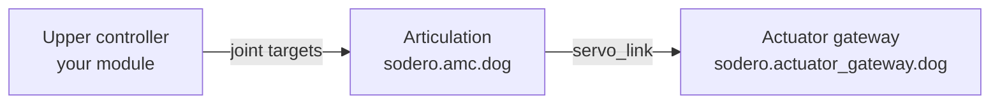

# Articulation

The **Articulation** controller drives an articulated robot joint by joint: legged robots, humanoids, grippers, pan-tilt heads, or any set of joints that receives joint targets. Unlike the manipulator controller, it uses no arm kinematics (no DH parameters, no Cartesian motions). It bounds and forwards the joint targets of an upper controller, such as a walking policy in your own module, and its **Articulation** UI lets you jog the joints by hand.

| Item | Value |
| :--- | :--- |
| Node | `sodero.amc.<name>` |
| Document | `.sdda`, made in Stellar Designer ([Articulated Robot](https://docs.sodero.io/stellar-x/latest/tutorials/stellar_designer/articulation/) in the Stellar X manual) |
| Joints | 1 to 64, driven by one actuator gateway |
| Units | rad, rad/s, N·m |

---

## 1. The Document

An `.sdda` document lists the joints and how the gateway's actuators drive them.

| Per joint | Meaning |
| :--- | :--- |
| Name | Joint name |
| Position min / max | Range of motion; targets outside it are refused |
| Velocity max | Velocity limit, also the reference for the jog speed |
| Torque max | Torque limit; the controller clamps its total output to it |
| Offset (optional) | Joint position at actuator position zero |
| Kp, Kd (optional) | Stiffness and damping, for PD torque control |

- **Drive mode.** In `position` mode, the controller bounds the joint targets and the drive follows them with its own position control. In `pd_torque` mode, the controller computes a PD torque from Kp and Kd and sends torque commands.
- **Actuator mapping.** One actuator can move several joints, and several actuators can move one joint, as long as the mapping can be inverted.
- **Watchdogs.** The controller switches the servo off and latches a stop when the gateway's feedback is older than 100 ms, or when no new target arrives for 200 ms (the defaults). Click **Clear stop**, then **Servo on**. Reconnecting never switches the servo on by itself.

---

## 2. Set Up the Nodes

1. In the Station's **Store**, install `sodero.actuator_gateway` and `sodero.amc` ([Apps and Packages](../../station/apps/index.md)).
2. Add the gateway and the Articulation controller, and connect the controller's `servo_link` to the gateway ([Build the Graph](../../station/graph/index.md)).
3. Upload the gateway's `.gw` and the controller's `.sdda` document ([Documents and Settings](../../station/documents/index.md)).
4. Set the gateway's **Robot name** and check the actuator mapping ([Connect to the World](../../station/world_connection/index.md)).
5. Run the World, go live, then start the gateway, the controller and the program that sends joint targets, in this order ([Start and Monitor Nodes](../../station/run/index.md)).

---

## 3. Open the Articulation UI

On the Live page, right-click the running `sodero.amc.<name>` node and choose **Open …** ([Start and Monitor Nodes](../../station/run/index.md#3-start-restart-or-stop-one-node)). The Articulation UI opens in a new tab. If its session expires, open it again from the node.

| Area | Contents |
| :--- | :--- |
| Left rail | **Joints** (joint monitor), **Constraints** (the configured limits), **Set origin** |
| Top bar | **Servo on**, **Servo off**, **Stop** (switches the servo off and latches a stop), **Clear stop** (releases it while the servo is off), the control mode, and the button that opens the **Joint control** panel |
| Status strip | **Servo** on or off, **Feedback** age in milliseconds, **Safety** (*Ready* or the reason for a stop) |
| **Controller** | The Articulation node this window controls |
| **Joint monitor** | Per joint: position, velocity, effort and target |

!!! warning "**Stop the upper controller first.** Pause or stop the program that sends joint targets, such as a walking policy, before you jog the joints by hand."

---

## 4. Jog Joints

1. Open the **Joint control** panel with the button at the right of the top bar.
2. Click **Servo on**.
3. Under **Joint jog**, set the **Speed**: 1–100 % of each joint's velocity limit, 10 % by default.
4. Hold **−** or **+** next to a joint. The joint moves while you hold the button and holds its position when you release it. A jog button also switches the servo on if it is off.

Leaving the window, switching to another tab or losing the connection switches the servo off.

---

## 5. Send Joint Targets

Under **Joint targets**:

1. Click **Use measured positions** to copy the current positions into the target fields.
2. Change the targets of the joints you want to move.
3. Click **Stream targets**. The controller follows the targets while the stream runs; **Stop target stream** ends it and switches the servo off.

---

## 6. Set the Origin

**Set origin** gives the current position of a joint a known angle, for example after an encoder was replaced on a real robot. Robots in a Robot World do not support it. For real robots, see [Articulation](https://docs.sodero.io/stellar-x/latest/controllers/articulation/) in the Stellar X manual.

---

## 7. Control from Programs

| From | How |
| :--- | :--- |
| A walking robot | Your module runs the walking policy and sends joint targets to the Articulation node |
| AI agents | The `station.articulation` tools: state, servo, joint targets, stops and fault reset ([AI Agents](../../connect/ai_agents/index.md)) |
| Your own tools | The Station API, through the [Project VPN](../../connect/project_vpn/index.md) |
