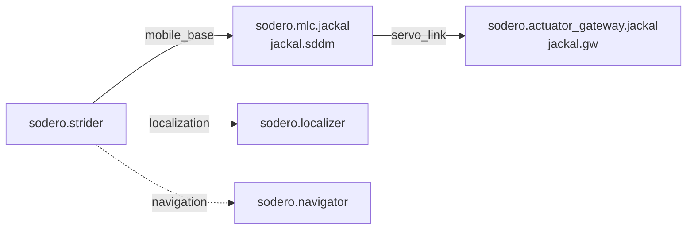

# Strider

!!! info "Availability"
    These instructions apply when the required app is installed, its nodes run, and its operator UI is available. Check [Compatibility](../../reference/compatibility/index.md) first.

**Strider** is the operator UI for wheeled mobile bases. With it you jog the base, watch its state and odometry, and send navigation goals. It works with every drive type that a mobile robot document (`.sddm`) can describe: differential drive, skid steer 4WD, mecanum 4WD, swerve 4WD and Ackermann.

---

## How Strider Works in a Station

Two nodes are involved:

| Node | Role |
| :--- | :--- |
| `sodero.mlc.<name>` | The mobile base controller. It turns body velocities into wheel commands for its gateway, integrates odometry, and keeps the speed and acceleration limits of its `.sddm` document. It has no UI of its own. |
| `sodero.strider` | Strider. It drives what its ports are connected to: `mobile_base` to the base controller (driving and status), `localization` to the localizer (the robot's position on the map) and `navigation` to the navigator (goals). |

---

## 1. Set Up the Nodes

1. Check that `sodero.actuator_gateway` and `sodero.mlc` are available in the Store, and select them. For Strider, also select `sodero.strider`.
2. Add the gateway and controller nodes, then connect the controller’s `servo_link` to the gateway. For Strider, connect its `mobile_base` to the base controller.
3. Go live and wait for app installation to finish. Keep the nodes stopped.
4. Upload the gateway’s `.gw` and the controller’s `.sddm` document. Reopen each node and confirm the selected document ([Documents and Settings](../../station/documents/index.md)).
5. Check the robot name and mapping, run the World, then start the gateway, controller and any dependent app.

---

## 2. Open Strider

If the running node provides a UI link or an **Open …** action, use it to open the app. If neither is available, check the installed app and supported version before continuing. If the session expires, reopen the UI from Station.

---

## 3. Screen Layout

The left rail has three pages: **Status**, **Drive** and **Navigation**. The top bar holds the actions of the current page and, on every page:

| Item | Description |
| :--- | :--- |
| Readiness pill | The current state in one line, for example *Manual Drive Ready* or *Servo Off*. Click it for the checks: Connection, Mobile base, Servo, Localization, Navigation. |
| **System Log** | Events of this browser session, filtered by System, Drive, Navigation and Localization |
| **Motion Alarm** | Active alarms and recent errors |
| **E-STOP** | Software stop: cancels driving and the navigation goal and sets the wheel speeds to zero at once, with the servo still on. It latches until **Clear E-Stop**, which switches the base to **Idle**. |
| Units | `m / m/s / deg` or `m / m/s / rad`, for display only |

### Status Page

| Card | Contents |
| :--- | :--- |
| **Trajectory (Odometry View)** | The path driven since the last mode change, in the odometry frame |
| **Operation Status** | Ready, moving or idle, servo on or off, and faults or stops |
| **Base Status (Odometry)** | Mode, and X, Y, Theta, VX, VY, WZ |
| **Control Node Health** | Whether the base, the localizer and the navigator are reachable |
| **Drive Unit Status** | The drive template and, per wheel, the servo state, position, velocity and target velocity |
| **Recent Events** | The latest events; **View All** opens the **System Log** |

!!! info "**Watchdog Tripped** while the base stands still in **Twist** mode is normal: no velocity command is arriving, so the base holds zero speed."

---

## 4. Jog the Base

On the **Drive** page:

1. Under **Drive Mode**, click **Twist**.
2. Under **Servo / Safety**, switch **Servo On**. The readiness pill shows *Manual Drive Ready*.
3. Set the **Linear Velocity Limit** (0.2 m/s by default, at most 0.8 m/s) and the **Angular Velocity Limit**.
4. Press and hold a pad button: **Forward (W)**, **Backward (S)**, **Turn Left (A)** or **Turn Right (D)**. The base moves while you hold the button and stops when you release it; **Stop (Space)** stops it too.
5. To drive with the keyboard, switch on **Live** in **Manual Drive**, then use **W**, **S**, **A**, **D** and **Space**. Commands stop when the window loses focus.
6. When you are done, switch the servo off and click **Idle**.

| Control | Meaning |
| :--- | :--- |
| **Drive Mode** | **Idle**: no motion. **Twist**: body velocity commands, for jogging and navigation. **Wheel**: direct wheel speeds (advanced). **EMG**: stops the base like **E-STOP**, without latching. |
| **Servo On** / **Off** | Enables or disables the drives. **Fault Reset** clears drive faults; then switch the servo off and on again. |
| **Stop Motion** | Stops manual driving and cancels a navigation goal |

!!! warning "Manual commands take priority over navigation: jogging during a navigation goal overrides the navigator and can end the goal. A manual command expires after about a second, so the base stops if the connection drops. A navigation goal does not expire: cancel it with **Stop Motion**, **Cancel** or **E-STOP**."

**Show** next to **Advanced Controls** opens **Wheel Direct** (each wheel's speed in **Wheel** mode), **Preview Command** (the wheel speeds a body velocity would give, without moving), **Steering Origin**, **Calibration** and **Record / Replay**.

---

## 5. Navigation Page

The **Navigation** page works when Strider's `localization` and `navigation` ports are connected to a running localizer and navigator, and the Station has a map bundle ([Documents and Settings](../../station/documents/index.md#2-kinds-of-documents)).

| Card | Contents |
| :--- | :--- |
| **Navigation Map (Occupancy Grid)** | The map, the robot, the planned path and the goal. Drag to pan, scroll to zoom. |
| **Localization Status** | Healthy, Degraded, Initializing, Relocalizing, Lost or Uninitialized. **Global localization** searches the whole map. |
| **Mission Status**, **Current Pose (Map)**, **Goal Pose**, **Route Summary** | The goal, where the robot is and how far it still has to go |
| **Navigator** | The navigator's state and a **Speed Limit** slider (10–100 %) |
| **Navigation Controls** | **Set Initial Pose**, **Set Goal**, **Clear Goal**, **Pause**, **Resume**, **Cancel** |

### Set the Initial Pose

If the localization status is not **Healthy**:

1. Click **Set Initial Pose**.
2. Press on the map where the robot stands and drag in the direction it faces.
3. Click **Set initial pose** (or **Relocalize here** when a pose was set before).

### Send a Goal

1. Make sure the base is in **Twist** with the servo on: the readiness pill shows *Navigation Ready*.
2. Click **Set Goal**, press on the map where the robot should go and drag in the direction it should face.
3. Click **Start Navigation**. The planned path appears.

**Pause** cancels the goal and keeps it; **Resume** sends it again. **Cancel** stops navigation.

---

## 6. Control Strider from Programs

- **AI agents** drive the base with the `strider` tools: state, servo, velocities, stops and fault reset ([AI Agents](../../connect/ai_agents/index.md)).
- **Your own module** on the Station connects to the base controller's `mobile_base` port ([Apps and Packages](../../station/apps/index.md)).
- **Your own tools** on your computer reach the Station API through the [Project VPN](../../connect/project_vpn/index.md).
