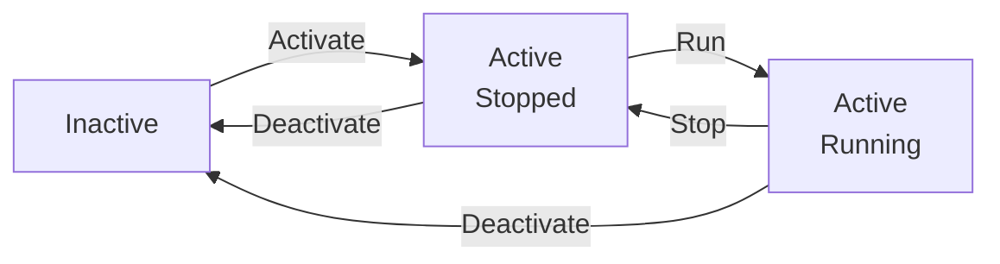
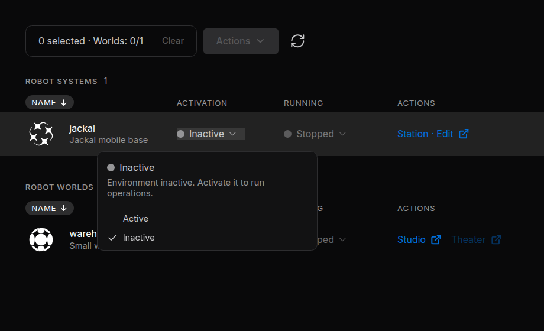
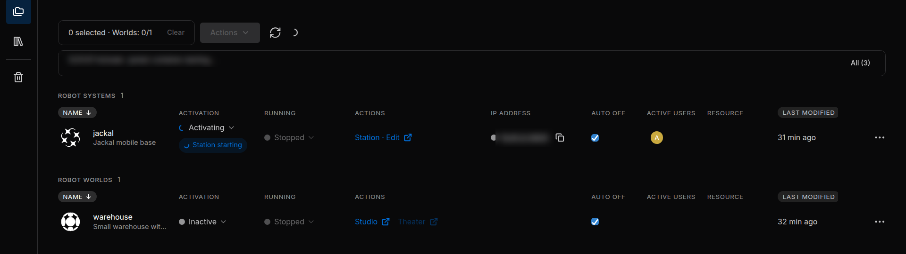
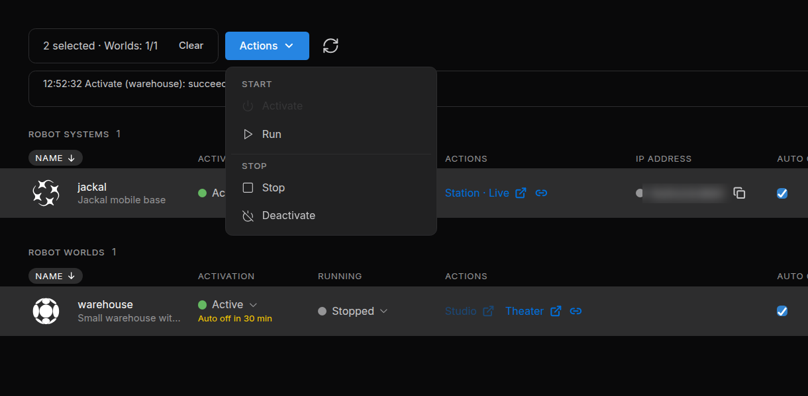
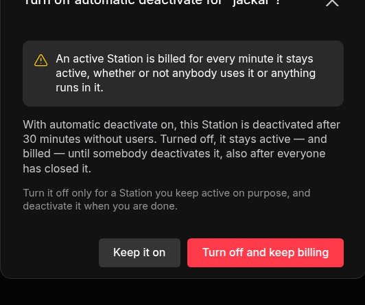

# Activate and Run

Each Robot System and Robot World has its own cloud environment. **Activate** prepares it, **Run** starts its work, **Stop** ends the work, and **Deactivate** releases the environment. Stopping a World resets its pose and clock; it is not a pause that preserves progress.

!!! warning "**An active environment uses credits.** It is billed for every minute it is active, whether or not anybody uses it or anything runs in it. Stop does not end that; Deactivate does ([Credits and Usage](../../account/billing/index.md))."

---

## How It Works

Two columns of the project page control a file: **Activation** brings its environment up or down, and **Running** starts or stops what runs in it.

| Action | Robot System | Robot World | Credits |
| :--- | :--- | :--- | :--- |
| **Activate** | Starts the environment and restores the Station's saved data and apps. No node starts. | Starts the environment and loads the World's scene. The simulation does not play yet. | Use begins |
| **Run** | Starts every saved node, like **Start all nodes** in the Station | Plays the simulation | No change |
| **Stop** | Stops the nodes | Stops the simulation and resets the World's pose and clock | Use goes on |
| **Deactivate** | Stops the nodes, saves the Station's data, then tears the environment down | Tears the environment down | Use ends |

A typical session: select the Robot World and the Robot Systems that drive it, choose **Actions › Activate**, then **Actions › Run**. Watch the World in **Theater** and work with the robots in **Station · Live**. **Stop** when you pause, and **Deactivate** when you are done.

---

## 1. Activate and Deactivate

Click the state in a file's **Activation** column and choose **Active** to activate the file, or **Inactive** to deactivate it.

<figure markdown="span">
  { width="520" }
  <figcaption>The Activation menu of the Robot System jackal</figcaption>
</figure>

While the file activates, it shows **Activating** and the current step, for example *Station starting* or *World starting*. It is usually **Active** after about a minute.

<figure markdown="span">
  { width="900" }
  <figcaption>jackal activating: Station starting</figcaption>
</figure>

| State | Meaning |
| :--- | :--- |
| **Inactive** | Not active. Uses no credits. |
| **Activating** | Coming up. You can already choose **Inactive**. |
| **Active** | Up, and using credits |
| **Deactivating** | Going down. This cannot be interrupted. |
| **Error** | The activation failed, or the environment stopped unexpectedly. Open the menu for the reason. |

- After an **Error**, choose **Active** to try again, or select the file and choose **Actions › Deactivate** to release it.
- Only one Robot World per project can be active ([How Robot Worlds and Robot Systems Work Together](../files/index.md#4-how-robot-worlds-and-robot-systems-work-together)).

A chip next to the column shows each result, for example *Environment active* or *Failed*. Click *Failed* to read the message.

While a request runs, the menu also offers **Cancel workflow (no rollback)**. It stops the request but undoes nothing: an environment that already came up stays active, and keeps using credits, until you deactivate it.

---

## 2. Run and Stop

Once a file is **Active**, click the state in its **Running** column and choose **Running** or **Stopped**.

A World without a scene cannot run: build it in [Studio](../../worlds/studio/index.md) first. **Stopped** keeps the file active, so it keeps using credits.

| State | Meaning |
| :--- | :--- |
| **Running** | Operations are running |
| **Partly running** | Robot System only: some nodes did not start. A **Failed** badge and a banner above the tables explain why. Open **Station · Live** and read that node's log ([Run and Monitor](../../station/run/index.md)). |
| **Stopped** | Operations are stopped. Also shown while the file is not active. |
| **Error** | The World reported an error |
| **-** | The state cannot be read. People with **Can view** always see **-**. |

---

## 3. Open a File

The **Actions** column holds the links that open a file in a new browser tab. A dimmed link tells you on hover why it cannot open now.

| Link | Opens when | Opens |
| :--- | :--- | :--- |
| **Station · Edit** | The Robot System is not active | The Station editor. Its **Go live** button activates the Station. |
| **Station · Live** | The Robot System is **Active** | The running Station ([Stellar Station](../../station/overview/index.md)) |
| **Studio** | The Robot World is **Inactive** or in **Error** | The World editor ([Studio](../../worlds/studio/index.md)) |
| **Theater** | The Robot World is **Active** | The live view of the World ([Theater](../../worlds/theater/index.md)) |

Opening a file never starts nodes or plays a World. To edit an active World in Studio, deactivate it first.

### Choose Rendering Mode

Before Studio or Theater opens, the portal asks how to draw the World on your screen.

| Mode | Draws the World |
| :--- | :--- |
| **RTX Real-time** | On a cloud GPU, with advanced materials and lighting. Each Studio or Theater tab in this mode runs its own cloud renderer, which uses credits. |
| **WebGPU** | In your browser, on this device's GPU. Performance depends on your hardware. |

Pick a mode and click **Open Cosmic Studio** or **Open Cosmic Theater**. **Remember on this device.** preselects your choice next time. The mode only changes how you see the World, not the simulation, and each person chooses their own.

---

## 4. Several Files at Once

Editors and managers can handle several files together from the selection bar.

1. Select the files: click their rows, or tick the box at the end of a row. A selection holds any number of Robot Systems and at most one Robot World.
2. Open **Actions** and choose an item.
3. Follow the progress in the files' chips and in the log under the selection bar.

<figure markdown="span">
  { width="760" }
  <figcaption>jackal and warehouse selected, with the Actions menu open</figcaption>
</figure>

The menu offers **Activate**, **Run**, **Stop** and **Deactivate**, which act on every selected file as [How It Works](#how-it-works) describes.

- There is no single step that activates and runs: choose **Run** once the files are active.
- The files are handled independently: if one fails, the others carry on.
- Sodero carries on with a request after you close the page. Back on the project page, click the refresh button to follow it again.

---

## 5. Auto Off

**Auto off** deactivates an active file that nobody has used for 30 minutes (the default). It is on for every file unless an editor turns it off.

| File | In use while |
| :--- | :--- |
| Robot System | Someone has the Station open in a browser tab, or an AI agent or a Project VPN tool works with the Station |
| Robot World | Someone watches it in **Theater** |

Running nodes and a playing World do **not** count as use: a World left playing with no viewer is deactivated like an idle one.

When nobody is using an active file, a yellow countdown appears under its state: *Auto off in N min*. It stops when somebody opens the file, and starts a minute or two after the last person leaves.

### Turn Auto Off Off

To keep a file active on purpose, clear its **Auto off** box. The portal warns that the file is billed for every minute it stays active: click **Turn off and keep billing** to confirm, or **Keep it on**.

<figure markdown="span">
  { width="420" }
  <figcaption>The warning before Auto off is turned off</figcaption>
</figure>

The file then stays active, and keeps using credits, until somebody deactivates it. Tick the box to turn Auto off on again.

!!! warning "**Deactivate what you no longer need.** Auto off is a safety net, not a replacement for deactivating."

---

## 6. Messages and Errors

| Message | What to do |
| :--- | :--- |
| *Activating and deactivating needs edit access to this project.* | Your role is **Can view**. Ask a manager for **Can edit**. |
| *Another Robot World is already running in this project* | Deactivate the active World first. |
| *This workspace has run out of credits. …* | See [When Credits Run Out](../../account/billing/index.md#when-credits-run-out). |
| *The … plan runs at most N Systems and Worlds at once. …* | Deactivate another Robot System or Robot World first; stopping it is not enough. |
| *Environment failed to activate* | Read the reason under it, then choose **Active** to try again. |
