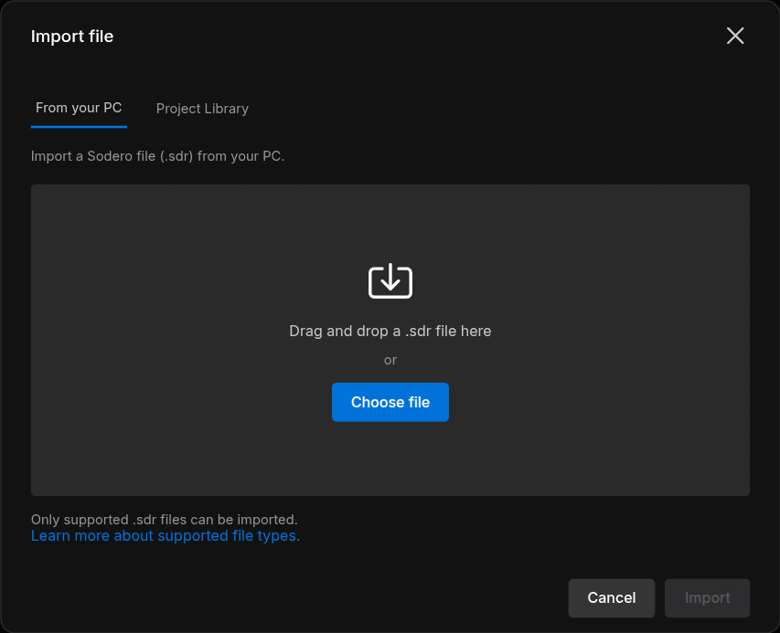
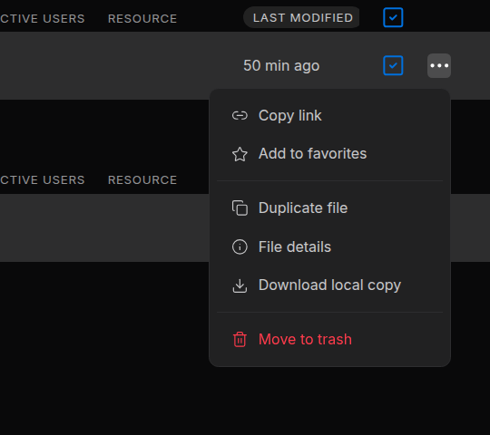

# Robot Systems and Robot Worlds

A project holds two kinds of file: **Robot Systems**, which run robot software in Stellar Station, and **Robot Worlds**, which simulate the place where the robots work.

| File | What it is | Edit it in | Work with it live in |
| :--- | :--- | :--- | :--- |
| **Robot System** | One Stellar Station ("the Station"): its node graph, documents, settings and apps | **Station · Edit** | **Station · Live** |
| **Robot World** | A simulated environment: a scene with your robots, the ground and lighting | **Studio** | **Theater** |

Design documents, such as gateway documents (`.gw`) and robot documents (`.sdd`, `.sddm`, `.sdda`), are not project files: they live inside a Station or in a [library](../libraries/index.md).

---

## 1. Create a File

1. In the project, click **New file**. An empty project also offers **Create new file**.
2. Choose **Robot System** or **Robot World** and click **Next**.
3. Enter a **File Name** (up to 20 characters) and, if you like, a **Description** (up to 40 characters).
4. For a Robot System, choose its [Starting apps](#starting-apps).
5. Click **Create**. The new file appears in its table, **Inactive**.

### Starting Apps

**Starting apps** offers bundles of Store apps for the new Station: **Empty** (*No apps; install what you need from the Store.*), **Manipulator**, **Mobile robot** and **Legged**. The apps install when the Station first starts. If some apps could not be added, the portal names them: install them from the Station's Store ([Apps and Packages](../../station/apps/index.md)).

A new Robot World has no scene yet. Open it with **Studio** to build one ([Studio](../../worlds/studio/index.md)); until then it has nothing to run.

---

## 2. Import an .sdr File

A Sodero file (`.sdr`) holds one Robot System or one Robot World. Importing it creates a **new** file in the project, with the name and description stored in the `.sdr`.

1. In the project, click **Import**. An empty project also offers **Import file**.
2. Choose the source: **From your PC** (drag the file onto the dialog, or click **Choose file**), **My Library** or **Project Library**.
3. Click **Import**.

<figure markdown="span">
  { width="560" }
  <figcaption>Importing an .sdr file from your PC</figcaption>
</figure>

The new file appears under **Robot Systems** or **Robot Worlds**, depending on what the `.sdr` holds.

### Move Robot Systems Between Stellar X and Sodero Cloud

A Robot System moves as an `.sdr` file between Sodero Cloud (**Download local copy**, **Import**) and a Stellar X controller (**Export SDR**, **Load SDR**):

- **From Stellar X:** export the Station on the controller with **Export SDR**, then import the file into a project.
- **To Stellar X:** [download a local copy](../projects/index.md#6-download-a-local-copy) of the Robot System, then load it on the controller with **Load SDR** ([Backup and Restore](https://docs.sodero.io/stellar-x/latest/station/backup_restore/) in the Stellar X manual).

!!! info "**Check the release and the apps.** The destination must run a Station release that accepts the file's graph and documents ([Compatibility](../../reference/compatibility/index.md)). An `.sdr` does not contain installed packages: after importing one from Stellar X, install the apps its nodes need; before loading one on Stellar X, install the packages the Station uses on the controller."

A Robot World's `.sdr` opens in Sodero Cloud only.

---

## 3. File Actions

The **⋯** button at the end of a file's row opens its menu.

<figure markdown="span">
  { width="360" }
  <figcaption>The menu of a Robot System, as a manager sees it</figcaption>
</figure>

| Item | Shown to | Does |
| :--- | :--- | :--- |
| **Copy link** | Everyone | Copies the project's link; a file has no page of its own |
| **Add to favorites** | Everyone | Lists the file under **Favorites** on **Home** |
| **Duplicate file** | Editors and managers | Copies the file in the same project, for example *jackal copy*. A Station copy keeps its documents and apps. |
| **File details** | Everyone | The file's information. Editors and managers can change its name, description and icon color here. |
| **Download local copy** | Managers | Saves the file as an `.sdr` ([Download a Local Copy](../projects/index.md#6-download-a-local-copy)) |
| **Move to trash** | Editors and managers | Moves the file to Trash after you confirm. An active file is deactivated first, and a Station saves its data on the way down. |

An official Sodero World cannot be duplicated. A World that uses official Sodero files is copied without them: add those assets to the copy again in [Studio](../../worlds/studio/index.md). To bring back a trashed file, restore it from **Trash** ([Move to Trash, Restore and Delete](../projects/index.md#7-move-to-trash-restore-and-delete)).

---

## 4. How Robot Worlds and Robot Systems Work Together

The Robot Systems of a project drive the robots in the project's active Robot World. You do not enter any address.

- **One active World per project.** A project can hold several Robot Worlds, but while one is active, the others cannot be activated (*Another Robot World is already running in this project*).
- **Active Stations connect automatically** to the project's active World, including their camera and IMU gateways. A Station activated before the World connects once the World is up.
- **Robots are matched by name.** A simulation gateway drives the robot named in its gateway document (**Robot name**): the name of the robot's articulation prim in the World, for example `jackal`. Use one gateway per independently controlled robot or joint group, and avoid overlapping actuator ranges.
- **Projects stay apart.** A Station never reaches a World in another project. Keep the World and the Robot Systems that drive it in the same project.

Step by step: [Drive Robots in the World](../../station/world_connection/index.md).
