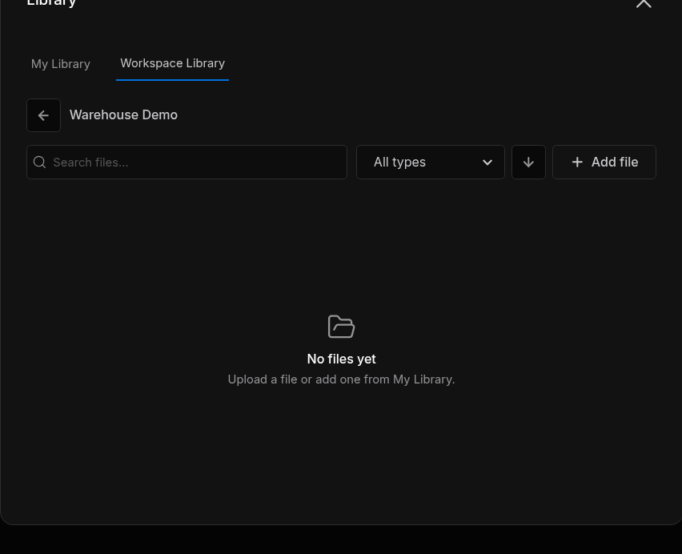

# Libraries

Libraries hold the files you reuse across Robot Systems and Robot Worlds: `.sdr` files, documents, scenes and other assets.

| Library | Holds | Who sees it | Who adds and deletes files |
| :--- | :--- | :--- | :--- |
| **My Library** | Your personal files of any type | Only you | You |
| A project's library | Files shared with one project | Everyone with access to the project | The workspace's owner and admins, and members when **Members can manage the Library** is on |
| **Sodero Assets** | Official robots, environments and documents from Sodero | Everyone | Nobody: it is read-only |

!!! info "The **Library** window lists the project libraries under **Workspace Library**, while some dialogs call the open project's library **Project Library**. Both names mean the project's library."

---

## 1. Open the Library

Click **Library** in the left navigation bar. The **Library** window has two tabs:

- **My Library**: your personal files.
- **Workspace Library**: the libraries of the workspace's projects. Click a project to see its files; the back arrow returns to the list of projects.

Both tabs have a search box, a type filter, a sort button and **Add file**. Each file has an **Export** button, which saves a copy on your computer, and a **Delete** button.

---

## 2. Add Files

1. In **My Library**, or in a project under **Workspace Library**, click **Add file**.
2. Choose the source:
    - **From your computer**: drag a file onto the dialog, or click **Choose file**.
    - In My Library, **Workspace Library**: copy a file from a project library you can open.
    - In a project's library, **My Library**: copy a file from your personal library.
3. Click **Add file**.

<figure markdown="span">
  { width="560" }
  <figcaption>The library of Warehouse Demo under Workspace Library</figcaption>
</figure>

A file can be up to 2 GiB.

---

## 3. Use Library Files

| File | Where you use it |
| :--- | :--- |
| `.sdr` | **Import** on the project page creates a Robot System or Robot World from it ([Import an .sdr File](../files/index.md#2-import-an-sdr-file)) |
| Gateway and robot documents (`.gw`, `.sdd`, `.sddm`, `.sdda`), camera settings, map bundles | In the Station, when you load a document into a node ([Documents and Settings](../../station/documents/index.md)) |
| Scenes and assets (`.usd`, `.usda`, `.usdc`) | In Studio, to build a World ([Studio](../../worlds/studio/index.md)) |

---

## 4. Delete Library Files

Click the file's **Delete** button. In a project's library, it is shown only to the people who may manage libraries.

!!! warning "**Deleting a library file removes it at once; it does not go to Trash.** Export a copy first if you may need the file again."

---

## 5. Sodero Assets

**Sodero Assets** is the official content that Sodero publishes for everyone: robots, grounds, lighting and sky images for Studio, and robot and gateway documents for **Manipulator**, **Mobile** and **Legged** robots in the Station.

Sodero Assets are read-only, and you can view, edit and simulate them only in Sodero. A World that uses them keeps them in Sodero: its local copy and its duplicates leave them out. An official Sodero World cannot be downloaded or duplicated.

---

## 6. Storage Limits

Your workspace's plan limits how much the libraries can hold. **Billing & Usage** shows the **Project libraries**, **Your My Library** and **Workspace storage** meters ([Credits and Usage](../../account/billing/index.md#limits)). A file that does not fit is refused with a message that names the limit: delete files you no longer need, or contact Sodero.
