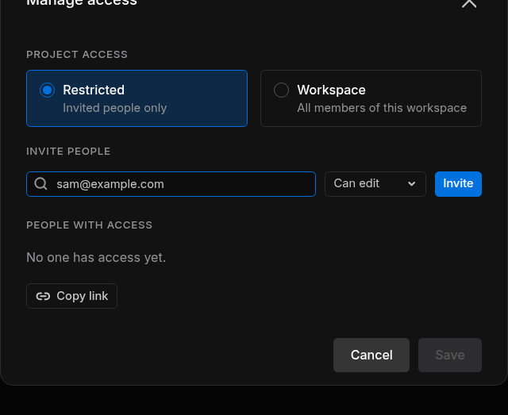

# Share and Collaborate

Work on a project with other people: invite them with a role, send them the project link and see who is working where. Sharing is set per project; membership of the workspace itself is covered in [Workspaces and People](../../account/workspaces/index.md).

---

## 1. Invite People

Managers invite people from the project list:

1. Open the project's **⋯** menu and choose **Manage access**.
2. Under **Invite people**, type an email address, or pick one of the workspace members it suggests.
3. Choose the role: **Can manage**, **Can edit** (the default) or **Can view** ([Project Access and Roles](../projects/index.md#4-project-access-and-roles)).
4. Click **Invite**. The invitation goes out at once.

<figure markdown="span">
  { width="480" }
  <figcaption>The Manage access dialog</figcaption>
</figure>

The person receives an email titled *Sodero project access: Warehouse Demo* with a **Review access** button. The invitation is valid for 7 days; inviting the same address again replaces it. If the dialog says *Couldn't send invitation. Try again.*, check the address: the person may already have access.

### Change Roles, Remove People, Set the Access

**People with access** lists everyone in the project with their role.

- To change a role, use the person's role menu. To remove someone, click **X**.
- **Project access** at the top of the dialog switches between **Restricted** and **Workspace**.
- Click **Save** to apply these changes. **Cancel** drops them; invitations already sent stay.

You cannot change your own role, and a project always keeps at least one manager.

---

## 2. Accept an Invitation

The invited person clicks **Review access** in the email, signs in with the address the invitation was sent to and clicks **Accept invitation**. To decline, they ignore the email. Details and messages: [Accept an Invitation](../../account/sign_in/index.md#3-accept-an-invitation).

---

## 3. Guests

People invited to a project without being members of its workspace join it as **guests**. They find the project in the workspace menu under **Switch workspace › Guest projects (N)** ([Guest Projects](../../account/workspaces/index.md#guest-projects)). Inside the project, a guest has the role they were invited with, like anyone else.

---

## 4. Send the Project Link

Every project has a link that opens it in the portal. Copy it with **Manage access › Copy link**, with a file's **⋯ › Copy link**, with **AI agents › Copy project link**, or from the browser's address bar.

The link opens the project only for people who are signed in and have access to it, so invite new people first. The same applies to the link icon next to an active file's **Station · Live** or **Theater** link, which copies the address of that live view.

---

## 5. See Who Is Working

The **Active users** column of the project page shows who is working in each file right now. Click the avatars for each person's name, role and activity:

| Activity | The person is |
| :--- | :--- |
| *Station Design* | Editing the Station in **Station · Edit** |
| *Station open* | Working in **Station · Live** |
| *Recent Station API activity* | Using the Station through an AI agent or the Project VPN |
| *Theater viewer* | Watching the World in **Theater** |
| *Studio collaboration* | Editing the World in **Studio** |

For recent activity in the whole workspace, such as projects created or files started and stopped, see [Notifications](../../account/workspaces/index.md#notifications).

---

## 6. Work Together on One Station or World

Several people can work in the same file at the same time:

- **Station.** Everyone who opens a Robot System works on the same Station.
- **Studio.** Everyone who opens a World in Studio joins the same editing session ([Studio](../../worlds/studio/index.md)).
- **Theater.** Everyone who opens an active World watches the same simulation, each in their own [rendering mode](../activate_run/index.md#choose-rendering-mode). Each **RTX Real-time** viewer has its own cloud renderer, which uses credits.

People with **Can view** can look but not change anything. For example, **Go live** is disabled for them in **Station · Edit**.

!!! idea "**Tip:** Agree on who activates, runs, stops and deactivates a shared file. These actions change the file for everyone working in it."
