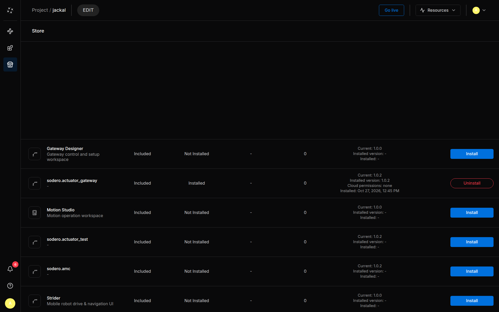

# Apps and Packages

Check the app itself in **Store**. A **Starting apps** bundle is a selection of apps, not confirmation that every required app is installed or available for the current environment. Verify the gateway and controller separately after going live.

Every node of a Station runs an app or module that is installed on that Station. **Add node** offers only what is installed, plus empty drafts. Apps come from the **Store**; your own programs are uploaded as module packages. Both are kept with the Robot System and installed each time its Station starts.

| Source | What it is | Badge in **Add node** | Where you install it |
| :--- | :--- | :--- | :--- |
| Store app | A program published by Sodero, such as the actuator gateway or a robot controller | **SODERO** | **Store** in the left rail |
| Your own module | A module package (`.tar.gz`) that you built | **CUSTOM** | **Modules › Add custom module**, or **Package** on the Live page |

---

## 1. Starting Apps

When you create a Robot System, **Starting apps** offers bundles of Store apps, for example for a manipulator or a mobile robot. **Empty** has none ([Create a File](../../projects/files/index.md#1-create-a-file)). The apps of the chosen bundle are recorded with the Robot System and install when the Station first starts.

If **Add node** lists only **Empty gateway**, **Empty controller** and the other drafts, no app is installed yet. Install the apps you need from the Store.

---

## 2. The Store

Click **Store** in the left rail. The Store lists the apps that Sodero publishes, one row each.

<figure markdown="span">
  { width="900" }
  <figcaption>The Store of a new Robot System, on the Edit page</figcaption>
</figure>

| Part of a row | Shows |
| :--- | :--- |
| Name | The app and a short description, for example **Gateway Designer** (*Gateway control and setup workspace*) |
| **Included** | Every Store app is included in Sodero Cloud; there is nothing to buy |
| State | **Not Installed** or **Installed** |
| Versions | *Current* (the Store's release), *Installed version*, *New* when a newer release is out, and *Installed* (the date). An installed app also lists its *Cloud permissions*: what its own UI may use in Sodero Cloud, such as your libraries. |
| Buttons | **Install** or **Uninstall**, and **Update** when a newer release is out |

### Install

Click **Install**. When the app installs depends on the page:

- **Edit page:** the app is recorded for the Robot System and installs when the Station starts.
- **Live page:** the app installs at once and is recorded for the Station's later starts.

The app then appears in **Add node**, under the node type it declares, with the **SODERO** badge ([Add a Node](../graph/index.md#1-add-a-node)).

### Update

**Update** (*Update to …*) replaces the installed release with the Store's current one. While a node of the app runs, the button is disabled (*Stop its running instances to update it*): stop those nodes first. On the Edit page, **Update** records the new release, which installs when the Station starts.

### Uninstall

**Uninstall** removes the app from the Robot System. While a node of the app runs, the button is disabled. While the saved graph still has nodes of the app, it is refused with a message that names them: delete those nodes, then uninstall.

---

## 3. Your Own Modules

### The Modules Page

Click **Modules** in the left rail. *Used modules in this system* lists the Station's modules with **Name**, **Type**, **Publisher** (**Sodero** or **Custom**), **Version** and **Used by**, the number of nodes that use each one. The **⋯** menu of a row offers **Module info** (version, publisher, source, size and the nodes that use it) and **Remove module**.

### Upload a Module Package

1. Click **Add custom module**.
2. Drop one or more packages (`.tar.gz` or `.tgz`) on the dialog, or click to choose them.
3. Click **Add module** (**Add N modules** for several).

On the Live page, **Package** in the toolbar does the same from the graph: choose one or more packages, and they upload one after another (*Uploading 1/2 · …*).

As with Store apps, a package uploaded on the Edit page installs when the Station starts, and one uploaded on the Live page installs at once. Either way it is kept with the Robot System. Your module then appears in **Add node** under the type it declares, with the **CUSTOM** badge.

How to build a module package is described in [Create Custom Modules](https://docs.sodero.io/stellar-x/latest/extend/custom_modules/) in the Stellar X manual. In Sodero Cloud:

- **Stations run on x86-64 computers.** Build the native programs in your package for x86-64 (`amd64`).
- **Keep packages small.** Every uploaded package is installed again each time the Station starts, so large packages make starting and stopping slower.

### Remove a Module

Stop and delete the nodes that use the module, then choose **⋯ › Remove module** in its row. The dialog says how many nodes still use it; click **Remove** to confirm.

---

## 4. Messages

| Message | What to do |
| :--- | :--- |
| *… is not a package archive (a .tar.gz) …* or *… the file name must end with .tar.gz or .tgz* | Choose the package archive itself: a gzip-compressed `.tar.gz` or `.tgz` file |
| *… the limit for a package archive (.tar.gz) is 360 MB.* | Make the package smaller |
| *… is built into this Station and cannot be replaced by an upload.* | The Station has its own version of this package. Leave it out of the upload. |
| *Package is running; stop its active instances before removing it: …* | Stop the listed nodes, then try again |
| *This package is used by the saved graph. Remove these nodes first: …* | Delete the listed nodes, then try again |
| *Install the package of … (…) from the Store first. Nothing was started.* | A node's app is not installed on this Station. Install it, then start the nodes again. |
| *It is installed now but may be gone after this Station stops and starts again: …* | The app runs now, but Sodero Cloud could not record it for the Robot System. After the next start, check the Store and install it again if it is missing. |
| *It is removed now but may come back after this Station stops and starts again: …* | After the next start, check the Store and uninstall it again if it is back |
| *Install failed*, *Update failed* or *Uninstall failed* | Try again. If it fails again, reload the page. |
| **Package error** with *Could not load the Store.* or *Could not load the item's packages.* | The Edit page could not read the apps. Reload the page. |
