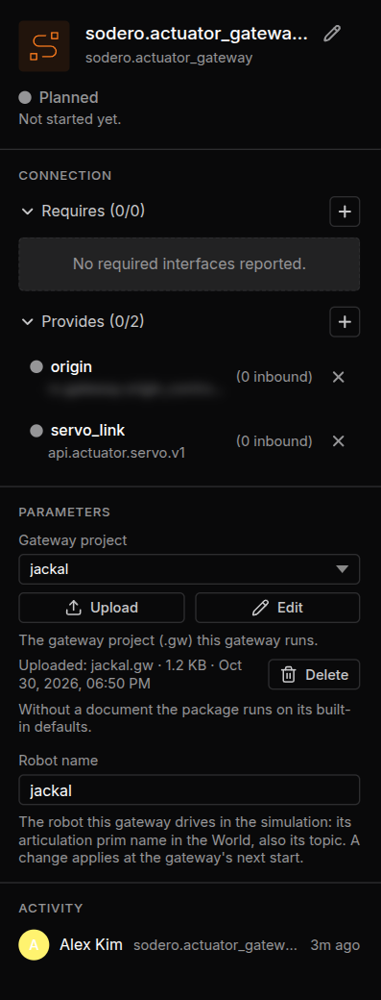
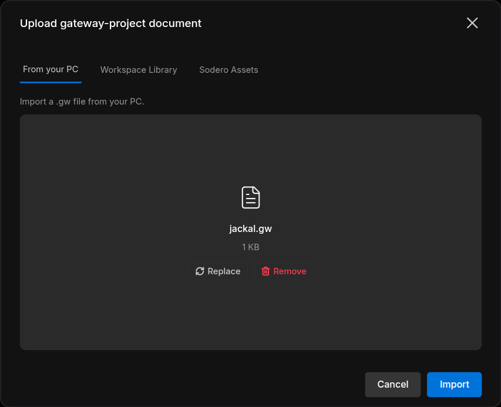
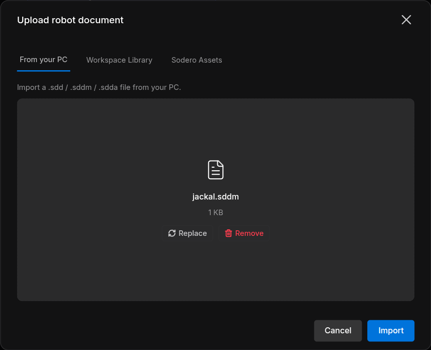

# Documents and Settings

Most nodes work from a **document**: a gateway runs a gateway document (`.gw`), a robot controller runs a robot document (`.sdd`, `.sddm` or `.sdda`). Some apps also have **settings** that you edit in the node's inspector. This page shows how to give a node its document, which kinds exist, and how to change settings. You can do all of this on the Edit page and on the Live page, while the node is stopped.

---

## 1. Choose or Upload a Document

Select the node. The **Parameters** section of its inspector has one field for each document the app reads, for example **Gateway project** on an actuator gateway or **document (robot)** on a controller.

<figure markdown="span">
  { width="300" }
  <figcaption>The inspector of an actuator gateway, with its gateway document jackal and the Robot name under Parameters</figcaption>
</figure>

- **A new node starts from a blank document.** When you add an actuator gateway or a robot controller, the Station gives it a document named after the node that holds a blank template: for `sodero.actuator_gateway.jackal`, the document `jackal` with the file `default.gw`. A robot controller's template is `default.sdd`, `default.sddm` or `default.sdda`. Upload the document made for your robot in its place.
- The dropdown lists the documents of that kind in the Station. A field that a controller requires reads *Select a required document* until it names one; other fields may offer **Built-in default (no document)**. Built-in defaults do not describe your robot: give every gateway and controller the document made for it.
- The line under the field tells which file the document holds, for example *Uploaded: jackal.gw · 1.2 KB · …*, or *Not uploaded*.

| Button | What it does |
| :--- | :--- |
| **Upload** | Brings in a new document ([Upload a Document](#upload-a-document)) |
| **Edit** | Opens the document in its editor in a new tab: the Gateway Designer for a gateway document, Stellar Designer for a robot document |
| **Delete** | Next to an uploaded file: puts the document back to its blank template. The Station asks first, for example *Delete jackal.gw? The gateway-project document jackal becomes the blank template default.gw.* |

### Upload a Document

1. Click **Upload** under the field. The dialog is named after the kind, for example **Upload gateway-project document** or **Upload robot document**.
2. Choose where the file comes from:

    | Tab | Files |
    | :--- | :--- |
    | **From your PC** | Drop the file on the dialog, or click **Choose file** |
    | **Workspace Library** | The files of the project library ([Libraries](../../projects/libraries/index.md)) |
    | **Sodero Assets** | Robot and gateway documents published by Sodero, under **Manipulator**, **Mobile** and **Legged**. Only for robot and gateway documents. |

3. Click **Import**.

<figure markdown="span">
  { width="520" }
  <figcaption>Uploading a gateway document from your PC</figcaption>
</figure>

<figure markdown="span">
  { width="520" }
  <figcaption>The same dialog for a robot document</figcaption>
</figure>

The Station confirms the upload, for example *jackal.gw uploaded as the gateway-project document jackal*, and the node takes the new document. If the upload fails, the message says why: *… was not uploaded — …*.

- If the field already names a document, the upload replaces that document.
- A new document is named after the last part of the node name: for `sodero.actuator_gateway.jackal` it is `jackal` ([Name the Node](../graph/index.md#name-the-node)).

### Rules

- **A running node is locked.** While a node runs, its inspector says *This node is running. Stop it to change its documents, parameters, settings, ports or name.* Stop the node before you upload, edit or delete its document or change its settings.
- **Each controller takes its own kind:** `.sdd` for `sodero.mmc`, `.sddm` for `sodero.mlc`, `.sdda` for `sodero.amc`.
- **A robot document names its gateway** and the gateway's actuators it uses. Connect the controller's `servo_link` to that gateway, and give the gateway at least as many actuators as the document uses.

---

## 2. Kinds of Documents

| Kind | File | Used by |
| :--- | :--- | :--- |
| Gateway document | `.gw` | Actuator gateways, `sodero.actuator_gateway.<name>` |
| Robot document | `.sdd` (manipulator), `.sddm` (mobile base), `.sdda` (articulated robot) | `sodero.mmc.<name>`, `sodero.mlc.<name>`, `sodero.amc.<name>` |
| Tool bank, Pose bank | `.tool`, `.pose`, exported from Motion Studio | The manipulator controller `sodero.mmc.<name>`, in its **Tool bank** and **Pose bank** fields. [Motion Studio](../../operate/motion_studio/index.md) edits them in place. |
| Camera document | `.yaml` | Camera gateways, `sodero.camera_gateway.<name>` |
| IMU document | `imu.yaml`, created in the node's settings | IMU gateways, `sodero.imu_gateway.<name>` |
| GNSS document | A gateway document that holds `gnss.yaml`, created in the node's settings | GNSS gateways, `sodero.gnss_gateway.<name>` |
| Map bundle | A `.nav` folder packed as `.tar.gz`, `.tgz`, `.tar` or `.zip`, for example `site.nav.tgz` | The localizer, the navigator and visual odometry |

A Station has **one map bundle**: the localizer, the navigator and visual odometry share it, and a new upload replaces it. What a map bundle holds is described in [Load and Configure a Map](https://docs.sodero.io/stellar-x/latest/navigation/map_bundle/) in the Stellar X manual.

---

## 3. Settings

Some apps declare settings. The inspector then shows one section per settings file below **Parameters**, titled by the app.

1. Stop the node if it runs.
2. Change the fields.
3. Click **Save settings** (*Settings saved.*). **Discard and reload** discards your changes.

- When the settings belong to a document, the section shows once the node has one: *Choose or upload a … document in Parameters; its … settings then appear here.*
- Some apps can create the file for you: click **Create with defaults**. An IMU or GNSS gateway without a document creates one here: enter a name under **New … document** and click **Create**.
- The fields themselves come from each app.

---

## 4. Make Documents in Stellar Designer

Gateway and robot documents are made in **Stellar Designer**: the Gateway Designer makes `.gw` documents, and the manipulator, mobile robot and articulation editors make `.sdd`, `.sddm` and `.sdda` documents. **Edit** in the inspector opens a node's document there. Every editor and field is described in the Stellar X manual: [Stellar Designer](https://docs.sodero.io/stellar-x/latest/tutorials/stellar_designer/introduction/) and [Gateway Designer](https://docs.sodero.io/stellar-x/latest/gateways/gateway_designer/).

- The robot that a simulation gateway drives in the World is set on the gateway node, as its **Robot name** ([Connect to the World](../world_connection/index.md#2-name-the-robot)).
- Ready-made documents for Sodero's robots are in **Sodero Assets**.

### Documents in an Obsolete Format { #documents-with-old-node-names }

Documents from an older Stellar Designer use an obsolete format, and the Station refuses them: the message says that the file *uses an obsolete format*, or names an *Obsolete robot file* or an *Obsolete gateway filename*. A robot document without `runtime.yaml`, the file that names its controller, is refused the same way: *The robot document has no runtime.yaml naming its controller.* Export the document again from the current Stellar Designer and upload the new file.

---

## 5. Troubleshooting

| Message | What to do |
| :--- | :--- |
| *Only … files can be imported.* | The file has the wrong extension for this field. Check the kind in the dialog's title. |
| *… is not a robot document (expected a .sdd, .sddm or .sdda file).* | Export the robot from Stellar Designer as `.sdd` (manipulator), `.sddm` (mobile) or `.sdda` (articulation) |
| *… was not uploaded — This package accepts … documents.* | The controller takes another kind of robot document: `.sdd` for `sodero.mmc`, `.sddm` for `sodero.mlc`, `.sdda` for `sodero.amc` |
| *… uses an obsolete format. …*, *Obsolete robot file: …* or *The robot document has no runtime.yaml naming its controller. …* | Export the document again from the current Stellar Designer ([Documents in an Obsolete Format](#documents-with-old-node-names)) |
| *Stop this node before changing its settings: …* | Stop the node, then save the settings again |
| *… is an archive but not a .nav bundle (no localizer.yaml inside).* or *…: the .nav bundle is incomplete — missing …* | Pack the localizer's `.nav` folder itself as `.tar.gz` or `.zip`, and upload that |
| *… is yaml but not a camera_gateway config …* | The file is not a camera document |
| *Another editor changed this robot file first — reload …* | Someone else changed the document at the same time. Reload, then repeat your change. |
