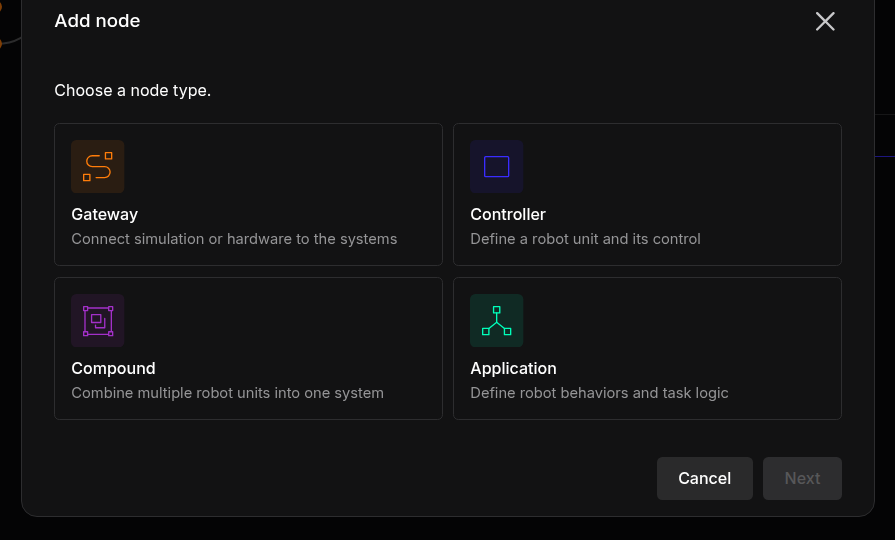
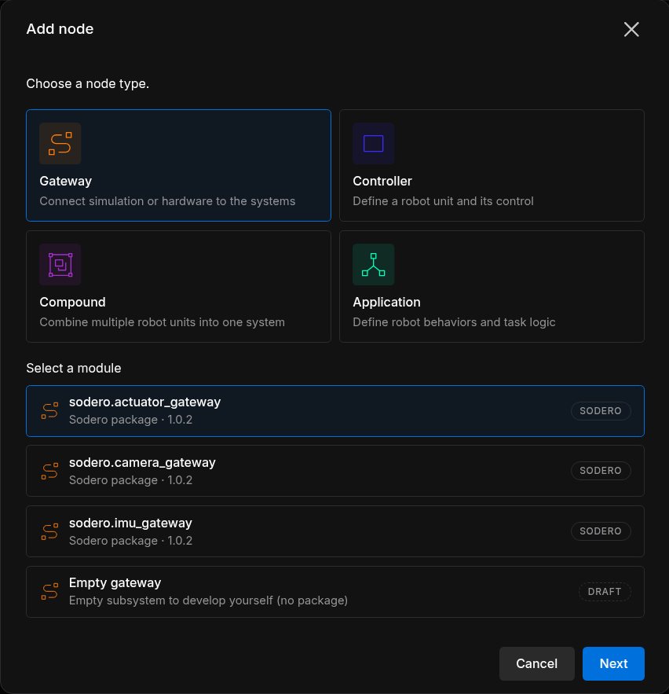
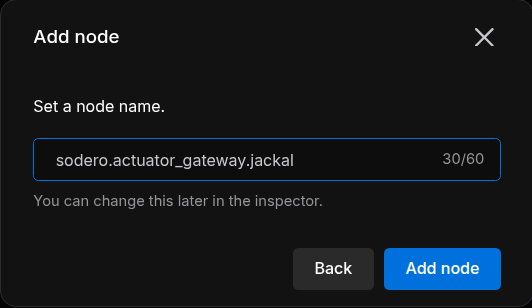

# Build the Graph

A Station is a graph of **nodes** connected through **ports**. This page shows how to add and name nodes, connect them, and keep a large graph tidy. You can change the graph on the Edit page and on the Live page; every change is saved automatically. The node types are explained in [Key Concepts](../../get_started/key_concepts/index.md).

---

## 1. Add a Node

1. Click **Add node** in the toolbar, or right-click the empty canvas.
2. Choose the node type: **Gateway**, **Controller**, **Compound** or **Application**.

    <figure markdown="span">
      { width="520" }
      <figcaption>Choosing the node type</figcaption>
    </figure>

3. Under **Select a module**, choose the app or module, then click **Next**.

    <figure markdown="span">
      { width="520" }
      <figcaption>Gateway › sodero.actuator_gateway</figcaption>
    </figure>

4. Enter the node name and click **Add node**. You can rename the node later.

    <figure markdown="span">
      { width="420" }
      <figcaption>Naming the node</figcaption>
    </figure>

The node appears on the canvas as **Planned**. Nothing runs until you start it on the Live page ([Run and Monitor](../run/index.md)).

### The Module List

| Badge | Entry | Detail line |
| :--- | :--- | :--- |
| **SODERO** | An app installed from the Store | *Sodero package ·* and its version |
| **CUSTOM** | A module package you uploaded | *Imported package · Installed* |
| **DRAFT** | **Empty gateway**, **Empty controller**, **Empty compound**, **Empty application** | *Empty subsystem to develop yourself (no package)*: a placeholder with no program behind it, for sketching a system. It does not start. |

Each type lists only the apps and modules installed on this Station. To add another, install it first ([Apps and Packages](../apps/index.md)).

### Name the Node

The name field proposes the app's own name, for example `sodero.actuator_gateway`. Add a last part that names the robot or device, so that the name reads `sodero.<package>.<name>`:

| Node | Example name |
| :--- | :--- |
| Actuator gateway of a robot | `sodero.actuator_gateway.jackal` |
| Mobile base controller of the same robot | `sodero.mlc.jackal` |
| Manipulator controller | `sodero.mmc.arm` |
| Articulation controller | `sodero.amc.dog` |
| Strider | `sodero.strider` |

- **The last part names the node's documents.** A new document you upload to `sodero.actuator_gateway.jackal` is named `jackal` ([Documents and Settings](../documents/index.md)).
- **Robot documents refer to their gateway by its node name**, for example `sodero.actuator_gateway.jackal`. Give the gateway the name its controller's document expects.
- **Give a robot's gateway and controller the same last part.** The graph stays easy to read.
- Names use letters, digits, `_`, `.` and `-`, start with a letter or digit, and have up to 60 characters (an empty draft: 20). Each name can be used once per Station: *… is already a node of this graph: use another id, e.g. ….2.*

---

## 2. Node Cards

| Part | Meaning |
| :--- | :--- |
| Title | The node name |
| Second line | The app or module the node runs |
| **REQUIRES n/m** | Ports the node needs from other nodes, on the left edge of the card: connected / total |
| **PROVIDES n/m** | Ports the node offers, on the right edge: ports with at least one connection / total |
| State | **Planned** until the node first starts, then its running state ([Node States](../run/index.md#4-node-states)) |

The card border has the color of the node type: orange for gateways, blue-violet for controllers, purple for compounds and mint for applications. The arrow at the top right of a card folds its ports away.

---

## 3. Connect Ports

Connect a port that one node requires to a matching port that another node provides:

- **Drag** from one port dot to the other.
- **Click** one port, then the other.
- In the inspector of the node that requires the port, click **Auto-connect** next to the port. The Station connects the first matching port it finds, or shows *No match*.

The Station accepts a connection only when the two ports are on different nodes, one requires and the other provides, and both use the same interface. The inspector shows each port's interface under its name, for example `api.actuator.servo.v1`. The Station also keeps the system's structure:

- Only a controller may use a gateway.
- An application uses controllers or compounds, never gateways directly.
- One controller drives a gateway.

A refused connection says why, for example *Connect ports on different nodes with opposite directions and matching contracts.*

To remove a connection, select the node and click **Disconnect** next to the port in the inspector.

!!! warning "**Check Auto-connect with several robots.** Auto-connect does not look at node names: with two gateways in the graph, it may pick the other robot's. Check the result, or drag the connection yourself."

### Common Connections

| Node (requires) | Port | Connect to (provides) |
| :--- | :--- | :--- |
| `sodero.mmc.<name>`, `sodero.mlc.<name>`, `sodero.amc.<name>` | `servo_link` | The robot's actuator gateway `sodero.actuator_gateway.<name>`, port `servo_link` |
| `sodero.strider` | `mobile_base` | The mobile base controller `sodero.mlc.<name>`, port `mobile_base` |
| `sodero.strider` | `localization` | The localizer, `sodero.localizer` |
| `sodero.strider` | `navigation` | The navigator, `sodero.navigator` |

Strider drives what its ports are connected to ([Strider](../../operate/strider/index.md)).

---

## 4. Rename and Delete

- **Rename:** click the pencil next to the node name in the inspector and enter the new name. The node keeps its connections and the documents it uses.
- **Delete:** right-click the node and choose **Delete node**. The dialog asks *Delete "…" from this robot system?*; click **Delete node**. The node's connections are removed too.

On the Live page, stop a node before you rename or delete it.

!!! warning "Deleting a node cannot be undone. Everyone working on the Station sees the change at once."

---

## 5. Find Your Way in a Large Graph

- **Filter** shows only nodes of one **Node type** or **Status**; **Reset all** clears it.
- **Fit view** zooms to show every node; **Auto layout** arranges the nodes by their connections.
- The **N issues** chip at the left of the toolbar lists problems, such as *Required port "servo_link" is not connected*. **Locate** jumps to the node.

---

## 6. Load and Export the Graph

- **Export** downloads the graph as a `.yaml` file. If something runs on the Live page that the graph does not show, it asks first: **Planned topology only** or **Also include what is running**.
- **Load YAML** loads such a file from your PC, **My Library** or the **Project Library**. It replaces the nodes and connections of the Station (*… loaded — N nodes now in the system.*).

The file holds the graph only: nodes, their parameters and their connections. Documents, settings and apps are not part of it. To copy a whole Robot System, use **Duplicate file**, or **Download local copy** and **Import**, on the project page ([Robot Systems and Robot Worlds](../../projects/files/index.md)).
