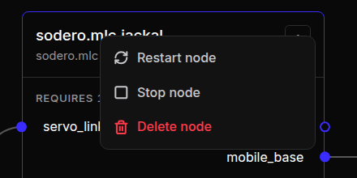

# Run and Monitor

Nodes run only on the Live page, and only when you start them. This page covers starting and stopping nodes, reading their state and logs, and what to do when a node does not start.

---

## 1. Go Live

Open the Robot System with **Station · Edit** and click **Go live**, or activate it on the project page and open **Station · Live** ([Edit and Live](../overview/index.md#edit-and-live)). The Station comes up with its saved graph, documents and apps, but **no node starts by itself**: nodes that have not run yet show **Planned**.

Starting and stopping nodes needs the **Can edit** or **Can manage** role in the project.

---

## 2. Start All Nodes

Click **Start all nodes** in the toolbar. The Station starts every node that is not running, in dependency order: *Nodes start in dependency order: gateway → controller → compound → application.* A node waits until the nodes it requires are up.

- A banner follows the progress. **Cancel start** stops the run; nodes that already started stay up.
- The result shows as a banner: *Runtime topology is up.*, or *Runtime topology is up; stopped during startup: …* when some nodes stopped again ([When a Node Does Not Start](#6-when-a-node-does-not-start)).
- The arrow next to the button opens its menu: **Start all nodes** and **Stop all nodes**.
- *Nothing in this topology can be launched from here.* means that the graph holds only empty drafts.

**Run** on the project page does the same for a Robot System, and can start a World and several Stations in one step ([Run and Stop](../../projects/activate_run/index.md#2-run-and-stop)).

---

## 3. Start, Restart or Stop One Node

Right-click a node on the Live page:

<figure markdown="span">
  { width="330" }
  <figcaption>The menu of a running node</figcaption>
</figure>

| Item | Shown when |
| :--- | :--- |
| **Open …** | The node has a UI of its own, for example Strider or Motion Studio |
| **Start node** | The node is not running |
| **Restart node**, **Stop node** | The node runs |
| **Delete node** | Always ([Rename and Delete](../graph/index.md#4-rename-and-delete)) |

Start a robot's nodes in order: the gateway first, then its controller, then the nodes that use the controller. Stop them in the reverse order.

When a running app exposes its operator UI, open it from that node. See [Compatibility](../../reference/compatibility/index.md) and the relevant controller chapter.

---

## 4. Node States

The footer of each node card and the inspector header show the node's state, and the inspector adds a short description.

| State | Description |
| :--- | :--- |
| **Planned** | *Not started yet.* |
| **Booting**, **Starting** | *Starting up.* |
| **Waiting binding** | *A required port has no connection yet.* |
| **Waiting target** | *Connected target is not ready yet.* |
| **Ready** | *Started and waiting to operate.* |
| **Operating** | *Running normally.* |
| **Running**, **Active** | *Process is up.* |
| **Paused** | *Paused.* |
| **Idle** | *Instance exists but is not running.* |
| **Degraded** | *Running with reduced performance.* |
| **Disconnected** | *Heartbeat lost.* |
| **Fault** | *Fault state — reset to recover.* |
| **Error**, **Failed**, **Crashed** | *The node reported an error.* |
| **Stopped**, **Exited** | *Process ended.* |

The dot next to the state is green while the node runs, yellow while it waits, red for errors and grey otherwise. Problems are also counted in the **N issues** chip of the toolbar.

**Waiting binding** means that the node runs, but a port it requires is not connected to a running node that provides it. Connect the port, and start the providing node first: the gateway before its controller. When the two ports do not fit together, the inspector shows the reason instead of the description.

---

## 5. Logs and Activity

On the Live page, the **Logs** section of the inspector shows the node's latest output. Choose a stream and click **Refresh**:

| Stream | Contents |
| :--- | :--- |
| **Package log** | The app's own log |
| **Standard output**, **Standard error** | The program's output |
| **Node log (userdata)** | The node's log file |
| **Process log** | When the process started and stopped |
| **Gateway events** | A gateway's status and problems. A controller shows the events of its gateway as **Gateway events (…)**. |

Each stream shows its last 200 lines and when it was last updated, for example *Last 200 lines · updated 5 s ago*.

- *Station packages are still being restored; this node may not start yet.* The Station is still installing its apps after going live. Wait a moment, then start the node.
- *Package restore at Station start failed: …* The node's app could not be installed ([Apps and Packages](../apps/index.md)).

**Activity**, under the logs, lists the latest changes to the node and who made them. The **Notifications** bell in the left rail lists the Station's recent events: nodes added, connected and deleted, files uploaded, and on the Live page also nodes started and stopped, and errors.

---

## 6. When a Node Does Not Start

| Message | What to do |
| :--- | :--- |
| *… did not start: …* | The app ended at once; the text after the colon is its own reason. **Details** shows more, and **Copy** copies it. Fix the cause, often the document or a setting, then start again. |
| *… cannot start yet: connect the … port or set …* | The app needs that port connected, or that parameter set in **Parameters**. Do one of the two, then start again. |
| *Install the package of … (…) from the Store first. Nothing was started.* | The node's app is not installed on this Station ([Apps and Packages](../apps/index.md)) |
| *Provider not ready: …* or *Requirements never bound* | A node that it requires did not come up. Start that node first and read its log. |
| *Process exited before reaching readiness* or *Timed out waiting for readiness* | The node stopped or hung while starting. Read its logs. |
| *Process stopped during topology startup; check its logs before retrying.* | The node started, then stopped. Read its logs, fix the cause, then start again. |
| *Gateway … cannot be driven by both … and …; choose one controller before starting all nodes.* | Two controllers are connected to one gateway. Disconnect one of them. |
| *Project edit access is required to start or cancel the topology.* | Your role is **Can view**. Ask a manager for **Can edit**. |

A gateway that cannot reach its robot in the World does not fail: it waits. See [Drive Robots in the World](../world_connection/index.md#7-troubleshooting).

---

## 7. Stop

| To | Do this | The Station |
| :--- | :--- | :--- |
| Stop one node | Right-click it › **Stop node** | Stays live |
| Stop every node | Choose **Stop all nodes** in the menu of **Start all nodes** (users of a node stop before the node itself), or **Stop** on the project page | Stays live and keeps using credits |
| End your session | **Stop live** in the Station, or **Deactivate** on the project page | Stops every node, saves its data and returns to the Edit page. It no longer uses credits. |

**Stop live** and **Deactivate** do the same. If nobody uses an active Station, Auto off deactivates it after 30 minutes by default ([Auto Off](../../projects/activate_run/index.md#5-auto-off)).

Stopping this Station does not stop or deactivate its World, and does not end separate rendering sessions. End those from the project page and close unneeded views.
