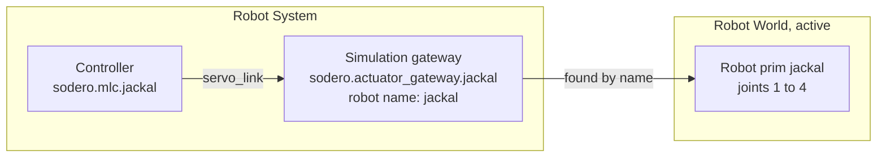

# Drive Robots in the World

The Robot Systems of a project drive the robots in the project's active Robot World. Sodero Cloud makes the connection: a simulation gateway reaches the World by itself and finds its robot by name. This page shows what to set so that a robot moves.

---

## 1. What Is Automatic

- **No address to set.** The simulation, camera and IMU gateways of an active Station connect to the project's active World by themselves. A simulator address stored in a gateway document is ignored.
- **Activate in any order.** A Station that is active before the World connects once the World is up.
- **One World per project.** Only one Robot World of a project can be active at a time, and a Station never reaches a World in another project ([How Robot Worlds and Robot Systems Work Together](../../projects/files/index.md#4-how-robot-worlds-and-robot-systems-work-together)).

---

## 2. Name the Robot

Use a simulation gateway document configured for the robot in the World. Its robot name must match the articulation prim name. Depending on the document and app release, the name can be supplied in the document or in the supported node settings. Check the applied name before starting; do not assume renaming a node changes its simulation target.

!!! warning "**The robot name must be exactly the name of the robot's articulation prim in the World.**"

| Station | World |
| :--- | :--- |
| Gateway document `jackal.gw` with the robot name `jackal` | The robot's articulation prim `jackal`, at `/World/jackal` in the World's hierarchy |

- Names are case-sensitive: `Jackal` and `jackal` are different robots.
- A robot name uses letters, digits and `_`, and does not start with a digit.
- Every robot in the World needs a name of its own.

If the names differ, the gateway never finds its robot: it keeps waiting, and the robot does not move.

---

## 3. Match Actuators and Joints

The gateway addresses joints by actuator index. Confirm the simulator's joint order and use the matching robot document; an alphabetical joint list in Studio does not establish that order.

| Gateway | Robot in the World |
| :--- | :--- |
| Actuators 1, 2, 3, 4 (indices 0 to 3) | The robot's 1st, 2nd, 3rd and 4th joint |

- Give the gateway one actuator per joint it drives. The robot document then maps the gateway's actuators to its joints or wheels ([Documents and Settings](../documents/index.md)).
- To drive one robot with two gateways, for example an arm and its gripper, set the gripper gateway's **DOF offset** to the index of the gripper's first joint ([Gateway Designer › Simulation Gateways](https://docs.sodero.io/stellar-x/latest/gateways/gateway_designer/#5-simulation-gateways) in the Stellar X manual).

What a robot needs in the World, such as its articulation and joint drives, is described in [Prepare a World for Simulation](../../worlds/prepare_world/index.md).

---

## 4. Several Robots and Stations

- Use one gateway and one controller per robot, each gateway with its own robot name.
- The gateways can sit in one Robot System or in several. Every active Robot System of the project connects to the same World.
- Drive each robot, or each part of a robot, from one gateway only.

---

## 5. Cameras and IMUs

- **Camera gateway** (`sodero.camera_gateway.<name>`): its camera name must be the name of the camera's prim in the World. It uses letters, digits, `_`, `-` and `.`. The World renders the robots' cameras while it is active; the first pictures can take a moment after the World starts.
- **IMU gateway** (`sodero.imu_gateway.<name>`): it reads the IMU of one robot, which you name like the robot of an actuator gateway.

The World must declare its cameras and IMUs ([Prepare a World for Simulation](../../worlds/prepare_world/index.md)).

---

## 6. Start Order

1. **Activate** the Robot World and the Robot System on the project page. **Go live** in the Station also activates the Robot System.
2. **Run** the World on the project page, so that it plays ([Run and Stop](../../projects/activate_run/index.md#2-run-and-stop)).
3. **Start the nodes**: **Start all nodes** on the Live page, or **Run** the Robot System on the project page. Selecting the World and the Robot System together and choosing **Actions › Run** plays the World and starts the nodes in one step ([Activate and Run](../../projects/activate_run/index.md#how-it-works)).
4. Open the controller UI and switch the servo on ([Strider](../../operate/strider/index.md), [Motion Studio](../../operate/motion_studio/index.md), [Articulation](../../operate/articulation/index.md)).

Stopping the World resets its robots' poses. After you run it again, check the controllers: if their servos are off, switch them on again.

---

## 7. Troubleshooting

A gateway connects to the World, not to another node. A World that is not running, or a robot name that does not match, therefore shows neither as **Waiting binding** nor as an error in the graph: the gateway's node can look normal while the gateway waits for its robot. Select the gateway and read its **Gateway events** log ([Logs and Activity](../run/index.md#5-logs-and-activity)). It says whether the gateway is still waiting for its robot or is connected to the simulation.

| Symptom | What to check |
| :--- | :--- |
| The gateway keeps waiting for its robot | The World is active and playing; it is in the same project; the robot name equals the robot's prim name exactly |
| The controller stays in **Waiting binding** | Its `servo_link` is connected to the gateway, and the gateway runs ([Node States](../run/index.md#4-node-states)) |
| The servo switches on, but the robot does not move | The gateway has as many actuators as the robot document uses. In Strider, the drive mode is **Twist**. |
| A wheel or joint turns the wrong way, or the wrong joint moves | Stop motion and check joint order, actuator mapping, axis direction and configured polarity. Change the appropriate document setting, then verify one joint at a time. |
| The servo switched off by itself | The World may have been stopped or reset. Switch the servo on again. |
| The camera gateway shows no picture | The camera name equals the camera's prim name; the World plays and declares its cameras |
| The robot moves slower than expected | In Theater, **Physics RTF** is below 1.00: the World simulates slower than real time ([Theater](../../worlds/theater/index.md)) |
