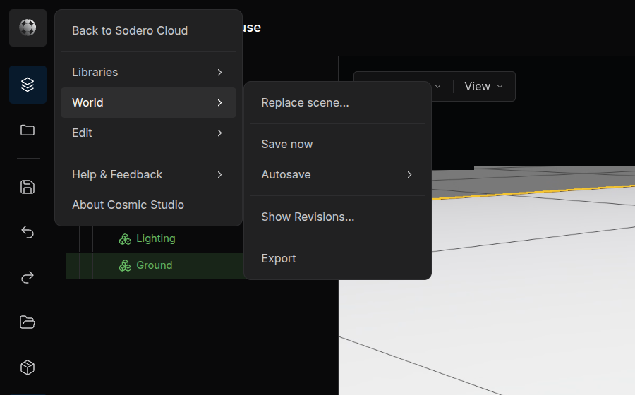
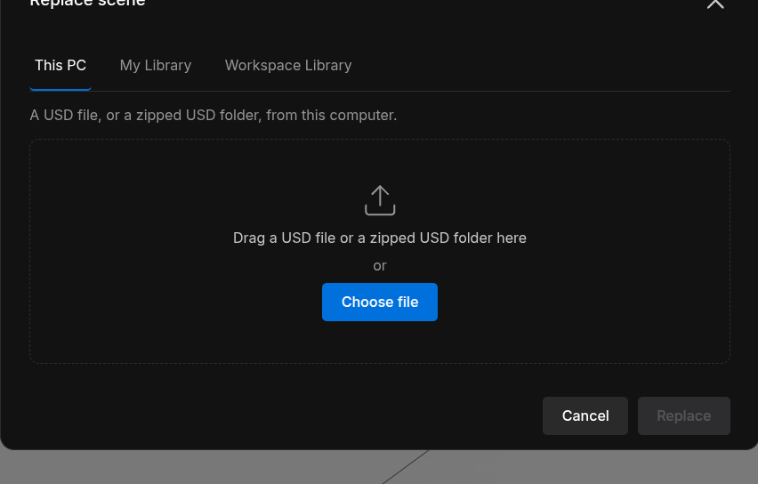
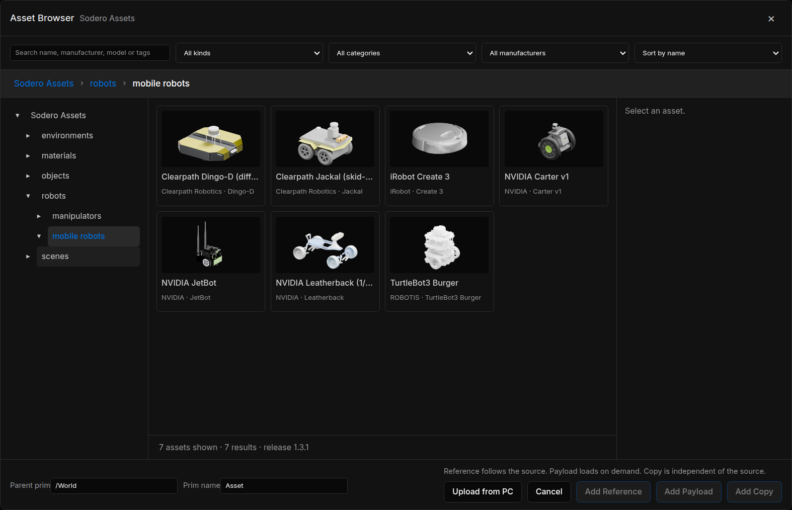
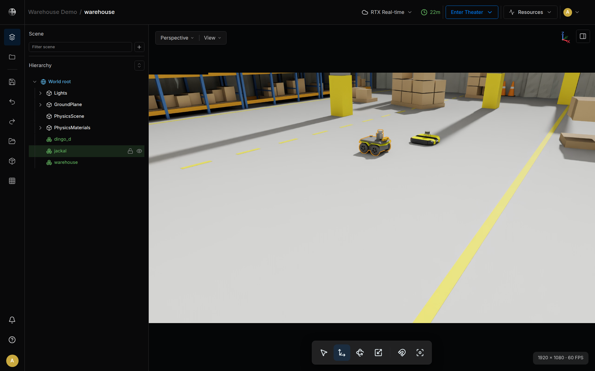

# Studio

Studio is the World editor of Sodero Cloud. In it you build a Robot World: bring in a scene or Sodero Assets, arrange the objects, set mass and joint poses, and save. Its browser tab is titled *Cosmic Studio*.

---

## 1. Open Studio

1. On the project page, click **Studio** in the Robot World's **Actions** column. Studio opens only while the World is **Inactive** (or in **Error**): deactivate an active World first.
2. In **Choose rendering mode**, pick **RTX Real-time** or **WebGPU** and click **Open Cosmic Studio** ([Choose Rendering Mode](../../projects/activate_run/index.md#choose-rendering-mode)).
3. Studio opens in a new tab once its editing session has started.

- The first time someone who can edit opens a new World, Studio adds a default environment from Sodero Assets: **Lighting** and **Ground**.
- A World with several top-level USD files asks which one to open.
- Keep the Sodero Cloud tab that opened Studio open while you work: Studio uses it to keep you signed in. If you close it, some actions say *Open Cosmic Studio from Sodero Cloud to use this.*

### The Studio Window

<figure markdown="span">
  { width="900" }
  <figcaption>Studio with the warehouse World of the Quick Start</figcaption>
</figure>

| Area | What it holds |
| :--- | :--- |
| **Header** | The project and World names, the renderer menu (**RTX Real-time** ▾), the session time, the save state (*Saved just now*), **Enter Theater** ▾, **Resources** ▾ and the people in the session |
| **Left rail** | The Cosmic Studio menu (the logo), **Scene**, **Save now**, **Undo**, **Redo**, the asset libraries **Workspace** and **Sodero Assets**, and **Grid** |
| **Scene** panel | **Filter scene**, **+** to add a group or a light, and the **Hierarchy** of the World |
| **Viewport** | The World, with **Perspective** ▾ and **View** ▾ at the top left, the tools at the bottom, and the resolution and frame rate at the bottom right |
| **Asset detail** | The properties of the selected object. The panel button at the top right of the viewport shows and hides it. |

The Cosmic Studio menu holds **Back to Sodero Cloud** (closes Studio), **Libraries**, **World**, **Edit**, **Help & Feedback** and **About Cosmic Studio**.

<figure markdown="span">
  { width="460" }
  <figcaption>The World menu</figcaption>
</figure>

---

## 2. Bring Content In

### Replace the Whole Scene

Use it for a scene built elsewhere, for example in NVIDIA Isaac Sim.

1. In the Cosmic Studio menu, choose **World › Replace scene…**.
2. On **This PC**, drag a USD file (`.usd`, `.usda`, `.usdc`) or a zipped USD folder (`.zip`) onto the dialog, or click **Choose file**. **My Library** and **Workspace Library** offer the USD files of your libraries.
3. Click **Replace** and confirm in the browser's dialog.
4. Studio says *Replaced with …*. If the **Hierarchy** still shows the old scene, reload the Studio page. Then click **Save now**.

<figure markdown="span">
  { width="520" }
  <figcaption>The Replace scene dialog</figcaption>
</figure>

- The unsaved edits of everyone in the session are discarded.
- A file can be up to 1 GiB. The scene must be Z-up: Studio refuses a Y-up scene ([Prepare a World for Simulation](../prepare_world/index.md)).
- In a zip, keep the scene's main USD file at the top level, with the files it uses beside it or below it. Studio opens the USD file nearest to the top of the zip.

### Add Sodero Assets

1. Click **Sodero Assets** in the left rail. The **Asset Browser** opens.
2. Search by name, manufacturer, model or tags, filter with **All kinds**, **All categories** and **All manufacturers**, or browse the folders: environments, materials, objects, robots and scenes.
3. Select the asset and check **Parent prim** (where it goes, `/World` by default) and **Prim name** (its name in the World).
4. Click **Add Reference** (follows the source asset), **Add Payload** (a reference that loads on demand) or **Add Copy** (an independent copy).

<figure markdown="span">
  { width="760" }
  <figcaption>The Asset Browser on the mobile robots of Sodero Assets</figcaption>
</figure>

- For a material, select the object first, then open the browser and choose **Bind Material**.
- **Upload from PC** uploads a single USD file to the browser's **Workspace** library, from which you add it the same way. For a scene made of several files, use **Replace scene…** with a zip.
- Sodero Assets are official Sodero content: you can view, edit and simulate them in Sodero, but exports and downloads leave them out ([Libraries](../../projects/libraries/index.md#5-sodero-assets)).

---

## 3. Arrange and Edit

Select an object in the viewport or in the **Hierarchy**. The viewport outlines it, and **Asset detail** shows its properties.

<figure markdown="span">
  { width="900" }
  <figcaption>The jackal selected in the Hierarchy and in the viewport</figcaption>
</figure>

- **Move, rotate and scale.** Pick **Select**, **Move**, **Rotate** or **Scale** at the bottom of the viewport and drag the gizmo; **Snap** turns snapping on and off. Or type **Position**, **Rotation** (degrees) and **Scale** under **Transform**. A field applies when you press `Enter` or leave it.
- **Organize.** **+** in the Scene panel adds a **Group** or a light; a World without lights looks dark. Right-click a row for **Focus**, **Show** or **Hide**, **Lock** or **Unlock**, **Rename**, **Duplicate**, **Delete** and more. Drag a row onto another to move it under that object.
- **Physics.** Set the **Mass** (kg) or the **Density** (kg/m³) of the selected body.
- **Joints.** For a robot, **Joints** lists its movable joints in alphabetical order, for example **Joints (4)** for the Jackal. Pose a joint with **−** and **+** (5° or 5 cm per step) or type a value. **Reset pose** sets every joint back to zero.

Studio has no tools to create articulations, joints, colliders or cameras: prepare robots before you bring them in ([Prepare a World for Simulation](../prepare_world/index.md)).

---

## 4. Save, Revisions and Export

| Action | How | What happens |
| :--- | :--- | :--- |
| **Save** | **Save now** in the left rail, or **World › Save now** | Writes the World to its files in the project. The header shows *Saved just now*. |
| **Autosave** | **World › Autosave** › 5, 10, 15 or 30 min | Saves at that interval, every 10 minutes by default |
| **Revisions** | **World › Show Revisions…** | **Create Revision** saves the World and keeps a copy. A revision's **⋯** menu offers **Restore this revision** and **Delete**. |
| **Export** | **World › Export** | Downloads the World: one `.usd` file, or a zip when the World uses other files |

- Activating a World loads its last saved state, so save before you activate. If the World is active while you save, the running World is updated.
- Restoring a revision first keeps the current state as a revision.
- An official Sodero World cannot be exported. When a World uses Sodero Assets, the export leaves those files out and says how many.

---

## 5. Work Together

- Everyone who opens the same World in Studio joins one editing session and sees the others' changes. The header shows who is there.
- Selecting an object reserves it for you: the others see who has it and cannot change it until you select something else.
- **Save now** and **Replace scene…** act on everyone's changes in the session.
- People with **Can view** see a **View only** badge. They can look around and inspect objects, but not change the World.

---

## 6. Keys and Camera

| Input | Action |
| :--- | :--- |
| `Q`, `W`, `E`, `R` | **Select**, **Move**, **Rotate**, **Scale** tool |
| `N` | Snap on or off |
| `F` | Frame the selection, or the whole World when nothing is selected |
| `Shift+F`, `Esc` | Follow the selection; stop following |
| Right-drag | Look around |
| Right-drag with `W` `A` `S` `D` `Q` `E` | Fly forward, left, back, right, down and up; `Shift` flies faster, the wheel changes the speed |
| Wheel, or `Alt` + right-drag | Move closer or farther |
| Middle-drag | Pan |
| `Alt` + left-drag | Orbit |

The keys are ignored while you type in a field.

---

## 7. Enter Theater

Click **Enter Theater** ▾ in the header and choose **RTX Real-time** or **WebGPU**. Studio activates the World if needed, which can take a minute, and opens it in [Theater](../theater/index.md) in a new tab. Once the World is active, the button reads **Open Theater**.

If another World of the project is active, Studio says **Another World is already running**: click **Open running World** to watch that one, or **Cancel**.

!!! warning "**An active World uses credits.** Enter Theater activates the World. Deactivate it on the project page when you are done ([Activate and Run](../../projects/activate_run/index.md))."
