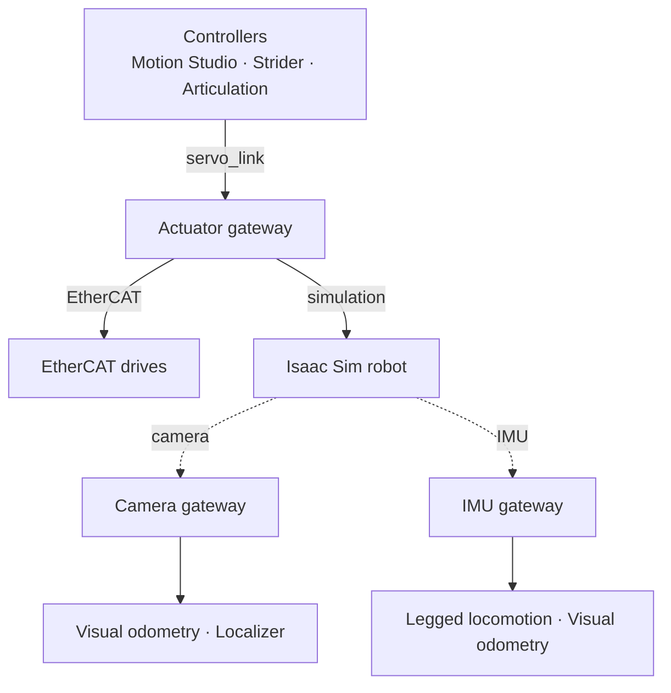

# Gateways Overview

A **gateway** is the node that connects the Station to the physical world: motors, drives and sensors, real or simulated. Controllers never talk to hardware directly. They exchange commands and states with a gateway through a port, and the gateway translates them for the fieldbus or the simulator.

Because only the gateway knows the hardware, the same controller and controller document can drive a simulated robot and the real one. To move from Isaac Sim to real motors, you give the robot an EtherCAT gateway document. Before you operate the real robot, verify its actuator mapping, calibration, limits and sensor settings: motor directions, gear ratios, encoder resolution and sensor mounting are properties of the hardware.

---

## Built-in Gateways

| Module | Node ID | Connects | Configured with |
| :--- | :--- | :--- | :--- |
| Actuator gateway | `sodero.actuator_gateway.NAME` | EtherCAT drives, or the joints of a robot in Isaac Sim | A `.gw` document ([Gateway Designer](../gateway_designer/index.md)) |
| Camera gateway | `sodero.camera_gateway.NAME` | An RGB-D camera: a camera in Isaac Sim, or a real camera through the [Device Bridge](../device_bridge/index.md) | Camera settings in the inspector ([Sensors and Cameras](../sensors_and_cameras/index.md)) |
| IMU gateway | `sodero.imu_gateway.NAME` | An IMU (and foot contacts in Isaac Sim): in Isaac Sim, or through the Device Bridge | IMU settings in the inspector ([Sensors and Cameras](../sensors_and_cameras/index.md#2-imu-gateway)) |

For devices the built-in gateways do not cover, you can write your own gateway as a module with the role `gateway` ([Create Custom Modules](../../extend/custom_modules/index.md)). Once installed, it appears in **Add node** › **Gateway** with the **CUSTOM** badge.

---

## Actuator Gateway Types

The `.gw` document chooses how the actuator gateway reaches its actuators:

| Type | `hardware.type` | Use | Page |
| :--- | :--- | :--- | :--- |
| **EtherCAT** | `ethercat` | CiA 402 servo drives on the controller's EtherCAT port, synchronized by distributed clocks | [EtherCAT Gateway](../ethercat/index.md) |
| **Isaac Sim** | `simulation` | The joints of a robot in NVIDIA Isaac Sim, through the Isaac Bridge extension | [Simulation Gateway](../simulation/index.md) |

---

## Actuators and Indices

A gateway drives a list of **actuators**, numbered from zero in the order they are defined (actuator 1 is index 0, actuator 2 is index 1, …). For EtherCAT, the order of the actuators is the order of the drives on the cable.

A controller's document refers to these indices to say which actuator drives which joint or wheel. For example, a Strider document for a 4-wheel base maps its wheels to the gateway's actuators `[0, 1, 2, 3]`.

Motor units and joint units are defined in different documents:

| Unit | Where it is defined |
| :--- | :--- |
| Motor (rpm, Nm, encoder counts) | The gateway's actuator specification: gear ratio, torque and speed limits, encoder resolution |
| Joint or wheel (rad, rad/s, m) | The controller's document: kinematics, limits, and the mapping from actuators to joints |

---

## Safety Behavior

- **Watchdog.** If a controller stops sending commands while the servo is on, the gateway keeps the last command for 3 s, then switches the servo off.
- **Limits.** The gateway clamps velocity and torque commands to the actuator limits of its document. Position limits come from the controller's document.
- **Emergency stop.** When a controller or the [test console](../test_console/index.md) requests an emergency stop, the gateway sends a quick stop to the EtherCAT drives and switches the servo off. How the drives slow down depends on their quick stop settings. These software stops do not replace the hardware emergency stop ([Stop Controls](../../hardware_setup/stop_controls/index.md)).
- **Fault reporting.** Drive faults, lost communication and missing devices are reported in the gateway's **Gateway events** log with a hint about what to check ([Running Nodes](../../station/running_nodes/index.md#5-logs)).
- **One hardware type per gateway.** A gateway drives either real drives on one bus or one simulated robot. Use separate gateways for separate buses.
