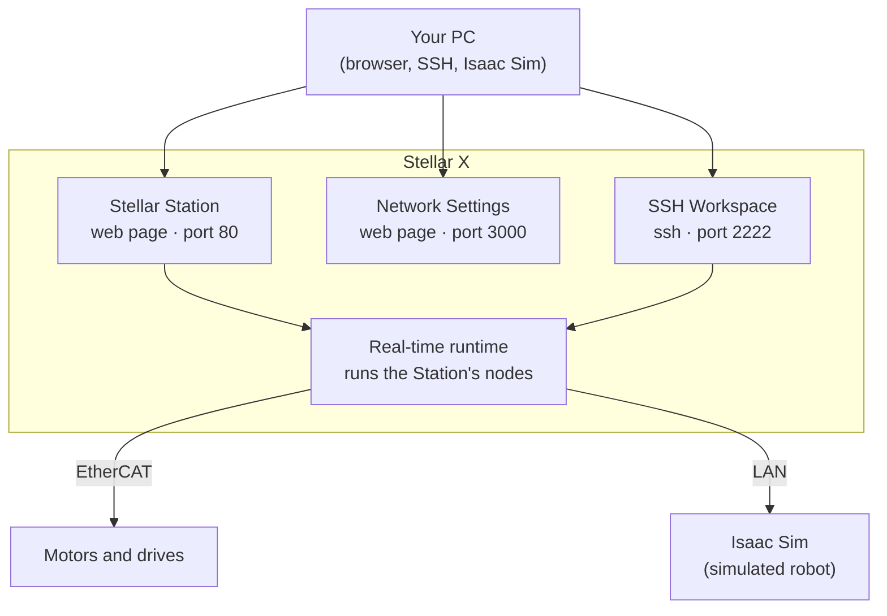
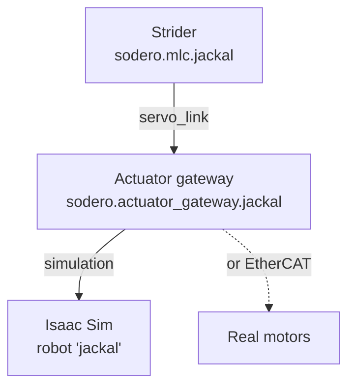

# Key Concepts

This page explains the building blocks you will meet everywhere in Stellar: the Station, nodes, ports, gateways, controllers and design documents. Read it once before you follow the [Learning Path](../../tutorials/learning_path/index.md); the rest of the documentation uses these terms without explaining them again.

---

## What Runs on Stellar X

| Part | What it is |
| :--- | :--- |
| **Stellar Station** | The web page of the controller (`http://ROBOT_ADDRESS`). You build the robot system as a graph of nodes, load their documents, start them and watch their logs. |
| **Network Settings** | A small page on port 3000 for the LAN address and SSH keys. See [Network Settings](../../hardware_setup/stellar_series/network_settings/index.md). |
| **SSH Workspace** | A development environment on the controller with the `sodero` command-line tool, for scripts and AI coding agents. See [SSH Workspace](../../ssh_workspace/overview/index.md). |
| **Runtime** | Runs the Station's nodes in real time. |

---

## Station and Nodes

A **Station** is the complete robot system on one controller. It is a graph of **nodes**: each node is one program, such as a motor gateway, a robot controller, a camera or your own application.

When you click **Add node** on the Station page, you choose one of four node types:

| Type | Purpose | Built-in modules |
| :--- | :--- | :--- |
| **Gateway** | Connects simulation or hardware to the system | Actuator gateway, IMU gateway, Camera gateway |
| **Controller** | Defines a robot unit and its control | Motion Studio, Strider, Articulation, Localizer, Visual odometry, Navigator, and Legged locomotion (prepared with Sodero support) |
| **Compound** | Combines several robot units into one system | Your own compound modules |
| **Application** | Defines robot behaviors and task logic | Your own modules |

Most built-in nodes have an ID of the form `sodero.<kind>.<name>`. You choose the name; the kind comes from the module:

| Module | Node ID |
| :--- | :--- |
| Actuator gateway | `sodero.actuator_gateway.NAME` |
| Camera gateway | `sodero.camera_gateway.NAME` |
| IMU gateway | `sodero.imu_gateway.NAME` |
| Motion Studio | `sodero.mmc.NAME` |
| Strider | `sodero.mlc.NAME` |
| Articulation | `sodero.amc.NAME` |
| Visual odometry, Localizer, Navigator | `sodero.visual_odometry`, `sodero.localizer`, `sodero.navigator` (one of each per Station) |

The rules for `NAME` are in [Nodes and Connections › Node Types and Modules](../../station/nodes_and_connections/index.md#node-types-and-modules).

---

## Ports and Connections

Nodes work together through **ports**. Every node card on the Station page lists two kinds:

- **REQUIRES**: a service the node needs from another node.
- **PROVIDES**: a service the node offers to other nodes.

You connect a required port to a compatible provided port by dragging between them. The most important connection is the **servo link** between a controller and its gateway:

| From (requires) | To (provides) | Meaning |
| :--- | :--- | :--- |
| Motion Studio, Strider, Articulation `servo_link` | Actuator gateway `servo_link` | The controller drives the gateway's actuators |
| Localizer `camera` | Camera gateway `camera` | The localizer sees through this camera |
| Localizer `odometry` | Strider `odometry` (or Visual odometry) | The localizer follows the robot's motion |
| Navigator `localization`, `map` | Localizer `localization`, `map` | Where the robot is, and the map to plan on |
| Navigator `mobile_base` | Strider `mobile_base` | The base the navigator drives |

The Station only connects compatible ports, so a wrong connection is refused at once instead of failing later.

---

## Gateways: Simulation or Real Hardware

A **gateway** is the only node that talks to actuators. Controllers never touch hardware directly; they send commands through their gateway. That is why the same controller and controller document can drive a simulated robot and a real one: the gateway's document decides which. The real robot still needs its own checks of actuator mapping, calibration, limits and sensors.

| Hardware type of the `.gw` | Drives |
| :--- | :--- |
| **Isaac Sim** | A robot in **NVIDIA Isaac Sim** on a PC on the same network, through the Isaac Bridge extension |
| **EtherCAT** | Real EtherCAT drives on the controller's EtherCAT port |

!!! warning "**Names must match.** A simulation gateway finds its robot in Isaac Sim by name. The gateway's **Robot name** must be exactly the name of the robot's articulation prim in the Isaac Sim scene (for example `/World/jackal` for the robot name `jackal`). With a different name, the gateway keeps waiting and the robot never moves. See [Simulation Gateway](../../gateways/simulation/index.md)."

---

## Design Documents

Actuator gateways and robot controllers are configured by a **design document**. You create documents with **Stellar Designer** (gateway documents with its **Gateway Designer**) and load them into nodes on the Station page.

| File | Node | Contents |
| :--- | :--- | :--- |
| `.gw` | Actuator gateway | Hardware type, actuators, EtherCAT or simulation settings |
| `.sdd` | Motion Studio | Manipulator: kinematics, dynamics, actuator mapping |
| `.sddm` | Strider | Mobile base: drive type, wheels, limits, actuator mapping |
| `.sdda` | Articulation | Articulated robot: joints and actuator mapping |

Camera and IMU gateways, visual odometry, the localizer and the navigator have no design document. They have **settings** that you edit in the node's inspector on the Station page ([Design Documents](../../station/design_documents/index.md#4-settings-of-sensor-and-navigation-nodes)). The localizer and the navigator also use a **map bundle** (`.nav`): one file with the map of the site and their settings ([Load and Configure a Map](../../navigation/map_bundle/index.md)).

Your own programs are installed as **modules** (packages) on the [Modules](../../station/modules/index.md) page and run as nodes on the Station.

---

## Simulation First, Then Real

The recommended workflow follows the same order every time:

1. **Design** the robot in Stellar Designer (`.sdd`, `.sddm` or `.sdda`).
2. **Simulate**: add a simulation gateway and the controller on the Station, connect them, and drive the robot in Isaac Sim.
3. **Go real**: give the robot an EtherCAT gateway document for its drives. The controller, its document and your applications are reused. Before you operate the robot, verify the actuator mapping, calibration, limits and sensor settings on the hardware, as in [EtherCAT Mobile Base](../../tutorials/ethercat_mobile_base/index.md).

---

## Glossary

| Term | Meaning |
| :--- | :--- |
| Station | The robot system on one controller, shown as a node graph on the Station page |
| Node | One program in the Station, such as a gateway, a controller, a sensor or your module |
| Port | A connection point of a node: REQUIRES (needs) or PROVIDES (offers) |
| Gateway | A node that connects controllers to actuators or sensors, real or simulated |
| Controller | A node of the Controller type: a robot controller, such as Motion Studio, Strider or Articulation, or a navigation node (Localizer, Visual odometry, Navigator) |
| Design document | The configuration file of an actuator gateway or a robot controller: `.gw`, `.sdd`, `.sddm`, `.sdda` |
| Map bundle | A `.nav` file with the map of a site and the settings of the localizer and the navigator |
| Module | A program that runs as a node: built in, or your own package installed on the Modules page |
| SDR | A backup file of the whole Station: graph, documents and settings |
| World | The simulated scene in Isaac Sim that the Station's simulation gateways connect to |
| Isaac Bridge | The Isaac Sim extension that connects the World to the Station |
