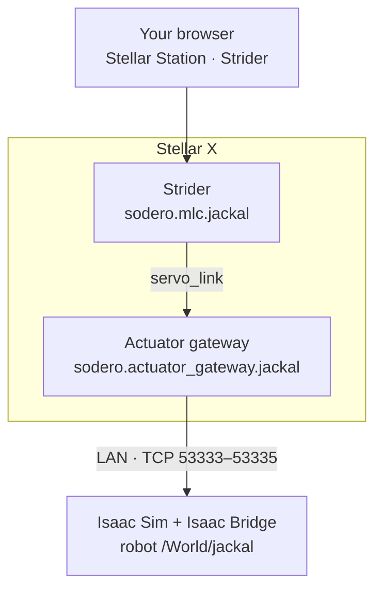
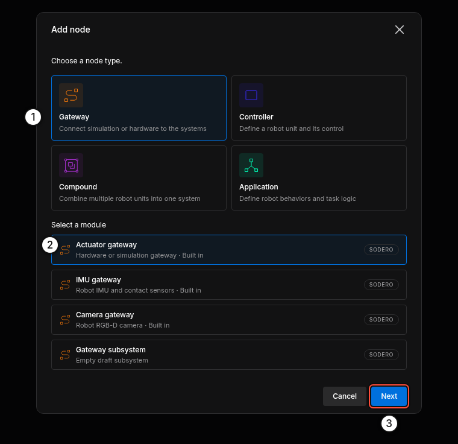
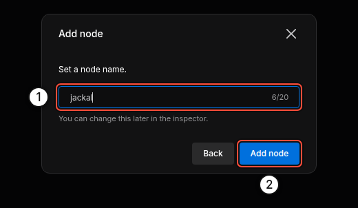
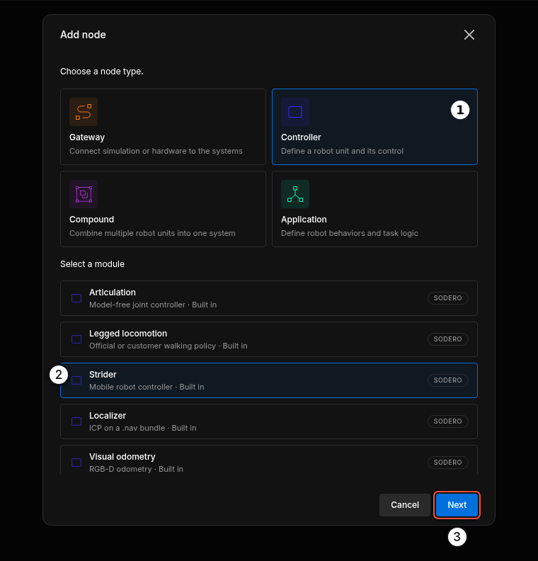
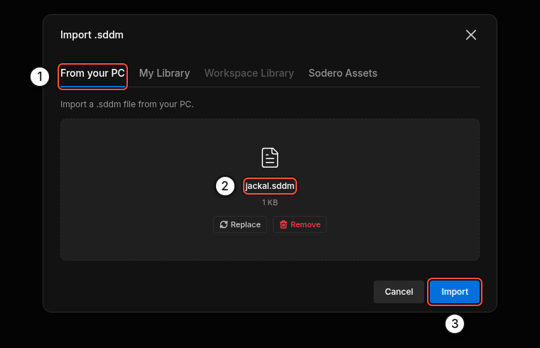
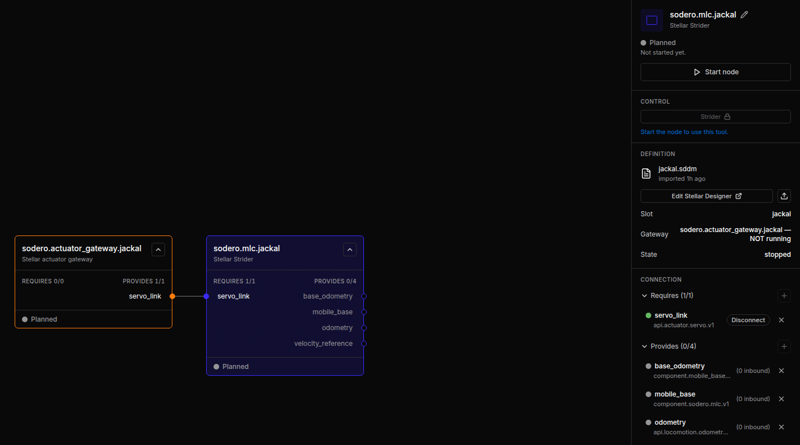
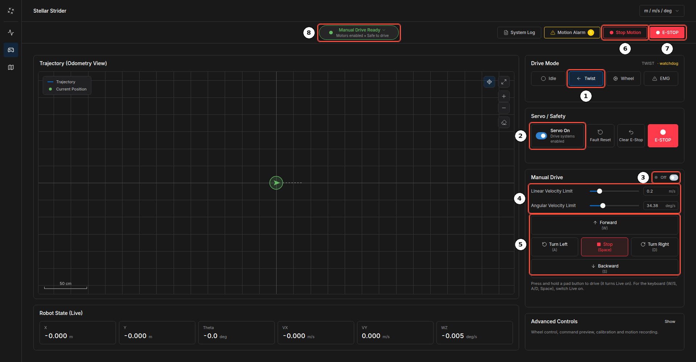

# Quick Start

You will build a small robot system on Stellar X and drive a simulated **Clearpath Jackal** in NVIDIA Isaac Sim with Strider. It takes about 15 minutes once Stellar X is on your network and Isaac Sim with the Isaac Bridge extension is installed (see **Before You Start**). You will:

1. add an actuator gateway and a Strider controller on Stellar Station,
2. load their design documents,
3. connect Isaac Sim, and
4. jog the robot from the browser.



---

## Before You Start

| You need | Details |
| :--- | :--- |
| Stellar X | Powered on and reachable from your PC ([Stellar X › Network Configuration](../../hardware_setup/stellar_series/stellar_x/index.md#4-network-configuration), [Network Settings](../../hardware_setup/stellar_series/network_settings/index.md)). In this guide its address is `192.168.60.18`, an example address on a lab network; use your controller's address instead, for example `10.0.0.1` on a direct cable. |
| A PC with NVIDIA Isaac Sim | Isaac Sim 6.0 with the Isaac Bridge 1.0.0 extension installed and enabled ([Isaac Bridge Installation](../../virtual_simulation/extension_installation/index.md)), on the same network as Stellar X. In this guide its address is `192.168.60.20`. |
| Example files | [jackal.gw](files/jackal.gw) (gateway), [jackal.sddm](files/jackal.sddm) (Strider) and [jackal_warehouse.zip](files/jackal_warehouse.zip) (Isaac Sim scene, 6 MB). Download all three and extract the scene. |

---

## Step 1: Add the Gateway

1. Open `http://192.168.60.18` in your browser.
2. Click **Add node**, choose **Gateway** ①, then **Actuator gateway** ② and click **Next** ③.

    <figure markdown="span">
      { width="620" }
      <figcaption>Gateway › Actuator gateway</figcaption>
    </figure>

3. Name it `jackal` ① and click **Add node** ②.

    <figure markdown="span">
      { width="460" }
    </figure>

---

## Step 2: Load the Gateway Document

1. Select the new node `sodero.actuator_gateway.jackal`. In its inspector, click the upload icon in **DEFINITION** (**Import .gw**).
2. On **From your PC** ①, choose `jackal.gw` ② and click **Import** ③.

    <figure markdown="span">
      { width="560" }
    </figure>

3. In **TARGET**, click **Change** and set the two values:
    - **Robot name**: `jackal`. It must equal the robot's prim name in Isaac Sim (`/World/jackal`).
    - **Sim host**: the IP address of your Isaac Sim PC.

    Click **Done**.

    <figure markdown="span">
      { width="331" }
    </figure>

!!! warning "If the robot name differs from the prim name in Isaac Sim, the gateway waits forever and the robot never moves."

---

## Step 3: Add Strider and Connect It

1. Click **Add node**, choose **Controller** ① › **Strider** ② and click **Next** ③. Name it `jackal` and click **Add node**.

    <figure markdown="span">
      { width="620" }
    </figure>

2. Select `sodero.mlc.jackal` and click the upload icon in **DEFINITION** (**Import .sddm**). On **From your PC** ①, choose `jackal.sddm` ② and click **Import** ③.

    <figure markdown="span">
      { width="560" }
    </figure>

3. Connect the two nodes: drag from the Strider's `servo_link` (left edge) to the gateway's `servo_link` (right edge), or click **Auto-connect** next to `servo_link` in the Strider's inspector.

<figure markdown="span">
  { width="900" }
  <figcaption>The gateway and Strider connected through servo_link</figcaption>
</figure>

---

## Step 4: Play the Scene in Isaac Sim

1. Open `jackal_warehouse.usd` in Isaac Sim (**File › Open**). The scene contains a Clearpath Jackal at `/World/jackal` and a Clearpath Dingo at `/World/dingo_d` in a warehouse.
2. Press **Play**.
3. Open **Window › Isaac Bridge**. It shows the ports as **serving** and `jackal … bound, 4 DOF`.

<figure markdown="span">
  { width="520" }
  <figcaption>Isaac Bridge status: ① ports serving ② robots bound ③ cameras ④ Rescan</figcaption>
</figure>

!!! info "The Isaac Sim PC must accept TCP connections from Stellar X on ports 53333–53335. Allow them in its firewall ([Isaac Bridge Installation](../../virtual_simulation/extension_installation/index.md#4-allow-the-ports-in-the-firewall))."

!!! idea "**Tip:** To use your own robot instead, prepare its scene as described in [Robot Setup](../../virtual_simulation/robot_setup/index.md): its articulation prim name is its robot name, and its joints, in order, are the gateway's actuators."

!!! idea "**Tip:** If you will continue with [Navigate in Simulation](../../navigation/simulation_tutorial/index.md), start Isaac Sim with the camera setting of its [Step 1](../../navigation/simulation_tutorial/index.md#step-1-prepare-isaac-sim) now. Then you do not need to restart Isaac Sim later."

---

## Step 5: Start the Nodes

1. Select the gateway and click **Start node**. Wait until its state is **Operating**.
2. Select the Strider and click **Start node**.

In the gateway's **LOGS** (stream **Gateway events**) you see the connection to Isaac Sim:

```text
Gateway sodero.actuator_gateway.jackal starting: simulation, 4 actuator(s), 1.0 ms cycle.
Simulation: robot 'jackal', simulator at 192.168.60.20; waiting for it to start.
Simulator connected.
```

---

## Step 6: Jog the Robot with Strider

1. In the Strider node's inspector, click **Strider** in **CONTROL**. Strider opens in a new tab.
2. Open the **Drive** page (gamepad icon in the left rail).
3. Under **Drive Mode**, click **Twist** ①.
4. Under **Servo / Safety**, switch **Servo On** ②.
5. Press and hold **Forward (W)** on the pad ⑤. The robot drives while you hold the button and stops when you release it. **Turn Left (A)**, **Turn Right (D)** and **Backward (S)** work the same way.

<figure markdown="span">
  { width="1000" }
  <figcaption>Strider's Drive page: ① Twist ② Servo On ③ Live switch for the keyboard ④ speed limits ⑤ drive pad ⑥⑦ stop and emergency stop ⑧ readiness</figcaption>
</figure>

!!! idea "**Tip:** Switch on **Live** ③ in **Manual Drive** to drive with the keyboard: **W**/**S** forward and back, **A**/**D** turn, **Space** stops."

<figure markdown="span">
  { width="900" }
  <figcaption>The simulated Jackal after a short drive and turn</figcaption>
</figure>

When you are done, switch the servo off and click **Idle** under **Drive Mode**.

---

## What's Next

| Next step | Page |
| :--- | :--- |
| Let the Jackal localize itself on a map and drive to goals | [Navigate in Simulation](../../navigation/simulation_tutorial/index.md) |
| Learn every part of the Station page | [Stellar Station](../../station/overview/index.md) |
| Build your own robot documents | [Stellar Designer](../../tutorials/stellar_designer/introduction/index.md), [Gateway Designer](../../gateways/gateway_designer/index.md) |
| Move from simulation to real motors | [EtherCAT Mobile Base](../../tutorials/ethercat_mobile_base/index.md), [EtherCAT Gateway](../../gateways/ethercat/index.md) |
| Let an AI coding agent do it for you | [AI Coding Agents](../../ssh_workspace/ai_agents/index.md) |
