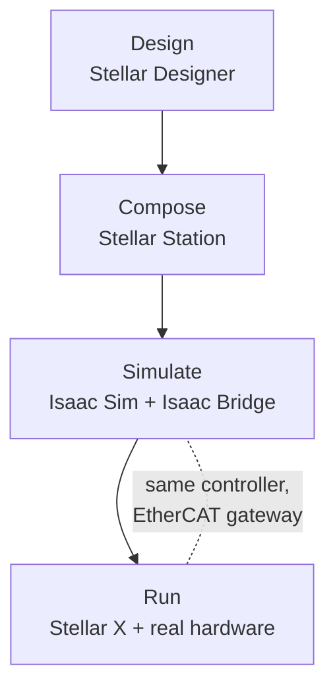

# Sodero Ecosystem

## One Platform from Design to the Real Robot
Sodero connects robot design, simulation and operation on one controller. You describe the robot in Stellar Designer, run it on Stellar X with the built-in controllers, and drive it in NVIDIA Isaac Sim or on real motors through a gateway.

The same controller and application structure can be reused in simulation and on supported hardware. Before operating the physical robot, configure its gateway and verify actuator mapping, calibration, limits and sensor settings.

### Core Architecture

**Gateways separate controllers from hardware.** Controllers never talk to hardware directly. A gateway connects them to EtherCAT drives, to a robot in NVIDIA Isaac Sim, or to sensors, so the same controller and controller document can drive a simulated robot and a real one.

**One Station for every node.** Gateways, controllers, navigation and your own modules run as nodes of one Station on Stellar X. They are connected through ports with defined interfaces, so built-in nodes and your own work together in the same way on every robot.

---

### From Design to the Real Robot
The Sodero ecosystem connects the entire process, from robot design and validation to physical deployment, into a single pipeline.

**Design: Stellar Designer.** A web-based tool for defining your robot's kinematics, links, joints, wheels and actuator mapping, and the gateway that connects its actuators, without any hardware.

**Compose: Stellar Station.** The control center on the controller. Add gateways and controllers as nodes, connect their ports, load their design documents and start them, all in the browser.

**Simulate: NVIDIA Isaac Sim.** The Isaac Bridge extension connects a robot in Isaac Sim to the Station. The simulated robot is driven by the same controller and controller document as the real one, through a simulation gateway instead of an EtherCAT gateway.

**Run: Stellar X.** The motion controller with an EtherCAT master that runs the Station and its nodes. On the real robot, its EtherCAT gateway drives the servo drives, after you have checked the actuator mapping, calibration and limits on the hardware.

In simulation and on the real robot alike, you operate the robot from the same built-in controller UIs: **Motion Studio** for manipulators, **Strider** for mobile bases and **Articulation** for articulated and legged robots.

!!! idea "**Tip:** Every tool runs in the browser and is served by Stellar X itself. Connect a PC to the controller's network and open its address; there is nothing to install on your PC except Isaac Sim and the Isaac Bridge extension for simulation."

!!! info "**Sodero Cloud.** The same Stellar Station, design documents and controller UIs also run in Sodero Cloud, where robots are simulated in Robot Worlds in the browser instead of Isaac Sim on your PC. See the [Sodero Cloud manual](https://docs.sodero.io/sodero-cloud/latest/)."

---

### Integration and Extensibility
Beyond controlling a single robot, Sodero fits into complex system integration (SI) environments.

**Modules.** Package your own programs and install them on the Station. They run as nodes next to the built-in ones and use the same interfaces to command robots, read sensors and send navigation goals.

**SSH Workspace and the `sodero` CLI.** Every Station operation is available as a command that prints JSON, for scripts, CI pipelines and AI coding agents.

---

### What's New in 2.0

Version 2.0 turns Stellar X from a single-robot motion controller into a complete robot system on one controller:

- **Stellar Station**: build the robot system as a graph of nodes (gateways, controllers, sensors, navigation and your own modules) and run it from the browser.
- **One Stellar Designer** for every design document: manipulators (`.sdd`), mobile bases (`.sddm`), articulated robots (`.sdda`) and gateways (`.gw`).
- **Mobile robots and navigation**: Strider drives wheeled bases; the Localizer and Navigator add map-based localization and autonomous navigation.
- **Isaac Bridge**: connect robots in NVIDIA Isaac Sim to the Station over the network, with cameras and IMUs.
- **SSH Workspace and AI agents**: develop on the controller over SSH and let AI coding agents operate the Station with the `sodero` CLI.

Continue with [Key Concepts](../key_concepts/index.md), then try the [Quick Start](../quick_start/index.md).
