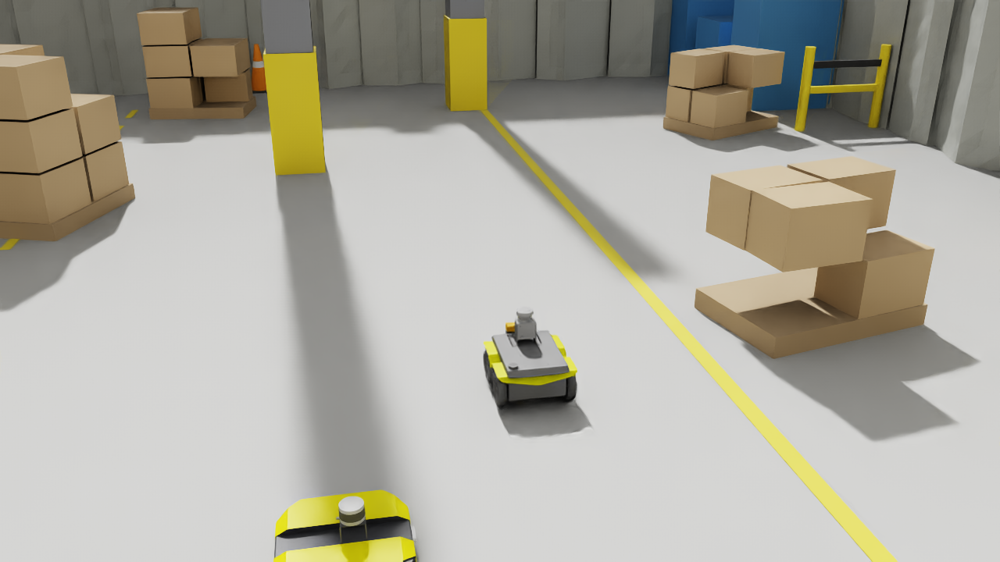
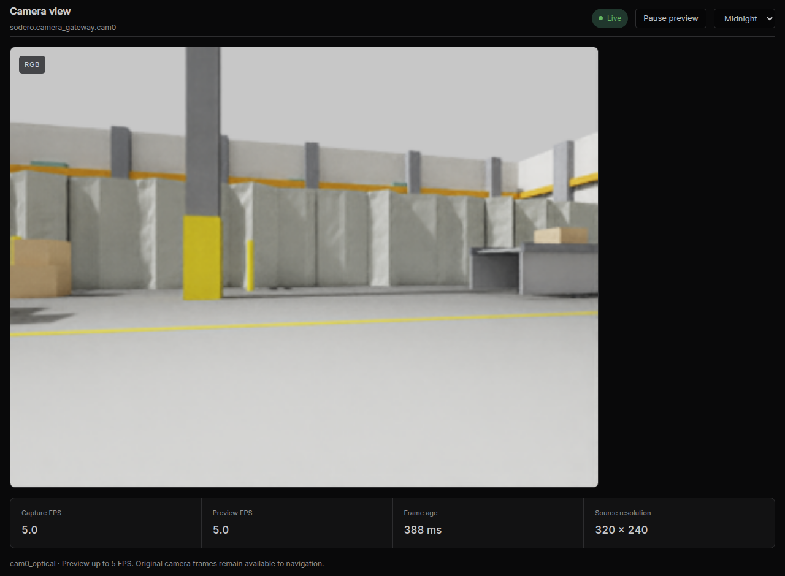
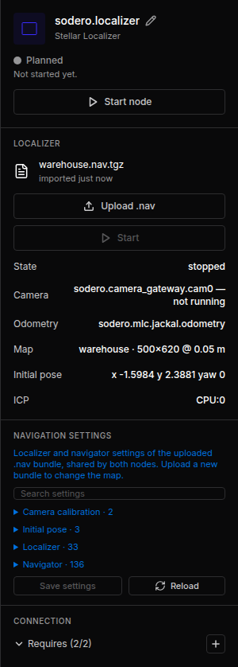
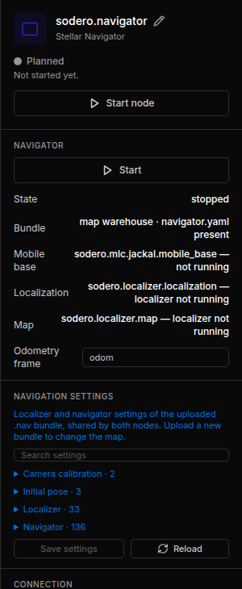
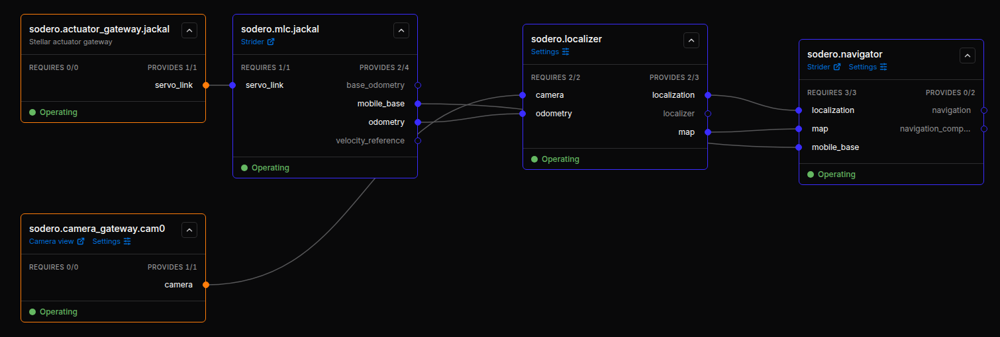
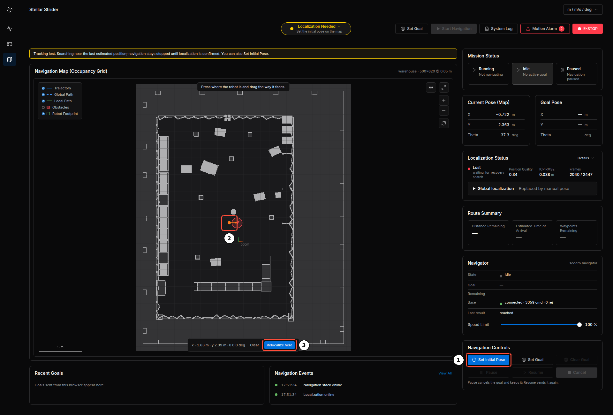
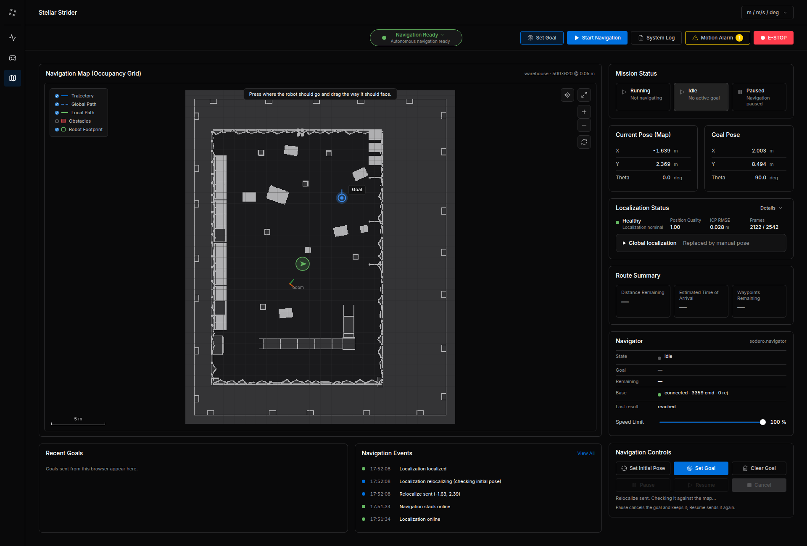
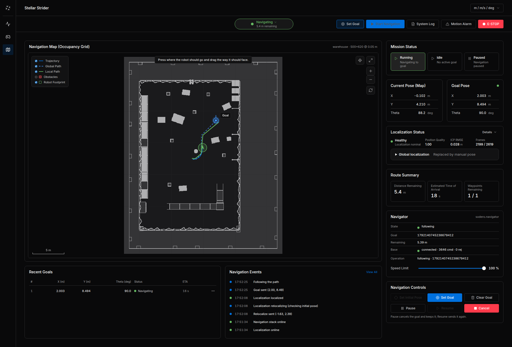
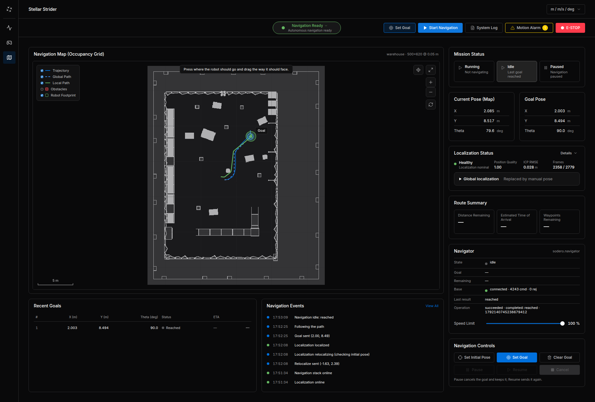
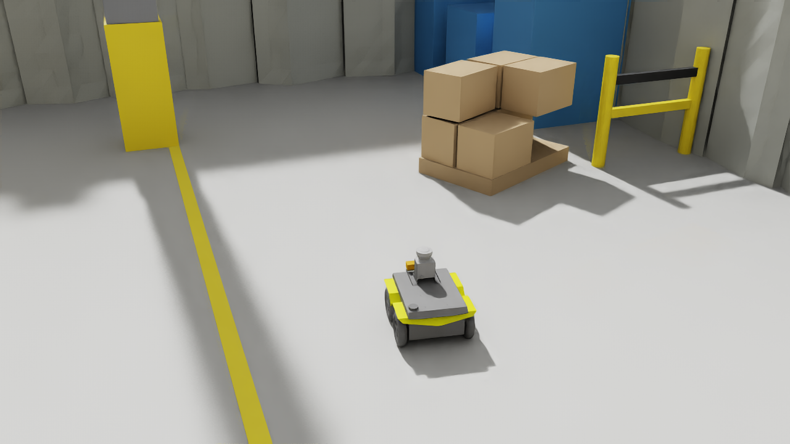

# Navigate in Simulation

This tutorial continues the [Quick Start](../../get_started/quick_start/index.md). You add a camera, the Localizer and the Navigator to the simulated Jackal, load the map of its warehouse, let the robot find itself on the map, and send it to a goal.

<figure markdown="span">
  { width="900" }
  <figcaption>The Jackal (center) driving to a goal in the warehouse, guided by the Station's navigation stack</figcaption>
</figure>

---

## Before You Start

| You need | Details |
| :--- | :--- |
| The Quick Start setup | `sodero.actuator_gateway.jackal` and `sodero.mlc.jackal`, running, with the Jackal driving in Isaac Sim |
| The example scene | `jackal_warehouse.usd` from the Quick Start ([jackal_warehouse.zip](../../get_started/quick_start/files/jackal_warehouse.zip)). The Jackal carries a depth camera `cam0` on its `base_link`, 0.22 m ahead of the base and 0.47 m above the floor, looking forward with a 90° horizontal field of view. |
| The map bundle | [warehouse.nav.tgz](files/warehouse.nav.tgz): the map of the warehouse scene with the settings used in this tutorial |

---

## Step 1: Prepare Isaac Sim

The localizer in this tutorial uses the camera at 320 × 240 pixels and 5 frames per second. Isaac Bridge renders cameras at 640 × 480 and 15 frames per second unless told otherwise, so start Isaac Sim from its installation folder with this camera setting (close it first if it runs):

=== "Linux"

    ```sh
    RC_ISAAC_CAMERA_DEVICES='[{"name": "cam0", "width": 320, "height": 240, "fps": 5}]' ./isaac-sim.sh
    ```

=== "Windows (Command Prompt)"

    ```bat
    set "RC_ISAAC_CAMERA_DEVICES=[{"name": "cam0", "width": 320, "height": 240, "fps": 5}]"
    isaac-sim.bat
    ```

Then open `jackal_warehouse.usd` and press **Play**. The Isaac Bridge window lists `cam0  320x240 at 5 fps`.

Check two more things before you go on:

- **Clocks.** The clocks of Stellar X and the Isaac Sim computer must agree within 20 ms. Synchronize both with a time server (NTP). If you cannot, see [Camera Timing](#camera-timing).
- **Quick Start nodes.** If you restarted Isaac Sim for this step, check that the gateway logs *Simulator connected again; turn the servo on to continue.* once the scene plays: the nodes reconnect by themselves ([Connect to Stellar Station › Stop, Pause and Play](../../virtual_simulation/connect_station/index.md#4-stop-pause-and-play)). You switch the servo on again in [Step 6](#step-6-start-and-localize).

---

## Step 2: Add the Camera Gateway

1. **Add node** › **Gateway** › **Camera gateway**, name it `cam0` ([Cameras and IMUs](../../gateways/sensors_and_cameras/index.md#1-camera-gateway)).
2. In its inspector, set **Camera name** `cam0` (the camera prim's name in the scene) and **Camera host** (the Isaac Sim computer). The port is `53335`.
3. With the camera node stopped, open **CAMERA SETTINGS** and enter the values of the table below. **horizontal fov deg** is under **Intrinsics**; a new gateway shows it without a mode selector.
4. Click **Save settings**, then **Start node**. Open **Camera view** on its card and check that frames arrive at `320 × 240`, about `5 fps`. If the image stays empty, see [Camera Timing](#camera-timing).

!!! warning "Change the camera defaults before localization"

    A new camera gateway starts with **horizontal fov deg = 60** and **fps = 15**. The Jackal camera in `jackal_warehouse.usd` has a **90°** horizontal field of view, and this tutorial uses **5 fps**. Change both values before starting the Localizer. A visible image confirms reception; it does not confirm correct camera calibration. A wrong field of view distorts the 3D points reconstructed from depth, so the Localizer can remain **Initializing**, **Relocalizing** or **Lost** even while the image looks normal.

| Setting in CAMERA SETTINGS | New gateway default | Value for this tutorial |
| :--- | :--- | :--- |
| **Intrinsics › horizontal fov deg** | `60` | **`90` — change this** |
| **General › fps** | `15` | **`5` — change this** |
| **General › frame id** | `cam0_optical` | `cam0_optical` |
| **General › width**, **height** | `0`, `0` | Keep `0`, `0`: detect `320 × 240` from incoming frames |
| **Simulation camera › capture latency ns** | `0` | Keep `0` for this example |
| **Simulation camera › recv timeout ms** | `1000` | Keep `1000` |

The gateway's **fps** setting does not change Isaac Sim's rendering rate. Set the source to `320 × 240` at `5 fps` in [Step 1](#step-1-prepare-isaac-sim). For a different scene or camera, enter its actual field of view; `90` is the value for this example. Isaac Bridge prints the field of view when the scene starts.

<figure markdown="span">
  { width="800" }
  <figcaption>The Jackal's camera</figcaption>
</figure>

If you already started navigation with the defaults, see [Correct Settings on a Running Setup](#correct-settings-on-a-running-setup).

---

## Step 3: Add the Localizer and Load the Map

1. **Add node** › **Controller** › **Localizer**. It is named `sodero.localizer`.
2. In its inspector, click **Upload .nav** and choose `warehouse.nav.tgz`. The inspector shows the map: `warehouse · 500×620 @ 0.05 m`, and the initial pose of the bundle.

<figure markdown="span">
  { width="300" }
  <figcaption>The localizer with its map and connections</figcaption>
</figure>

---

## Step 4: Add the Navigator

**Add node** › **Controller** › **Navigator**. It is named `sodero.navigator` and uses the navigator settings of the same map bundle.

<figure markdown="span">
  { width="300" }
  <figcaption>The navigator, using the same map bundle</figcaption>
</figure>

---

## Step 5: Connect the Ports

Drag these five connections (from the required port on the left of a card to the provided port on the right of another):

| From | To |
| :--- | :--- |
| `sodero.localizer` › `camera` | `sodero.camera_gateway.cam0` › `camera` |
| `sodero.localizer` › `odometry` | `sodero.mlc.jackal` › `odometry` |
| `sodero.navigator` › `localization` | `sodero.localizer` › `localization` |
| `sodero.navigator` › `map` | `sodero.localizer` › `map` |
| `sodero.navigator` › `mobile_base` | `sodero.mlc.jackal` › `mobile_base` |

<figure markdown="span">
  { width="1000" }
  <figcaption>The complete navigation graph, all nodes operating</figcaption>
</figure>

!!! warning "When the Station has several Strider nodes, make sure the localizer's `odometry` and the navigator's `mobile_base` connect to the **same** robot."

---

## Step 6: Start and Localize

1. In Isaac Sim, stop and play the scene so the Jackal is back at its starting pose.
2. Start the nodes in order: `sodero.localizer`, then `sodero.navigator` (the gateway, the Strider and the camera already run).
3. In the gateway's log, after *Simulator connected again*, open Strider and switch **Twist** and **Servo On** again (a simulation restart turns the servo off).
4. Open Strider's **Navigation** page (the **Strider** link on the Navigator's card). **Localization Status** shows **Healthy** once the camera view matches the map.

If the status stays **Initializing**, **Relocalizing** or **Lost** while the camera image is visible, first check the saved **horizontal fov deg = 90** and **fps = 5** settings from [Step 2](#step-2-add-the-camera-gateway). If they are correct and the robot still cannot localize or appears at the wrong place, set the initial pose: click **Set Initial Pose** ①, press on the map where the robot is and drag in the direction it faces ②, then click **Set initial pose** (**Relocalize here** ③ when a pose was set before).

<figure markdown="span">
  { width="1000" }
  <figcaption>Setting the initial pose</figcaption>
</figure>

---

## Step 7: Send a Goal

1. Click **Set Goal**, press on the map at the goal and drag in the direction the robot should face. **Goal Pose** shows the coordinates.

    <figure markdown="span">
      { width="1000" }
      <figcaption>The goal is set; the robot is localized (Healthy)</figcaption>
    </figure>

2. Click **Start Navigation**. The planned path appears and the robot drives; **Navigator** shows *following* and **Route Summary** the remaining distance.

<figure markdown="span">
  { width="1000" }
  <figcaption>Following the path to the goal</figcaption>
</figure>

When the robot arrives, **Recent Goals** shows *Reached* and **Navigation Events** *Navigation idle: reached*.

<figure markdown="span">
  { width="1000" }
  <figcaption>Goal reached</figcaption>
</figure>

<figure markdown="span">
  { width="900" }
  <figcaption>The Jackal at the goal in Isaac Sim</figcaption>
</figure>

---

## Step 8: Finish

Click **Cancel** if a goal is still running, switch the servo off and choose **Idle** in Strider, then stop the nodes (navigator, localizer, camera, Strider, gateway) and the Isaac Sim scene.

---

## Troubleshooting

### Camera Timing

Every camera frame carries its capture time on the Isaac Sim computer's clock, and the camera gateway accepts only frames captured at most 20 ms ahead of and 2 s behind Stellar X's clock. It drops the others: the **Camera view** in Step 2 stays empty, and the camera gateway's log shows *Frames … are stale or carry capture times that do not match this Station's clock (clock skew?)*. Two computers that each follow a time server on the internet are easily more than 20 ms apart.

If you cannot synchronize the clocks, start Isaac Sim with `RC_CAMERA_CAPTURE_TIME=0` as well. The frames then carry no capture time, and the camera gateway stamps each frame when it arrives. An arrival time is later than the capture time by the rendering and network delay, so synchronized clocks remain the better choice for localization.

=== "Linux"

    ```sh
    RC_CAMERA_CAPTURE_TIME=0 RC_ISAAC_CAMERA_DEVICES='[{"name": "cam0", "width": 320, "height": 240, "fps": 5}]' ./isaac-sim.sh
    ```

=== "Windows (Command Prompt)"

    ```bat
    set "RC_CAMERA_CAPTURE_TIME=0"
    set "RC_ISAAC_CAMERA_DEVICES=[{"name": "cam0", "width": 320, "height": 240, "fps": 5}]"
    isaac-sim.bat
    ```

### Nodes After an Isaac Sim Restart

Restarting Isaac Sim interrupts the robot: the gateway loses the simulator and switches the servo off, and Strider stops the base. The nodes reconnect by themselves. Once the scene plays again, wait until the gateway logs *Simulator connected again; turn the servo on to continue.*, then switch **Twist** and **Servo On** again in Strider ([Connect to Stellar Station › Stop, Pause and Play](../../virtual_simulation/connect_station/index.md#4-stop-pause-and-play)). The Localizer may still hold its last pose; set the initial pose again if the robot appears at the wrong place.

### Correct Settings on a Running Setup

If you already started navigation with the defaults:

1. Cancel any active navigation goal and wait for the robot to stop.
2. Stop **Navigator → Localizer → Camera gateway**. The camera settings become editable after the camera node stops.
3. Set **horizontal fov deg** to `90` and **fps** to `5`, then click **Save settings**.
4. Start **Camera gateway → Localizer → Navigator**. Check the camera image and wait for **Localization Status: Healthy**. If it still needs an initial pose, set the robot's actual position and direction as described in [Step 6](#step-6-start-and-localize).

---

## Tips for Your Own Robot

- **Run the simulation in real time.** The controllers follow the simulation's time, but the camera localization runs on wall time. A slow simulation makes localization lag behind.
- **Skid-steer bases turn less than their wheels say**, because the wheels slide sideways. Let the robot turn in place before it drives (`rotate_to_heading_min_angle` about 0.25 rad), and calibrate the wheel offsets of the `.sddm` so odometry matches the real turn.
- **Repeating structures** (identical racks, long corridors) can mislead the localizer. Limit the correction per update (`icp.max_jump_m`, `icp.max_jump_rad`) and keep distinct objects in the camera's view.
- **The camera height** in the map bundle's extrinsics is measured from the floor ([Localization and Navigation](../overview/index.md#2-coordinate-frames)).

---

Next: [Create a Map from Your Site](../create_map/index.md), for the map of your own site.
