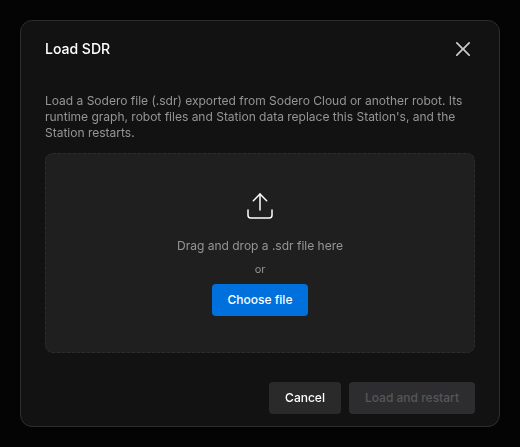

# Backup and Restore

The whole Station (its node graph, design documents, settings and Station data) can be saved to one **`.sdr`** file and loaded again on the same or another Stellar X. Use it to back up a working system, to copy a system to another robot, or to bring a Station built in Sodero Cloud onto a robot.

An `.sdr` file does not contain installed module packages. To restore a Station on another Stellar X, prepare that unit first ([Load on Another Stellar X](#3-load-on-another-stellar-x)).

---

## 1. Export the Station

Click **Export SDR** in the Runtime toolbar. Pending edits are saved first, then the browser downloads a file named after the Station, for example `stellar-x.sdr`.

The file contains:

| Part | Contents |
| :--- | :--- |
| Runtime graph | All nodes and their connections |
| Robot documents | The `.sdd`, `.sddm` and `.sdda` documents of the controllers |
| Station data | Gateway documents (`.gw`), settings of sensor and navigation nodes, maps and other Station state |

Installed module packages are not part of the file; they stay on the controller.

!!! idea "**Tip:** Export the Station before larger changes, such as importing a new document over a working one or loading another `.sdr`."

---

## 2. Load an `.sdr` File

1. Stop all nodes (**Start all nodes** menu › **Stop all nodes**).
2. Click **Load SDR**, drop the file or click **Choose file**.
3. Click **Load and restart**.

<figure markdown="span">
  { width="460" }
  <figcaption>Loading an .sdr file</figcaption>
</figure>

The Station replaces its graph, robot documents and Station data with the file's content and restarts. The page shows *Restarting the Station with …* and reloads when the Station is back, usually within a minute. The nodes are not started; start them when you need them.

- Installed modules stay installed.
- If the file cannot be loaded, the Station keeps its data and the dialog says why.
- After a successful load there is no command to return to the previous Station. Export the Station before you load another `.sdr` if you may need it again.

!!! warning "Loading is refused while any node runs: *Stop all nodes before loading a .sdr.*"

### Files That Cannot Be Loaded

| Message | Cause |
| :--- | :--- |
| *This .sdr holds a simulation, not a Station.* | The file is a World (simulation) export. Open it in Sodero Cloud. |
| *This robot does not have enough free disk space to load this .sdr.* | The unpacked file is too large for the controller's storage. |
| *This .sdr uses an obsolete document format (…).* | Documents in the file, named in the message, use the format of an earlier Stellar software version. Nothing is loaded. Contact [Sodero support](https://www.sodero.io/contact). |

---

## 3. Load on Another Stellar X

An `.sdr` file carries the Station, not the software of the unit. Before you load it on another Stellar X:

1. Make sure that the other unit runs the same version of the Stellar software as the unit the file comes from.
2. Install the module packages that the Station's nodes use, in the same versions, on the other unit's [Modules](../modules/index.md) page. Built-in modules come with the unit.
3. Load the file as described in [Load an `.sdr` File](#2-load-an-sdr-file).
4. Check each node before you start it: the simulator address (**Sim host**) and camera addresses, which belong to the original site, and on real hardware the EtherCAT wiring and the drives, which must match the gateway documents. Start the gateways first and test real hardware as on a new robot.
