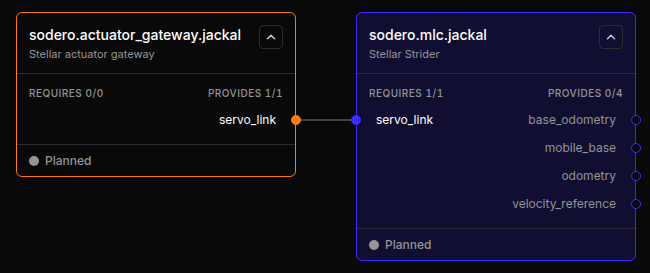
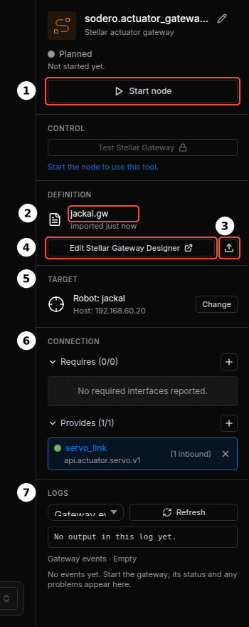
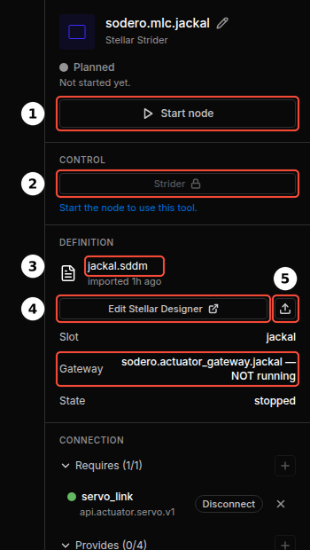

# Nodes and Connections

A Station is a graph of **nodes** connected through **ports**. This page shows how to add nodes, connect them, and rename or delete them. See [Key Concepts](../../get_started/key_concepts/index.md) for what the node types mean.

---

## 1. Add a Node

1. Click **Add node** in the toolbar (or right-click the empty canvas).
2. Choose a node type ①, select a module ② and click **Next** ③.

    <figure markdown="span">
      { width="620" }
      <figcaption>Gateway › Actuator gateway</figcaption>
    </figure>

3. Enter a node name ① and click **Add node** ②. You can rename the node later in the inspector.

    <figure markdown="span">
      { width="460" }
      <figcaption>Naming the node</figcaption>
    </figure>

The new node appears on the canvas in the **Planned** state. It is saved with the graph, but nothing runs until you start it.

### Node Types and Modules

| Type | Module | Typical use |
| :--- | :--- | :--- |
| **Gateway** | Actuator gateway | Motors and drives, real (EtherCAT) or simulated (Isaac Sim) |
| | IMU gateway | IMU and foot-contact data |
| | Camera gateway | An RGB-D camera |
| **Controller** | Motion Studio | Manipulators |
| | Strider | Wheeled mobile bases |
| | Articulation | Articulated robots with direct joint control |
| | Localizer | Map-based localization (one per Station) |
| | Visual odometry | Camera-based odometry (one per Station) |
| | Navigator | Path planning and goal following (one per Station) |
| **Compound** | Your compound modules | Several robot units combined into one system |
| **Application** | Your application modules | Robot behaviors and task logic |

The module sets the node's ID: an actuator gateway named `jackal` becomes `sodero.actuator_gateway.jackal`. The IDs of all built-in modules are listed in [Key Concepts › Station and Nodes](../../get_started/key_concepts/index.md#station-and-nodes).

!!! info "**Legged locomotion** and **Visual odometry** need preparation that this documentation does not cover step by step. Legged locomotion runs a walking policy made for your robot, whose joint names and order must match the robot's Articulation document. Visual odometry needs a calibrated camera, and an IMU for walking robots. This documentation describes their connections and settings; ask Sodero support before you use them on your robot."

Modules marked **SODERO** are built in. Modules you installed on the [Modules](../modules/index.md) page are marked **CUSTOM** and appear under the type they declare. Each type also lists a **… subsystem** entry (*Empty draft subsystem*): it adds an empty placeholder node with no program behind it, for sketching a system, and that node cannot be started.

<figure markdown="span">
  { width="620" }
  <figcaption>Choosing a controller module: ① Controller ② Strider ③ Next (the list scrolls)</figcaption>
</figure>

!!! info "**Name rules.** Gateway names have at most 64 characters. They are converted to lowercase, and every character other than `a`–`z`, `0`–`9`, `_` and `-` becomes `_`. Controller names (Motion Studio, Strider, Articulation) have at most 24 characters, start with a lowercase letter and use only lowercase letters, digits and `_`. Names of nodes from your own modules have at most 60 characters, start with a letter or digit and use letters, digits, `_`, `.` and `-`. The Localizer, Visual odometry and Navigator have fixed names."

!!! idea "**Tip:** Give a robot's gateway and controller the same name, for example `sodero.actuator_gateway.jackal` and `sodero.mlc.jackal`. The graph stays easy to read, and **Auto-connect** finds the right partner."

---

## 2. The Node Card

<figure markdown="span">
  { width="650" }
  <figcaption>A gateway and a Strider connected through servo_link</figcaption>
</figure>

| Part | Meaning |
| :--- | :--- |
| Title and module | The node ID and its module, for example `sodero.actuator_gateway.jackal` / Stellar actuator gateway. A running controller shows a link to its UI here. |
| **REQUIRES n/m** | Ports this node needs from other nodes: connected / total. Required ports sit on the left edge of the card. |
| **PROVIDES n/m** | Ports this node offers: ports with at least one connection / total. They sit on the right edge. |
| Status | The node's state, such as **Planned**, **Operating** or **Error** ([Running Nodes](../running_nodes/index.md#3-node-states)). |

The card border has the color of the node type: orange for gateways, blue-violet for controllers, purple for compounds and mint for applications.

---

## 3. Connect Ports

Connect a required port to a provided port of another node. There are three ways:

- **Drag** from one port dot to another. While you drag, compatible ports pulse blue and incompatible ones turn red.
- **Click** one port, then the other.
- In the inspector of the node that requires the port, click **Auto-connect** next to the port. The Station picks the matching provider.

The Station accepts a connection only when the two ports are on different nodes, one requires and the other provides, and both use the same contract (the interface type shown under the port name in the inspector, for example `api.actuator.servo.v1`). It also enforces the system structure:

- Only a **controller** may use a gateway.
- An **application** uses controllers or compounds, never gateways directly.
- An actuator gateway serves one robot controller (Motion Studio, Strider or Articulation) at a time.

### Common Connections

| Node (requires) | Port | Connect to (provides) |
| :--- | :--- | :--- |
| Motion Studio, Strider, Articulation | `servo_link` | Actuator gateway `servo_link` |
| Legged locomotion | `servo`, `imu` | Articulation `articulation`, IMU gateway `imu` |
| Localizer | `camera`, `odometry` | Camera gateway `camera`; Strider or Visual odometry `odometry` |
| Visual odometry | `camera`, `imu` (optional) | Camera gateway `camera`; IMU gateway `imu` |
| Navigator | `mobile_base`, `localization`, `map` | Strider `mobile_base`; Localizer `localization` and `map` |

To remove a connection, select the node and click **Disconnect** next to the port in the inspector.

!!! idea "**Tip:** A Motion Studio node can drive actuators of several gateways. Click **+ Gateway link** in its inspector to add another `servo_link` port."

---

## 4. The Inspector

Click a node to open its inspector. The sections depend on the node type.

<figure markdown="span">
  { width="320" }
  <figcaption>A gateway node: ① Start node ② its document ③ import ④ Gateway Designer ⑤ TARGET ⑥ CONNECTION ⑦ LOGS</figcaption>
</figure>

<figure markdown="span">
  { width="320" }
  <figcaption>A Strider node: ① Start node ② its controller UI ③ its document ④ Stellar Designer ⑤ import. The box shows the gateway it drives.</figcaption>
</figure>

| Section | Contents |
| :--- | :--- |
| Header | Node name (pencil icon to rename), module, state, and **Start node** / **Stop node** |
| **CONTROL** | Buttons that open the node's tool: **Stellar Motion Studio**, **Strider**, **Articulation** for controllers; **Test Stellar Gateway** for gateways. They unlock once the node runs. |
| **DEFINITION** | The node's design document: file name and when it was imported, **Edit Stellar Designer** / **Edit Stellar Gateway Designer**, and the upload icon to import a file ([Design Documents](../design_documents/index.md)) |
| **TARGET** | Simulation gateways only: the robot name in Isaac Sim and the **Sim host** ([Simulation Gateway](../../gateways/simulation/index.md)) |
| Settings | Camera, IMU, visual odometry, localizer, navigator and legged locomotion nodes: their settings form |
| **CONNECTION** | Requires and Provides ports with their contracts, **Auto-connect** and **Disconnect** |
| **LOGS** | Output and events of the node ([Running Nodes](../running_nodes/index.md#5-logs)) |

---

## 5. Rename and Delete

- **Rename:** stop the node, then click the pencil icon next to the node name in the inspector.
- **Delete:** stop the node, then right-click it and choose **Delete node**. The node and its connections are removed from the graph.

<figure markdown="span">
  { width="352" }
  <figcaption>Right-click menu of a node</figcaption>
</figure>

<figure markdown="span">
  { width="420" }
  <figcaption>Delete confirmation</figcaption>
</figure>

!!! warning "Deleting a node cannot be undone. Export the Station first if you may need the node again ([Backup and Restore](../backup_restore/index.md))."

---

## 6. Find Nodes in a Large Graph

- **Filter** shows nodes of one type or status.
- **Fit view** zooms to show every node; **Auto layout** arranges the nodes by their connections.
- The **N issues** chip at the left of the toolbar lists problems such as unconnected required ports; **Locate** jumps to the node.

<figure markdown="span">
  { width="260" }
  <figcaption>Filter by node type and status</figcaption>
</figure>
