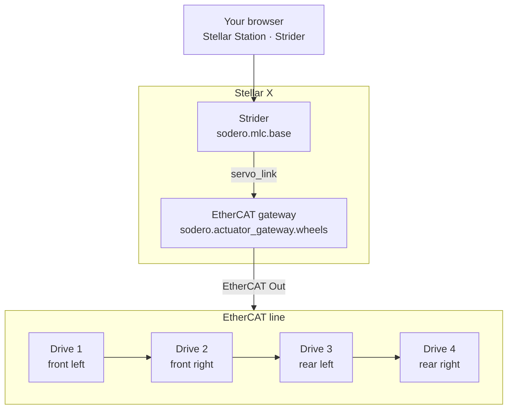
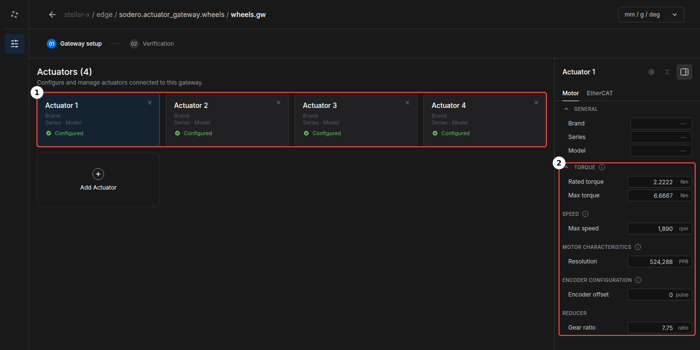
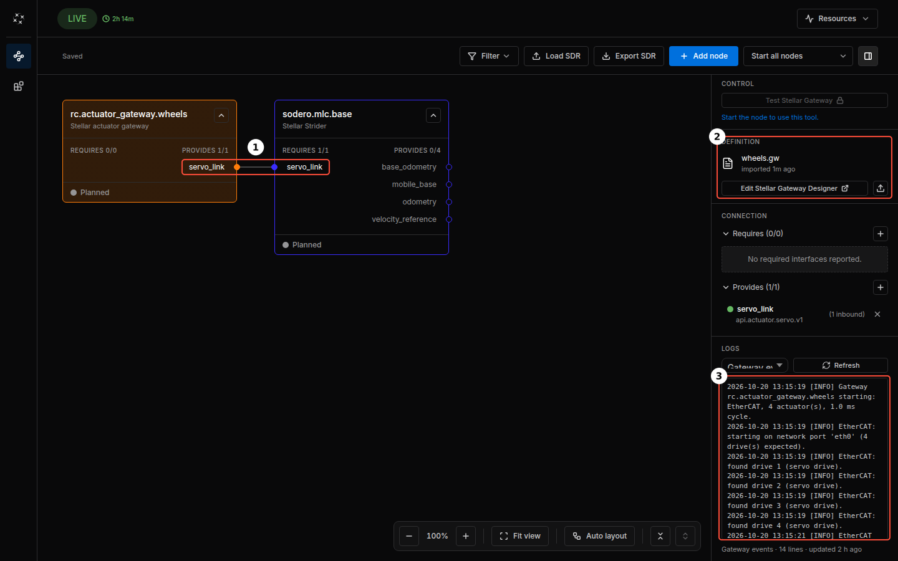
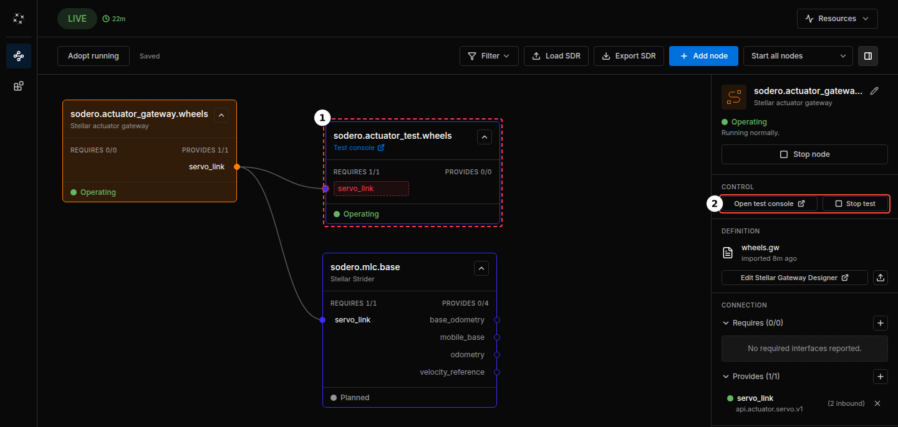
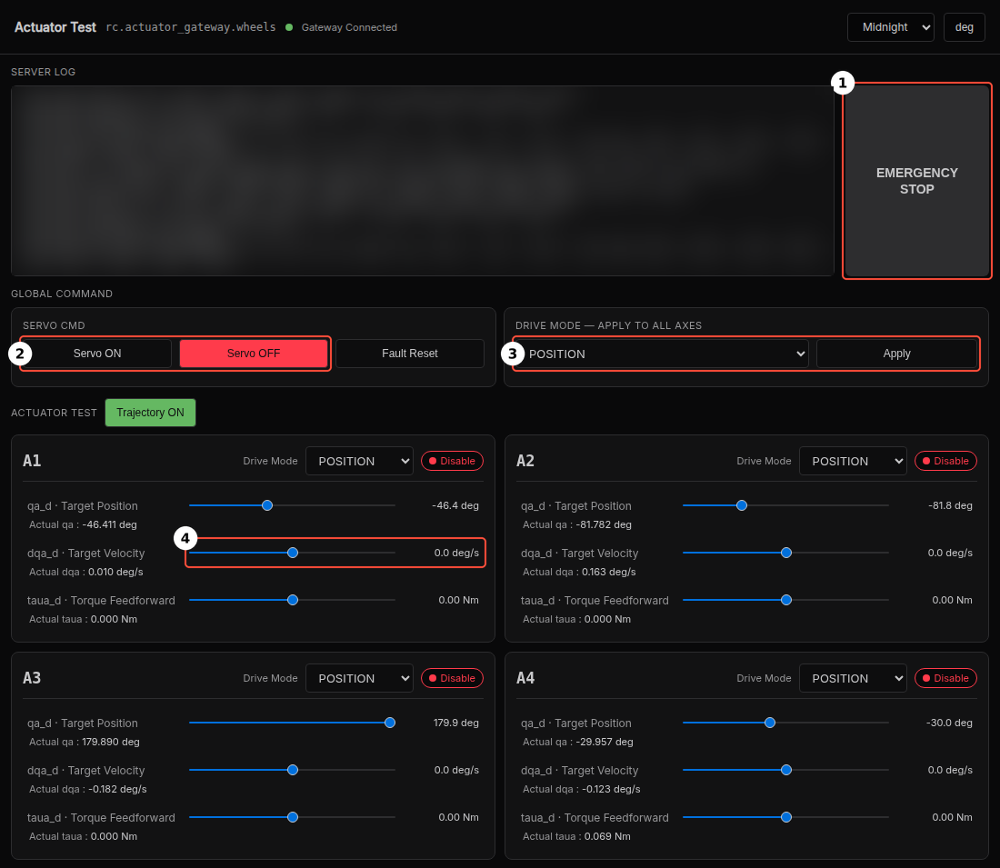

# EtherCAT Mobile Base

!!! info "Updated example pair (2026-10-27)"

    Download both the `.gw` and `.sddm` files from this page again if you have older copies. They use the current `sodero.*` node IDs; older screenshots may still show `rc.*`. See [Compatibility and Downloads](../../reference/compatibility/index.md#example-files).

This tutorial drives a four-wheel skid-steer base with four EtherCAT servo drives from Stellar X. It is the [Quick Start](../../get_started/quick_start/index.md) system on real motors: Strider still drives the base, and an EtherCAT gateway takes the place of the simulation gateway. You will:

1. wire the four drives to Stellar X,
2. add the gateway and Strider on Stellar Station and load their example documents,
3. bring up the EtherCAT network,
4. turn each wheel on its own from the gateway's test console, and
5. jog the wheels with Strider.



!!! error "**Real motors move.** Lift the base so that its wheels are off the ground until every wheel turns the right way. Wire the drives' safe torque off (STO) and an emergency stop, and keep the emergency stop within reach ([Stop Controls](../../hardware_setup/stop_controls/index.md))."

---

## Before You Start

| You need | Details |
| :--- | :--- |
| Stellar X | Powered on and reachable from your PC ([Network Settings](../../hardware_setup/stellar_series/network_settings/index.md)). In this guide its address is `192.168.60.18`. |
| Four servo drives | EtherCAT drives with the CiA 402 profile and cyclic synchronous velocity (CSV). Their RxPDO must include **Target velocity (0x60FF)** ([EtherCAT Gateway › What You Need](../../gateways/ethercat/index.md#1-what-you-need)). |
| Motors | One motor per wheel. The example uses motors with a rated torque of 2.2222 Nm, a peak torque of 6.6667 Nm, a maximum speed of 1,890 rpm and an encoder with 524,288 counts per turn, each behind a 7.75 : 1 gear. |
| A four-wheel base | The example base has wheels of 0.098 m radius at ±0.131 m front and back and ±0.188 m left and right of the base center. |
| Example files | [wheels.gw](files/wheels.gw) (EtherCAT gateway with four drives) and [base.sddm](files/base.sddm) (Strider). |

!!! info "Your drives, motors and base are probably not the example's. Load the example files anyway and change the values in the Gateway Designer and Stellar Designer, as the steps below describe."

---

## Step 1: Wire the Drives

1. Plug Stellar X's **EtherCAT Out** port into the **IN** port of the front-left drive.
2. Connect its **OUT** port to the **IN** port of the front-right drive, then on to the rear-left and the rear-right drive.
3. Power the drives and release their STO and the emergency stop.

The cable order is the actuator order of the gateway, and the Strider document assigns the actuators to the wheels:

| Drive on the cable | Gateway actuator | Wheel |
| :---: | :---: | :--- |
| 1st | 1 (index 0) | `fl`, front left |
| 2nd | 2 (index 1) | `fr`, front right |
| 3rd | 3 (index 2) | `rl`, rear left |
| 4th | 4 (index 3) | `rr`, rear right |

!!! warning "Do not use a network switch. EtherCAT frames must pass through the drives in a line ([EtherCAT Gateway › Wire the Drives](../../gateways/ethercat/index.md#2-wire-the-drives))."

---

## Step 2: Add the Gateway and Load `wheels.gw`

1. Open `http://192.168.60.18` in your browser.
2. Click **Add node**, choose **Gateway** › **Actuator gateway** and click **Next**. Name it `wheels` and click **Add node** ([Quick Start › Step 1](../../get_started/quick_start/index.md#step-1-add-the-gateway)).
3. Select `sodero.actuator_gateway.wheels`. In its inspector, click the upload icon in **DEFINITION** (**Import .gw**), choose `wheels.gw` on **From your PC** and click **Import**.
4. Click **Edit Stellar Gateway Designer** to check the document.

    <figure markdown="span">
      { width="1000" }
      <figcaption>① four actuators, one per drive in cable order ② the Motor tab of actuator 1</figcaption>
    </figure>

    The gateway has four actuators ①, one per drive. Every actuator has the same **Motor** tab ②:

    | Field | Example value |
    | :--- | ---: |
    | **Rated torque** | 2.2222 Nm |
    | **Max torque** | 6.6667 Nm |
    | **Max speed** | 1,890 rpm |
    | **Resolution** | 524,288 PPR |
    | **Encoder offset** | 0 pulse |
    | **Gear ratio** | 7.75 |

    The **EtherCAT** tab of each actuator holds the drive's position on the cable (**Idx** 0 to 3), its label (`drive_fl` to `drive_rr`) and the PDO mapping: the six RxPDO and the six TxPDO objects listed in [Process Data](../../gateways/ethercat/index.md#process-data), including **Target velocity (0x60FF)**.

5. If your hardware differs, change it here: select your drive in the **EtherCAT** tab and enter your motor in the **Motor** tab of each actuator ([EtherCAT Gateway › Create the Gateway Document](../../gateways/ethercat/index.md#3-create-the-gateway-document)).
6. Open **02 Verification**, click **Verify** and fix any errors. Then click the back arrow to return to the Station.

---

## Step 3: Add Strider and Connect It

1. Click **Add node**, choose **Controller** › **Strider** and click **Next**. Name it `base` and click **Add node**.
2. Select `sodero.mlc.base`, click the upload icon in **DEFINITION** (**Import .sddm**), choose `base.sddm` and click **Import**.
3. Connect the two nodes: drag from the Strider's `servo_link` to the gateway's `servo_link`, or click **Auto-connect** next to `servo_link` in the Strider's inspector.

<figure markdown="span">
  { width="1000" }
  <figcaption>① the gateway and Strider connected through servo_link ② the gateway's document ③ the gateway's log after a start</figcaption>
</figure>

`base.sddm` describes the example base: a skid-steer chassis with four drive wheels, 0.098 m wheel radius and 17 kg. For your own base, select `sodero.mlc.base`, click **Edit Stellar Designer** and enter its dimensions and limits ([Mobile Robot (.sddm)](../stellar_designer/mobile_robot/index.md)).

---

## Step 4: Start the Gateway

1. Select the gateway and click **Start node**. Wait until its state is **Operating**.
2. In its **LOGS** (stream **Gateway events**) ③, check that all four drives answered and reached operation:

    ```text
    Gateway sodero.actuator_gateway.wheels starting: EtherCAT, 4 actuator(s), 1.0 ms cycle.
    EtherCAT: starting on network port 'eth0' (4 drive(s) expected).
    EtherCAT: found drive 1 (…).
    EtherCAT: found drive 2 (…).
    EtherCAT: found drive 3 (…).
    EtherCAT: found drive 4 (…).
    EtherCAT ready: 4 drive(s) operational, 1.0 ms cycle.
    ```

    Each *found drive* line names the drive as the drive reports itself.

If the gateway stops before *EtherCAT ready*, its log says why: no cable link, a drive missing from the chain, a PDO mapping that does not match the drive, or a drive that refuses the configuration. See [EtherCAT Gateway › Troubleshooting](../../gateways/ethercat/index.md#6-troubleshooting).

---

## Step 5: Test the Wheels with the Test Console

The gateway's [test console](../../gateways/test_console/index.md) moves single actuators without a controller. This step uses its velocity mode to check every wheel before Strider drives them.

1. Select the gateway and click **Test Stellar Gateway** in its **CONTROL** section. The test console opens in a new browser tab.

    <figure markdown="span">
      { width="1000" }
      <figcaption>① the test console, connected to the gateway's servo_link ② the gateway's test console buttons</figcaption>
    </figure>

    While the test runs, the console is a node of the graph, `sodero.actuator_test.wheels` ①, and the gateway's **CONTROL** section shows **Open test console** and **Stop test** ②. The node has a red dashed outline because it is not part of your saved graph. It goes away when the test ends; do not add it to the graph with **Adopt running**.

2. In the console, check that the top bar shows **Gateway Connected** and that there is one card per actuator, **A1** to **A4**. Card **A1** is actuator 1, the first drive on the cable.

    <figure markdown="span">
      { width="760" }
      <figcaption>① EMERGENCY STOP ② Servo ON and Servo OFF ③ the drive mode of all actuators ④ the target velocity of actuator 1</figcaption>
    </figure>

3. Under **DRIVE MODE — APPLY TO ALL AXES** ③, choose **VELOCITY** and click **Apply**.
4. Click **Servo ON** ②. The indicator on every card changes from **Disable** to **Enable**. Check the gateway's log on the Station page for *Servo ON: all 4 drive(s) enabled.* The cards show the requested state; only this log line confirms that all four drives are enabled.
5. On card **A1**, press and hold the **dqa_d · Target Velocity** slider ④ and drag it to the right, to about 60 deg/s. The wheel turns while you hold the mouse button and stops when you release it. Keep the console's tab open while a wheel turns ([Test Console › End the Test](../../gateways/test_console/index.md#end-the-test)).
6. Do the same on cards **A2**, **A3** and **A4**.

Each card must turn its own wheel ([Step 1](#step-1-wire-the-drives)) forward, the way the base drives forward. At 60 deg/s a wheel needs 6 s for one turn.

| What you see | Cause and fix |
| :--- | :--- |
| A different wheel turns | The cable order does not match the wheel order. Rewire the drives in the order of [Step 1](#step-1-wire-the-drives). |
| The wheel turns backward | The motor is mounted the other way round. Invert its direction in the drive, for example with the drive's polarity parameter as a start-up SDO in the **EtherCAT** tab. Leave the influence factor in the Strider document at `1` ([Mobile Robot › Actuator Mapping](../stellar_designer/mobile_robot/index.md#step-3-actuator-mapping)). |
| One turn takes clearly more or less than 6 s | **Gear ratio** or **Resolution** in the gateway is wrong. |
| The gateway's log shows *Servo ON failed* (the cards can still show **Enable**) | A drive does not enable: check its STO and enable inputs, the emergency stop and its main power. Then click **Servo OFF** and **Servo ON**. |

To change the gateway document, for example a drive's polarity, end the test first: click **Servo OFF** in the console and **Stop test** in the gateway's **CONTROL** section, then **Stop node** on the gateway. Edit and save the document, start the gateway, and open the test again ([Test Console › Change the Gateway Document](../../gateways/test_console/index.md#change-the-gateway-document)).

When every wheel passes, click **Servo OFF**. Then click **Stop test** in the gateway's **CONTROL** section. Closing the console's tab does not end the test.

!!! info "Open the test while no robot controller runs: the Station does not open a test while a Motion Studio node runs, and starting a robot controller (Motion Studio, Strider or Articulation) ends every running test. **EMERGENCY STOP** ① stops all drives of the gateway and switches their servo off; click it again to release it. It does not replace the hardware emergency stop ([Stop Controls](../../hardware_setup/stop_controls/index.md))."

---

## Step 6: Jog the Wheels with Strider

1. Select the Strider and click **Start node**. The gateway's log shows *Robot controller connected.*
2. In the Strider's inspector, click **Strider** in **CONTROL** and open the **Drive** page ([Strider › Jog the Base](../../controllers/strider/index.md#4-jog-the-base-drive-page)).
3. Under **Drive Mode**, click **Twist**. Under **Servo / Safety**, switch **Servo On**. The gateway's log shows *Servo ON: all 4 drive(s) enabled.*
4. Set **Linear Velocity Limit** to a low value, such as 0.1 m/s.
5. Press and hold **Forward (W)** for a moment. All four wheels turn forward.
6. Press and hold **Turn Left (A)**. The left wheels turn backward and the right wheels forward.

The wheels passed the test console, so a wrong wheel or direction here comes from the Strider document: its actuator mapping must assign actuators 1 to 4 to `fl`, `fr`, `rl` and `rr`, each with the influence factor `1` ([Mobile Robot › Actuator Mapping](../stellar_designer/mobile_robot/index.md#step-3-actuator-mapping)). If the wheels turn too fast or too slow, check the wheel radius in the Strider document.

When every wheel turns the right way, switch the servo off and click **Idle**. Put the base on the ground and drive it slowly, with the limits still low.

---

## What's Next

| Next step | Page |
| :--- | :--- |
| Every Strider control, odometry calibration and programs | [Strider](../../controllers/strider/index.md) |
| Localize the base on a map and drive it to goals | [Localization and Navigation](../../navigation/overview/index.md) |
| EtherCAT parameters, process data and all gateway messages | [EtherCAT Gateway](../../gateways/ethercat/index.md) |
| Your own base's dimensions, wheels and limits | [Mobile Robot (.sddm)](../stellar_designer/mobile_robot/index.md) |
