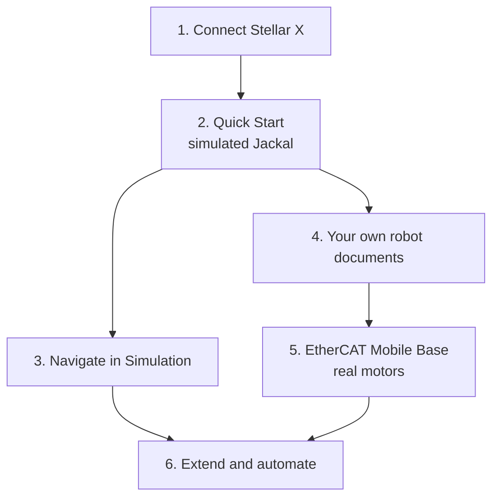

# Learning Path

The tutorials of this documentation build on each other: first connection, a simulated robot, navigation, then real motors. Follow them in this order, or start where your project is. The first hands-on tutorial is the [Quick Start](../../get_started/quick_start/index.md); its [Before You Start](../../get_started/quick_start/index.md#before-you-start) section lists what to prepare.

---

## 1. Connect Stellar X

| What you do | Page | You need |
| :--- | :--- | :--- |
| Power Stellar X, connect your PC and open the Station | [Stellar X](../../hardware_setup/stellar_series/stellar_x/index.md) | Stellar X, a LAN cable |
| Give Stellar X an address on your network | [Network Settings](../../hardware_setup/stellar_series/network_settings/index.md) | — |
| Learn the terms: Station, nodes, ports, gateways, documents | [Key Concepts](../../get_started/key_concepts/index.md) | — |

---

## 2. Drive a Simulated Robot

| What you do | Page | You need |
| :--- | :--- | :--- |
| Install Isaac Sim and the Isaac Bridge extension | [Install Isaac Bridge](../../virtual_simulation/extension_installation/index.md) | A PC with an NVIDIA GPU ([Compatibility](../../reference/compatibility/index.md)) |
| Add a gateway and Strider, load the example documents and jog the Jackal | [Quick Start](../../get_started/quick_start/index.md) | The Quick Start's example files |

---

## 3. Navigate in Simulation

| What you do | Page | You need |
| :--- | :--- | :--- |
| Add a camera, the Localizer and the Navigator, load the map and drive to goals | [Navigate in Simulation](../../navigation/simulation_tutorial/index.md) | The Quick Start setup, the example map bundle |
| Load a map of your own site later | [Load and Configure a Map](../../navigation/map_bundle/index.md), [Create a Map from Your Site](../../navigation/create_map/index.md) | A 3D model or scan of the site |

---

## 4. Describe Your Own Robot

| What you do | Page | You need |
| :--- | :--- | :--- |
| A mobile base: chassis, wheels, limits, actuator mapping | [Mobile Robot (.sddm)](../stellar_designer/mobile_robot/index.md) | Your base's dimensions |
| A manipulator: DH parameters, limits, actuator mapping | [Manipulator (.sdd)](../stellar_designer/manipulator/index.md) | Your arm's kinematics and limits |
| A robot driven joint by joint, such as a legged robot | [Articulated Robot (.sdda)](../stellar_designer/articulation/index.md) | Your robot's joints and limits |
| The gateway of its motors | [Gateway Designer](../../gateways/gateway_designer/index.md) | Motor and drive data |
| Try the documents in Isaac Sim first | [Prepare the Robot](../../virtual_simulation/robot_setup/index.md), [Connect to Stellar Station](../../virtual_simulation/connect_station/index.md) | Your robot's scene in Isaac Sim |

---

## 5. Bring Up Real Motors

| What you do | Page | You need |
| :--- | :--- | :--- |
| Read how to stop the robot before anything moves | [Stop Controls](../../hardware_setup/stop_controls/index.md) | A wired emergency stop |
| Wire four EtherCAT drives, test each wheel and jog the base | [EtherCAT Mobile Base](../ethercat_mobile_base/index.md) | Four CiA 402 drives and motors, a four-wheel base |
| Move single actuators without a controller | [Test Console](../../gateways/test_console/index.md) | A running gateway |

---

## 6. Extend and Automate

| What you do | Page |
| :--- | :--- |
| Work on the controller over SSH | [SSH Workspace](../../ssh_workspace/overview/index.md), [sodero CLI](../../ssh_workspace/sodero_cli/index.md) |
| Run your own programs as nodes | [Create Custom Modules](../../extend/custom_modules/index.md) |
| Connect your own camera, IMU or wheel board through the Device Bridge | [Write Device Bridge Drivers](../../extend/device_bridge_drivers/index.md) |
| Let an AI coding agent do routine work | [AI Coding Agents](../../ssh_workspace/ai_agents/index.md) |
