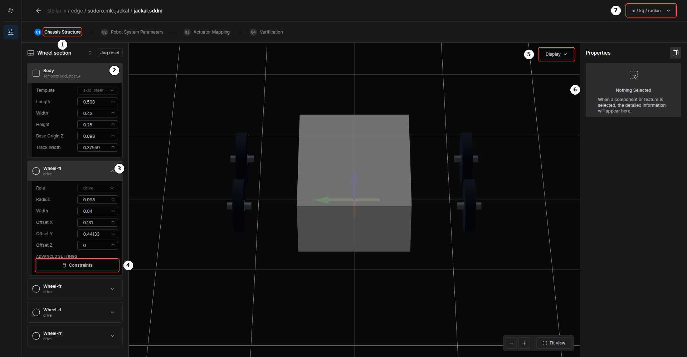
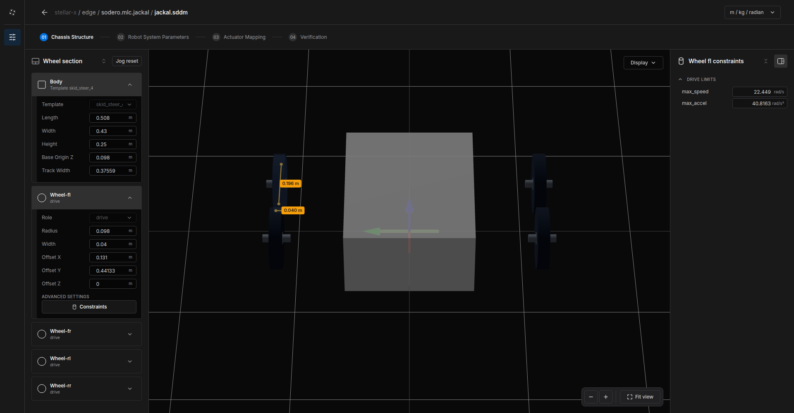
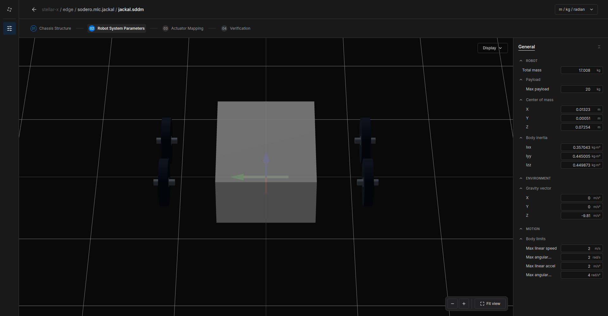
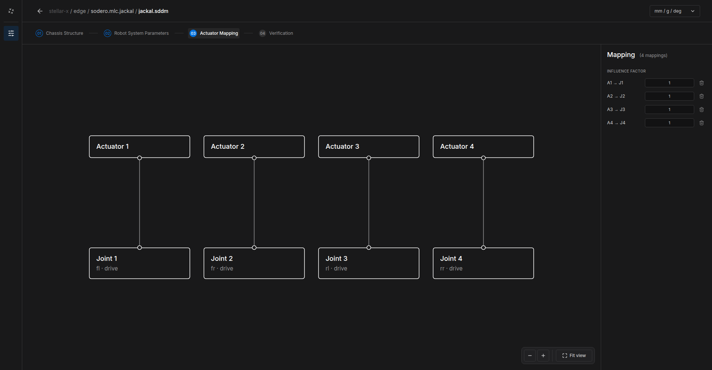
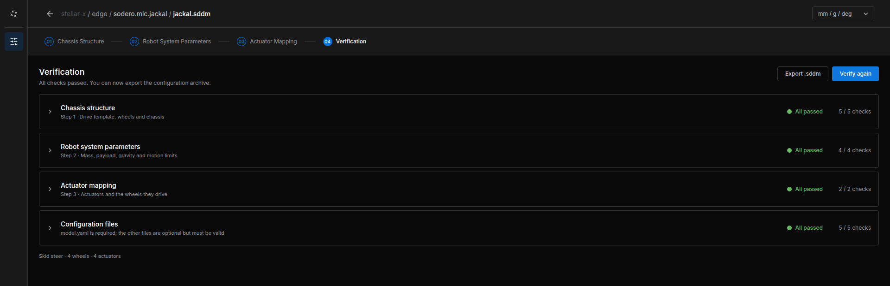

# Mobile Robot (.sddm)

This tutorial builds the document of a wheeled mobile base, using the Clearpath Jackal (skid steer, four wheels) of the [Quick Start](../../../get_started/quick_start/index.md). The document belongs to a Strider node (`sodero.mlc.NAME`).

---

## Before You Start

1. On the Station, add a **Controller › Strider** node, for example `jackal`, and an **Actuator gateway** for its wheel motors ([Nodes and Connections](../../../station/nodes_and_connections/index.md)).
2. Select the Strider node and click **Edit Stellar Designer**.
3. In **Create robot definition**, choose the template that matches your drive:

| Template | Drive |
| :--- | :--- |
| Differential drive 2WD | Two driven wheels and casters |
| MiR250 differential | Differential drive of a MiR250 |
| Skid steer 4WD | Four fixed driven wheels that slide when turning |
| Mecanum 4WD | Four mecanum wheels, omnidirectional |
| Swerve 4WD | Four steered and driven wheels |
| Ackermann | Car-like steering |

The template sets the drive type, which decides how body velocities become wheel commands. Then change its dimensions to those of your robot.

---

## Step 1: Chassis Structure

<figure markdown="span">
  { width="1000" }
  <figcaption>Chassis Structure of a skid-steer base</figcaption>
</figure>

Step **01 Chassis Structure** ① shows the body and the wheels of the base.

**Body** ②:

| Field | Meaning |
| :--- | :--- |
| **Template** | The drive type of the template, for example `skid_steer_4` (read-only) |
| **Length**, **Width**, **Height** | Outer dimensions of the body |
| **Base Origin Z** | Height of the robot's base frame above the floor (normally the wheel radius) |
| **Track Width** | Distance between the left and right wheels of a differential drive |

**Wheels** ③: one card per wheel, for example **Wheel-fl**. The template sets the wheel names and their roles:

| Template | Wheels | Role |
| :--- | :--- | :--- |
| Differential drive 2WD, MiR250 differential | `left`, `right` | `drive` |
| Skid steer 4WD, Mecanum 4WD | `fl`, `fr`, `rl`, `rr` | `drive` |
| Swerve 4WD | `fl`, `fr`, `rl`, `rr` | `drive_steer` |
| Ackermann | `front_left`, `front_right`, `rear_left`, `rear_right` | `steer` at the front, `drive` at the rear |

| Field | Meaning |
| :--- | :--- |
| **Role** | Read-only, set by the template: `drive` (driven), `steer` (steered) or `drive_steer` (driven and steered) |
| **Radius**, **Width** | Wheel size |
| **Offset X**, **Offset Y**, **Offset Z** | Wheel position relative to the base frame (X forward, Y left) |

**Constraints** ④ opens the wheel's drive limits in the right panel ⑥: **max_speed** and **max_accel** of the wheel.

<figure markdown="span">
  { width="1000" }
  <figcaption>The constraints of the front-left wheel, with its diameter and width in the 3D view</figcaption>
</figure>

**Display** ⑤ changes the 3D view; the unit menu ⑦ changes the display units.

!!! warning "Skid-steer wheels slide sideways when the robot turns, so the robot turns less than the wheel speeds suggest. The skid-steer kinematics use the wheels' **Offset Y**: turn the robot in place by a known angle and increase the left and right **Offset Y** until the odometry matches the real turn. The simulated Jackal of the Quick Start, for example, uses an effective **Offset Y** of 0.441 m."

---

## Step 2: Robot System Parameters

<figure markdown="span">
  { width="1000" }
  <figcaption>Robot System Parameters of the Jackal</figcaption>
</figure>

| Group | Fields | Meaning |
| :--- | :--- | :--- |
| **ROBOT** | Total mass, Max payload, Center of mass, Body inertia | Mass properties of the robot |
| **ENVIRONMENT** | Gravity vector | Normally `(0, 0, -9.81) m/s²` |
| **MOTION** | Max linear speed, Max angular speed, Max linear accel, Max angular accel | Limits of the body velocity. Strider and the Navigator never exceed them. |

---

## Step 3: Actuator Mapping

<figure markdown="span">
  { width="1000" }
  <figcaption>Four actuators driving the four wheels</figcaption>
</figure>

Connect each actuator of the gateway to the wheel it drives (or steers), as for a manipulator ([Manipulator › Actuator Mapping](../manipulator/index.md#step-3-actuator-mapping)). The order must match the gateway: in the Jackal's gateway, actuator 1 is the front-left wheel, 2 front-right, 3 rear-left, 4 rear-right.

A mobile base uses the mapping only to know which actuator drives which wheel; leave the **INFLUENCE FACTOR** at `1`. The wheel kinematics already account for the left and right side. If a real wheel still turns the wrong way, invert the motor's direction in its drive, for example by writing the drive's polarity parameter as a start-up SDO ([EtherCAT Gateway](../../../gateways/ethercat/index.md#ethercat-tab)).

---

## Step 4: Verification

Click **Verify**. Stellar Designer checks the chassis structure, the system parameters, the actuator mapping and the configuration files.

<figure markdown="span">
  { width="1000" }
  <figcaption>All checks passed: skid steer, 4 wheels, 4 actuators</figcaption>
</figure>

**Export .sddm** saves a copy of the document to your computer.

---

## Try the Robot

Start the gateway and the Strider node, open Strider, choose **Twist**, switch the servo on and drive slowly ([Strider](../../../controllers/strider/index.md)). Check that:

- **Forward** drives forward and every wheel turns the right way,
- **Turn Left** turns counterclockwise (seen from above),
- the odometry on the **Status** page matches the distance and angle actually driven.
