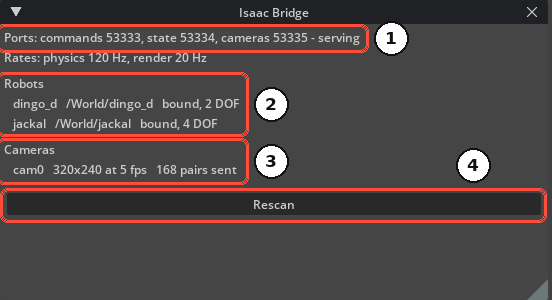
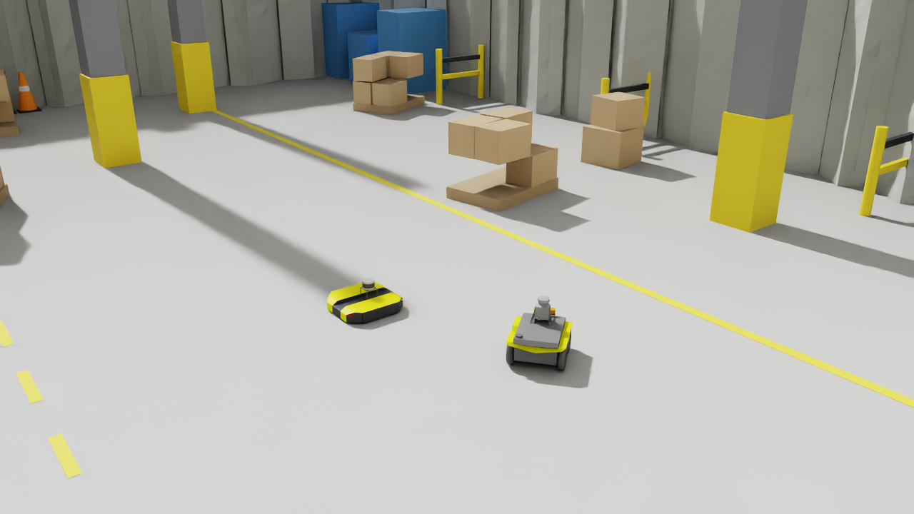

# Connect to Stellar Station

With Isaac Bridge installed and the robot prepared, point the Station's gateways at Isaac Sim and drive the robot.

---

## 1. Play the Scene

1. Open the scene in Isaac Sim and press **Play**.
2. Open **Window › Isaac Bridge** and check that the ports are **serving** and your robot is **bound**.

<figure markdown="span">
  { width="560" }
  <figcaption>① ports serving ② robots bound ③ cameras served ④ Rescan</figcaption>
</figure>

---

## 2. Set the Gateways on the Station

Set the Station nodes to match Isaac Sim. For a simulation gateway, select it, click **Change** in its **TARGET** section, enter **Robot name** ① and **Sim host** ②, and click **Done** ③. The values apply when the gateway starts next time.

| Isaac Sim | Station node | Field |
| :--- | :--- | :--- |
| Robot `jackal` | Actuator gateway (simulation) | **TARGET › Robot name** `jackal` |
| The Isaac Sim computer | Actuator gateway (simulation) | **TARGET › Sim host**: the computer's IP address |
| Camera `cam0` | Camera gateway | **Camera name** `cam0`, **Camera host**: the computer's IP address, **Port** 53335 |
| Robot `jackal` (with an IMU) | IMU gateway | **Robot in World** `jackal` |

The IMU gateway has no address field: it connects to the simulator address set for the controller, which must be the Isaac Sim computer. When a simulator address is set, it also replaces **Sim host** at every start of a simulation gateway. The gateway's log shows the address in use ([Addresses Set for the Controller](../../gateways/simulation/index.md#addresses-set-for-the-controller)).

!!! warning "**The Robot name on the Station must be exactly the robot's prim name in Isaac Sim.** Names are case-sensitive. If they differ, the gateway keeps waiting and the robot never moves."

<figure markdown="span">
  { width="331" }
  <figcaption>The TARGET section of a simulation gateway: ① Robot name ② Sim host ③ Done</figcaption>
</figure>

How to create the gateways and their documents: [Simulation Gateway](../../gateways/simulation/index.md), [Cameras and IMUs](../../gateways/sensors_and_cameras/index.md).

---

## 3. Start and Drive

1. Start the gateways, then the controllers ([Running Nodes](../../station/running_nodes/index.md)).
2. Each simulation gateway logs *Simulator connected.*
3. Open the controller's UI, switch the servo on, and jog: [Strider](../../controllers/strider/index.md) for mobile bases, [Motion Studio](../../controllers/motion_studio/index.md) for manipulators.

<figure markdown="span">
  { width="900" }
  <figcaption>The Jackal jogged from Strider</figcaption>
</figure>

---

## 4. Stop, Pause and Play

The gateways treat Isaac Sim like a power supply of real drives:

| In Isaac Sim | Result |
| :--- | :--- |
| **Pause** | The robots stay where they are. The gateways see the simulator stop and switch the servo off; switch it on again after you resume. |
| **Stop**, then **Play** | A new session: the robots start again at their authored pose, as after a power cycle. Switch the servo on again. |
| Editing the scene while it plays | Takes effect at the next **Play**, or click **Rescan** in the Isaac Bridge window |
| Closing Isaac Sim and starting it again | The gateways lose the simulator and switch the servo off, and the controllers stop the robots. The gateways reconnect by themselves: when the scene plays again, wait until the gateway logs *Simulator connected again; turn the servo on to continue.*, then switch the servo on. |

!!! info "After the simulation restarts, the robot is back at its starting pose, but the Localizer may still hold its last pose. If Strider's Navigation page shows a wrong pose, set the initial pose again."

---

## 5. Several Robots

One scene can hold several robots. Add one gateway (and controller) per robot on the Station, each with its own **Robot name**. All gateways use the same Isaac Sim computer and ports; the status window lists every robot it serves.

A robot can also be driven by several gateways, for example an arm and its gripper. Each gateway drives its own range of joints, set by its **DOF offset** ([Gateway Designer](../../gateways/gateway_designer/index.md#5-simulation-gateways)).

---

## 6. Real-Time Performance

The simulation runs in real time while the computer keeps up with the render rate. The controllers follow the simulation's time, but camera-based localization runs on wall-clock time, so a simulation that runs slower than real time degrades localization.

- Use moderate camera sizes and frame rates; each camera is rendered in addition to the viewport.
- Close viewports and windows you do not need.
- Do not run other heavy GPU programs (such as training) on the same computer at the same time.
- Keep the clocks of both computers synchronized (NTP). The camera gateway accepts frames at most 20 ms ahead of and 2 s behind its own clock. If you cannot synchronize them, start Isaac Sim with `RC_CAMERA_CAPTURE_TIME=0`: the camera gateway then stamps each frame when it arrives.

---

## 7. Troubleshooting

| Symptom | Cause and fix |
| :--- | :--- |
| The status window does not show **serving** | Another program (for example a second Isaac Sim) holds ports 53333–53335. Close it and press **Play** again. |
| Gateway log stays at *waiting for it to start* | Isaac Sim is not playing, **Sim host** (or the simulator address set for the controller) is not the Isaac Sim computer, or a firewall blocks the ports ([Install Isaac Bridge](../extension_installation/index.md#4-allow-the-ports-in-the-firewall)) |
| Isaac Sim console: *'sim_command' for 'X', which is no robot or tracked object of this stage* | The gateway's **Robot name** `X` is not the prim name of a robot in the scene |
| The Isaac Bridge window does not list the robot | The prim has no PhysX articulation root, or another robot in the scene has the same prim name ([Prepare the Robot](../robot_setup/index.md#9-check-the-robot)) |
| The robot is listed but never **bound** | It is not a valid PhysX articulation (check the Isaac Sim console) |
| Camera gateway: *publishes frames of camera(s) … but none of camera …* | The camera gateway's **Camera name** is not the camera's prim name |
| Camera gateway: frames *stale* or with capture times that do not match | The clocks of the two computers differ. Synchronize them, or start Isaac Sim with `RC_CAMERA_CAPTURE_TIME=0` so that the camera gateway uses arrival times. |
| The robot moves too fast or too slow | The computer cannot keep up with the render rate. Lower camera sizes or rates, or close viewports. |

The Isaac Sim console shows the bridge's messages, prefixed with the robot or camera name.
