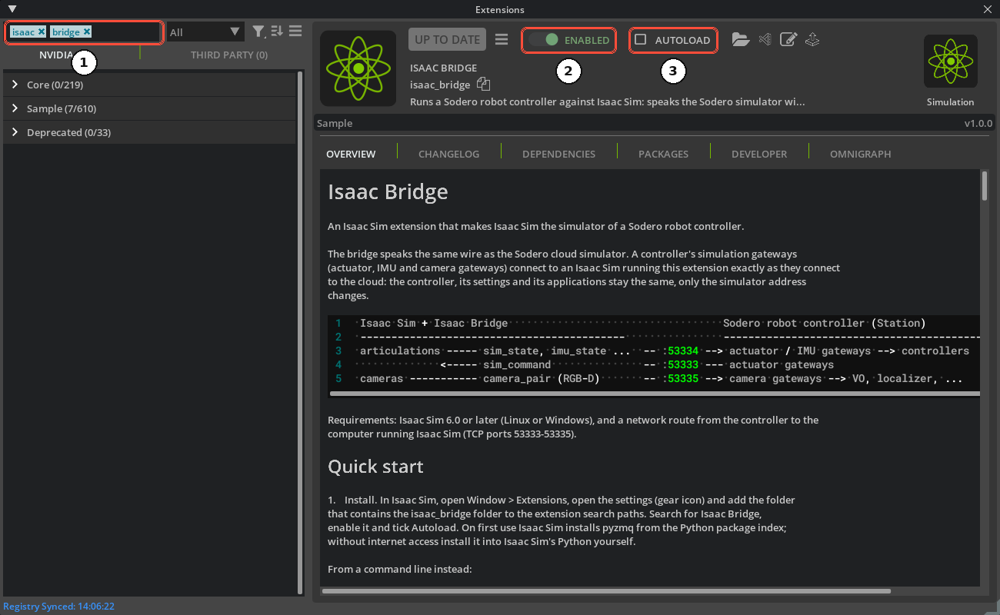

# Install Isaac Bridge { #isaac-bridge-installation }

**Isaac Bridge** is the Isaac Sim extension that connects Isaac Sim to the gateways of Stellar Station. Install it once on the computer that runs Isaac Sim.

---

## 1. Download the Extension

The source of Isaac Bridge is published on GitHub. Download release **v1.0.0**, the version this documentation is verified with ([Compatibility](../../reference/compatibility/index.md)):

```sh
git clone --branch v1.0.0 https://github.com/Sodero-labs/isaac_bridge.git
```

Or download the source ZIP file of release v1.0.0 from the repository's **Releases** page, extract it, and rename the extracted folder `isaac_bridge-1.0.0` to `isaac_bridge`. Either way you get a folder `isaac_bridge`. Remember the folder that **contains** it, for example `~/isaac_extensions` when the extension is in `~/isaac_extensions/isaac_bridge`.

---

## 2. Add the Extension to Isaac Sim

1. Start Isaac Sim.
2. Open **Window › Extensions**.
3. Open the Extensions window's settings (the menu icon next to the search field) and add the folder that contains `isaac_bridge` to **Extension Search Paths**.
4. Search for `isaac bridge` ①.
5. Switch the extension on ②.
6. Tick **AUTOLOAD** ③, so the extension starts with Isaac Sim from now on.

<figure markdown="span">
  { width="1000" }
  <figcaption>① search ② enable ③ autoload</figcaption>
</figure>

When the extension starts the first time, Isaac Sim installs the Python package `pyzmq` from the internet. For a computer without internet access, download the package on a computer that has internet access and the same operating system and Isaac Sim version, copy the `wheels` folder to the Isaac Sim computer, and install it from there. Run the commands in Isaac Sim's installation folder:

=== "Linux"

    ```sh
    # On the computer with internet access
    ./python.sh -m pip download pyzmq -d wheels
    # On the Isaac Sim computer, with the copied wheels folder
    ./python.sh -m pip install --no-index --find-links wheels pyzmq
    ```

=== "Windows"

    ```bat
    REM On the computer with internet access
    python.bat -m pip download pyzmq -d wheels
    REM On the Isaac Sim computer, with the copied wheels folder
    python.bat -m pip install --no-index --find-links wheels pyzmq
    ```

!!! info "You can also start Isaac Sim with the extension from a command line: `isaac-sim.sh --ext-folder ~/isaac_extensions --enable isaac_bridge` (`isaac-sim.bat` on Windows)."

---

## 3. Open the Status Window

Open **Window › Isaac Bridge**. The window shows what the bridge serves. Before a scene plays it is mostly empty; press **Play** in Isaac Sim and it fills in:

<figure markdown="span">
  { width="560" }
  <figcaption>The Isaac Bridge status window while a scene plays</figcaption>
</figure>

| No. | Line | Meaning |
| :---: | :--- | :--- |
| 1 | **Ports** | The command (53333), state (53334) and camera (53335) ports, and **serving** when the gateways can connect. The line below shows the scene's physics and render rates. |
| 2 | **Robots** | Every robot of the scene: its name, its prim path, **bound** when the bridge controls it, and its number of joints (DOF) |
| 3 | **Cameras** | Every camera served: name, resolution, frame rate and frames sent |
| 4 | **Rescan** | Looks for robots and cameras again after you changed the scene while it plays |

The command and state ports (53333, 53334) open at the first **Play** and stay open until the scene is closed. The camera port (53335) opens at each **Play** when the scene has cameras, and closes at **Stop**.

---

## 4. Allow the Ports in the Firewall

Stellar X connects to the Isaac Sim computer on **TCP ports 53333, 53334 and 53335**. Allow them for incoming connections from Stellar X.

=== "Ubuntu (ufw)"

    ```sh
    sudo ufw allow from <Stellar X IP address> to any port 53333:53335 proto tcp
    ```

=== "Windows"

    Open **Windows Defender Firewall › Advanced settings › Inbound Rules › New Rule…**, choose **Port**, **TCP**, ports `53333-53335`, and allow the connection for your private network.

!!! warning "The bridge does not authenticate its clients: any computer that reaches these ports can command the robots of the scene. Use it on a trusted network only, and do not open the ports to the internet."

---

## 5. Update or Remove

- **Update:** put the new release into the same `isaac_bridge` folder: run `git fetch --tags` and `git checkout RELEASE_TAG` in the folder (a clone of a release tag cannot `git pull`), or replace the folder with the new release's ZIP as in [step 1](#1-download-the-extension). Restart Isaac Sim and check the connection again: the [status window](#3-open-the-status-window) shows the ports **serving** and your robots **bound**, and each simulation gateway logs *Simulator connected.* Check [Compatibility](../../reference/compatibility/index.md) for the versions this documentation is verified with.
- **Remove:** switch the extension off in **Window › Extensions**, untick **AUTOLOAD**, and remove its folder from **Extension Search Paths**.

The extension's [README](https://github.com/Sodero-labs/isaac_bridge/blob/v1.0.0/docs/README.md){:target="_blank"} describes advanced settings, such as camera sizes and rates, which cameras to publish, and the ports.

Next: [Prepare the Robot](../robot_setup/index.md).
